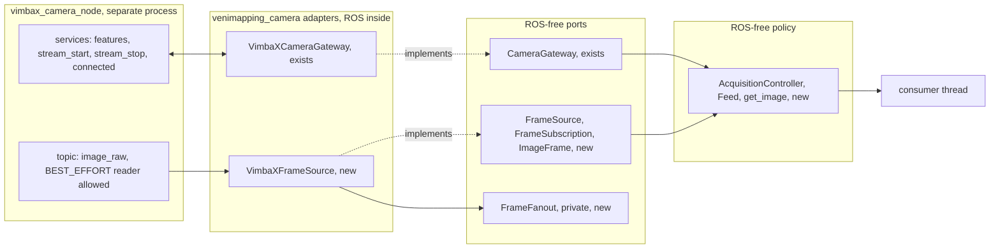

# Image acquisition design v2

- Status: integrated draft, round 1. Before the prose pass.
- Worktree checkpoint: `8d2c760`. Planning folder: `docs/architecture/image-acquisition-planning/`.
- Section owners: data plane by Codex. Control plane, error vocabulary, bring-up, testing, and implementation sequence by Claude. The coordinator wrote sections 1 to 4 and 9 to 14.
- Open issues: `docs/architecture/image-acquisition-planning/issues.md`.

## 1. Summary

v2 adds image acquisition to `venimapping_camera` for one in-process C++ consumer. It adds three targets, no new package, and no driver patch. It keeps the v1 split between a control plane and a data plane. It changes most v1 details, because the code and three camera checks showed different driver and camera behavior.

What v2 proposes:

1. A ROS-free data plane. `ImageFrame` holds the received message through a shared owner, so no pixel copy occurs. `FrameSource` keeps one subscription on `<namespace>/image_raw` with BEST_EFFORT, KEEP_LAST 2. Each `FrameSubscription` has its own bounded queue, default capacity 1, drop oldest.
2. Frame identity. Each frame carries `receive_seq`, a count per source, and `stream_epoch`, which only the controller starts. An admission gate discards frames with a stamp at or below the epoch boundary.
3. A ROS-free `AcquisitionController` on one worker thread. The worker is the only gateway caller. Counted leases decide when the stream starts and stops.
4. A start sequence. The worker reads back the camera profile, corrects it while stopped, checks the format against the driver gate, waits for a matched reader, opens admission, and then calls `stream_start`.
5. Recovery rules. One reconciliation stop separates a wedged driver from a transient failure. A 250 ms silence threshold leads to a connection check, an outage state, and a new epoch after a reconnect.
6. Get image. It samples a running stream, or it starts free run when idle. It returns the first queued frame received after the request, inside one deadline of 2000 ms.
7. A contractual error domain, `kAcquisition`, with 11 fixed codes. Driver errors pass unchanged.
8. Bring-up. The driver loads a 30 Hz Mono8 profile from a settings file on each open. `camera.yaml` pins `autostream: 0`, `buffer_count: 7`, `use_ros_time: true`, and a raw-only plugin filter.
9. Four test tiers. Unit tests run without ROS on fakes that share the real admission code. A temporary feed probe and four hardware checks run on the rig.
10. Nine implementation steps and one conditional step. Each step builds alone and has an exit check.

Phase 1 leaves out the software trigger, `CameraInfo` pairing, a ROS service for get image, device stamps, and driver patches. Each has a trigger to start it (section 10).

State of the design after round 1:

1. 26 issues are Open. Three of them are Blocking: i10, i11, and i26, all on the control plane. Most other open issues are interface details at the boundary between the two planners.
2. Nine decisions wait for Logan (section 13). The design runs on a stated working assumption for each one.
3. The timestamp source, d20, is a working assumption. The two dispute verdicts disagree (section 14).

### Labels and citations

1. Labels:
   - `[F]` is a fact with a citation.
   - `[A]` is a working assumption. It is cheap to reverse.
   - `[Q]` is an open question.
2. Citation forms:
   - `path:line` is a path from the project worktree root.
   - `driver:path:line` is a path from the driver root `vimbax_ros2_driver/`.
   - `ros:path:line` is a path from the ROS 2 Jazzy source root `ros2-jazzy/src/`.
   - `facts 1.4.3` is section 1.4, item 3 of `coordinator/facts.md` in the planning folder. Facts ids such as `A28` and `X3` are in the same file.
   - `c1 §3.5` is section 3.5 of `claude/camera/c1.md`. `c2` is `claude/camera/c2.md`. `c3` is `codex/camera/c3.md`.
   - Lower-case ids such as `d17` and `ic3` are entries in `register.md` in the planning folder. `R1` to `R16` and `T1` to `T12` are requirements and technical unknowns. `L1` to `L9` are the decisions for Logan.
   - `i1` to `i30` are issues in `issues.md`.

## 2. Current state

This section gives the acquisition path at the checkpoint. Each item comes from `coordinator/facts.md`, which joins two independent traces of the code.

### 2.1 Project code

1. `[F]` No project code receives pixels. No file under `src/` contains `image_raw` or `sensor_msgs`. `venimapping_camera` does not depend on `sensor_msgs` (`src/venimapping_camera/package.xml:15-16`).
2. `[F]` `camera.launch.py` starts one process, `vimbax_camera/vimbax_camera_node`, with the node name `vimbax_camera` and the namespace from `camera_namespace`, default `/vimbax_camera` (`src/venimapping_bringup/launch/camera.launch.py:19-41`).
3. `[F]` `camera.yaml` sets only `camera_id: "0GPF3"` and `autostream: 0` (`src/venimapping_bringup/config/camera.yaml:9-12`). All other driver parameters keep their defaults: `buffer_count` 7, `use_ros_time` false, `settings_file` and `camera_info_url` empty (`driver:vimbax_camera/src/vimbax_camera_node.cpp:276-305`, `:415-418`).
4. `[F]` `CameraGateway` is a ROS-free C++23 abstract class with 30 pure virtual methods. They cover connection, status, stream start and stop, settings, and each feature type (`src/venimapping_camera/include/venimapping_camera/camera_gateway.hpp:35-138`).
5. `[F]` The gateway contract states "no clamping, fallback, retry, readback, or validation" (`src/venimapping_camera/include/venimapping_camera/camera_gateway.hpp:24-26`).
6. `[F]` Each gateway call checks the bound thread, waits for the service, and waits for the reply against one deadline (`src/venimapping_camera/src/vimbax_camera_gateway.cpp:147-211`). A setter that times out can still have been applied (`src/venimapping_camera/src/gateway_support/vimbax_service_calls.hpp:79-94`).
7. `[F]` If the bound thread also spins the node, each call times out. The thread check detects misuse and does not synchronize (`src/venimapping_camera/include/venimapping_camera/vimbax_camera_gateway.hpp:45-47`).
8. `[F]` A nonzero driver `error.code` becomes a `kDriver` error with code and text unchanged. Gateway diagnostics 1 to 5 are for logs and tests only (`src/venimapping_camera/src/vimbax_camera_gateway.cpp:213-229`, `src/venimapping_camera/src/gateway_support/gateway_errors.hpp:15-22`).
9. `[F]` `camera_gateway_probe` is the only executable and is marked temporary (`src/venimapping_camera/CMakeLists.txt:50-56`). It returns early if a setter fails, so it does not guarantee that it restores the camera (`src/venimapping_camera/src/camera_gateway_probe.cpp:744-768`).
10. `[F]` `package.xml` declares `ament_cmake_gtest`, but the build defines no test target (`src/venimapping_camera/package.xml:18`, `src/venimapping_camera/CMakeLists.txt:18-77`).

### 2.2 Driver stream lifecycle

| Call | State before | Result | Evidence |
|---|---|---|---|
| `stream_start` | `kStopped` | Start, then `kActive`, or an error | `driver:vimbax_camera/src/vimbax_camera.cpp:414-515` |
| `stream_start` | `kActive` | Success, no effect | `driver:vimbax_camera/src/vimbax_camera.cpp:516-517` |
| `stream_start` or `stream_stop` | `kStarting` or `kStopping` | -15 | `driver:vimbax_camera/src/vimbax_camera.cpp:518-519`, `:584-585` |
| `stream_stop` | `kStopped` | Success, no effect | `driver:vimbax_camera/src/vimbax_camera.cpp:582-583` |
| either | camera unavailable | -3 | `driver:vimbax_camera/src/vimbax_camera_node.cpp:1551-1553`, `:1571-1573` |

1. `[F]` Each error return in `start_streaming` leaves `kStarting`. Each error return in `stop_streaming` leaves `kStopping`. No service resets the state (facts 1.4.1 to 1.4.4).
2. `[F]` Start and stop serialize. A -15 comes only from a state that an earlier failure left behind, not from a race (facts X1).
3. `[F]` Each successful start and stop takes at least 100 ms, because the command poll sleeps 100 ms (`driver:vimbax_camera/src/vimbax_camera.cpp:503`, `:529`, `:674-688`).
4. `[F]` With `autostream: 0`, only `stream_start` and the reconnect restart start the stream (`driver:vimbax_camera/src/vimbax_camera_node.cpp:588-593`).
5. `[F]` After a reopen, the driver restarts a stream that was active or starting at the disconnect, and it ignores the result (facts 1.9.7, X3).
6. `[F]` A `buffer_count` change while the camera is disconnected calls `is_streaming()` on a null pointer (facts 1.10.1).

### 2.3 Image publishing

1. `[F]` One `image_transport::CameraPublisher` publishes `image_raw` and `camera_info` with one shared header (`driver:vimbax_camera/src/vimbax_camera_node.cpp:350-364`).
2. `[F]` Publisher QoS is RELIABLE, KEEP_LAST 10, VOLATILE. No parameter changes it (`driver:vimbax_camera/src/vimbax_camera_node.cpp:354-357`). A RELIABLE publisher matches a BEST_EFFORT reader (`ros:ros2/rmw_dds_common/rmw_dds_common/src/qos.cpp:114-124`).
3. `[F]` `image_transport` advertises one subtopic for each installed plugin unless `image_raw.enable_pub_plugins` limits it (`ros:ros-perception/image_common/image_transport/src/publisher.cpp:112-155`).
4. `[F]` The driver has no snapshot service. Pixels leave the driver only on `image_raw` (facts 1.3.5).
5. `[F]` The start gate admits Mono8, Mono12, Mono16, Bayer 8 to 16 bits, Rgb8, Bgr8, and three YUV422 formats (`driver:vimbax_camera/src/vimbax_camera.cpp:1621-1651`). A gate failure leaves `kStarting`.
6. `[F]` Mono12 publishes as `mono16`, shifted left by 4 bits. The message does not record the shift (`driver:vimbax_camera/src/vimbax_camera.cpp:1781-1806`).
7. `[F]` CycloneDDS loans only self-contained types. `sensor_msgs/Image` has unbounded fields, so each subscription gets a deserialized heap copy (`ros:ros2/rmw_cyclonedds/rmw_cyclonedds_cpp/src/rmw_node.cpp:2479`, `:2984`).

### 2.4 Timestamps and frame identity

1. `[F]` With `use_ros_time: false`, `header.stamp` is the SDK frame timestamp. The G1-130 has no `DeviceTimestampFrequency`, so the driver publishes raw ticks as nanoseconds (`driver:vimbax_camera/src/vimbax_camera.cpp:1777`, c1 §3.4).
2. `[F]` With `use_ros_time: true`, `header.stamp` is `node->now()` in the frame thread, after the transform and before publish (`driver:vimbax_camera/src/vimbax_camera_node.cpp:1608-1609`).
3. `[F]` The driver reads `use_ros_time` on each frame. A change during a stream changes the time basis between two frames (facts 1.6.4).
4. `[F]` `header.frame_id` names a TF frame, not a frame instance. The message carries no counter. The CycloneDDS RMW does not fill the sequence fields of the message info (facts 1.6.6, 1.6.7, 1.6.9).

### 2.5 Frame loss visibility

| Where a frame is lost | What shows it | Evidence |
|---|---|---|
| SDK receives an incomplete frame | WARN log. Not published. | `driver:vimbax_camera/src/vimbax_camera.cpp:1739-1742` |
| SDK has no free buffer | WARN log "N frames missing" at the next frame | `driver:vimbax_camera/src/vimbax_camera_node.cpp:1596-1601` |
| DDS sample rejected at the reader | `message_lost` event | `ros:ros2/rmw_cyclonedds/rmw_cyclonedds_cpp/src/rmw_node.cpp:3943-3955` |
| Reader KEEP_LAST history replaces an unread sample | Nothing | `ros:eclipse-cyclonedds/cyclonedds/src/core/ddsc/src/dds_rhc_default.c:854-875` |
| Project queue evicts a frame | Only a counter that the project writes | No code yet |

### 2.6 Commands, triggers, and connection

1. `[F]` `features/command_run` runs any command feature. The reply has no frame identity (`driver:vimbax_camera/src/vimbax_camera_node.cpp:1039-1067`).
2. `[F]` `status` writes each `TriggerSelector` value to read the trigger state, and it leaves the selector at the last value (`driver:vimbax_camera/src/vimbax_camera.cpp:1452-1473`).
3. `[F]` No ROS event exists for frames, stream state, or connection. While the camera is unavailable, each camera service returns -3 (facts 1.9.2, 1.9.5).
4. `[F]` On a reconnect, a detached thread reopens the camera and loads `settings_file`. A failed load only logs an error (`driver:vimbax_camera/src/vimbax_camera_node.cpp:390-400`, `:556-568`).
5. `[F]` If the first open fails, the driver calls `rclcpp::shutdown()` (`driver:vimbax_camera/src/vimbax_camera_node.cpp:375-382`).

## 3. Requirements and working assumptions

### 3.1 Requirements from Logan

No requirement below has an answer from Logan. Each row is a working assumption `[A]`. Cost to reverse is Low when one value or one file changes, Medium when a contract or a sequence changes, and High when a package or an owner changes.

| Id | Unknown | Working assumption | What depends on it | Cost to reverse |
|---|---|---|---|---|
| R1 | Frame consumers and their process | One C++ consumer in the same process, on the driver host | d1, d2, d7, d13, d20, d29, L2 | High |
| R2 | Resolution, ROI, binning | Full sensor, 1296 x 1032, no binning. Interfaces take size and `step` from each frame. | d10 byte bounds, d18 profile | Low |
| R3 | Pixel format and bit depth | Mono8 in phase 1. Mono12 only if a consumer needs more than 8 bits. | d14, d18, d19, L5 | Low |
| R4 | Feed frame rate | 30 Hz Mono8 free run (c3). The design must also carry 69.7 Hz Mono8, 93.2 MB/s. | d9, d10, d18, d22 | Low |
| R5 | Memory budget for held frames | At most `(queue capacity + frames the consumer holds) x 1.34 MB` per subscription | d10, d13, ic1 | Low |
| R6 | Freshness for get image | "Received after the request" is enough. | d23, d24, d27, L4 | Medium |
| R7 | Maximum wait for get image | Cold up to 2 s. Warm about one frame period, 33 ms at 30 Hz. | d25, d26, L6 | Low above 200 ms |
| R8 | Get image rate and overlap | Less than once per second. It may overlap a feed and must not stop it. | d13, d25, d28, L6 | Low |
| R9 | Feed loss tolerance | The feed may drop frames. Newer frames have priority. Each visible drop is counted. | d9, d10, d12, L1, L7 | High if loss must be zero |
| R10 | Time basis | Consumers need a stamp on the host clock. No PTP or hardware sync. | d20, L1 | Medium |
| R11 | Intrinsics with each frame | Not in phase 1 | d3, d15 | Low |
| R12 | Topology and middleware | Driver and consumers on one host with CycloneDDS | d8, d9, d20, L2 | Medium |
| R13 | Driver fork patches | The design works without a patch. | d19, d21, L3 | Low |
| R14 | Outage behavior | An outage does not close a feed. The feed reports it and starts a new epoch. | d11, d22, L9 | Low |
| R15 | Other driver clients | While the project acquires, no other client writes features, calls stream services, or calls `status`. | d16, d18, d27, L8 | Medium |
| R16 | Persistence of feature writes | A power cycle resets service writes. The profile must apply again after each reopen. | d18, d22 | Medium |

### 3.2 Technical assumptions

| Id | Assumption now | What depends on it | Cost to reverse |
|---|---|---|---|
| T3 | Free run gives 69.7 Hz Mono8 and 45.1 Hz Mono12 at `ExposureTime` 4999.455 us. A 30.0 Hz write gives 30.010 Hz. | R4, d10, d22 | Low |
| T4 | The device stamp origin and its exposure event stay unknown. Phase 1 does not use the device stamp. | d20, d12 | Low |
| T7 | `AcquisitionFrameRate` writability during a stream stays unknown. Phase 1 does not need it. | Phase 2 rate control | Low |
| T9 | A RELIABLE reader can make the driver block in `publish`. d9 avoids it. | d9, d10 | Low |
| T10 | The installed `image_transport` plugins are unknown. The bring-up filter removes the dependency. | d8 | Low |
| T11 | Host socket buffers are not tuned. Bring-up lists the 8 MiB values as a host check. | d9 | Low |
| T12 | Match time is unknown. d17 waits on the match, so no rule needs the number. | d17, d25 | Low |
| P1 | The camera power-on values equal the phase 1 shape values. | d18, d22 | Low |
| P2 | The settings file and the profile file describe the same values. A bring-up test checks this. | d18 | Low |
| P3 | One frame take costs a few milliseconds on the executor thread. | d5 | Low |
| P4 | The double shared lock in the driver does not hang on glibc. | d21, L3 | Medium |
| P5 | A `buffer_count` change during a disconnect crashes the driver. Only the file sets it. | d10, d21 | Low |
| P6 | Host `CLOCK_REALTIME` does not step back during acquisition. | d20, d22, ic3 | Low |
| P7 | `get_publisher_count()` is safe from the worker while the executor spins. | d17, ic2 | Low |
| P8 | `std::chrono::system_clock` reads `CLOCK_REALTIME` on the project toolchain. | ic3 | Low |
| P9 | A 1 s limit between the header stamp and the receipt time catches a device-clock stamp and never rejects a host stamp. | ic3, ic6 | Low |

T1, T2, T5, T6, and T8 are closed by the camera checks (section 11).

## 4. Architecture overview

### 4.1 Components



| Component | Role | Owner section |
|---|---|---|
| `ImageFrame` | Immutable frame value. Shares the received message. No ROS type. | data plane (5) |
| `FrameSource`, `FrameSubscription` | Port. One subscription per source. One bounded queue per `FrameSubscription`. Admission and epochs. | data plane (5) |
| `FrameFanout` | Private ROS-free core of the source: queues, fan-out lock, admission, counters. The adapter and the test fake share it. | data plane (5) |
| `VimbaXFrameSource` | Adapter. One rclcpp subscription on `<namespace>/image_raw`. | data plane (5) |
| `AcquisitionController`, `Feed` | Policy. Leases, start sequence, profile readback, recovery, get image. | control plane (6) |
| `AcquisitionCode` | Contractual error codes in the `kAcquisition` domain | error vocabulary (6) |
| `camera.yaml`, `camera_settings.xml`, `acquisition_profile.yaml`, `camera.launch.py` | Driver parameters, camera profile, expected values | bring-up (7) |
| `camera_feed_probe` | Temporary composition root and rig check tool | testing (8) |

### 4.2 Threads

From register ic4.

| Thread | Started by | Runs | Never calls |
|---|---|---|---|
| Executor thread | composition root | `SingleThreadedExecutor::spin` on the one node: gateway replies, the image callback, the `message_lost` callback | the gateway, the controller, consumer code |
| Controller worker | `AcquisitionController::start` | The bind hook first, then gateway calls, the 100 ms tick, and lease changes | `FrameSubscription::take` or `try_take` |
| Consumer thread, one per `Feed` and one per `get_image` call | application | `Feed::take`, `Feed::try_take`, and the `get_image` wait | the gateway, `FrameSource` |
| Any thread | | `close()`, `stats()`, `status()`, `shutdown()` | |

1. Start order: make the node, create the gateway, create the frame source, create the controller, start the executor thread, start the controller worker.
2. Stop order: call the controller shutdown while the executor still spins. Then stop and join the executor. Then destroy the controller, the frame source, the gateway, and the node.
3. `[A]` Phase 1 uses one node and one executor thread. The feed probe measures the gateway round-trip time while stopped and while streaming at 69.7 Hz. If streaming adds more than 5 ms, the composition root moves the subscription to a second node (d5, step 9a).

### 4.3 Build targets

From register ic8. All targets are in `venimapping_camera`.

| Target | Kind | Links | Owner |
|---|---|---|---|
| `venimapping_camera_gateway_api` | INTERFACE, exists | none | error vocabulary adds headers |
| `venimapping_camera_frame_api` | library, ROS-free | `venimapping_camera_gateway_api` | data plane |
| `venimapping_camera_vimbax_frame_source` | library | `venimapping_camera_frame_api`, `rclcpp`, `sensor_msgs` | data plane |
| `venimapping_camera_acquisition` | library, ROS-free | `venimapping_camera_gateway_api`, `venimapping_camera_frame_api` | control plane |

`[F]` The package already splits a ROS-free INTERFACE target from the ROS adapter target (`src/venimapping_camera/CMakeLists.txt:22-48`). A new package would add a manifest and an export and enforce no new rule (d1).

### 4.4 Decision register

The register in the planning folder holds the full entries, the evidence, and the interface contracts ic0 to ic8. This table gives each decision in one line, with the round 1 amendments.

| Id | Topic | Status | Decision |
|---|---|---|---|
| d1 | Package layout | Agreed | Three new targets in `venimapping_camera`. No new package. |
| d2 | Port shape | Agreed | A separate ROS-free `FrameSource` port. `CameraGateway` does not change. |
| d3 | Frame type | Settled | ROS-free `ImageFrame` with layout, identity, bit depth, and one `host_stamp_ns`. |
| d4 | Memory model | Agreed | Keep the received message alive through a type-erased shared owner. No pixel copy. |
| d5 | Threads | Settled | One node and one executor thread in phase 1. The feed probe decides a split. |
| d6 | Error vocabulary | Settled | New contractual `kAcquisition` domain, codes 1 to 11. |
| d7 | Consumer API | Agreed | Pull with `take(timeout)` and `try_take()`. Empty result on timeout. |
| d8 | Transport | Agreed | Plain rclcpp subscription on `<namespace>/image_raw`. Raw plugin only. |
| d9 | Subscriber QoS | Settled | BEST_EFFORT, KEEP_LAST 2, VOLATILE, fixed in the adapter. |
| d10 | Queue and `buffer_count` | Settled | Capacity per subscription, default 1, range 1 to 4, drop oldest. `buffer_count` 7 in `camera.yaml`. |
| d11 | Frame identity | Agreed | `receive_seq` per source plus a stream epoch. Only the controller starts an epoch. |
| d12 | Loss reporting | Settled | Counters per loss site. No `stamp_gap_frames` in phase 1. |
| d13 | Several consumers | Settled | One subscription, one queue per `FrameSubscription`. One feed and one get image at a time. |
| d14 | Pixel interpretation | Settled | Pass pixels unchanged. Add `significant_bits` from the `PixelFormat` readback. |
| d15 | Calibration | Agreed | No `CameraInfo` in phase 1. |
| d16 | Stream ownership | Agreed | The controller worker owns stream calls and feature writes through counted leases. |
| d17 | Feed start | Agreed | Match before start. The last release stops the stream. |
| d18 | Configuration | Settled | `settings_file` applies the 30 Hz Mono8 profile at each open. The controller reads it back. Item 7 amendment proposed in i11. |
| d19 | Start and stop failure | Settled | Format check, one reconciliation stop, then `kWedged`. |
| d20 | Timestamp source | Working assumption | `use_ros_time: true`. `host_stamp_ns` from `header.stamp`. Logan question L1. |
| d21 | Driver changes | Agreed | No patch in phase 1. Four candidate patches go to Logan. |
| d22 | Outage | Settled | 250 ms floor, close admission, check connection, read back profile, new epoch. |
| d23 | Get image source | Agreed | Sample a running stream, or start free run when idle. No trigger in phase 1. |
| d24 | Freshness | Agreed, amended (i12) | A frame pushed to the get image subscription after it opened, with `receive_seq` greater than `frames_received` at the request. |
| d25 | Idle behavior | Agreed | One subscription for the source lifetime. Cold calls start the stream. |
| d26 | Deadline | Settled | One caller deadline, default 2000 ms. The stop is outside it. |
| d27 | Trigger association | Agreed | Phase 2 only. |
| d28 | Get image during a feed | Agreed | Share the stream. Get image has its own queue. |
| d29 | Caller interface | Agreed | C++ only in phase 1. |

Other round 1 amendments:

1. ic5 gains control-plane rows for `kFeedClosed` and `kInvalidArgument`. `AcquisitionController::create` can also return `kFormatNotStreamable` (i28).
2. ic4: the worker starts through `AcquisitionController::start(WorkerInit)`. The hook binds the gateway thread (i29).

## 5. Data plane

Source: `codex/sections/data-plane.md`, owner Codex. The coordinator changed only the heading levels. Open issues on this section: i1 to i9.

[F] The driver publishes `sensor_msgs/msg/Image` on `image_raw`. The project gateway uses services and binds its blocking calls to one worker thread. (`driver:vimbax_camera/src/vimbax_camera_node.cpp:350-357,1620-1638`, `src/venimapping_camera/src/vimbax_camera_gateway.cpp:49-69`, `src/venimapping_camera/include/venimapping_camera/vimbax_camera_gateway.hpp:45-64`)

Keep v1's separate frame port and pull interface. The controller composes `FrameSource` with `CameraGateway`. Consumers pull from `FrameSubscription` on their own threads, so frame processing cannot hold the executor. The frame API and the VimbaX adapter are separate libraries in `venimapping_camera` (`d1`, `d2`, `d7`, `ic8`). (`docs/architecture/image-acquisition-design-v1.md:306-346`)

[A] Phase 1 serves one local C++ consumer on the driver host with CycloneDDS. The controller allows one feed and one outstanding get image. This assumption sets the local port and queue limits (`d13`, `d29`, R1, R12). [Q] Will a consumer need another process or host, calibration, or more than 8 bits (L2, R11, L5)?

### Frame and pixel ownership

`ImageFrame` is a ROS-free value in `venimapping::camera` (`d3`, `d4`, `d11`, `d14`, `d15`, `ic1`). It carries these fields from `ImageFrameFields` and exposes a `const noexcept` accessor for each field.

| Field | Type | Meaning |
|---|---|---|
| `width`, `height` | `std::uint32_t` each | Image dimensions in pixels, from the message. |
| `step` | `std::uint32_t` | Bytes per row, from the message. |
| `encoding` | `std::string` | Wire encoding, unchanged. |
| `is_bigendian` | `bool` | Pixel byte order, from the message. |
| `tf_frame` | `std::string` | Coordinate frame name from `header.frame_id`. |
| `significant_bits` | `std::uint8_t` | Source bit depth from the `PixelFormat` readback for this epoch. |
| `host_stamp_ns` | `std::int64_t` | Driver stamp on host `CLOCK_REALTIME`, in nanoseconds since the Unix epoch. |
| `receive_seq` | `std::uint64_t` | Receive sequence for this `FrameSource`. |
| `stream_epoch` | `std::uint32_t` | Admission epoch for this `FrameSource`, starting at 1. |
| `pixels()` | `std::span<const std::byte>` | Read-only view into the received payload. |

`ImageFrame::create(ImageFrameFields, std::shared_ptr<const void>, std::span<const std::byte>)` returns `Expected<ImageFrame>`. If either dimension is zero, it returns `kInvalidArgument`. It returns the same error if `step` times `height` exceeds the span size. Compute that product in 64 bits before the comparison (`ic1`, `ic5`).

The adapter uses the received image as the type-erased owner and points the span into its `data`. A shared block holds the fields, the owner, and the span. Copying an `ImageFrame` increments one reference count and allocates no memory. Accessors are safe on any thread. Keep an `ImageFrame` alive while using its span. A retained frame stays valid after the subscription, source, and node are gone. [A] The adapter uses the default message allocator, so the payload lifetime does not depend on the node (`d4`, `ic1`).

[F] With the local CycloneDDS receive path, an image uses a regular received message. Its unbounded fields prevent a loan. The driver can also copy or shift pixels before publish. (`ros:ros2/common_interfaces/sensor_msgs/msg/Image.msg:21-26`, `ros:ros2/rmw_cyclonedds/rmw_cyclonedds_cpp/src/rmw_node.cpp:2949-2984`, `driver:vimbax_camera/src/vimbax_camera.cpp:1695-1712,1781-1806`)

Keep v1's shared owner so fan-out adds no pixel copy. Pass through both the payload and encoding. Add `significant_bits` because the wire encoding alone cannot give the original bit depth (`d4`, `d14`). [F] The driver publishes Mono12 as `mono16` with samples shifted left four bits. (`docs/architecture/image-acquisition-design-v1.md:261-305`, `driver:vimbax_camera/src/vimbax_camera.cpp:1791-1797,1835-1844`)

[A] The initial profile uses full-sensor Mono8 at 1296 × 1032 and 30 Hz. The load target is 69.7 Hz. [F] The c1 check measured 1,337,472 bytes per image and 93.2 MB/s at that load. The c3 check measured 30.010 Hz. A different profile changes the payload and load estimates. Each frame supplies its own layout (`d10`, `d18`, R2–R5). (`docs/architecture/image-acquisition-planning/claude/camera/c1.md:100-119`, `docs/architecture/image-acquisition-planning/codex/camera/c3.md:45-50`)

### Source, subscription, and backpressure

The source keeps one ROS subscription for its lifetime, including while idle (`d13`, `d25`). `subscribe` opens an empty project queue. The controller owns stream operations and leases (`d16`, `d17`). Get image opens a capacity-1 subscription on the same source and leaves the feed queue independent (`d24`, `d28`).

```cpp
struct SubscribeOptions {
  std::size_t capacity = 1;
};

struct FrameSubscriptionStats {
  std::uint64_t frames_delivered;
  std::uint64_t queue_evictions;
  std::uint64_t frames_cleared;
};

struct EpochStart {
  std::uint32_t epoch;
  std::int64_t boundary_ns;
};

struct FrameSourceStats {
  std::uint64_t frames_received;
  std::uint64_t frames_admitted;
  std::uint64_t discarded_layout;
  std::uint64_t discarded_stamp_basis;
  std::uint64_t discarded_admission;
  std::optional<std::uint64_t> transport_lost;
  std::optional<std::chrono::steady_clock::time_point> last_admitted;
  std::uint32_t current_epoch;
  bool admission_open;
};

class FrameSubscription {
 public:
  virtual ~FrameSubscription() = default;
  [[nodiscard]] virtual Expected<std::optional<ImageFrame>> take(
      std::chrono::milliseconds timeout) = 0;
  [[nodiscard]] virtual Expected<std::optional<ImageFrame>> try_take() = 0;
  virtual void close() noexcept = 0;
  [[nodiscard]] virtual FrameSubscriptionStats stats() const = 0;
};

class FrameSource {
 public:
  virtual ~FrameSource() = default;
  [[nodiscard]] virtual Expected<std::unique_ptr<FrameSubscription>> subscribe(
      const SubscribeOptions& options) = 0;
  [[nodiscard]] virtual std::size_t matched_publishers() const = 0;
  [[nodiscard]] virtual EpochStart open_admission(std::uint8_t significant_bits) = 0;
  virtual void close_admission() noexcept = 0;
  [[nodiscard]] virtual FrameSourceStats stats() const = 0;
};
```

`subscribe` accepts capacities 1 through 4 and returns `kInvalidArgument` outside that range. It allocates queue storage before locking the fan-out. Each admission pushes a shared frame to every open queue and increments `frames_delivered` for each push. At capacity, the queue evicts its oldest frame and increments `queue_evictions`. The callback never waits for space. Capacity 1 keeps the newest pending frame. This replaces v1's default of 4 to limit backlog for the phase 1 consumer (`d10`, `d13`, `ic2`). (`docs/architecture/image-acquisition-design-v1.md:348-359,714-724`)

`take` returns the oldest queued frame. If the queue is empty, it waits on a condition variable with a steady-clock deadline. A timeout of zero or less acts as `try_take`. A timeout or empty `try_take` returns a successful empty optional, including during suspended admission. The first pull binds the consumer thread. A pull from another thread on an open subscription returns `kWrongThread` (`d7`, `ic2`, `ic5`).

Any thread can call `stats` or `close`. `close` is idempotent. It removes the queue from fan-out, counts its cleared frames, and wakes a waiting pull. Destruction of the concrete subscription closes it. Source destruction also closes its subscriptions, which can outlive it. After either close, a waiting or later pull returns `kFeedClosed` (`ic2`, `ic5`).

For the Mono8 profile, each queue retains at most `capacity × step × height` payload bytes. Capacity 4 retains at most 5,349,888 bytes. The feed and get image queues together retain at most five payloads, or 6,687,360 bytes. Both queues can reference the same payload. Consumer-held frames add up to `step × height` each at that profile. DDS history, the in-flight callback, and SDK buffers have their own storage. Bring-up sets `buffer_count: 7` in `camera.yaml` at launch (`d10`, `d13`, `ic1`).

### Admission and loss reporting

[A] Phase 1 sets driver `use_ros_time: true` and sets `use_sim_time: false` on the driver and application node. [F] The driver then stamps each frame after the transform and before publish. The stamp marks processing time. (`d20`, `ic6`, `driver:vimbax_camera/src/vimbax_camera.cpp:1745-1757`, `driver:vimbax_camera/src/vimbax_camera_node.cpp:1605-1618`, `ros:ros2/rcl/rcl/src/rcl/time.c:62-72`, `ros:ros2/rcutils/src/time_unix.c:58-74`)

`FrameFanout` owns the queues, the fan-out lock, admission, and counters (`ic3`, `ic7`). The source starts with admission closed and `current_epoch` zero. Only the controller worker opens admission. It does so before its start call, after matching and format checks, or before admission resumes after recovery (`d11`, `d17`, `d19`, `d22`). Under the lock, `open_admission` increments the epoch, reads the `CLOCK_REALTIME` boundary, stores `significant_bits`, and returns `EpochStart`. `close_admission` closes the gate and clears every queue. It adds each cleared frame to `frames_cleared` and leaves the subscriptions open.

The adapter forwards each converted message to `FrameFanout::on_message(owner, fields, pixels)` with the three epoch and identity fields initially zero. Tests inject the realtime and steady clocks. The fan-out applies these steps (`d11`, `d12`, `d20`, `ic3`, `ic7`).

1. Increment `frames_received`. Assign the next `receive_seq`, including for a message that admission later discards.
2. Read `CLOCK_REALTIME` and the steady clock once each.
3. Build the frame with `ImageFrame::create` before taking the fan-out lock. If layout validation fails, count the discard in `discarded_layout`.
4. If the stamp differs from the realtime read by more than 1 s, count the discard in `discarded_stamp_basis`.
5. Under the fan-out lock, compare the stamp to the active boundary. If admission is closed or the stamp is at or below the boundary, count the discard in `discarded_admission`.
6. Under the same lock, finish the unpublished frame with the epoch and bit depth. Push it to each open queue. Set `last_admitted` to the steady read. Increment `frames_admitted` before any pull can return the frame.

`receive_seq` never resets during the lifetime of the source. Opening a subscription and fan-out use the same lock. The first admitted push after the queue opens is eligible for get image (`d24`, `ic8`). The worker reads `last_admitted` on its 100 ms silence tick. The controller owns the silence threshold and recovery (`d22`). [A] A 1 s stamp check catches the observed device clock basis. A backward host clock step can delay admission until realtime passes the boundary or recovery opens a new epoch (P6, P9). (`docs/architecture/image-acquisition-planning/claude/camera/c1.md:123-143`)

Use separate counts for callback discards, queue evictions, clears, and RMW events (`d12`). `transport_lost` starts at zero when the RMW supports the event and stays empty when it does not. Phase 1 has no `stamp_gap_frames` or device stamp. The separate device stamp probe informs L1 (`d20`).

[F] The driver logs incomplete SDK frames and SDK frame ID gaps. CycloneDDS reports DDS sample loss through `message_lost`. It can overwrite an unread history entry without that event. (`driver:vimbax_camera/src/vimbax_camera.cpp:1724-1742`, `driver:vimbax_camera/src/vimbax_camera_node.cpp:1595-1603`, `ros:ros2/rmw_cyclonedds/rmw_cyclonedds_cpp/src/rmw_node.cpp:3943-3955`, `ros:eclipse-cyclonedds/cyclonedds/src/core/ddsc/src/dds_rhc_default.c:854-875`)

The counters cannot give the number of lost frames from incomplete receives, SDK buffer shortages, or reader history overwrites. They also cannot count unseen losses at epoch starts or in trigger mode (`d12`). An admission discard counts a message that reached the callback. A receive sequence gap at a consumer therefore does not measure camera loss.

### VimbaX adapter and threads

`VimbaXFrameSource::create(rclcpp::Node&, const std::string& camera_namespace)` returns `Expected<std::unique_ptr<VimbaXFrameSource>>`. The node outlives the adapter, which is neither copyable nor movable. The factory maps creation failures to `kSourceCreateFailed` (`ic2`, `ic5`).

Create one `rclcpp::Subscription<sensor_msgs::msg::Image>` in the node's default callback group. Strip trailing slashes from `camera_namespace` and append `/image_raw`. [F] The gateway uses this namespace rule for its service names. (`d8`, `ic2`, `src/venimapping_camera/src/gateway_support/vimbax_service_calls.hpp:36-46`)

Fix QoS at BEST_EFFORT, KEEP_LAST 2, VOLATILE. Depth 2 gives the executor one extra unread sample before DDS can overwrite it. The project queue counts its own evictions. [F] The driver's RELIABLE, KEEP_LAST 10, VOLATILE publisher matches this reader. (`d9`, `driver:vimbax_camera/src/vimbax_camera_node.cpp:354-357`, `ros:ros2/rmw/rmw/include/rmw/qos_profiles.h:51-62`, `ros:ros2/rmw_dds_common/rmw_dds_common/src/qos.cpp:114-124`)

Keep v1's plain rclcpp reader for raw pixels. The bring-up filter selects only the raw plugin, so extra installed plugins cannot add image topics (`d8`, `ic6`). (`docs/architecture/image-acquisition-design-v1.md:377-389`, `ros:ros-perception/image_common/image_transport/src/publisher.cpp:112-155`)

Parse `header.stamp` as `int64(sec) × 1,000,000,000 + nanosec`. The callback takes only `std::shared_ptr<const sensor_msgs::msg::Image>`. It passes layout, stamp, owner, and byte span to `FrameFanout` (`d20`, `ic7`). [A] Phase 1 needs only raw frames, so the adapter has no `CameraInfo` reader or pairing policy (`d15`, R11).

The adapter reports the matched publisher count from `get_publisher_count()`. It returns zero if that call fails. It registers a `message_lost` callback and records the RMW count. If event registration fails because the RMW lacks support, create the reader without the event (`d17`, `ic2`). (`ros:ros2/rclcpp/rclcpp/src/rclcpp/subscription_base.cpp:162-166,277-288`)

The application runs one node and one `SingleThreadedExecutor` thread for gateway replies, image callbacks, and loss events. The controller uses a separate bound worker and never pulls a frame. Consumers wait on their own threads. `FrameSource` methods are safe from any thread. In phase 1, the worker owns subscriptions and admission. The callback only contends for the fan-out lock. Under the lock, it does no heap allocation, pixel copy, I/O, logging, or consumer work. Each admitted frame reaches every open queue before the callback returns (`d5`, `ic2`, `ic4`, `ic8`).

During shutdown, keep the executor spinning until the controller closes admission, completes any required stop, and joins its worker. Then stop and join the executor before destroying the adapters and node. The feed probe measures callback time and gateway round-trip time while stopped and while streaming Mono8 at 69.7 Hz. If streaming adds more than 5 ms, the composition root passes a second node and executor to the adapter (`d5`, `ic4`, `ic7`).

## 6. Control plane, policy layer, and error vocabulary

Source: `claude/sections/control-plane.md` and `claude/sections/error-vocabulary.md`, owner Claude. The coordinator changed only the heading levels and removed the repeated label lines. v1 called the controller the policy layer. In v2, the control plane and the policy layer are one class, `AcquisitionController`. Open issues on 6.1: i10, i11, i13 to i18, i26, i27. Open issues on 6.2: i18, i23, i27.

### 6.1 Control plane

The control plane is the `AcquisitionController` class. It decides when the driver stream starts and stops, which camera values it expects, and what a feed or a get image call sees during a failure. It is ROS-free. It uses two ports and owns neither of them: `CameraGateway` for driver services and `FrameSource` for frames (d2, d16).

#### Inputs from the code

1. `[F]` `CameraGateway` already has every call that the controller needs: `connection_status`, `stream_start`, `stream_stop`, and the enum, int, bool, and float feature getters and setters (`src/venimapping_camera/include/venimapping_camera/camera_gateway.hpp:35-110`). The controller adds no gateway method (d2).
2. `[F]` The gateway does no readback, and a setter that times out can still apply (`src/venimapping_camera/include/venimapping_camera/camera_gateway.hpp:24-26`, `src/venimapping_camera/include/venimapping_camera/vimbax_camera_gateway.hpp:49`).
3. `[F]` Gateway calls block. They must come from the thread that called `bind_to_current_thread()`, and that thread must not spin the node (`src/venimapping_camera/include/venimapping_camera/vimbax_camera_gateway.hpp:45-47`, `:63-64`).
4. `[F]` `camera_status()` leaves `TriggerSelector` on its last value (`src/venimapping_camera/include/venimapping_camera/vimbax_camera_gateway.hpp:69-71`). The controller never calls it in phase 1.
5. `[F]` With `autostream: 0`, only a `stream_start` call and the reconnect restart start the stream (`src/venimapping_bringup/config/camera.yaml:12`, `driver:vimbax_camera/src/vimbax_camera_node.cpp:588-593`).
6. `[F]` A start while active and a stop while stopped succeed with no effect. A start or a stop in `kStarting` or `kStopping` returns -15, and no service resets that state (`driver:vimbax_camera/src/vimbax_camera.cpp:516-519`, `:582-585`).

#### Public interface

Header `include/venimapping_camera/acquisition_controller.hpp`, target `venimapping_camera_acquisition` (d1, ic0, ic8). The sketch gives names and signatures. The header carries the full comments.

```cpp
namespace venimapping::camera {

struct AcquisitionProfile {                 // d18, values from the bringup file
  std::string pixel_format;                 // "Mono8"
  std::int64_t width;                       // 1296
  std::int64_t height;                      // 1032
  std::string trigger_mode;                 // "Off", under TriggerSelector FrameStart
  bool frame_rate_enable;                   // true
  double frame_rate_hz;                     // 30.0
  double exposure_time_us;                  // 4999.455
  std::vector<std::string> allowed_formats; // {"Mono8"}, each must be on the driver gate
};

struct ControllerOptions {
  AcquisitionProfile profile;
  std::chrono::milliseconds linger{0};      // d25
};

struct FeedOptions {
  std::size_t capacity = 1;                 // 1 to 4 (d10)
};

struct GetImageOptions {
  std::chrono::milliseconds deadline{2000}; // d26
};

enum class StreamState : std::uint8_t {
  kIdle, kStreaming, kOutage, kConnectionUnknown, kStalled, kWedged, kShutDown,
};

struct ControllerStatus {
  StreamState state;
  std::uint32_t leases;
  std::uint32_t epoch;                      // last EpochStart::epoch, 0 before the first
  std::optional<Error> last_error;          // last gateway or acquisition failure
};

class Feed final {                          // move-only, ic2
 public:
  Feed(Feed&&) noexcept;
  Feed& operator=(Feed&&) noexcept;
  ~Feed();                                  // runs close()
  [[nodiscard]] Expected<std::optional<ImageFrame>> take(std::chrono::milliseconds timeout);
  [[nodiscard]] Expected<std::optional<ImageFrame>> try_take();
  void close() noexcept;
  [[nodiscard]] FrameSubscriptionStats stats() const;
};

class AcquisitionController final {
 public:
  using WorkerInit = std::function<Expected<void>()>;

  // Fails with kInvalidArgument for a bad option, and with kFormatNotStreamable
  // if an allowed format is not on the driver gate. Starts no thread.
  [[nodiscard]] static Expected<std::unique_ptr<AcquisitionController>> create(
      CameraGateway& gateway, FrameSource& frames, ControllerOptions options);

  // Starts the worker. The worker runs init first. Returns the init result.
  [[nodiscard]] Expected<void> start(WorkerInit init);

  // Idempotent. Any thread. Returns after the worker has joined.
  void shutdown() noexcept;

  [[nodiscard]] Expected<Feed> feed_open(const FeedOptions& options);
  [[nodiscard]] Expected<ImageFrame> get_image(const GetImageOptions& options);
  [[nodiscard]] ControllerStatus status() const;
};

}  // namespace venimapping::camera
```

1. The controller is pinned. It is not copyable and not movable, like `CameraGateway` (`src/venimapping_camera/include/venimapping_camera/camera_gateway.hpp:29-32`).
2. `create` takes references. The composition root keeps the gateway and the frame source alive until the controller is destroyed (ic4).
3. `WorkerInit` lets the composition root bind the gateway thread without a ROS type in this header. The root passes `[&gw] { return gw.bind_to_current_thread(); }`.
4. `feed_open`, `get_image`, `status`, and `shutdown` are safe from any thread. A request that comes before `start` waits in the worker queue. A request after `shutdown` returns `kFeedClosed`.
5. A `Feed` can outlive the controller. It then acts as a closed subscription (ic2 rule 7), and its lease release does nothing.
6. `status()` is how a consumer sees an outage, a stall, or a wedge. `take` stays empty in those states (d22, R14).

#### Threads

The controller follows ic4. It adds no thread beyond the worker.

| Thread | Runs in the controller | Never does |
|---|---|---|
| Controller worker | The request queue, all gateway calls, all `FrameSource` calls, the 100 ms tick | `take` or `try_take` |
| Caller of `feed_open` or `get_image` | Posts a request, waits on a future. In `get_image`, it also runs `take` on the get image subscription | Gateway calls, `FrameSource` calls |
| Any thread | `Feed::close`, `status`, `shutdown` | Blocks on a gateway call |

1. The worker is the only gateway caller (d5 item 2, d16). Every stream and feature call is therefore serial. A second start or a feature write cannot race a stop.
2. The worker waits on one condition variable with a timeout to the next tick. A request wakes it at once.
3. `[A]` Each in-process gateway call takes a few milliseconds. The CLI value of 586.6 ms per call includes process start and discovery (c1 §3.5 item 4), so it does not apply. The feed probe records the in-process value.

#### Leases and the stream lifecycle

Each open `Feed` and each outstanding `get_image` holds one lease (d16). The worker keeps the count.

1. When the count goes from 0 to 1, the worker runs the start sequence in the next subsection.
2. When the count goes from 1 to 0 and `linger` is 0, the worker calls `close_admission()` and then `stream_stop()` (ic3 item 4.3).
3. If `linger` is more than 0, the worker keeps the stream and admission open for that time. A new lease in that time uses the running stream. At the end, step 2 runs (d25).
4. In phase 1, the controller allows one open feed and one outstanding get image. A second request of the same kind returns `kRequestBusy` with no gateway call (d13 item 4).
5. A lease request in `kWedged` returns `kStreamWedged` with no gateway call (d19 item 3).

`feed_open(options)` on the worker:

1. Check the state and the busy rule.
2. Call `FrameSource::subscribe({options.capacity})`. A bad capacity returns `kInvalidArgument` from the data plane (ic2).
3. Take the lease. If the stream already runs with admission open, return the `Feed` at once (d17 item 3).
4. If not, run the start sequence. On success, return the `Feed`. On failure, close the subscription, release the lease, and return the error.

`Feed::close()` calls `FrameSubscription::close()`, which clears the queue and wakes a waiting `take`. It then posts the lease release to the worker and returns. It does not wait for `stream_stop` (ic2).

`[A]` `feed_open` has no caller deadline in phase 1. Each gateway call has the gateway timeout, so the wait is bounded by the sum of the call timeouts and the 1000 ms match limit. See `draft-notes.md`.

#### Start sequence

The worker runs these steps before each `stream_start` that it makes. The steps implement d17, d18, d19, and ic3 item 4.1.

1. Read back the profile. See the next subsection.
2. If a value differs, write the profile values and read back again (d18 items 5 and 6).
3. If `PixelFormat` is not in `profile.allowed_formats`, return `kFormatNotStreamable`. Make no `stream_start` call (d19 item 1). This check comes before the mismatch check, because a wrong format wedges the driver (c1 §3.1 item 2).
4. If another value still differs, return `kProfileMismatch` (d18 item 6).
5. Poll `FrameSource::matched_publishers()` every 10 ms. If it stays 0 for 1000 ms, return `kSubscriptionNotMatched` (d17 item 2).
6. Call `open_admission(significant_bits)`. The value is 8 for `Mono8` and 12 for `Mono12`, from the readback in step 1 (d14). Record the returned epoch and the steady time of the call.
7. Call `stream_start()`.
8. If step 7 fails or times out, run the failure recovery in "Start and stop failure recovery".

`[F]` The first frame arrives about 79 ms before the `stream_start` reply at Mono8 (c1 §3.5 item 2). Admission opens in step 6, so those frames reach the queue. A reader made after the reply misses 3 to 5 frames (c1 §3.5 item 3).

`[F]` The idle subscription stays matched for the life of the `FrameSource` (d25). On a warm system, step 5 ends at the first poll.

#### Configuration order and readback

Bring-up loads the phase 1 profile through the driver `settings_file` on each open and reopen (d18 item 1). The controller does not trust the load. `[F]` A failed load only logs an error (`driver:vimbax_camera/src/vimbax_camera_node.cpp:390-400`).

Readback, in this order (d18 item 3):

| Step | Gateway call | Compare with |
|---|---|---|
| 1 | `feature_enum_get("PixelFormat")` | `profile.pixel_format` |
| 2 | `feature_int_get("Width")` | `profile.width` |
| 3 | `feature_int_get("Height")` | `profile.height` |
| 4 | `feature_enum_set("TriggerSelector", "FrameStart")` | Write only |
| 5 | `feature_enum_get("TriggerMode")` | `profile.trigger_mode` |
| 6 | `feature_bool_get("AcquisitionFrameRateEnable")` | `profile.frame_rate_enable` |
| 7 | `feature_float_get("AcquisitionFrameRate")` | `profile.frame_rate_hz`, within 0.001 |
| 8 | `feature_float_get("ExposureTime")` | `profile.exposure_time_us`, within 0.001 |

1. `[F]` `TriggerMode` applies to the current `TriggerSelector`, and `camera_status()` moves the selector (facts 1.5.7, c2 §3.3 item 5). Step 4 makes the read in step 5 target `FrameStart`.
2. `[F]` `TriggerSelector` is writable during acquisition (c2 §3.3 item 7). Step 4 is therefore safe after a driver restart, when the stream already runs.
3. `[A]` The float tolerance is 0.001. c3 read back 30.000001907348633 Hz after a write of 30.0 (c3 §3 item 3).
4. A read that fails returns its error unchanged. The worker then releases the lease.

Corrective writes, in this order, only while the stream is stopped (d18 items 5 and 7):

1. `PixelFormat`, `Width`, `Height`.
2. `TriggerSelector` = `FrameStart`, then `TriggerMode`.
3. `AcquisitionFrameRateEnable`.
4. `AcquisitionFrameRate`.
5. `ExposureTime`.

The worker writes only the values that differ. `[F]` `AcquisitionFrameRate` is read only until `AcquisitionFrameRateEnable` is true (c1 §3.6 item 2, c3 §3 item 2), so the enable comes first. `[F]` `PixelFormat`, `Width`, and `TriggerMode` are read only while streaming (c1 §3.6). A write failure does not stop the sequence. The second readback decides the result.

Phase 1 makes no write of an acquisition value during a stream (d18 item 7). The selector write in readback step 4 is the only write during a stream. It changes no acquisition value.

#### Get image

`get_image(options)` follows d23, d24, d26, and d28.

On the caller thread:

1. Compute `deadline = steady_now + options.deadline`.
2. Post the request to the worker. Wait on its future until `deadline`.
3. If the future gives an error, return it.
4. If the future gives the subscription and the value `R`, call `take(deadline - now)` in a loop. Skip each frame with `receive_seq <= R`. Return the first other frame.
5. If the deadline passes in step 2 or step 4, return `kDeadlinePassed`.
6. In each case, close the subscription and post the lease release before the return.

On the worker:

1. Check the state and the busy rule.
2. Read `R = frames.stats().frames_received`.
3. Call `subscribe({1})` and take the lease (d10 item 3, d28).
4. If the stream runs with admission open, give the subscription and `R` to the caller.
5. If not, run the start sequence. Then give the subscription and `R` to the caller.

Freshness (d24):

1. The get image queue opens after the request. Each frame in it was pushed after the queue opened.
2. `[A]` `receive_seq` equals `frames_received` after its increment, so `R` is the sequence of the last message that existed at the request. A message that a callback held before the fan-out lock can still reach the new queue. Step 4 on the caller thread skips it.
3. The queue has capacity 1 and drops the oldest frame. If several frames arrive before the caller takes, the caller gets the newest one. Each frame in the queue meets R6, "received after the request".
4. `[F]` A frame received after the request can have been exposed before it (facts A68). Phase 1 accepts this (R6). L4 asks Logan.

Deadline and stop (d26):

1. The deadline covers the lease, the readback, the format check, the match, `stream_start`, and the first frame.
2. The `stream_stop` after delivery is outside it. A cold call returns before the stop ends.
3. If the caller leaves at the deadline, the worker finishes its pending gateway call. It then sees that the caller left, closes the subscription, and releases the lease itself.
4. A failed stop goes to the failure recovery. The worker is serial, so the next request waits until the recovery ends (d26 item 6).

Expected times at the 30 Hz profile:

| Case | Time | Source |
|---|---|---|
| Warm, a feed or a linger keeps the stream running | At most about one frame period, 33 ms | d28 |
| Cold, idle and matched | 8 readback calls, then about 110 ms to the `stream_start` reply. The first frame arrives about 30 ms after the driver starts to handle the call. | c1 §3.5 items 1 and 2 |
| Cold stop, after the return | At least 100 ms on the driver | facts 1.4.6 |

Phase 1 has no software trigger (d23, d27). The `TriggerSoftware` path and `kTriggerNoFrame` wait for phase 2.

#### Start and stop failure recovery

This subsection implements d19.

1. If `stream_start` or `stream_stop` fails or times out, the worker calls `stream_stop()` one time to reconcile.
2. If the first failure was -3, the camera is not reachable. The worker skips the reconciliation stop and goes to the outage rules.
3. If the reconciliation stop succeeds, the worker returns the first error unchanged. The state becomes `kIdle`, and the lease is released.
4. If the reconciliation stop returns -15, fails another way, or times out, the state becomes `kWedged`. The request that started the recovery returns `kStreamWedged`.

In `kWedged`:

1. The worker calls `close_admission()`. Open feeds stay open, and `take` returns empty.
2. Each lease request returns `kStreamWedged` with no gateway call.
3. The error text tells the operator to restart the driver process. The project does not restart it (d19 item 4).
4. The worker calls `connection_status()` every 250 ms. A result other than `true` marks the driver as gone. The first `true` after that counts as a reconnect or a driver restart.
5. After that, the worker clears `kWedged`. With no users, it calls `stream_stop()` and enters `kIdle`. With users, it follows the reconnect steps in the next subsection (d19 item 5).

`[F]` Each error return in `start_streaming` leaves `kStarting`, and each one in `stop_streaming` leaves `kStopping` (facts 1.4.1, 1.4.2). `[F]` `status.streaming` is false in `kStopping` (`driver:vimbax_camera/src/vimbax_camera.cpp:1508-1513`), so a `status` test misses that wedge. The reconciliation stop catches both states.

`[A]` A disconnect and a driver restart each last more than 250 ms, so the poll sees the "gone" result.

#### Silence, outage, and reconnect

This subsection implements d22 and ic3 items 4 and 5. It runs while a lease exists, or a linger runs, and the stream is in free run.

1. On each 100 ms tick, the worker reads `frames.stats().last_admitted`. The silence start is the later of that time and the steady time of the last `open_admission` call.
2. The threshold is `max(250 ms, 5 x frame period)`. The frame period is `1 / profile.frame_rate_hz`. At 30 Hz, five periods are 167 ms, so the threshold is 250 ms.
3. `[F]` At 30 Hz, the longest measured interval was 34 ms (c3 §3 item 4). At 69.7 Hz, it was 16 ms (c1 §3.3 item 2). A 250 ms gap is therefore not normal jitter.
4. At the threshold, the worker calls `close_admission()`, which clears the queues. It then calls `connection_status()`.

| `connection_status()` result | New state | Worker action |
|---|---|---|
| `false`, or driver error -3 | `kOutage` | Poll `connection_status()` every 250 ms while a user remains |
| Another error | `kConnectionUnknown` | Same poll |
| `true` | `kStalled` | One stop and start cycle |

`[F]` No ROS event reports a disconnect, and each camera service returns -3 while the camera is unavailable (facts 1.9.2, 1.9.5).

In `kOutage` and `kConnectionUnknown`, feeds stay open and `take` returns empty (R14, L9). A `get_image` waits until its deadline and returns `kDeadlinePassed`. `status()` shows the state.

When the poll returns `true`:

1. `[F]` The driver reopens the camera, loads `settings_file`, and then restarts a stream that was active or starting at the disconnect (facts 1.9.6, 1.9.7). The driver ignores the restart result.
2. The worker reads back the profile.
3. If all values match, the worker calls `open_admission()`. The source admits only frames with `host_stamp_ns` greater than the new boundary (d22 item 6, ic3).
4. If a value differs, the worker calls `stream_stop()`, writes the profile, and reads back. It then runs the start sequence from step 3. That sequence opens admission before `stream_start`.
5. If no frame is admitted within one more threshold, the worker calls `stream_start()` one time. A failure goes to the failure recovery (d22 item 7).
6. On the first admitted frame, the state becomes `kStreaming`.

In `kStalled`:

1. The worker calls `stream_stop()`, then runs the start sequence. A failure goes to the failure recovery (d22 item 8).
2. If silence continues for one more threshold, the state stays `kStalled`. The worker makes no more calls.
3. An admitted frame returns the state to `kStreaming`. Admission is open after the cycle, so a late frame still counts.

A stream with no user (d22 item 9):

1. On each tick with no lease and no linger, the worker compares `frames_received` with its value at the last tick.
2. If it rose, a stream runs with no user, for example after a reconnect. The worker calls `stream_stop()`.
3. This check needs no gateway call while the camera is idle.

New epochs come only from `open_admission` calls (d11). The worker calls it in the start sequence and after a reconnect. No stamp rule starts an epoch (d20).

#### Shutdown

`shutdown()` follows ic4, stop order step 1.

1. Mark the controller as shutting down. New requests return `kFeedClosed`.
2. Close each open subscription. A waiting `take` returns `kFeedClosed` at once.
3. Call `close_admission()`.
4. If the stream runs, call `stream_stop()`. The executor still spins, so the reply arrives.
5. Join the worker. The state becomes `kShutDown`.

The worker and each `Feed` share ownership of the subscription. A `Feed` that is destroyed during shutdown therefore leaves no dangling pointer.

#### What this section changes from v1

| v1 choice | v2 choice | Reason |
|---|---|---|
| The policy layer runs on the gateway worker, with no new concurrency (v1 §8) | The same, through the `WorkerInit` hook | The gateway thread contract does not change (d5) |
| `FeedOpen` subscribes and starts, with no match wait (v1 §8.1) | Match wait before each start | A subscription made before `stream_start` does not prove a match (facts A66) |
| Configuration is verified by readback, with no fixed source (v1 §8.3) | `settings_file` applies the profile, and the controller reads back and corrects | Only `settings_file` applies values before the driver restart after a reopen (d18) |
| `GetImage` has a stream sample and a software trigger strategy (v1 §8.2) | Stream sample only | R6 needs "received after the request", and a trigger stops a feed (d23) |
| A take timeout makes the consumer check the connection (v1 §8.4) | The worker checks silence on a tick and opens a new epoch after recovery | Consumers do not call the gateway, and a reconnect restarts the stream with no project call (d22) |
| Close always stops the stream (v1 §8.1) | The last lease release stops it | Get image and a feed share one stream (d16, d28) |

### 6.2 Error vocabulary

Acquisition adds one contractual error domain, `ErrorDomain::kAcquisition`, with eleven fixed codes (d6, ic5). Driver errors still pass unchanged, and gateway diagnostics stay private. A missing frame is a successful empty result, not an error.

#### What exists today

1. `[F]` `ErrorDomain` has two values, `kDriver = 0` and `kGateway = 1`. `Error` has the factories `from_driver` and `from_gateway`, each with a nonzero code (`src/venimapping_camera/include/venimapping_camera/types/error.hpp:17-34`).
2. `[F]` `Expected<T>` is `std::expected<T, Error>` (`src/venimapping_camera/include/venimapping_camera/types/expected.hpp:17-18`).
3. `[F]` A nonzero driver `error.code` becomes a `kDriver` error with the code and text unchanged (`src/venimapping_camera/src/vimbax_camera_gateway.cpp:213-229`).
4. `[F]` Gateway diagnostics 1 to 5 are for logs and tests only. Callers classify errors by domain (`src/venimapping_camera/src/gateway_support/gateway_errors.hpp:15-22`).

v1 proposed new non-contractual gateway diagnostics for the data plane (v1 §9). v2 replaces that with a contractual domain. A wedge, a format refusal, a passed deadline, and a closed feed need different caller actions (facts 1.4.3, 1.4.4, c1 §3.1). A caller cannot act on a code that is not part of the contract.

#### Header changes

`types/error.hpp` gets one enum value and one factory. The factory follows the existing form.

```cpp
enum class ErrorDomain : std::uint8_t {
  kDriver = 0,
  kGateway = 1,
  kAcquisition = 2,
};

// In class Error:
[[nodiscard]] static constexpr Error from_acquisition(std::int32_t code, std::string text) noexcept
{
  assert(code != 0 && "an acquisition error code must be nonzero");
  return Error{ErrorDomain::kAcquisition, code, std::move(text)};
}
```

New installed header `types/acquisition_error.hpp`:

```cpp
namespace venimapping::camera {

enum class AcquisitionCode : std::int32_t {
  kFeedClosed = 1,
  kDeadlinePassed = 2,
  kStreamWedged = 3,
  kFormatNotStreamable = 4,
  kProfileMismatch = 5,
  kSubscriptionNotMatched = 6,
  kWrongThread = 7,
  kTriggerNoFrame = 8,          // reserved for phase 2
  kRequestBusy = 9,
  kInvalidArgument = 10,
  kSourceCreateFailed = 11,
};

[[nodiscard]] inline Error acquisition_error(AcquisitionCode code, std::string text)
{
  return Error::from_acquisition(static_cast<std::int32_t>(code), std::move(text));
}

[[nodiscard]] constexpr bool is_acquisition(const Error& error, AcquisitionCode code) noexcept
{
  return error.domain() == ErrorDomain::kAcquisition &&
         error.code() == static_cast<std::int32_t>(code);
}

[[nodiscard]] constexpr std::string_view to_string(AcquisitionCode code) noexcept;

}  // namespace venimapping::camera
```

1. The numbers are fixed. A code is never reused or renumbered. A new code takes the next free number.
2. Both headers stay ROS-free. They belong to the existing INTERFACE target `venimapping_camera_gateway_api`, so `acquisition_error` and `to_string` are `inline` (ic8).
3. The `int32_t` base matches `Error::code()`, as `GatewayDiagnostic` does (`src/venimapping_camera/src/gateway_support/gateway_errors.hpp:16`).
4. The text names the cause and the value. For example: "PixelFormat Mono10 is not in the allowed formats [Mono8]".

#### Error values

| Code | Name | Layer | Returned by | Cause | Caller action |
|---|---|---|---|---|---|
| 1 | `kFeedClosed` | data plane | `take`, `try_take` | `close()` ran, the `FrameSource` is gone, or the controller shut down | Stop reading. Open a new feed if needed. |
| 1 | `kFeedClosed` | control plane | `feed_open`, `get_image` | The request came after `shutdown()` | Stop. The acquisition stack is closed. |
| 2 | `kDeadlinePassed` | control plane | `get_image` | No admitted frame before `GetImageOptions::deadline` (d26) | Retry later, or report. Read `status()` to see an outage. |
| 3 | `kStreamWedged` | control plane | `feed_open`, `get_image` | The controller is in `kWedged` (d19) | The operator restarts the driver process. The controller clears the state after it sees the restart. |
| 4 | `kFormatNotStreamable` | control plane | `feed_open`, `get_image`, `AcquisitionController::create` | `PixelFormat` is outside the allowed formats that are on the driver gate (d19 item 1) | Fix the settings file or the profile file. No retry. |
| 5 | `kProfileMismatch` | control plane | `feed_open`, `get_image` | A value still differs after the corrective writes (d18 item 6) | Compare the settings file with the profile file. No retry. |
| 6 | `kSubscriptionNotMatched` | control plane | `feed_open`, `get_image` | No matched publisher after 1000 ms (d17) | Check that the driver runs under the same namespace. Retry after that. |
| 7 | `kWrongThread` | data plane | `take`, `try_take` | A call from a thread other than the first consumer thread (ic2 rule 4) | Fix the caller. This is a program error. |
| 8 | `kTriggerNoFrame` | control plane | Nothing in phase 1 | Reserved for the phase 2 software trigger (d27) | None in phase 1. |
| 9 | `kRequestBusy` | control plane | `feed_open`, `get_image` | A feed is already open, or a get image is already outstanding (d13) | Wait for the other request, or close the other feed. |
| 10 | `kInvalidArgument` | data plane | `subscribe`, `ImageFrame::create` | Capacity outside 1 to 4, or a bad frame layout | Fix the argument. This is a program error. |
| 10 | `kInvalidArgument` | control plane | `AcquisitionController::create`, `feed_open` | A bad option in `ControllerOptions`, or a bad `FeedOptions::capacity` passed through from `subscribe` | Fix the option. |
| 11 | `kSourceCreateFailed` | data plane | `VimbaXFrameSource::create` | The ROS subscription could not be made | The composition root reports and exits. |

1. The data plane returns only codes 1, 7, 10, and 11. It never returns `kDriver` or `kGateway` errors (ic5 item 1).
2. The image callback never returns an error. It counts each discard in `FrameSourceStats` (ic5 item 4).
3. `kWrongThread` and `kInvalidArgument` are program errors. A test finds them. A running system does not retry them.

#### Errors that pass through the controller

The controller returns gateway errors from its readback, its writes, and its stream calls unchanged (ic5 item 2). A caller sees these classes:

| Domain and code | Typical cause | Caller action |
|---|---|---|
| `kDriver`, -3 (`VmbErrorNotFound`) | The camera is not available. A disconnect is in progress (facts 1.9.5). | Retry after `status()` leaves `kOutage`, or after a fixed wait. |
| `kDriver`, another code | The driver refused one call. | Report the code and the text. The controller has already reconciled the stream state (d19). |
| `kGateway`, any code | The driver services do not answer, or a call timed out. | Check that the driver process runs. Retry after that. |

1. A caller must classify an error by `domain()` first and then by `code()`. A `kGateway` code number has no meaning to the caller (`src/venimapping_camera/src/gateway_support/gateway_errors.hpp:15`).
2. -15 (`VmbErrorInvalidCall`) never reaches a caller from a stream call. The controller turns it into `kWedged`, and the next request returns `kStreamWedged`.
3. -18 (`VmbErrorNotSupported`) from a format refusal at start cannot occur, because the format check comes first (c1 §3.1 item 2).

#### Results that are not errors

| Result | Where | Meaning |
|---|---|---|
| Empty `std::optional` from `take` or `try_take` | data plane | No frame in the timeout. Also during an outage, a stall, a wedge, or a closed admission (ic5 item 3). |
| A queue eviction | data plane | The queue was at capacity. `queue_evictions` counts it (d10). |
| A discard in the callback | data plane | `discarded_layout`, `discarded_stamp_basis`, or `discarded_admission` counts it (d12). |
| `transport_lost` growth | data plane | DDS rejected samples at the reader (d12). |
| An outage, a stall, or a wedge with a feed open | control plane | `status().state` shows it. The feed stays open (d22, R14). |

`[A]` R14 keeps a feed open during an outage. If Logan answers L9 with "close the feed", phase 1 adds code 12, `kOutage`, which `take` returns. No other code changes.

#### Caller pattern

A feed consumer reads the result in this order:

1. If the result has an error, check `is_acquisition(e, kFeedClosed)`. If true, stop the loop.
2. If the error is another code, it is a program error. Log it and stop the loop.
3. If the optional is empty, read `controller.status()` when the empty results last longer than the consumer accepts.
4. If the optional has a frame, use it. Check `stream_epoch` against the last frame to see a restart.

A get image caller reads the result in this order:

1. On success, use the frame.
2. On `kRequestBusy`, `kDeadlinePassed`, `kSubscriptionNotMatched`, a `kGateway` error, or driver -3, retry later.
3. On `kStreamWedged`, `kFormatNotStreamable`, or `kProfileMismatch`, report to the operator and do not retry.

## 7. Bring-up

Source: `claude/sections/bring-up.md`, owner Claude. The coordinator changed only the heading levels and removed the repeated label line. Open issues on this section: i19, i25.

`venimapping_bringup` starts the driver with values that the acquisition code depends on. This section lists the parameter, launch, file, and namespace changes, and the checks that prove them (ic6, d8, d10, d15, d18, d20).

### What exists today

1. `[F]` `camera.launch.py` starts `vimbax_camera/vimbax_camera_node` with the node name `vimbax_camera`. The namespace comes from the launch argument `camera_namespace`, default `/vimbax_camera`. Parameters come from the launch argument `params_file` (`src/venimapping_bringup/launch/camera.launch.py:19-41`).
2. `[F]` `camera.yaml` sets only `camera_id: "0GPF3"` and `autostream: 0` under the key `/**/vimbax_camera` (`src/venimapping_bringup/config/camera.yaml:9-12`).
3. `[F]` The package installs `config/` and `launch/` and has no tests (`src/venimapping_bringup/CMakeLists.txt:14`).
4. `[F]` All other driver parameters keep their defaults: `buffer_count` 7, `use_ros_time` false, `settings_file` and `camera_info_url` empty (`driver:vimbax_camera/src/vimbax_camera_node.cpp:276-305`, `:415-418`).
5. `[F]` `settings_file` and `camera_info_url` are read-only parameters. `use_ros_time` and `buffer_count` can change at run time (`driver:vimbax_camera/src/vimbax_camera_node.cpp:282-305`, `:415-418`).

### Driver parameters

New `camera.yaml`:

```yaml
/**/vimbax_camera:
  ros__parameters:
    camera_id: "0GPF3"
    autostream: 0
    buffer_count: 7
    use_ros_time: true
    use_sim_time: false
    image_raw:
      enable_pub_plugins: ["image_transport/raw"]
```

| Key | Value | Reason | Register |
|---|---|---|---|
| `autostream` | `0`, no change | `[F]` With 0, only a `stream_start` call and the reconnect restart start the stream (facts 1.4.12). The controller owns the stream. | d16 |
| `buffer_count` | `7`, now written | `[F]` About 3100 Mono8 frames and 630 Mono12 frames streamed at 7 with no "frames missing" log (c1 §3.7 item 2). `[A]` A run-time change during a disconnect crashes the driver (facts 1.10.2), so only this file sets it. | d10, d21 |
| `use_ros_time` | `true` | `[F]` The driver then sets `header.stamp = node_->now()` after the transform and before publish (`driver:vimbax_camera/src/vimbax_camera_node.cpp:1608-1609`). `ImageFrame::host_stamp_ns` comes from that stamp. | d20 working assumption |
| `use_sim_time` | `false` | `[F]` With sim time off, the ROS clock reads `CLOCK_REALTIME` (`ros:ros2/rcl/rcl/src/rcl/time.c:62-72`). | d20 |
| `image_raw.enable_pub_plugins` | `["image_transport/raw"]` | `[F]` `image_transport` advertises one subtopic per installed plugin unless this list limits it (`ros:ros-perception/image_common/image_transport/src/publisher.cpp:114-153`). The filter makes the topic set the same on each host. | d8 |
| `camera_info_url` | not set | `[F]` No calibration exists for this camera (c1 §3.5 item 5). Phase 1 has no `CameraInfo`. | d15 |
| `settings_file` | set by the launch file | See "Camera settings file". | d18 |

1. `[F]` The parameter name for the plugin filter is the topic name relative to the node namespace, with `/` changed to `.`, plus `.enable_pub_plugins` (`ros:ros-perception/image_common/image_transport/src/publisher.cpp:114-128`). For `image_raw`, it is `image_raw.enable_pub_plugins`.
2. `[F]` The driver reads `use_ros_time` on each frame, so a change during a stream changes the time basis between two frames (facts 1.6.4). No project code changes it while acquisition runs (d20 decided item 2).
3. `[F]` `camera_info` still publishes, because the driver uses a `CameraPublisher` (facts 1.3.1). It carries only width and height (facts 1.8.2). The filter does not affect it.

### Launch file

`camera.launch.py` gets two launch arguments. Both pass to the driver after `params_file`, so they win over the file.

```python
DeclareLaunchArgument(
    "use_ros_time",
    default_value="true",
    description="Host header stamps. Only the device stamp probe sets false.",
),
DeclareLaunchArgument(
    "settings_file",
    default_value=PathJoinSubstitution(
        [FindPackageShare("venimapping_bringup"), "config", "camera_settings.xml"]
    ),
    description="Camera feature file that the driver loads on each open.",
),
Node(
    package="vimbax_camera",
    executable="vimbax_camera_node",
    namespace=LaunchConfiguration("camera_namespace"),
    name="vimbax_camera",
    parameters=[
        LaunchConfiguration("params_file"),
        {
            "use_ros_time": LaunchConfiguration("use_ros_time"),
            "settings_file": LaunchConfiguration("settings_file"),
        },
    ],
),
```

1. `[F]` `launch_ros` reads a substituted parameter value as YAML, so `"true"` becomes a boolean (`ros:ros2/launch_ros/launch_ros/launch_ros/utilities/evaluate_parameters.py:71-79`).
2. `[A]` A later entry in `parameters` overrides an earlier one for the same name. The bring-up check reads the value back, so a wrong order fails the check.
3. `settings_file` must be an absolute installed path. A YAML file cannot use `FindPackageShare`, so the launch file sets it (d18 item 1).
4. The `use_ros_time` argument exists only for the device stamp probe run (d20 item 6). That run uses `use_ros_time:=false` and never uses the controller.

### Camera settings file

New file `config/camera_settings.xml`. The driver loads it on each open and reopen (d18 item 1).

1. `[F]` The driver loads `settings_file` inside `initialize_camera`. On a reconnect, it sets the restart flag only after that function returns (`driver:vimbax_camera/src/vimbax_camera_node.cpp:390-400`, `:561-566`). The file is therefore the only way to apply the profile before the driver restarts the stream.
2. `[F]` The load saves and restores the remote device, local device, and stream modules (`driver:vimbax_camera/src/vimbax_camera.cpp:1358-1367`). The save service accepts only a `.xml` name (`driver:vimbax_camera/src/vimbax_camera.cpp:1335-1337`).
3. `[F]` A missing file or a failed load only logs an error. The driver continues (`driver:vimbax_camera/src/vimbax_camera.cpp:1312-1314`, `driver:vimbax_camera/src/vimbax_camera_node.cpp:394-399`). The controller readback catches this (d18).

Make the file on the rig. Do these steps with the stream stopped and the driver started without `settings_file`:

1. Write `PixelFormat` `Mono8`, `Width` 1296, and `Height` 1032.
2. Write `TriggerSelector` `FrameStart`, then write `TriggerMode` `Off`.
3. Write `AcquisitionFrameRateEnable` `true`.
4. Write `AcquisitionFrameRate` 30.0.
5. Write `ExposureTime` 4999.455.
6. Do not call the `status` service between steps 2 and 6. It moves `TriggerSelector` (facts 1.5.7).
7. Call `settings/save` with an absolute `.xml` path.
8. Copy the file to `src/venimapping_bringup/config/camera_settings.xml`.
9. Run the bring-up check in this section.

`[F]` c3 wrote steps 3 and 4 on this camera while stopped. The read back was 30.000001907348633 Hz, and the stream gave 30.010 Hz (c3 §3 items 2 to 4).

`[A]` The file holds values for this one camera, `0GPF3`. A new camera needs a new file.

### Acquisition profile file

New file `config/acquisition_profile.yaml`. It holds the values that the controller expects (d18 item 2). The composition root reads it as ROS parameters and fills `AcquisitionProfile`. The controller stays ROS-free.

```yaml
/**:
  ros__parameters:
    use_sim_time: false
    profile:
      pixel_format: "Mono8"
      width: 1296
      height: 1032
      trigger_mode: "Off"
      acquisition_frame_rate_enable: true
      acquisition_frame_rate: 30.0
      exposure_time: 4999.455
      allowed_formats: ["Mono8"]
```

1. The file goes only to the application node through `--params-file`. The key `/**` therefore reaches no other node.
2. `use_sim_time: false` on the application node keeps its clock on `CLOCK_REALTIME` (d20 decided item 1).
3. `[A]` P2: the settings file and this file describe the same values. The bring-up check proves it on the rig.
4. In phase 1, the application node is the feed probe, `camera_feed_probe`. It declares `camera_namespace` with the default `/vimbax_camera`, as `camera_gateway_probe` does (`src/venimapping_camera/src/camera_gateway_probe.cpp:136`).

### Namespace

1. The launch argument `camera_namespace` stays the only source of the driver namespace.
2. The application node passes one `camera_namespace` string to `VimbaXCameraGateway::create` and to `VimbaXFrameSource::create` (ic6).
3. `[F]` Both adapters remove trailing slashes and append the leaf (`src/venimapping_camera/src/gateway_support/vimbax_service_calls.hpp:36-46`). The same string therefore gives `/vimbax_camera/image_raw` and `/vimbax_camera/stream_start`.
4. If the launch argument changes, the application node needs the same value. A wrong value gives a gateway error from the readback, or `kSubscriptionNotMatched`.

### Package changes

| File | Change |
|---|---|
| `config/camera.yaml` | New keys in "Driver parameters" |
| `config/camera_settings.xml` | New. The phase 1 camera profile |
| `config/acquisition_profile.yaml` | New. The expected values for readback |
| `launch/camera.launch.py` | Two launch arguments and the parameter override |
| `CMakeLists.txt` | An `if(BUILD_TESTING)` block with `ament_add_pytest_test` for `test/test_camera_config.py` |
| `package.xml` | `test_depend` on `ament_cmake_pytest` and `python3-yaml` |
| `test/test_camera_config.py` | New. The configuration test without a camera |

The `install(DIRECTORY config launch ...)` line already installs the new files (`src/venimapping_bringup/CMakeLists.txt:14`).

### Checks

Configuration test without a camera, `test/test_camera_config.py`:

1. Load `config/camera.yaml`. Check each value in "Driver parameters".
2. Load `config/acquisition_profile.yaml`. Check that each `allowed_formats` entry is `Mono8` or `Mono12`.
3. Call `generate_launch_description()`. Check that the arguments `use_ros_time` and `settings_file` exist with their defaults.
4. Old behavior: `camera.yaml` has no `use_ros_time` key and the launch file has no `settings_file` argument, so the test fails. New behavior: it passes.

Bring-up check on the rig, `camera_feed_probe` with `mode:=bringup` (ic6 item 3, d18 item 8, d20 items 7 and 8):

1. Read the driver parameter `use_ros_time` before any `stream_start`. Fail on `false`.
2. List the topics under the namespace. Fail if a topic name starts with `<namespace>/image_raw/`.
3. Read back the profile through the controller readback code. Fail on any difference.
4. Start the stream through the controller. Read the first frame on a raw subscription. Fail if `header.stamp` differs from the receipt time on `CLOCK_REALTIME` by more than 1 s.
5. Stop the stream.

Old behavior: step 1 fails, because `use_ros_time` is false (facts 1.1.5). Step 4 also fails, because the stamp is about 12674 s of camera clock (c1 §3.4 item 3). New behavior: all steps pass.

### Host check

`[F]` The driver README asks for the Cyclone DDS tuning in the ROS DDS tuning guide (`driver:README.md:35-36`). The Cyclone DDS README gives `net.core.rmem_max=8388608` and `net.core.rmem_default=8388608` (`ros:ros2/rmw_cyclonedds/README.md:30-31`).

1. Run `sysctl net.core.rmem_max net.core.rmem_default` on the driver host.
2. If a value is less than 8388608, record it in the probe report.

No code depends on these values (ic6 item 4, T11). v1 proposed a project `cyclonedds.xml` (v1 §15.5). v2 does not add it, because one host with tuned kernel buffers needs no file, and no measurement shows a loss without it.

`[F]` `env.sh` keeps a `RMW_IMPLEMENTATION` value that the user already set (`scripts/env.sh:127-134`). The probe report prints the RMW in use, because `transport_lost` and the loan rules depend on Cyclone DDS (d12, facts 1.3.13).

## 8. Testing

Source: `claude/sections/testing.md`, owner Claude. The coordinator changed only the heading levels and removed the repeated label line. Open issues on this section: i10, i13 to i18, i20 to i22, i26, i27.

Tests come in four tiers. Each tier needs more of the system than the one before it. Each test names the old behavior that makes it fail and the new behavior that makes it pass (ic7).

| Tier | Needs | Runs in | Target or tool |
|---|---|---|---|
| 1. Unit, no ROS | A compiler and GoogleTest | `colcon test`, each build | `test_acquisition_error`, `test_image_frame`, `test_frame_fanout`, `test_acquisition_controller` |
| 2. ROS, no driver | rclcpp and Cyclone DDS | `colcon test`, each build | `test_vimbax_frame_source`, `test_camera_config.py` |
| 3. Driver and camera | The rig, with the driver launched | Manual, before a merge that changes acquisition | `camera_feed_probe` modes |
| 4. Short hardware checks | The rig and an operator | Manual, once per release of the acquisition code | Unplug, wedge, and load checks |

### What exists today

1. `[F]` `package.xml` declares `ament_cmake_gtest`, but the build defines no test target (`src/venimapping_camera/package.xml:18`, `src/venimapping_camera/CMakeLists.txt:18-77`).
2. `[F]` `camera_gateway_probe` is the only executable. It checks a live driver and is marked temporary (`src/venimapping_camera/CMakeLists.txt:50-56`).
3. `[F]` No project code receives pixels (facts 1.1.1). For each tier 1 and tier 2 test of new code, the old behavior is therefore "the type or the call does not exist, so the test does not build".

Where a test checks a rule that differs from v1 or from a direct gateway client, the table names that old behavior. That is the behavior that the test must catch.

### Test files

All test files are in `src/venimapping_camera/test/`, except the bring-up test.

| File | Purpose |
|---|---|
| `fakes/fake_frame_source.hpp`, `.cpp` | `FakeFrameSource` over a real `FrameFanout` (ic7 item 5) |
| `fakes/fake_camera_gateway.hpp`, `.cpp` | `FakeCameraGateway`, a scripted `CameraGateway` |
| `acquisition_error_test.cpp` | Tier 1, error domain |
| `image_frame_test.cpp` | Tier 1, `ImageFrame` |
| `frame_fanout_test.cpp` | Tier 1, queues, admission, counters |
| `acquisition_controller_test.cpp` | Tier 1, controller with both fakes |
| `vimbax_frame_source_test.cpp` | Tier 2, adapter over a test publisher |
| `src/venimapping_bringup/test/test_camera_config.py` | Tier 2, bring-up files (see the bring-up section) |

### Fakes

`FakeFrameSource` implements `FrameSource` over the private `FrameFanout`, so the fake and the adapter share one admission code path (ic7 item 5).

```cpp
class FakeFrameSource final : public FrameSource {
 public:
  explicit FakeFrameSource(FrameFanoutClock& clock);
  // Builds Mono8 fields and calls FrameFanout::on_message.
  // host_stamp_ns defaults to clock.realtime_ns().
  void inject(std::uint32_t width, std::uint32_t height,
              std::optional<std::int64_t> host_stamp_ns = std::nullopt);
  void set_matched_publishers(std::size_t n);
  // FrameSource overrides forward to the FrameFanout.
};
```

`FakeCameraGateway` implements all 30 `CameraGateway` methods.

1. It keeps a feature map with the phase 1 profile values and a stream state: stopped, active, or wedged.
2. While active, a write to `PixelFormat`, `Width`, `Height`, or `TriggerMode` fails, as on the camera (c1 §3.6).
3. `TriggerMode` has one value per `TriggerSelector`. The fake keeps the current selector, so a read without a selector write reads the wrong entry (c2 §3.3).
4. `script(method, result)` sets the next result of one method. `delay(method, duration)` makes one call block.
5. `on_stream_start(callback)` runs a callback inside `stream_start`. A test uses it to inject frames before the reply (c1 §3.5 item 2).
6. `calls()` returns the call log as strings, for example `enum_set TriggerSelector FrameStart`.
7. `camera_status()` fails the test if a controller calls it.

`[A]` The controller tests run in real time. The thresholds are 250 ms and the tick is 100 ms, so a silence test takes about 0.5 s. The whole controller suite takes a few seconds. A fake worker clock is not needed in phase 1.

### Tier 1: error domain and frame

| Test | Checks | Old behavior | New behavior |
|---|---|---|---|
| `AcquisitionError.FixedNumbers` | `static_assert` on each `AcquisitionCode` value, 1 to 11, and `kAcquisition == 2` | `ErrorDomain` has two values (`src/venimapping_camera/include/venimapping_camera/types/error.hpp:17-20`). Does not build. | Passes |
| `AcquisitionError.Factory` | `from_acquisition(5, "x")` has domain 2, code 5, text "x". `is_acquisition` matches only that pair. | No factory | Passes |
| `ImageFrame.RejectsBadLayout` | Width 0, height 0, and `step * height` larger than the span return `kInvalidArgument`. One case uses `step` 65536 and `height` 65537, so a 32-bit product overflows. | No type | Passes |
| `ImageFrame.CopySharesOwner` | A copy leaves the owner use count unchanged, and both copies point to the same bytes (ic1 item 2) | No type | Passes |
| `ImageFrame.OutlivesOwnerHandle` | The test drops its owner handle. The frame bytes stay readable. | No type | Passes |

### Tier 1: `FrameFanout`

These tests check the data-plane contract in ic2, ic3, and ic8. A fake clock sets `realtime_ns()` and `steady_now()`.

| Test | Checks | Old behavior | New behavior |
|---|---|---|---|
| `Fanout.SequenceFromOne` | The first `receive_seq` is 1. Each later one is 1 more. `frames_received` equals the last sequence. A discarded message also takes a number. | v1 sequence per subscription (v1 §15.1) | Sequence per source, also for discards (d11) |
| `Fanout.ClosedAdmissionDiscards` | Before `open_admission`, a message counts in `discarded_admission`, and `take` returns empty | No admission in v1 | Passes |
| `Fanout.BoundaryDiscards` | A stamp equal to the boundary is discarded. A stamp 1 ns later is admitted. | No boundary | Strictly greater (d20 item 5) |
| `Fanout.StampBasisDiscards` | A stamp 12673 s, like the camera clock in c1 §3.4, counts in `discarded_stamp_basis` | Device stamps pass | Discarded (ic3 item 3.4) |
| `Fanout.EpochAndBits` | Frames after `open_admission(8)` carry epoch 1 and `significant_bits` 8. A second call gives epoch 2. | No epoch, no bit depth | Passes (d11, d14) |
| `Fanout.DropOldest` | Capacity 2, three frames. `take` gives frames 2 and 3. `queue_evictions` is 1. | v1 default capacity 4 (v1 §15.2) | Default 1, drop oldest (d10) |
| `Fanout.CapacityRange` | Capacity 0 and 5 return `kInvalidArgument`. 1 and 4 succeed. | No range | Passes |
| `Fanout.CloseWakesTake` | A thread waits in `take(10 s)`. `close()` from another thread makes it return `kFeedClosed` within 50 ms. | No type | Passes (ic8 guarantee 2) |
| `Fanout.CloseAdmissionClears` | Two queued frames. `close_admission()` empties the queue and adds 2 to `frames_cleared`. The subscription stays open. | No admission | Passes |
| `Fanout.WrongThread` | A `take` from a second thread returns `kWrongThread` | No check | Passes |
| `Fanout.SubscribeAfterPush` | A frame pushed before `subscribe` does not reach the new queue. The next one does. | No type | Passes (d24) |
| `Fanout.SourceGone` | Destroy the source. `take` on the subscription returns `kFeedClosed`. | No type | Passes (ic2 rule 7) |

### Tier 1: `AcquisitionController`

Each test uses `FakeCameraGateway` and `FakeFrameSource`. A test asserts on `calls()`, on the result, and on `status()`.

| Test | Checks | Old behavior | New behavior |
|---|---|---|---|
| `Controller.ColdFeedOrder` | Call log: 8 readback calls, then `stream_start`. `open_admission` comes before `stream_start`. | v1 §8.1 starts with no match wait and no readback | Readback, match, admission, start (d17, d18) |
| `Controller.SelectorBeforeMode` | `enum_set TriggerSelector FrameStart` comes just before each `enum_get TriggerMode`. No `camera_status` call. | A read without the selector reads the wrong selector (c2 §3.3) | Passes |
| `Controller.KeepsFramesBeforeReply` | `on_stream_start` injects 3 frames before the reply. With capacity 4, the feed gets all 3. | A reader made after the reply misses them (c1 §3.5 item 3) | Passes |
| `Controller.MatchTimeout` | Matched publishers 0. `feed_open` returns `kSubscriptionNotMatched` after 1000 ms, with no `stream_start` call. The lease count is 0. | v1 starts at once | Passes (d17) |
| `Controller.FormatRefusal` | The fake keeps `PixelFormat` at Mono10 and fails its write. Result `kFormatNotStreamable`. No `stream_start` call. | A direct client calls start, gets -18, and wedges the driver (facts 1.4.1) | Passes (d19 item 1) |
| `Controller.CorrectiveWriteOrder` | The fake starts with the enable false and the rate 69.71556. The log shows the enable write before the rate write. Then a second readback and a start. | The gateway does no readback (`src/venimapping_camera/include/venimapping_camera/camera_gateway.hpp:24-26`) | Passes (d18 item 5) |
| `Controller.ProfileMismatch` | The fake ignores the `ExposureTime` write. Result `kProfileMismatch`. No start. | No readback | Passes (d18 item 6) |
| `Controller.FloatTolerance` | Rate reads 30.000001907348633. No write. | No readback | Passes (d18 item 4) |
| `Controller.LeaseCount` | Open a feed, then a warm get image. One `stream_start`. Close the feed while the get image waits. No stop. After the get image returns, `close_admission` and then `stream_stop`. | v1 close always stops (v1 §8.1) | Last release stops (d16) |
| `Controller.Busy` | A second `feed_open` while one is open returns `kRequestBusy` with no gateway call. Same for a second `get_image`. | No limit | Passes (d13) |
| `Controller.WarmFreshness` | Inject frame A, then call `get_image`. The result is a later frame, with `receive_seq` greater than A. | v1 drains, then takes (v1 §8.2) | Passes (d24) |
| `Controller.InFlightFrameSkipped` | The test holds a frame with a sequence at or below `R` and delivers it after `subscribe`. `get_image` skips it. | No rule | Passes (d24) |
| `Controller.DeadlinePassed` | `stream_start` blocks 3 s. `get_image` returns `kDeadlinePassed` after 2000 ms, within 50 ms. Later, the worker calls `stream_stop` and the lease count is 0. | No deadline | Passes (d26) |
| `Controller.StopOutsideDeadline` | `stream_stop` blocks 500 ms. A cold `get_image` returns before the stop ends. | No rule | Passes (d26 item 3) |
| `Controller.StartFailReconciled` | `stream_start` returns -1. The reconciliation stop succeeds. The result is the driver error -1, domain `kDriver`. State `kIdle`. | No reconciliation | Passes (d19 item 3) |
| `Controller.WedgeOnStartTimeout` | `stream_start` times out. The reconciliation stop returns -15. State `kWedged`. The next `feed_open` returns `kStreamWedged` with no new gateway call. | v1 treats -15 as a race (facts X1) | Passes (d19) |
| `Controller.WedgeOnStopFailure` | The last release. `stream_stop` fails, and the reconciliation stop returns -15. State `kWedged`. | No reconciliation | Passes (d19) |
| `Controller.WedgeCleared` | In `kWedged`, `connection_status` gives `false`, then `true`. State `kIdle`. The next `feed_open` succeeds. | No wedge state | Passes (d19 item 5) |
| `Controller.SilenceToOutage` | Stop injecting frames. `connection_status` gives `false`. State `kOutage` within 400 ms. `frames_cleared` rises. `take` returns empty, not an error. | v1 leaves the check to the consumer (v1 §8.4) | Passes (d22 items 1 to 4) |
| `Controller.ConnectionUnknown` | Same, but `connection_status` returns a gateway timeout. State `kConnectionUnknown`. | No state | Passes (d22 item 4) |
| `Controller.ReconnectNewEpoch` | After `kOutage`, `connection_status` gives `true`. Readback matches. An old-stamp frame is discarded. A new frame has epoch 2. State `kStreaming`. | No epoch | Passes (d22 items 5 and 6) |
| `Controller.ReconnectProfileChanged` | After a reconnect, `ExposureTime` differs. Log: `stream_stop`, writes, readback, `stream_start`. | No readback | Passes (d22 item 5) |
| `Controller.ReconnectNoRestart` | After a reconnect, no frame arrives. One `stream_start` after one more threshold. | No rule | Passes (d22 item 7) |
| `Controller.Stall` | `connection_status` gives `true` with no frames. One stop and one start. No more calls in the next 1 s. State `kStalled`. | No rule | Passes (d22 item 8) |
| `Controller.NoUserStreamStopped` | No lease. Inject 3 frames. The worker calls `stream_stop` within 200 ms. | A reconnect restart runs with no user (facts 1.9.7) | Passes (d22 item 9) |
| `Controller.Linger` | Linger 500 ms. Release, then a get image after 100 ms. One `stream_start` in total. | No linger | Passes (d25) |
| `Controller.Shutdown` | A thread waits in `Feed::take`. `shutdown()` makes it return `kFeedClosed`. Log ends with `stream_stop`. A later `feed_open` returns `kFeedClosed`. | No controller | Passes (ic4) |
| `Controller.FeedOutlivesController` | Destroy the controller, then close the `Feed`. No crash under AddressSanitizer. | No controller | Passes |

### Tier 2: adapter with ROS, no driver

`vimbax_frame_source_test.cpp` makes a node and a `SingleThreadedExecutor` on a test namespace, for example `/acq_test_<pid>`. A test publisher uses RELIABLE, KEEP_LAST 10, VOLATILE, like the driver (`driver:vimbax_camera/src/vimbax_camera_node.cpp:354-357`). No camera and no driver are needed (ic7 item 7).

| Test | Checks | Old behavior | New behavior |
|---|---|---|---|
| `Adapter.TopicName` | Namespace `"/acq_test/"` gives the topic `/acq_test/image_raw` | No project subscriber (facts 1.1.1) | Passes (d8) |
| `Adapter.QosMatches` | `matched_publishers()` reaches 1 within 2 s with the RELIABLE publisher | No project subscriber (facts 1.1.1) | Passes (d9, d17) |
| `Adapter.QosIsBestEffort` | The graph shows the reader with BEST_EFFORT, KEEP_LAST 2 | A default reader is RELIABLE | Passes (d9) |
| `Adapter.Conversion` | A 4 x 2 `mono8` message with a host stamp. The frame has the same width, height, step, encoding, `is_bigendian`, `tf_frame`, stamp in ns, and bytes. | No project frame | Passes (d3) |
| `Adapter.SequenceAcrossDiscards` | One message before `open_admission`, two after. Sequences 1, 2, 3. Admitted frames carry 2 and 3. | No sequence | Passes (d11) |
| `Adapter.StampBasis` | A message with stamp 12673 s. `discarded_stamp_basis` is 1. | Device stamps pass | Passes (ic3) |
| `Adapter.NoPixelCopy` | The frame span points into the received message data | v1 also keeps the message (v1 §6.1). The test guards the rule. | Passes (d4) |
| `Adapter.TransportLostPresent` | With Cyclone DDS, `transport_lost` has a value | No counter | Passes (d12) |

### Tier 3: driver and camera, `camera_feed_probe`

`camera_feed_probe` is a temporary executable, like `camera_gateway_probe`. It is the phase 1 composition root (ic4). It loads `acquisition_profile.yaml` and takes the parameter `mode`.

| Mode | Steps | Pass condition | Old behavior |
|---|---|---|---|
| `bringup` | The bring-up check in the bring-up section | All five steps pass | `use_ros_time` false and a camera-clock stamp fail it |
| `feed` | Open a feed for 30 s at the profile. Record the rate, the counters, the callback time, and the match time (T12). | 29 to 31 Hz. `discarded_*` all 0. `transport_lost` 0. `queue_evictions` less than 1 % of `frames_delivered`. | No feed exists. The CLI reader showed 30.010 Hz (c3 §3 item 4), which is the reference. |
| `load` | Same as `feed` with `profile.acquisition_frame_rate:=69.71556` for 30 s, then 10 s at 30 Hz | 69 to 70.5 Hz. The camera ends at the 30 Hz profile. | No feed exists. The reference is 69.721 Hz (c1 §3.3). |
| `rtt` | 50 `feature_enum_get PixelFormat` calls while stopped, then 50 while streaming at 69.7 Hz. Report the median and the 95th percentile. | Report only. If the streaming median is more than 5 ms above the stopped median, d5 moves the image subscription to a second node. | Not measured |
| `get_image` | 10 cold calls 2 s apart, then 10 warm calls with a feed open | Each returns a frame. Each `receive_seq` is above the value at the request. Cold times under 2 s. Warm times under 67 ms. | Not possible with the gateway alone |
| `stamps` | Needs the driver with `use_ros_time:=false`. No controller. The gateway starts the stream at 30 Hz, then at 69.7 Hz, 30 s each. A raw subscription with `rclcpp::MessageInfo` records header stamp deltas and source timestamp deltas. | Report only. The two d20 conditions: delta spread within 0.5 period with no loss, and agreement with the driver "frames missing" log under load. | Not measured (d12 item 3, d20 item 6) |

1. The probe prints the RMW name and the two `rmem` values (bring-up host check).
2. The probe restores the 30 Hz profile at the end of each mode that changes it.
3. `[Q]` The `stamps` mode needs load to test the second d20 condition. The probe can add a second subscriber with a slow consumer. The method stays open until the first run.

### Tier 4: short hardware checks

Each check takes less than 5 minutes. An operator runs it.

| Check | Steps | Pass condition | Old behavior |
|---|---|---|---|
| Unplug | 1. Start `camera_feed_probe` with `mode:=feed` and 120 s. 2. After 20 s, pull the PoE cable for 10 s. 3. Plug it in. | `status()` goes to `kOutage` within 400 ms of the last frame. After the reconnect, frames arrive with epoch 2. The feed stays open. | v1 assumed that the driver does not restart the stream (facts A28). With no controller, nothing reports the outage. |
| Wedge | 1. Stop the stream. 2. Write `PixelFormat` `Mono10` with the CLI. 3. Call `stream_start` with the CLI. It fails and leaves `kStarting`. 4. Run `mode:=feed`. 5. Restart the driver. | Step 4 gives `kStreamWedged`. After step 5, `status()` leaves `kWedged`, and a new feed works at Mono8. | The driver stays wedged, and each start returns -15 (facts 1.4.3) |
| Settings load | 1. Start the driver with `settings_file:=/nonexistent.xml`. 2. Change `ExposureTime` with the CLI. 3. Run `mode:=feed`. | The controller corrects `ExposureTime` and streams at 30 Hz | The driver only logs the failed load (`driver:vimbax_camera/src/vimbax_camera_node.cpp:394-399`) |
| Outside reader | Run `ros2 topic hz` with `--qos-reliability reliable` during `mode:=load` | Report `transport_lost`, the driver "frames missing" log, and the probe rate | Not measured. Tests T9. |

The wedge check leaves the driver wedged until step 5. Run it last.

### Coverage of register entries

| Entry | Tier 1 | Tier 2 | Tier 3 | Tier 4 |
|---|---|---|---|---|
| d5 | | | `rtt` | |
| d9 | | `QosIsBestEffort` | `load` | Outside reader |
| d10, d13 | `DropOldest`, `Busy` | | | |
| d11, d24 | `SequenceFromOne`, `WarmFreshness` | `SequenceAcrossDiscards` | `get_image` | |
| d12, d20 | `StampBasisDiscards` | `StampBasis` | `bringup`, `stamps` | |
| d17 | `ColdFeedOrder`, `MatchTimeout` | `QosMatches` | `feed` | |
| d18 | `CorrectiveWriteOrder`, `ProfileMismatch` | | `bringup` | Settings load |
| d19 | `Wedge*`, `StartFailReconciled` | | | Wedge |
| d22 | `SilenceToOutage`, `Reconnect*`, `Stall` | | | Unplug |
| d26 | `DeadlinePassed`, `StopOutsideDeadline` | | `get_image` | |

## 9. Proposed source tree

Merged from `codex/source-tree.md` and `claude/source-tree.md`. All files stay in the two existing packages (d1). `[F]` `venimapping_camera` installs each header under `include/` and no header under `src/` (`src/venimapping_camera/CMakeLists.txt:58-63`). Private headers therefore go under `src/frame_support/` and `src/acquisition_support/`, like the existing `src/gateway_support/`.

### 9.1 Tree

`new` marks a new file. `mod` marks a changed file. The number is the implementation step in section 10.

```text
src/
├── venimapping_bringup/
│   ├── CMakeLists.txt                          mod 1   pytest test under BUILD_TESTING
│   ├── package.xml                             mod 1   test_depend ament_cmake_pytest, python3-yaml
│   ├── config/
│   │   ├── camera.yaml                         mod 1   buffer_count, use_ros_time, use_sim_time, plugin filter
│   │   ├── camera_settings.xml                 new 1   phase 1 camera profile, loaded on each open
│   │   └── acquisition_profile.yaml            new 1   values that the controller reads back
│   ├── launch/
│   │   └── camera.launch.py                    mod 1   use_ros_time and settings_file arguments
│   └── test/
│       └── test_camera_config.py               new 1   configuration test without a camera
└── venimapping_camera/
    ├── CMakeLists.txt                          mod 2-5, 8
    ├── package.xml                             mod 4   depend sensor_msgs
    ├── include/venimapping_camera/
    │   ├── types/error.hpp                     mod 2   kAcquisition, from_acquisition
    │   ├── types/acquisition_error.hpp         new 2   AcquisitionCode 1 to 11
    │   ├── image_frame.hpp                     new 3   ImageFrameFields, ImageFrame
    │   ├── frame_source.hpp                    new 3   FrameSource, FrameSubscription, stats types
    │   ├── vimbax_frame_source.hpp             new 4   VimbaXFrameSource
    │   └── acquisition_controller.hpp          new 5-6 AcquisitionController, Feed, options, status
    ├── src/
    │   ├── image_frame.cpp                     new 3   layout check, shared frame block
    │   ├── frame_support/
    │   │   ├── frame_fanout.hpp                new 3   private fan-out, clocks, on_message
    │   │   └── frame_fanout.cpp                new 3   queues, admission, counters
    │   ├── vimbax_frame_source.cpp             new 4   subscription, conversion, match count, message_lost
    │   ├── acquisition_controller.cpp          new 5-7 worker, leases, start sequence, get image, recovery
    │   ├── acquisition_support/
    │   │   ├── profile_readback.hpp            new 5   readback, comparison, corrective writes
    │   │   ├── profile_readback.cpp            new 5   eight readback calls, five write groups
    │   │   └── stream_formats.hpp              new 5   Mono8 and Mono12 with significant_bits
    │   └── camera_feed_probe.cpp               new 8   temporary composition root and rig modes
    └── test/
        ├── fakes/
        │   ├── fake_frame_source.hpp, .cpp     new 5   FakeFrameSource over FrameFanout
        │   └── fake_camera_gateway.hpp, .cpp   new 5   scripted CameraGateway with call log
        ├── acquisition_error_test.cpp          new 2
        ├── image_frame_test.cpp                new 3
        ├── frame_fanout_test.cpp               new 3
        ├── vimbax_frame_source_test.cpp        new 4
        └── acquisition_controller_test.cpp     new 5-7
```

### 9.2 Files by owner

Paths in `venimapping_camera` are relative to `src/venimapping_camera/`.

| File | Change | Step | Owner section | Purpose |
|---|---|---|---|---|
| `include/venimapping_camera/image_frame.hpp` | New | 3 | data-plane | `ImageFrameFields`, the checked `ImageFrame` factory, and read-only accessors for shared frame storage |
| `include/venimapping_camera/frame_source.hpp` | New | 3 | data-plane | The ROS-free source and subscription ports, queue options, epoch result, and stats types |
| `src/image_frame.cpp` | New | 3 | data-plane | Layout validation and the shared frame block that keeps the type-erased pixel owner |
| `src/frame_support/frame_fanout.hpp` | New | 3 | data-plane | The private fan-out, injectable clocks, and the message entry point for the adapter and the test fake |
| `src/frame_support/frame_fanout.cpp` | New | 3 | data-plane | Bounded queues, pull and close, admission checks, and source and subscription counters |
| `include/venimapping_camera/vimbax_frame_source.hpp` | New | 4 | data-plane | The pinned VimbaX adapter type and its factory over a caller-owned node |
| `src/vimbax_frame_source.cpp` | New | 4 | data-plane | Subscribe to `image_raw`, convert each message, report publisher matches and RMW loss events |
| `package.xml` | Change | 4 | data-plane | Add `sensor_msgs` |
| `include/venimapping_camera/types/error.hpp` | Change | 2 | error-vocabulary | `ErrorDomain::kAcquisition = 2` and `Error::from_acquisition` |
| `include/venimapping_camera/types/acquisition_error.hpp` | New | 2 | error-vocabulary | `AcquisitionCode` 1 to 11, `acquisition_error`, `is_acquisition`, `to_string` |
| `include/venimapping_camera/acquisition_controller.hpp` | New | 5, 6 | control-plane | `AcquisitionProfile`, `ControllerOptions`, `FeedOptions`, `GetImageOptions`, `StreamState`, `ControllerStatus`, `Feed`, `AcquisitionController` |
| `src/acquisition_controller.cpp` | New | 5, 6, 7 | control-plane | Worker queue, leases, start sequence, get image, d19 recovery, silence and outage, shutdown |
| `src/acquisition_support/profile_readback.hpp`, `.cpp` | New | 5 | control-plane | Readback, comparison, and corrective writes in the d18 order |
| `src/acquisition_support/stream_formats.hpp` | New | 5 | control-plane | Driver gate formats that this camera offers, `Mono8` and `Mono12`, and their `significant_bits` |
| `src/camera_feed_probe.cpp` | New | 8 | testing | Temporary. The phase 1 composition root and the rig check modes |
| `test/fakes/fake_frame_source.hpp`, `.cpp` | New | 5 | testing | `FakeFrameSource` over `FrameFanout`, with `inject` and `set_matched_publishers` |
| `test/fakes/fake_camera_gateway.hpp`, `.cpp` | New | 5 | testing | Feature map, per-selector `TriggerMode`, stream state, locks during a stream, call log |
| `test/acquisition_error_test.cpp` | New | 2 | testing | Fixed code numbers and the factory |
| `test/image_frame_test.cpp` | New | 3 | testing | Layout checks, shared ownership, lifetime |
| `test/frame_fanout_test.cpp` | New | 3 | testing | Sequence, admission, epoch, queue, close, and thread rules |
| `test/vimbax_frame_source_test.cpp` | New | 4 | testing | Adapter over a RELIABLE test publisher, with no driver |
| `test/acquisition_controller_test.cpp` | New | 5, 6, 7 | testing | Controller cases against both fakes |
| `CMakeLists.txt` | Change | 2 to 5, 8 | data-plane, control-plane, testing | See 9.3 |
| bring-up files in 9.1 | New or change | 1 | bring-up | See section 7 |

### 9.3 Shared `CMakeLists.txt` in `venimapping_camera`

Both planners edit this file. The register gives each part one owner (ic0).

| Part | Owner | Step |
|---|---|---|
| `if(BUILD_TESTING)` block, `find_package(ament_cmake_gtest)`, test targets | testing, through the step that adds each test | 2 to 5 |
| `venimapping_camera_frame_api` library over `venimapping_camera_gateway_api`, with install and export | data-plane | 3 |
| `find_package(sensor_msgs)`, `venimapping_camera_vimbax_frame_source` with `rclcpp` and `sensor_msgs`, `ament_export_dependencies(sensor_msgs)` | data-plane | 4 |
| `venimapping_camera_acquisition` library, links only the two ROS-free API targets | control-plane | 5 |
| `camera_feed_probe` executable and its install line | testing | 8 |

1. `src/frame_support/` stays private. Test targets reach it through the package include path `src/` (Codex source tree, Claude note M8).
2. Open issue i24: no step yet installs and exports `venimapping_camera_acquisition`, and steps 4 and 5 edit this file in parallel.

### 9.4 Files that do not change

| File | Reason |
|---|---|
| `include/venimapping_camera/camera_gateway.hpp` | The gateway already has the stream and feature calls (d2) |
| `include/venimapping_camera/vimbax_camera_gateway.hpp`, `src/vimbax_camera_gateway.cpp` | Same reason. `bind_to_current_thread` reaches the worker through `WorkerInit` |
| `src/gateway_support/gateway_errors.hpp` | Gateway diagnostics stay private (d6) |
| `src/camera_gateway_probe.cpp` | Stays as the gateway probe |
| `scripts/env.sh` | No project Cyclone DDS file in phase 1 (ic6 item 4) |

## 10. Implementation sequence

Source: `claude/sections/implementation-sequence.md`, owner Claude. The coordinator changed only the heading levels and removed the repeated label line. Open issues on this section: i19 to i21, i24.

The work lands in nine steps and one conditional step. Each step builds alone, passes its own exit check, and leaves no code that a later step must repair. The order follows the build rules in ic8.

Paths are relative to `src/venimapping_camera/` unless the row names `src/venimapping_bringup/`.

### Order and dependencies

| Step | Name | Owner section | Needs step | Needs the rig |
|---|---|---|---|---|
| 1 | Bring-up parameters and files | bring-up | none | Yes, for the settings file and the exit check |
| 2 | Acquisition error domain | error-vocabulary | none | No |
| 3 | Frame API | data-plane | 2 | No |
| 4 | VimbaX frame source | data-plane | 3 | No |
| 5 | Controller core and fakes | control-plane, testing | 3 | No |
| 6 | Get image | control-plane | 5 | No |
| 7 | Silence, outage, and wedge recovery | control-plane | 6 | No |
| 8 | Feed probe and rig checks | testing | 1, 4, 7 | Yes |
| 9 | Hardware checks and the device stamp run | testing | 8 | Yes |
| 9a | Conditional executor split | data-plane, testing | 8 | Yes |

1. Steps 1 and 2 can land in either order.
2. Step 4 and steps 5 to 7 can run in parallel after step 3. They touch different files.
3. `[F]` The gateway already has every call that the controller needs (`src/venimapping_camera/include/venimapping_camera/camera_gateway.hpp:35-110`). No step changes the gateway (d2).

### Step 1. Bring-up parameters and files

Files:

- `src/venimapping_bringup/config/camera.yaml`
- `src/venimapping_bringup/config/camera_settings.xml`, new
- `src/venimapping_bringup/config/acquisition_profile.yaml`, new
- `src/venimapping_bringup/launch/camera.launch.py`
- `src/venimapping_bringup/CMakeLists.txt`
- `src/venimapping_bringup/package.xml`
- `src/venimapping_bringup/test/test_camera_config.py`, new

Work:

1. Make `camera_settings.xml` on the rig with the steps in the bring-up section.
2. Add the parameters, the launch arguments, and the profile file.
3. Add the pytest test.

Exit check:

1. `colcon build --packages-select venimapping_bringup` succeeds.
2. `colcon test --packages-select venimapping_bringup` passes.
3. On the rig, launch the driver. `ros2 param get /vimbax_camera/vimbax_camera use_ros_time` prints `True`.
4. `ros2 topic list` shows no topic that starts with `/vimbax_camera/image_raw/`.
5. CLI reads of the seven profile values match `acquisition_profile.yaml`.
6. `camera_gateway_probe` passes as before.

`[F]` No project code reads image stamps today (facts 1.1.1), so `use_ros_time: true` breaks nothing.

### Step 2. Acquisition error domain

Files:

- `include/venimapping_camera/types/error.hpp`
- `include/venimapping_camera/types/acquisition_error.hpp`, new
- `CMakeLists.txt`: an `if(BUILD_TESTING)` block with `find_package(ament_cmake_gtest REQUIRED)` and the target `test_acquisition_error`
- `test/acquisition_error_test.cpp`, new

Exit check:

1. `colcon build --packages-select venimapping_camera` succeeds with no new warning under `-Wall -Wextra -Wpedantic` (`src/venimapping_camera/CMakeLists.txt:14-16`).
2. `colcon test --packages-select venimapping_camera` runs `test_acquisition_error`, and it passes.
3. `camera_gateway_probe` builds with no source change.

This step is first among the C++ steps, because each later target returns these codes (ic8 rule 1).

### Step 3. Frame API

Files, owned by the data-plane section:

- `include/venimapping_camera/image_frame.hpp`, new
- `include/venimapping_camera/frame_source.hpp`, new
- `src/image_frame.cpp`, new
- `src/frame_support/frame_fanout.hpp`, `src/frame_support/frame_fanout.cpp`, new
- `CMakeLists.txt`: the library `venimapping_camera_frame_api`, its install and export lines, and the targets `test_image_frame` and `test_frame_fanout`
- `test/image_frame_test.cpp`, `test/frame_fanout_test.cpp`, new

Exit check:

1. The build succeeds without `sensor_msgs` in `package.xml` (ic8 rule 2).
2. `test_image_frame` and `test_frame_fanout` pass. The testing section lists their cases.
3. `git grep -n -E 'rclcpp|sensor_msgs' -- src/venimapping_camera/include/venimapping_camera/image_frame.hpp src/venimapping_camera/include/venimapping_camera/frame_source.hpp src/venimapping_camera/src/image_frame.cpp src/venimapping_camera/src/frame_support` prints nothing.
4. `test_frame_fanout` passes under ThreadSanitizer, with `-fsanitize=thread`.

### Step 4. VimbaX frame source

Files, owned by the data-plane section:

- `include/venimapping_camera/vimbax_frame_source.hpp`, new
- `src/vimbax_frame_source.cpp`, new
- `package.xml`: `<depend>sensor_msgs</depend>`
- `CMakeLists.txt`: `find_package(sensor_msgs REQUIRED)`, the library `venimapping_camera_vimbax_frame_source`, its export, `ament_export_dependencies(sensor_msgs)`, and the target `test_vimbax_frame_source`
- `test/vimbax_frame_source_test.cpp`, new

Exit check:

1. `colcon test` passes on a host with no camera and no driver. The adapter test uses its own publisher (ic7 item 7).
2. `ros2 pkg xml venimapping_camera` lists `sensor_msgs`.

### Step 5. Controller core and fakes

Files:

- `include/venimapping_camera/acquisition_controller.hpp`, new: `AcquisitionProfile`, `ControllerOptions`, `FeedOptions`, `StreamState`, `ControllerStatus`, `Feed`, and `AcquisitionController`
- `src/acquisition_controller.cpp`, new: the worker queue, leases, `feed_open`, `Feed`, the start sequence, the readback and corrective writes, the d19 recovery, and `shutdown`
- `src/acquisition_support/profile_readback.hpp`, `.cpp`, new
- `src/acquisition_support/stream_formats.hpp`, new
- `test/fakes/fake_frame_source.hpp`, `.cpp`, new
- `test/fakes/fake_camera_gateway.hpp`, `.cpp`, new
- `test/acquisition_controller_test.cpp`, new
- `CMakeLists.txt`: the library `venimapping_camera_acquisition`, which links only `venimapping_camera_gateway_api` and `venimapping_camera_frame_api`, and the target `test_acquisition_controller`

In this step, the header has no `get_image` and no `GetImageOptions`. Step 6 adds them. The worker tick does nothing until step 7. Later steps add declarations and change no existing signature.

Exit check:

1. `test_acquisition_controller` passes these cases: `ColdFeedOrder`, `SelectorBeforeMode`, `KeepsFramesBeforeReply`, `MatchTimeout`, `FormatRefusal`, `CorrectiveWriteOrder`, `ProfileMismatch`, `FloatTolerance`, `Busy` for feeds, `StartFailReconciled`, `WedgeOnStartTimeout`, `WedgeOnStopFailure`, `Shutdown`, and `FeedOutlivesController`.
2. The acquisition target builds with no ROS include path. A configure-time check reads the `LINK_LIBRARIES` property of `venimapping_camera_acquisition` and fails on `rclcpp`.
3. The suite passes under ThreadSanitizer and AddressSanitizer.

### Step 6. Get image

Files:

- `include/venimapping_camera/acquisition_controller.hpp`: `GetImageOptions` and `get_image`
- `src/acquisition_controller.cpp`: `get_image`, the caller-side deadline, the skip of frames with `receive_seq <= R`, and the worker release after a caller leaves
- `test/acquisition_controller_test.cpp`: new cases

Exit check:

1. These cases pass: `LeaseCount`, `Busy` for get image, `WarmFreshness`, `InFlightFrameSkipped`, `DeadlinePassed`, and `StopOutsideDeadline`.
2. All step 5 cases still pass.

### Step 7. Silence, outage, and wedge recovery

Files:

- `src/acquisition_controller.cpp`: the 100 ms tick, the silence threshold, `kOutage`, `kConnectionUnknown`, `kStalled`, the reconnect path, the wedge poll, the stop of a stream with no user, and linger
- `test/acquisition_controller_test.cpp`: new cases

Exit check:

1. These cases pass: `SilenceToOutage`, `ConnectionUnknown`, `ReconnectNewEpoch`, `ReconnectProfileChanged`, `ReconnectNoRestart`, `Stall`, `NoUserStreamStopped`, `WedgeCleared`, and `Linger`.
2. All earlier cases still pass.
3. The full controller suite runs in less than 30 s.

### Step 8. Feed probe and rig checks

Files:

- `src/camera_feed_probe.cpp`, new: the phase 1 composition root, in the ic4 start and stop order, with the modes `bringup`, `feed`, `load`, `rtt`, `get_image`, and `stamps`
- `CMakeLists.txt`: the executable `camera_feed_probe`, marked temporary, and its install line

Exit check, on the rig:

1. `mode:=bringup` passes all five steps.
2. `mode:=feed` gives 29 to 31 Hz with the counters in the testing section.
3. `mode:=load` gives 69 to 70.5 Hz.
4. `mode:=get_image` passes the cold and warm limits.
5. `mode:=rtt` gives two medians. The v2 document records them with the callback time and the match time (T12).

### Step 9. Hardware checks and the device stamp run

Files: none. The v2 document gets a results table.

Work:

1. Run the unplug, settings load, and outside reader checks.
2. Launch the driver with `use_ros_time:=false`. Run `mode:=stamps` at 30 Hz and at 69.7 Hz.
3. Run the wedge check last.

Exit check:

1. The unplug, wedge, and settings load checks pass their conditions.
2. The stamp results and the outside reader results are in the v2 document as input to L1 and L7.

### Step 9a. Conditional executor split

Run this step only if the `rtt` streaming median is more than 5 ms above the stopped median (d5 item 5).

Files:

- `src/camera_feed_probe.cpp`: a second node and a second `SingleThreadedExecutor` thread. The probe passes the second node to `VimbaXFrameSource::create`.

Exit check:

1. `mode:=rtt` gives a streaming median within 5 ms of the stopped median.
2. Steps 8 and 9 checks pass again.

`[F]` The adapter takes the node as an argument and uses its default callback group (ic2 adapter item 5). The split therefore changes only the composition root.

### What is not in phase 1

| Item | Entry | Trigger to start it |
|---|---|---|
| Software trigger get image, `kTriggerNoFrame` | d23, d27 | Logan answers L4 with yes |
| `CameraInfo` pairing | d15 | A consumer needs intrinsics (R11) |
| `stamp_gap_frames` and `device_stamp_ns` | d12, d20 | L1, and the step 9 stamp run meets both d20 conditions |
| A ROS service for get image | d29 | Logan answers L2 with another process |
| Driver fork patches | d21 | Logan answers L3 |

## 11. Camera findings

Three short checks ran on the Alvium G1-130 VSWIR, device `DEV_000A471E3D7C`, over PoE at `/vimbax_camera` with `autostream` 0. `camera-log.md` records that the runner stopped the stream, restored and verified each listed feature, and left no driver process after each check. No draft, review, or fix task asked for a new check in round 1.

### 11.1 c1: formats, size, rate, stamps, start latency, access modes

| Question | Result | Source |
|---|---|---|
| Formats offered and on the gate (T1) | The camera offers Mono8, Mono10, Mono10p, Mono12, Mono12p, Mono12Packed. Only Mono8 and Mono12 pass the driver gate. The default is Mono8. | c1 §3.1 |
| Size and payload (T2) | Full sensor 1296 x 1032. Mono8 1337472 bytes, `step` 1296. Mono12 2674944 bytes, `step` 2592. | c1 §3.2 |
| Free-run rate (T3) | 69.721 Hz Mono8, intervals 13 to 16 ms, 93.2 MB/s. 45.124 Hz Mono12, intervals 21 to 23 ms. `ExposureTime` 4999.455 us. | c1 §3.3 |
| Timestamp (T4) | No `DeviceTimestampFrequency`. The header stamp is camera-clock nanoseconds, about 12674 s, not comparable with host time. Drift 13 ppm or less over 42 s. | c1 §3.4 |
| Start latency (T5) | The first frame arrives about 30 ms (Mono8) and 43 ms (Mono12) after the driver starts to handle `stream_start`. The reply comes 79 ms and 69 ms later. A reader made after the reply misses 3 to 5 frames. | c1 §3.5 |
| Access while streaming (T7) | `PixelFormat`, `Width`, and `TriggerMode` become read only. `ExposureTime` and `AcquisitionFrameRateEnable` stay writable. `AcquisitionFrameRate` is read only while the enable is false. | c1 §3.6 |
| Rate enable (T8) | `AcquisitionFrameRateEnable` exists and is false. | c1 §3.7 |
| Driver loss log | No "frames missing" and no "Frame with status" line in about 3100 Mono8 and 630 Mono12 frames | c1 §3.7 |
| Calibration | No calibration file exists for this camera | c1 §3.5 item 5 |

Design effects: the format allow-list (d19), the byte bounds (d10, R5), the match before start (d17), the stamp basis check (ic3), and the rule that no shape write happens during a stream (d18).

### 11.2 c2: software trigger

| Question | Result | Source |
|---|---|---|
| Trigger features (T6) | `TriggerSelector` `FrameStart`, `TriggerSource` `Software`, and the `TriggerSoftware` command exist. | c2 §3.1 |
| One command, one frame | With `TriggerMode` `On` under `FrameStart`, each of the 7 commands that gave a frame gave exactly one. Commands 1 and 6 returned error code 0 and gave no frame. Command 1 had no selector write before it, and c2 attributes command 6 to a `status` call that moved the selector. | c2 §3.2, §3.3 |
| Selector dependency | `TriggerSoftware` follows the current `TriggerSelector`. A `status` call between a selector write and a mode write sent the mode write to the wrong selector at least 3 times in 13 windows. | c2 §3.3 |
| Selector during a stream | `TriggerSelector` is writable during acquisition. | c2 §3.3 item 7 |
| Latency | The frame arrives about 76 to 101 ms before the `command_run` reply. In-process, about 17 to 32 ms after the command is sent (derived). | c2 §3.4 |

Design effects: the trigger stays out of phase 1 (d23, d27). The controller never calls `status` (d16). The selector write before each `TriggerMode` read (d18, i11).

### 11.3 c3: 30 Hz rate profile

| Question | Result | Source |
|---|---|---|
| Rate access after enable (T8) | With `AcquisitionFrameRateEnable` true and the stream stopped, `AcquisitionFrameRate` is readable and writable. Range 1.04e-05 to 69.71556 Hz. | c3 §3 items 1, 2 |
| 30.0 Hz write | Succeeded. Read back 30.000001907348633 Hz. | c3 §3 item 3 |
| Delivered rate | 30.010 Hz, window 555, intervals 32 to 34 ms | c3 §3 item 4 |

Design effects: the phase 1 profile at 30 Hz (R4, d18), the write order with the enable first, the float tolerance of 0.001, and the 250 ms silence floor (d22).

### 11.4 Questions that no check answered

1. `[Q]` The spread of device stamp deltas, and whether a stamp gap counter agrees with the driver loss log. The feed probe `stamps` mode measures it (step 9).
2. `[Q]` The gateway round-trip time under image load. The `rtt` mode measures it (step 8, d5).
3. `[Q]` `AcquisitionFrameRate` writability during a stream (T7). Phase 1 does not need it.
4. `[Q]` The device stamp origin and its exposure event (T4).

## 12. Changes from v1

v1 is `docs/architecture/image-acquisition-design-v1.md`. "Keep" means v2 uses the v1 choice. "Change" means v2 uses a different form. "Drop" means v2 removes it.

| v1 choice | v1 § | v2 | Reason |
|---|---|---|---|
| Two ports: `CameraGateway` for control, a separate `FrameSource` for frames | 5 | Keep | A frame push does not fit the bound-worker gateway contract (d2). |
| Ports are ROS-free, adapters are pinned, factories return `Expected`, C++23 | 4 | Keep | The code already follows these rules (facts A47). |
| Add `StreamStart`, `StreamStop`, `FeatureCommandRun`, and int and bool calls to `CameraGateway` | 7, 13 phase A | Drop | The gateway already has all 30 methods (facts A3). |
| No new package. New targets in `venimapping_camera` | 15.5 | Keep | The target graph already enforces the ROS-free rule (d1). |
| `ImageFrame` keeps the received message alive. No pixel copy. | 6.1 | Keep | CycloneDDS gives a heap copy, and a copy adds 93.2 MB/s at Mono8 (d4). |
| Frame fields `stamp_ns`, `frame_id`, `receive_seq` per subscription from 0 | 6.1, 15.1 | Change | `host_stamp_ns`, `tf_frame`, `is_bigendian`, `significant_bits`, `receive_seq` per source from 1, and `stream_epoch` (d3, d11, d14). Each name says what it holds. |
| Pass the encoding unchanged, with no bit depth | 6.2 | Change | Pass unchanged and add `significant_bits` from the readback. The wire encoding hides the Mono12 shift (d14). |
| Pull API with `Take`, `TryTake`, `Close` | 6.3 | Keep, with snake_case names | Pull keeps consumer code off the executor (d7). |
| `Subscribe` follows the gateway bound-thread rules | 6.3 | Change | `FrameSource` methods are safe from any thread. In phase 1, only the worker calls them (ic2). |
| One subscription per feed. RELIABLE, KEEP_LAST small, configurable | 6.4, 15.2 | Change | One subscription per source. BEST_EFFORT, KEEP_LAST 2, fixed (d9, d13). A RELIABLE reader can block the driver, and a history overwrite is invisible (facts X8). |
| Queue capacity default 4, drop oldest | 6.4, 15.2 | Change | Default 1, range 1 to 4, drop oldest (d10). R9 gives newer frames priority. |
| `FeedStats` with received, overflow, and transport loss | 6.4 | Change | Counters per subscription and per source, with three discard counters (d12). |
| RELIABLE delivery moves all loss into the project queue, where it is counted | 6.4, 14 | Drop | Wrong. A history overwrite raises no event (facts A41, X8). |
| One node and one `SingleThreadedExecutor` thread | 6.5, 14 | Keep for phase 1 | The probe measures load and decides a split (d5). |
| Policy layer on the gateway worker, no new concurrency | 8 | Keep | Through `start(WorkerInit)` (i29). |
| `FeedOpen`: configure, subscribe, start. Close always stops. | 8.1 | Change | Leases, a match wait before each start, admission, and the last release stops (d16, d17). |
| `GetImage` S1 sample and S2 software trigger, chosen per call | 8.2, 15.4 | Change | S1 only. The trigger moves to phase 2 (d23, d27). R6 does not need exposure after the request, and a trigger must stop a feed (c1 §3.6). |
| Freshness: drain the queue, then take the next frame | 8.2 | Change | A new subscription after the request plus a `receive_seq` cutoff (d24, i12). |
| Cold `GetImage` makes a temporary subscription. A persistent one is later tuning. | 8.2 | Change | The subscription lives as long as the source (d25). The v1 reason, an rclcpp rule against temporary subscriptions, has no source (facts A69). |
| `GetImageOptions::timeout` | 15.4 | Change | One deadline, default 2000 ms. The stop is outside it (d26). |
| Configuration verified by readback, with no fixed source | 8.3 | Change | `settings_file` applies the profile at each open. The controller reads back and corrects while stopped (d18). |
| Frame rate is the run-time knob | 8.3 | Change | No feature write during a stream in phase 1. The 30 Hz profile needs the enable first (c3). |
| A take timeout makes the consumer check the connection. The driver does not restart the stream. | 8.4, 14 | Change | The worker checks silence on a 100 ms tick. The driver does restart the stream after a reopen (facts A28, d22). |
| -15 means a start or stop raced a transition | 3.2 | Drop | Wrong (facts X1). -15 means a wedged state. d19 handles it. |
| No new error domain. Non-contractual diagnostics. | 9 | Change | Contractual `kAcquisition` domain with 11 codes (d6). A caller cannot act on a private code. |
| `use_ros_time: true` | 10 | Keep, as a working assumption | The d20 verdicts disagree. Logan decides (L1). |
| `camera_info_url` to a project calibration file | 10 | Drop for phase 1 | No calibration exists, and R11 needs none (d15). |
| `buffer_count` default 7, revisit with data | 10 | Keep, written in `camera.yaml` | c1 showed no loss at 7. A run-time change can crash the driver (facts 1.10.2). |
| `cyclonedds.xml` and `CYCLONEDDS_URI` in `env.sh` | 10, 15.5 | Drop | A host check of the kernel buffers replaces it (section 7). |
| Plain rclcpp reader, not `image_transport` | 11 | Keep | Add a raw-only publisher filter in bring-up (d8). |
| Direct VmbC adapter as a later escape hatch | 11 | Keep, deferred | The driver opens the camera in exclusive mode, so the swap also moves capture and reconnect into the project (d8). |
| ROS get image service deferred | 11 | Keep | R1 names one in-process consumer (d29). |
| Two test tiers: unit on fakes and a probe | 12 | Change | Four tiers, with a ROS adapter tier and short hardware checks (section 8). |
| Phases A to D | 13 | Change | Nine steps and one conditional step. Phase A is already done (section 10). |
| No driver patch named | 14 | Change | No patch in phase 1. Four candidate patches go to Logan (d21, L3). |
| `detail/frame_queue` and `detail/frame_factory` | 15.5 | Change | `src/frame_support/frame_fanout` and `src/acquisition_support/` (section 9). |

## 13. Decisions for Logan

Each question changes an interface, an owner, or a package. A question that changes only one profile value is not in this list. The recommended default is the working assumption that v2 uses now.

### L1. Host header stamp or camera-side loss count

- Question: Must a ROS reader of `image_raw` outside the project, for example a bag or a TF user, get a host `header.stamp`? Must the project count camera-side frame loss?
- Options and effects:
  1. An outside reader needs a host stamp. Keep `use_ros_time: true`. Camera-side loss stays invisible in phase 1.
  2. No outside reader needs it, and camera-side loss must be counted. Set `use_ros_time: false`. The adapter uses the message-info form, fills `host_stamp_ns` from the DDS source timestamp, and adds `device_stamp_ns`. `stamp_gap_frames` enters after the probe meets both d20 conditions.
  3. Both are needed. The driver must publish both stamps. This is a new patch for L3.
  4. Neither is needed. Keep `use_ros_time: true`.
- Recommended default: option 1 or 4, the current assumption. It has fewer parts, and the reversal adds one field and changes no consumer code (d20).
- Entries: d20, d12, R9, R10.

### L2. Consumer outside the process

- Question: Will a frame consumer run in another process or on another host?
- Options and effects:
  1. No. Keep the C++ ports and `Feed`.
  2. Another process on the same host. Add a ROS service for get image, and decide whether the feed is the driver topic or a project topic. d2 reopens.
  3. Another host. Host stamps are on two clocks. R12 and d8 reopen, and a compressed transport becomes a choice.
- Recommended default: no.
- Entries: d2, d7, d29, R1, R12.

### L3. Driver fork patches

- Question: May the project patch the driver fork? If yes, which of the four candidates?
- Options and effects:
  1. No. Keep the d19 operator restart and the d21 work-arounds.
  2. Wedge reset. `kStreamWedged` can change to a project recovery without a driver restart.
  3. `buffer_count` null check. The rule "set `buffer_count` only in the file" can relax.
  4. `TriggerSelector` restore in `status`. The phase 2 trigger path loses its selector race.
  5. Double shared lock fix. P4 closes.
- Each accepted patch needs a fault-injection test of the path it changes (d21).
- Recommended default: no patch in phase 1. If Logan accepts patches, take the wedge reset first.
- Entries: d21, d19, d27, R13.

### L4. Exposure after the request

- Question: Must get image return a frame exposed after the request?
- Options and effects:
  1. No. Keep d23 and d24.
  2. Yes. The software trigger path enters phase 1. A get image then stops an open feed, which conflicts with R8. Logan must then also say which one wins.
- Recommended default: no.
- Entries: d23, d27, R6.

### L5. More than 8 bits

- Question: Does a consumer need more than 8 bits per pixel?
- Options and effects:
  1. No. The profile stays Mono8.
  2. Yes. The profile allows Mono12. `significant_bits` becomes 12, each frame doubles to 2674944 bytes, and the memory bound doubles.
- Recommended default: no.
- Entries: d14, d18, d19, R3.

### L6. Cold get image latency and rate

- Question: Must a cold get image finish in less than about 200 ms, or run more than once per second?
- Options and effects:
  1. No. Keep the linger time at 0.
  2. Yes. The controller keeps the stream running after the last release. The linger time becomes a profile value greater than 0, and the stream runs while idle.
- Recommended default: no.
- Entries: d25, d26, R7, R8.

### L7. Zero frame loss

- Question: Must the feed lose no frames?
- Options and effects:
  1. No. Keep d9 and d10.
  2. Yes. The subscriber changes to RELIABLE with a deeper queue. The driver can then block in publish (T9), and frame identity needs the SDK `frameID` from a patch.
- Recommended default: no.
- Entries: d9, d10, d12, R9.

### L8. Other clients during acquisition

- Question: May another client, for example `rqt` or the CLI, control the driver while the project acquires?
- Options and effects:
  1. No. Keep the counted leases of d16 and the readback of d18.
  2. Yes. The controller cannot trust its own count. It must read `status` before each stream decision, and a `status` call moves `TriggerSelector` (facts 1.5.7).
- Recommended default: no.
- Entries: d16, d18, d27, R15.

### L9. Feed at an outage

- Question: Must a feed close at an outage, or stay open and report it?
- Options and effects:
  1. Stay open. Keep d22. `take` returns empty during the outage, and `status()` shows it.
  2. Close. `take` returns a new outage error, code 12, and the consumer opens a new feed after the reconnect.
- Recommended default: stay open.
- Entries: d11, d22, R14.

## 14. Recorded disagreements

These disagreements remain after the register, the drafts, and the reviews. The design follows the column "v2 uses". The review findings that are still open are in `issues.md`, not here.

| Entry | Claude position | Codex position | Evidence | v2 uses | State |
|---|---|---|---|---|---|
| d20, timestamp source | Keep `use_ros_time: false`. Fill `host_stamp_ns` from the DDS source timestamp. Add an optional device stamp and a provisional `stamp_gap_frames`. | Set `use_ros_time: true`. Fill one `host_stamp_ns` from the header. No gap counter until a probe run proves it. | Both stamps mark a driver event on host `CLOCK_REALTIME` (`driver:vimbax_camera/src/vimbax_camera_node.cpp:1608-1609`, `ros:ros2/rmw_cyclonedds/rmw_cyclonedds_cpp/src/rmw_node.cpp:1965-1970`). No check measured the device stamp delta spread. | Codex verdict, as a working assumption | For Logan, L1 (i30) |
| d5, threads | A second node and executor for images from the start, so that frame load never delays a gateway reply | One node and one executor thread, as in v1 | The executor thread deserializes each 1.34 MB frame (facts 1.3.13). No measurement of the gateway time under load exists. | One node. Step 9a splits it if `rtt` shows more than 5 ms. | Open until the step 8 `rtt` result |
| d9, reader depth | KEEP_LAST 2. One late take moves the older frame into the project queue, where an eviction counts it. | KEEP_LAST 1. Depth 2 can deliver an older unread frame. No reader-depth comparison exists. | A history overwrite raises no event (`ros:eclipse-cyclonedds/cyclonedds/src/core/ddsc/src/dds_rhc_default.c:854-875`). c1 and c3 used a depth 5 reader only. | Depth 2 | Settled toward Claude. Codex keeps the dissent in its draft notes. |
| d10, default capacity | Default 2, to absorb one frame period of consumer delay | Default 1, newest frame first | R9 gives newer frames priority. The cost to change is one constant. | Default 1 | Settled toward Codex. Claude keeps the dissent in its draft notes. |
| d26, stop and the deadline | The stop is outside the deadline. A cold call returns before the stop ends. A stop failure becomes controller state. | A cold success should include the stop result. Reserve 250 ms of the deadline for the stop. | A successful stop takes at least 100 ms (facts 1.4.6). A timed-out gateway call can still apply (facts 1.1.14). | Stop outside | Settled toward Claude. Codex keeps the dissent in its draft notes. |
| d24, get image answer | Any admitted frame after the request, with `receive_seq > R`. The newest one in the capacity-1 queue. | A one-shot latch if the first push must be the answer. Otherwise the oldest frame still queued at the pull. | R6 needs only "received after the request". The first frame arrives about 79 ms before the start reply (c1 §3.5). | Claude rule, amended d24 (i12) | Closed for phase 1. Reopens if Logan makes the first frame contractual. |
| d13, several consumers | One queue per `FrameSubscription` | Two fixed slots, one for the feed and one for get image | Both designs use one ROS subscription (facts 1.3.13). The controller limit gives the same memory bound. | Per-subscription queues | Settled as a combination. Codex dissent recorded in the register. |
| d18, configuration source | Service writes only, because a failed file load is invisible and an XML file is hard to review | `settings_file` on each open and reopen, with readback | Only the file applies values before the driver restart after a reopen (`driver:vimbax_camera/src/vimbax_camera_node.cpp:561-566`). | `settings_file` plus readback | Settled toward Codex. Claude accepts it and records a residual concern about values outside the profile (N7, i25). |

Disagreements that the drafts withdrew:

1. d3 naming. Codex used `frame_id`. The Codex draft uses `tf_frame`.
2. d6 grouping. Codex grouped the format refusal and the readback failure under one code. The Codex draft uses the fixed ic5 codes.
3. d14 bit depth. Codex wanted to defer `significant_bits`. The Codex draft adopts it, because d19 and d22 read `PixelFormat` back before each epoch.
4. d19 reconciliation. Claude had no reconciliation stop. The Claude draft implements it.
5. d22 silence floor. Claude used 500 ms. The Claude draft withdraws this, because c3 measured a longest interval of 34 ms at 30 Hz.
