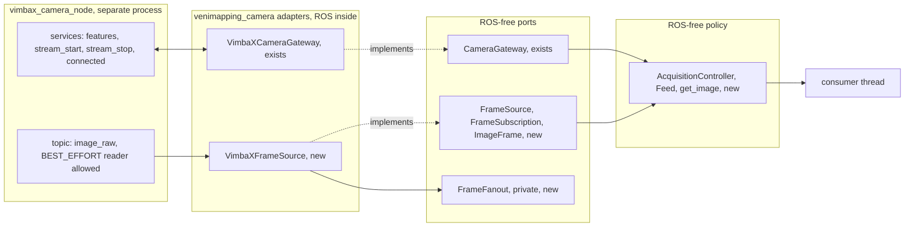

# Image acquisition design v2

- Status: integrated draft, round 5. No issue is Open. The prose pass is next.
- Worktree checkpoint: `6a6dfb2`. Planning folder: `docs/architecture/image-acquisition-planning/`.
- Section owners: data plane by Codex. Control plane, error vocabulary, bring-up, testing, and implementation sequence by Claude. The coordinator wrote sections 1 to 4 and 9 to 14.
- Issue list: `docs/architecture/image-acquisition-planning/issues.md`.

## 1. Summary

v2 adds image acquisition to `venimapping_camera` for one in-process C++ consumer. It adds three targets, no new package, and no driver patch. It keeps the v1 split between a control plane and a data plane. It changes most v1 details, because the code and three camera checks showed different driver and camera behavior.

What v2 proposes:

1. A ROS-free data plane. `ImageFrame` holds the received message through a shared owner, so no pixel copy occurs. `FrameSource` keeps one subscription on `<namespace>/image_raw` with BEST_EFFORT, KEEP_LAST 2. Each `FrameSubscription` has its own bounded queue, default capacity 1, drop oldest. A subscription can outlive its source, because it holds its own queue block and lock state.
2. Frame identity. Each frame carries `receive_seq`, a count per source from 1, and `stream_epoch`, which only the controller starts. An admission gate discards frames with a stamp at or below the epoch boundary.
3. A ROS-free `AcquisitionController` on one worker thread. The worker is the only gateway caller. Counted leases decide when the stream starts and stops. Each `Feed` owns its subscription alone.
4. A start sequence. The worker reads back the camera profile, corrects it only after a confirmed stop, checks the final format against the driver gate, waits for a matched reader, opens admission, and then calls `stream_start`.
5. Recovery rules. One reconciliation stop separates a wedged driver from a transient failure. A 250 ms silence threshold leads to a connection check, an outage state, and a new epoch after a reconnect. Each stream state has a rule for new requests.
6. Get image. It samples a running stream, or it starts free run when idle. It returns a frame received after the request, inside one deadline of 2000 ms. `feed_open` has its own deadline of 5000 ms.
7. A contractual error domain, `kAcquisition`, with 11 fixed codes. Driver errors pass unchanged.
8. Bring-up. The driver loads a 30 Hz Mono8 profile from a settings file on each open. `camera.yaml` pins `autostream: 0`, `buffer_count: 7`, `use_ros_time: true`, and a raw-only plugin filter.
9. Four test tiers. Unit tests run without ROS on fakes that share the real admission code. A temporary feed probe and five hardware checks run on the rig.
10. Nine implementation steps and one conditional step. Each step builds alone and has an exit check.

Phase 1 leaves out the software trigger, `CameraInfo` pairing, a ROS service for get image, device stamps, and driver patches. Each has a trigger to start it (section 10).

State of the design after round 5:

1. No issue is Open. 35 issues are Closed, and 1 issue, i30, is For Logan.
2. Round 5 closed 2 issues: i15 and the register issue i36.
   - i15. After a successful `init`, `start` returns `kFeedClosed` if it reads `kStopping` or `kStopped`. One table gives the `start` result for each init result and each lifecycle value. A private start test hook forces the order in which a concurrent `shutdown()` sets `kStopped` first.
   - i36. Section 4.4 records the register text for that fix.
3. Nine decisions wait for Logan (section 13). The design runs on a stated working assumption for each one.
4. The timestamp source, d20, is a working assumption. The two dispute verdicts disagree (section 14).

### Labels and citations

1. Labels:
   - `[F]` is a fact with a citation.
   - `[A]` is a working assumption. It is cheap to reverse.
   - `[Q]` is an open question.
2. Citation forms:
   - `path:line` is a path from the project worktree root.
   - `driver:path:line` is a path from the driver root `vimbax_ros2_driver/`.
   - `ros:path:line` is a path from the ROS 2 Jazzy source root `ros2-jazzy/src/`.
   - `vimbax:path:line` is a path from `/opt/vimbax`.
   - `facts 1.4.3` is section 1.4, item 3 of `coordinator/facts.md` in the planning folder. Facts ids such as `A28` and `X3` are in the same file.
   - `c1 §3.5` is section 3.5 of `claude/camera/c1.md`. `c2` is `claude/camera/c2.md`. `c3` is `codex/camera/c3.md`.
   - Lower-case ids such as `d17` and `ic3` are entries in `register.md` in the planning folder. `R1` to `R16` and `T1` to `T12` are requirements and technical unknowns. `L1` to `L9` are the decisions for Logan.
   - `i1` to `i36` are issues in `issues.md`. `N1` to `N9` and `M1` to `M10` are entries in `claude/draft-notes.md`.

## 2. Current state

This section gives the acquisition path at the checkpoint. Each item comes from `coordinator/facts.md`, which joins two independent traces of the code.

### 2.1 Project code

1. `[F]` No project code receives pixels. No file under `src/` contains `image_raw` or `sensor_msgs`. `venimapping_camera` does not depend on `sensor_msgs` (`src/venimapping_camera/package.xml:15-16`).
2. `[F]` `camera.launch.py` starts one process, `vimbax_camera/vimbax_camera_node`, with the node name `vimbax_camera` and the namespace from `camera_namespace`, default `/vimbax_camera` (`src/venimapping_bringup/launch/camera.launch.py:19-41`).
3. `[F]` `camera.yaml` sets only `camera_id: "0GPF3"` and `autostream: 0` (`src/venimapping_bringup/config/camera.yaml:9-12`). All other driver parameters keep their defaults: `buffer_count` 7, `use_ros_time` false, `settings_file` and `camera_info_url` empty (`driver:vimbax_camera/src/vimbax_camera_node.cpp:276-305`, `:415-418`).
4. `[F]` `CameraGateway` is a ROS-free C++23 abstract class with 30 pure virtual methods. They cover connection, status, stream start and stop, settings, and each feature type (`src/venimapping_camera/include/venimapping_camera/camera_gateway.hpp:35-138`).
5. `[F]` The gateway contract states "no clamping, fallback, retry, readback, or validation" (`src/venimapping_camera/include/venimapping_camera/camera_gateway.hpp:24-26`).
6. `[F]` Each gateway call checks the bound thread, waits for the service, and waits for the reply against one deadline (`src/venimapping_camera/src/vimbax_camera_gateway.cpp:147-211`). A setter that times out can still have been applied (`src/venimapping_camera/src/gateway_support/vimbax_service_calls.hpp:79-94`).
7. `[F]` If the bound thread also spins the node, each call times out. The thread check detects misuse and does not synchronize (`src/venimapping_camera/include/venimapping_camera/vimbax_camera_gateway.hpp:45-47`).
8. `[F]` A nonzero driver `error.code` becomes a `kDriver` error with code and text unchanged. Gateway diagnostics 1 to 5 are for logs and tests only (`src/venimapping_camera/src/vimbax_camera_gateway.cpp:213-229`, `src/venimapping_camera/src/gateway_support/gateway_errors.hpp:15-22`).
9. `[F]` `camera_gateway_probe` is the only executable and is marked temporary (`src/venimapping_camera/CMakeLists.txt:50-56`). It returns early if a setter fails, so it does not guarantee that it restores the camera (`src/venimapping_camera/src/camera_gateway_probe.cpp:744-768`).
10. `[F]` `package.xml` declares `ament_cmake_gtest`, but the build defines no test target (`src/venimapping_camera/package.xml:18`, `src/venimapping_camera/CMakeLists.txt:18-77`).

### 2.2 Driver stream lifecycle

| Call | State before | Result | Evidence |
|---|---|---|---|
| `stream_start` | `kStopped` | Start, then `kActive`, or an error | `driver:vimbax_camera/src/vimbax_camera.cpp:414-515` |
| `stream_start` | `kActive` | Success, no effect | `driver:vimbax_camera/src/vimbax_camera.cpp:516-517` |
| `stream_start` or `stream_stop` | `kStarting` or `kStopping` | -15 | `driver:vimbax_camera/src/vimbax_camera.cpp:518-519`, `:584-585` |
| `stream_stop` | `kStopped` | Success, no effect | `driver:vimbax_camera/src/vimbax_camera.cpp:582-583` |
| either | camera unavailable | -3 | `driver:vimbax_camera/src/vimbax_camera_node.cpp:1551-1553`, `:1571-1573` |

1. `[F]` Each error return in `start_streaming` leaves `kStarting`. Each error return in `stop_streaming` leaves `kStopping`. No service resets the state (facts 1.4.1 to 1.4.4).
2. `[F]` Start and stop serialize. A -15 comes only from a state that an earlier failure left behind, not from a race (facts X1).
3. `[F]` Each successful start and stop takes at least 100 ms, because the command poll sleeps 100 ms (`driver:vimbax_camera/src/vimbax_camera.cpp:503`, `:529`, `:674-688`).
4. `[F]` With `autostream: 0`, only `stream_start` and the reconnect restart start the stream (`driver:vimbax_camera/src/vimbax_camera_node.cpp:588-593`).
5. `[F]` After a reopen, the driver restarts a stream that was active or starting at the disconnect, and it ignores the result (facts 1.9.7, X3).
6. `[F]` A `buffer_count` change while the camera is disconnected calls `is_streaming()` on a null pointer (facts 1.10.1).
7. `[F]` The driver starts its frame processing thread before `CaptureStart` and `AcquisitionStart`, which can still fail (`driver:vimbax_camera/src/vimbax_camera.cpp:458-510`).

### 2.3 Image publishing

1. `[F]` One `image_transport::CameraPublisher` publishes `image_raw` and `camera_info` with one shared header (`driver:vimbax_camera/src/vimbax_camera_node.cpp:350-364`).
2. `[F]` Publisher QoS is RELIABLE, KEEP_LAST 10, VOLATILE. No parameter changes it (`driver:vimbax_camera/src/vimbax_camera_node.cpp:354-357`). A RELIABLE publisher matches a BEST_EFFORT reader (`ros:ros2/rmw_dds_common/rmw_dds_common/src/qos.cpp:114-124`).
3. `[F]` `image_transport` advertises one subtopic for each installed plugin unless `image_raw.enable_pub_plugins` limits it (`ros:ros-perception/image_common/image_transport/src/publisher.cpp:112-155`).
4. `[F]` The driver has no snapshot service. Pixels leave the driver only on `image_raw` (facts 1.3.5).
5. `[F]` The start gate admits Mono8, Mono12, Mono16, Bayer 8 to 16 bits, Rgb8, Bgr8, and three YUV422 formats (`driver:vimbax_camera/src/vimbax_camera.cpp:1621-1651`). A gate failure leaves `kStarting`.
6. `[F]` Mono12 publishes as `mono16`, shifted left by 4 bits. The message does not record the shift (`driver:vimbax_camera/src/vimbax_camera.cpp:1781-1806`).
7. `[F]` CycloneDDS loans only self-contained types. `sensor_msgs/Image` has unbounded fields, so each subscription gets a deserialized heap copy (`ros:ros2/rmw_cyclonedds/rmw_cyclonedds_cpp/src/rmw_node.cpp:2479`, `:2984`).

### 2.4 Timestamps and frame identity

1. `[F]` With `use_ros_time: false`, `header.stamp` is the SDK frame timestamp. The G1-130 has no `DeviceTimestampFrequency`, so the driver publishes raw ticks as nanoseconds (`driver:vimbax_camera/src/vimbax_camera.cpp:1777`, c1 §3.4).
2. `[F]` With `use_ros_time: true`, `header.stamp` is `node->now()` in the frame thread, after the transform and before publish (`driver:vimbax_camera/src/vimbax_camera_node.cpp:1608-1609`).
3. `[F]` The driver reads `use_ros_time` on each frame. A change during a stream changes the time basis between two frames (facts 1.6.4).
4. `[F]` `header.frame_id` names a TF frame, not a frame instance. The message carries no counter. The CycloneDDS RMW does not fill the sequence fields of the message info (facts 1.6.6, 1.6.7, 1.6.9).

### 2.5 Frame loss visibility

| Where a frame is lost | What shows it | Evidence |
|---|---|---|
| SDK receives an incomplete frame | WARN log. Not published. | `driver:vimbax_camera/src/vimbax_camera.cpp:1739-1742` |
| SDK has no free buffer | WARN log "N frames missing" at the next frame | `driver:vimbax_camera/src/vimbax_camera_node.cpp:1596-1601` |
| DDS sample rejected at the reader | `message_lost` event | `ros:ros2/rmw_cyclonedds/rmw_cyclonedds_cpp/src/rmw_node.cpp:3943-3955` |
| Reader KEEP_LAST history replaces an unread sample | Nothing | `ros:eclipse-cyclonedds/cyclonedds/src/core/ddsc/src/dds_rhc_default.c:854-875` |
| Project queue evicts a frame | Only a counter that the project writes | No code yet |

### 2.6 Commands, triggers, and connection

1. `[F]` `features/command_run` runs any command feature. The reply has no frame identity (`driver:vimbax_camera/src/vimbax_camera_node.cpp:1039-1067`).
2. `[F]` `status` writes each `TriggerSelector` value to read the trigger state, and it leaves the selector at the last value (`driver:vimbax_camera/src/vimbax_camera.cpp:1452-1473`).
3. `[F]` No ROS event exists for frames, stream state, or connection. While the camera is unavailable, each camera service returns -3 (facts 1.9.2, 1.9.5).
4. `[F]` On a reconnect, a detached thread reopens the camera and loads `settings_file`. A failed load only logs an error (`driver:vimbax_camera/src/vimbax_camera_node.cpp:390-400`, `:556-568`).
5. `[F]` The `connected` service returns `camera_ != nullptr` only (`driver:vimbax_camera/src/vimbax_camera_node.cpp:1520-1527`).
6. `[F]` If the first open fails, the driver calls `rclcpp::shutdown()` (`driver:vimbax_camera/src/vimbax_camera_node.cpp:375-382`).

## 3. Requirements and working assumptions

### 3.1 Requirements from Logan

No requirement below has an answer from Logan. Each row is a working assumption `[A]`. Cost to reverse is Low when one value or one file changes, Medium when a contract or a sequence changes, and High when a package or an owner changes.

| Id | Unknown | Working assumption | What depends on it | Cost to reverse |
|---|---|---|---|---|
| R1 | Frame consumers and their process | One C++ consumer in the same process, on the driver host | d1, d2, d7, d13, d20, d29, L2 | High |
| R2 | Resolution, ROI, binning | Full sensor, 1296 x 1032, no binning. Interfaces take size and `step` from each frame. | d10 byte bounds, d18 profile | Low |
| R3 | Pixel format and bit depth | Mono8 in phase 1. Mono12 only if a consumer needs more than 8 bits. | d14, d18, d19, L5 | Low |
| R4 | Feed frame rate | 30 Hz Mono8 free run (c3). The design must also carry 69.7 Hz Mono8, 93.2 MB/s. | d9, d10, d18, d22 | Low |
| R5 | Memory budget for held frames | At most `(queue capacity + frames the consumer holds) x 1.34 MB` per subscription | d10, d13, ic1 | Low |
| R6 | Freshness for get image | "Received after the request" is enough. | d23, d24, d27, L4 | Medium |
| R7 | Maximum wait for get image | Cold up to 2 s. Warm about one frame period, 33 ms at 30 Hz. | d25, d26, L6 | Low above 200 ms |
| R8 | Get image rate and overlap | Less than once per second. It may overlap a feed and must not stop it. | d13, d25, d28, L6 | Low |
| R9 | Feed loss tolerance | The feed may drop frames. Newer frames have priority. Each visible drop is counted. | d9, d10, d12, L1, L7 | High if loss must be zero |
| R10 | Time basis | Consumers need a stamp on the host clock. No PTP or hardware sync. | d20, L1 | Medium |
| R11 | Intrinsics with each frame | Not in phase 1 | d3, d15 | Low |
| R12 | Topology and middleware | Driver and consumers on one host with CycloneDDS | d8, d9, d20, L2 | Medium |
| R13 | Driver fork patches | The design works without a patch. | d19, d21, L3 | Low |
| R14 | Outage behavior | An outage does not close a feed. The feed reports it and starts a new epoch. | d11, d22, L9 | Low |
| R15 | Other driver clients | While the project acquires, no other client writes features, calls stream services, or calls `status`. | d16, d18, d27, L8 | Medium |
| R16 | Persistence of feature writes | A power cycle resets service writes. The profile must apply again after each reopen. | d18, d22 | Medium |

### 3.2 Technical assumptions

| Id | Assumption now | What depends on it | Cost to reverse |
|---|---|---|---|
| T3 | Free run gives 69.7 Hz Mono8 and 45.1 Hz Mono12 at `ExposureTime` 4999.455 us. A 30.0 Hz write gives 30.010 Hz. | R4, d10, d22 | Low |
| T4 | The device stamp origin and its exposure event stay unknown. Phase 1 does not use the device stamp. | d20, d12 | Low |
| T7 | `AcquisitionFrameRate` writability during a stream stays unknown. Phase 1 does not need it. | Phase 2 rate control | Low |
| T9 | A RELIABLE reader can make the driver block in `publish`. d9 avoids it. | d9, d10 | Low |
| T10 | The installed `image_transport` plugins are unknown. The bring-up filter removes the dependency. | d8 | Low |
| T11 | Host socket buffers are not tuned. Bring-up lists the 8 MiB values as a host check. | d9 | Low |
| T12 | Match time is unknown. d17 waits on the match, so no rule needs the number. | d17, d25 | Low |
| P1 | The camera power-on values equal the phase 1 shape values. | d18, d22 | Low |
| P2 | The settings file and the profile file describe the same values. A bring-up test checks this. | d18 | Low |
| P3 | One frame take costs a few milliseconds on the executor thread. | d5 | Low |
| P4 | The double shared lock in the driver does not hang on glibc. | d21, L3 | Medium |
| P5 | A `buffer_count` change during a disconnect crashes the driver. Only the file sets it. | d10, d21 | Low |
| P6 | Host `CLOCK_REALTIME` does not step back during acquisition. | d20, d22, ic3 | Low |
| P7 | `get_publisher_count()` is safe from the worker while the executor spins. | d17, ic2 | Low |
| P8 | `std::chrono::system_clock` reads `CLOCK_REALTIME` on the project toolchain. | ic3 | Low |
| P9 | A 1 s limit between the header stamp and the receipt time catches a device-clock stamp and never rejects a host stamp. | ic3, ic6 | Low |
| P10 | Each in-process gateway call takes a few milliseconds, so the cold path is less than 500 ms. The `rtt` probe mode measures it. | d26, `FeedOptions::deadline` | Low |
| P11 | The camera keeps service writes across a driver restart without a power cycle. The bring-up part A check uses it. | ic6 | Low |

T1, T2, T5, T6, and T8 are closed by the camera checks (section 11).

## 4. Architecture overview

### 4.1 Components



| Component | Role | Owner section |
|---|---|---|
| `ImageFrame` | Immutable frame value. Shares the received message. No ROS type. | data plane (5) |
| `FrameSource`, `FrameSubscription` | Port. One subscription per source. One bounded queue per `FrameSubscription`. Admission and epochs. | data plane (5) |
| `FrameFanout`, `FrameFanoutClock` | Private ROS-free core of the source: queues, fan-out lock, admission, counters, and an injectable clock. The adapter and the test fake each hold one by value. | data plane (5) |
| `VimbaXFrameSource` | Adapter. One rclcpp subscription on `<namespace>/image_raw`. | data plane (5) |
| `AcquisitionController`, `Feed` | Policy. Leases, request deadlines, start sequence, profile readback, recovery, get image. | control plane (6) |
| `LeaseLink` | Private shared block between a `Feed` and the worker. Gives the worker a close path and lets a release outlive the controller. | control plane (6) |
| `AcquisitionCode` | Contractual error codes in the `kAcquisition` domain | error vocabulary (6) |
| `camera.yaml`, `camera_settings.xml`, `acquisition_profile.yaml`, `camera.launch.py` | Driver parameters, camera profile, expected values | bring-up (7) |
| `camera_feed_probe` | Temporary composition root and rig check tool | testing (8) |

### 4.2 Threads

From register ic4, with the shutdown rules of rounds 2 to 5 (i33, i34, i35, i36).

| Thread | Started by | Runs | Never calls |
|---|---|---|---|
| Executor thread | composition root | `SingleThreadedExecutor::spin` on the one node: gateway replies, the image callback, the `message_lost` callback | the gateway, the controller, consumer code |
| Controller worker | `AcquisitionController::start` | The bind hook first, then gateway calls, the 100 ms tick, lease changes, and each gateway call of the shutdown | `FrameSubscription::take` or `try_take`, a join of its own thread |
| Consumer thread, one per `Feed` and one per `get_image` call | application | `Feed::take`, `Feed::try_take`, and the `get_image` take loop | the gateway, `FrameSource` |
| Any thread | | `close()`, `stats()`, `status()`, `start()`, `shutdown()` | |

1. Start order: make the node, create the gateway, create the frame source, create the controller, start the executor thread, start the controller worker.
2. Stop order: call the controller shutdown while the executor still spins. Then stop and join the executor. Then destroy the controller, the frame source, the gateway, and the node.
3. `[A]` Phase 1 uses one node and one executor thread. The feed probe measures the gateway round-trip time while stopped and while streaming at 69.7 Hz. If streaming adds more than 5 ms, the composition root moves the subscription to a second node (d5, step 9a).
4. A `shutdown()` before `start` runs on the calling thread. It completes each queued request with `kFeedClosed` and makes no gateway call (i15).
5. One thread moves the worker `std::thread` object out and joins. Only that thread sets `kStopped`, after its join returns. Each other `start` or `shutdown()` that needs the worker to exit waits for `kStopped`. The worker never joins and never waits (i15).
6. `start` reads the init result and the lifecycle value in one locked section. After a successful `init`, it returns success only in `kStarting`. In `kStopping` or `kStopped`, it returns `kFeedClosed` after the worker has exited (i15).

### 4.3 Build targets

From register ic8. All targets are in `venimapping_camera`. Each library has its own `install(TARGETS ... EXPORT export_${PROJECT_NAME})` call (i24).

| Target | Kind | Links | Owner |
|---|---|---|---|
| `venimapping_camera_gateway_api` | INTERFACE, exists | none | error vocabulary adds headers |
| `venimapping_camera_frame_api` | library, ROS-free | `venimapping_camera_gateway_api` | data plane |
| `venimapping_camera_vimbax_frame_source` | library | `venimapping_camera_frame_api`, `rclcpp`, `sensor_msgs` | data plane |
| `venimapping_camera_acquisition` | library, ROS-free | `venimapping_camera_gateway_api`, `venimapping_camera_frame_api` | control plane |

`[F]` The package already splits a ROS-free INTERFACE target from the ROS adapter target (`src/venimapping_camera/CMakeLists.txt:22-48`). A new package would add a manifest and an export and enforce no new rule (d1).

### 4.4 Decision register

The register in the planning folder holds the full entries, the evidence, and the interface contracts ic0 to ic8. This table gives each decision in one line, with the amendments from rounds 1 to 5. The register file is at the `register-final` text. Until the next register write, this section is the record of the amendments (i32, i33, i34, i35, i36).

| Id | Topic | Status | Decision |
|---|---|---|---|
| d1 | Package layout | Agreed | Three new targets in `venimapping_camera`. No new package. |
| d2 | Port shape | Agreed | A separate ROS-free `FrameSource` port. `CameraGateway` does not change. |
| d3 | Frame type | Settled | ROS-free `ImageFrame` with layout, identity, bit depth, and one `host_stamp_ns`. |
| d4 | Memory model | Agreed | Keep the received message alive through a type-erased shared owner. No pixel copy. |
| d5 | Threads | Settled | One node and one executor thread in phase 1. The feed probe decides a split. |
| d6 | Error vocabulary | Settled | New contractual `kAcquisition` domain, codes 1 to 11. |
| d7 | Consumer API | Agreed | Pull with `take(timeout)` and `try_take()`. Empty result on timeout. |
| d8 | Transport | Agreed | Plain rclcpp subscription on `<namespace>/image_raw`. Raw plugin only. |
| d9 | Subscriber QoS | Settled | BEST_EFFORT, KEEP_LAST 2, VOLATILE, fixed in the adapter. |
| d10 | Queue and `buffer_count` | Settled | Capacity per subscription, default 1, range 1 to 4, drop oldest. `buffer_count` 7 in `camera.yaml`. |
| d11 | Frame identity | Agreed | `receive_seq` per source from 1, plus a stream epoch. Only the controller starts an epoch. |
| d12 | Loss reporting | Settled | Counters per loss site. No `stamp_gap_frames` in phase 1. |
| d13 | Several consumers | Settled | One subscription, one queue per `FrameSubscription`. One feed and one get image at a time. |
| d14 | Pixel interpretation | Settled | Pass pixels unchanged. Add `significant_bits` from the final `PixelFormat` readback. |
| d15 | Calibration | Agreed | No `CameraInfo` in phase 1. |
| d16 | Stream ownership | Agreed | The controller worker owns stream calls and feature writes through counted leases. |
| d17 | Feed start | Agreed | Match before start. The last release stops the stream. |
| d18 | Configuration | Settled, amended (i11, i13) | `settings_file` applies the 30 Hz Mono8 profile at each open. The controller reads it back and corrects only after a confirmed stop. Item 7 allows the `TriggerSelector` write before a `TriggerMode` read during a stream. |
| d19 | Start and stop failure | Settled, amended (i18) | Format check, one reconciliation stop, then `kWedged`. One confirmation stop for each change signal. Only a successful confirmation stop clears `kWedged`. |
| d20 | Timestamp source | Working assumption | `use_ros_time: true`. `host_stamp_ns` from `header.stamp`. Logan question L1. |
| d21 | Driver changes | Agreed | No patch in phase 1. Four candidate patches go to Logan. |
| d22 | Outage | Settled, amended (i10, i13) | 250 ms floor, close admission, check connection, read back profile, new epoch. The fallback start runs the full start sequence. |
| d23 | Get image source | Agreed | Sample a running stream, or start free run when idle. No trigger in phase 1. |
| d24 | Freshness | Agreed, amended (i12) | A frame pushed to the get image subscription after it opened, with `receive_seq` greater than `frames_received` at the request. |
| d25 | Idle behavior | Agreed | One subscription for the source lifetime. Cold calls start the stream. |
| d26 | Deadline | Settled, amended (i14, i27) | One caller deadline for `get_image`, default 2000 ms, and for `feed_open`, default 5000 ms. The worker checks it before each gateway call. The caller checks it when it accepts a frame. The stop is outside it. |
| d27 | Trigger association | Agreed | Phase 2 only. |
| d28 | Get image during a feed | Agreed | Share the stream. Get image has its own queue. |
| d29 | Caller interface | Agreed | C++ only in phase 1. |

Contract amendments from round 1:

1. ic5 gains control-plane rows for `kFeedClosed` and `kInvalidArgument`. `AcquisitionController::create` can also return `kFormatNotStreamable` (i28).
2. ic4: the worker starts through `AcquisitionController::start(WorkerInit)`. The hook binds the gateway thread (i29).

Contract amendments from round 2, for the accepted data-plane fixes (i32):

1. ic1 item 4: the frame is immutable after `create` or after `FrameFanout` publishes it (i7).
2. ic1 sketch: `encoding()` and `tf_frame()` return `const std::string&`. The other accessors return the field type (i6).
3. ic2 `FrameSourceStats` adds `callback_ns_max` and `callback_ns_total` (i2).
4. ic2 `VimbaXFrameSource` item 1: an empty `camera_namespace` returns `kSourceCreateFailed` (i8).
5. ic3 item 3.1: `receive_seq = frames_received.fetch_add(1) + 1` (i1).
6. ic3 item 3.2: a second `steady_now()` read after the deferred releases (i2).
7. ic3 item 3.3: the private `ImageFrame` stage factory replaces `ImageFrame::create` in the callback (i7).
8. ic7 item 2: `FrameFanoutClock` is an abstract class with virtual `realtime_ns() const` and `steady_now() const`. The clock outlives `FrameFanout` (i9).
9. ic8 guarantee 10: the callback interval runs from the first `steady_now()` read to the read after the deferred releases (i2).

Contract amendments from round 2, for the accepted control-plane fixes (i33):

1. d18 item 7: "Phase 1 writes no acquisition value during a stream. The `TriggerSelector` write before a `TriggerMode` read is allowed." (i11)
2. d22 item 5: the stop before the corrective writes is part of the start sequence and gives a confirmed stop (i13).
3. d22 item 7: the fallback calls `close_admission` and runs the start sequence (i10).
4. d26: `FeedOptions::deadline`, default 5000 ms, uses the same request mechanism as `get_image` (i27).
5. ic3 item 4.3: `close_admission` also runs at once after a failed `stream_start` (i17, accepted part).
6. ic4 stop order step 1: the worker makes each gateway call of the shutdown (i15, accepted part).
7. ic5: `kDeadlinePassed` adds `feed_open`. `kFeedClosed` adds the init failure and requests queued at shutdown. `kInvalidArgument` adds a second `start` call. Item 2 adds the rule that the second readback decides a corrective write result (i23).

Contract amendments from round 3, for the accepted control-plane fixes (i34):

1. d26 item 2: the deadline also covers the acceptance of the first frame. The worker checks the outcome and the deadline before each gateway call that the request causes (i14).
2. d26 item 4: "A passed deadline returns `kDeadlinePassed`. The caller checks the deadline after each frame that `take` returns, and drops a frame that it took after the deadline." (i14)
3. d26: `FeedOptions::deadline` also covers the wait in the worker queue. This completes round 2 item 4 (i14, i27).
4. d19 item 5: "A change signal and then a successful confirmation `stream_stop` clear `kWedged`. The worker makes one confirmation stop for each change signal. Any failure of it keeps `kWedged`." (i18)
5. ic2 `Feed`: a `LeaseLink` with a `released` flag, a lease set keyed by link, the move assignment rule, and `kFeedClosed` from an empty `Feed`. Sole ownership does not change (i26).
6. ic3 item 4.3: `close_admission` also runs when a request expires after `open_admission` and before `stream_start` (i14).
7. ic3: the rule for frames of an epoch whose start is pending (`claude/sections/control-plane.md:335-352`, i17).
8. ic4 stop order step 1: a shutdown before `start` completes each queued request with `kFeedClosed` on the calling thread, with no gateway call (i15, accepted part).
9. ic5: `kFeedClosed` adds `start` after shutdown started, and a shutdown before `start`. `kInvalidArgument` names a second `start` while the worker starts or runs (i15, accepted part). Round 5 item 1 adds the `start` return rule.

Contract amendments from round 4, for the accepted Claude round 3 fixes (i35):

1. ic4 stop order step 1, join rule: "One thread moves the worker `std::thread` object out under the lifecycle mutex and joins. After its join returns, that thread alone sets `kStopped` and notifies all waiters. Each other `start` or `shutdown()` that needs the worker to exit waits for `kStopped`. The worker never joins and never waits." (i15, accepted part)
2. ic4 stop order step 1, worker thread: "`shutdown()` on the worker sets the shutdown flag and `kStopping`, posts the stop request, and returns." (i15, accepted part)
3. ic6 item 3: the bring-up rig check adds the part A control launch, the readback before the reopen, and the `grep -F` match anywhere in the line. Before each log check, it adds the init wait for `Initialization done!` with a 60 s limit. A missing line fails the check (i19, i25).

Contract amendments from round 5, for the accepted Claude round 4 fix (i36). Item 1 replaces the waiting round 3 item 3 (`claude/fixes/round-3.md`, register item 3):

1. ic4 and ic5, `start` return rule: "A `start` that fails in `init`, or that sees a shutdown before it handles the init result, returns only after the worker has exited. After a successful `init`, `start` returns `kFeedClosed` if the lifecycle value is `kStopping` or `kStopped`, and success only if it is still `kStarting`." (i15)
2. ic7, controller test seam: "The controller has one test seam, `detail::ControllerTestAccess`, in a private header. It sets a hook that `start` runs with no lock held, before it waits for the init result. The hook is empty in production." (i15)

## 5. Data plane

Source: `codex/sections/data-plane.md`, owner Codex. The coordinator changed only the heading levels. No issue on this section is open after round 5.

[F] The driver publishes `sensor_msgs/msg/Image` on `image_raw`. The project gateway uses services and binds blocking calls to one worker thread. (`driver:vimbax_camera/src/vimbax_camera_node.cpp:350-357,1620-1638`, `src/venimapping_camera/src/vimbax_camera_gateway.cpp:49-69`, `src/venimapping_camera/include/venimapping_camera/vimbax_camera_gateway.hpp:45-64`)

Keep v1's separate frame port and pull interface. The controller composes `FrameSource` with `CameraGateway`. Consumers pull from `FrameSubscription` on their own threads. This keeps frame processing off the executor. The frame API and the VimbaX adapter use separate libraries in `venimapping_camera` (`d1`, `d2`, `d7`, `ic8`). (`docs/architecture/image-acquisition-design-v1.md:306-346`)

[A] Phase 1 serves one local C++ consumer on the driver host with CycloneDDS. The controller allows one feed and one outstanding get image request. This assumption sets the local port and the controller's queue limits (`d13`, `d29`, R1, R12).

[Q] Will a consumer need another process or host, calibration, or more than 8 bits (L2, R11, L5)?

### Frame and pixel ownership

`ImageFrame` is a ROS-free value in `venimapping::camera` (`d3`, `d4`, `d11`, `d14`, `d15`, `ic1`). It exposes one `const noexcept` accessor per field. Scalar accessors return by value. `encoding()` and `tf_frame()` return `const std::string&` into the shared frame block. This avoids a string allocation in a `noexcept` accessor.

| Field | Type | Meaning |
|---|---|---|
| `width`, `height` | `std::uint32_t` each | Image dimensions in pixels, from the message. |
| `step` | `std::uint32_t` | Bytes per row, from the message. |
| `encoding` | `std::string` | Wire encoding, unchanged. |
| `is_bigendian` | `bool` | Pixel byte order, from the message. |
| `tf_frame` | `std::string` | Coordinate frame name from `header.frame_id`. |
| `significant_bits` | `std::uint8_t` | Source bit depth from the final verified `PixelFormat` for this epoch. |
| `host_stamp_ns` | `std::int64_t` | Driver stamp on host `CLOCK_REALTIME`, in nanoseconds since the Unix epoch. |
| `receive_seq` | `std::uint64_t` | Receive sequence for this `FrameSource`, starting at 1. |
| `stream_epoch` | `std::uint32_t` | Admission epoch for this `FrameSource`, starting at 1. |
| `pixels()` | `std::span<const std::byte>` | Read-only view into the received payload. |

`ImageFrame::create(ImageFrameFields, std::shared_ptr<const void>, std::span<const std::byte>)` returns `Expected<ImageFrame>`. It returns `kInvalidArgument` if either dimension is zero or if `step × height` exceeds the span size. Compute the product in 64 bits before the comparison (`ic1`, `ic5`).

`ImageFrame` declares `frame_support::FrameFanout` as a friend. The private `stage` factory validates the layout and allocates a mutable frame block before the fan-out lock. The public `create` factory uses the same validation and returns an immutable frame. Under the lock, only `FrameFanout` sets `stream_epoch` and `significant_bits` on its unpublished block. It then moves the sole staging handle into an `ImageFrame` with a const block and publishes that frame to the queues. The frame is immutable after `FrameFanout` publishes it (`ic1`, `ic3`, `ic8`).

The adapter uses the received message as the type-erased owner and points the span into its `data`. The shared frame block holds the fields, owner, and span. A frame copy increments one reference count and allocates no memory. Accessors are safe on any thread. Keep a frame copy alive while using its string references or pixel span. A retained frame stays valid after the subscription, source, and node are gone. [A] The adapter uses the default message allocator, so the payload lifetime does not depend on the node (`d4`, `ic1`).

[F] The local CycloneDDS receive path uses a regular message because `Image` has unbounded fields. The driver can copy or shift pixels before publish. (`ros:ros2/common_interfaces/sensor_msgs/msg/Image.msg:21-26`, `ros:ros2/rmw_cyclonedds/rmw_cyclonedds_cpp/src/rmw_node.cpp:2949-2984`, `driver:vimbax_camera/src/vimbax_camera.cpp:1695-1712,1781-1806`)

Keep v1's shared owner so fan-out adds no pixel copy. Pass through the payload and encoding. Add `significant_bits` to preserve the source bit depth (`d4`, `d14`). [F] The driver publishes Mono12 as `mono16` with samples shifted left four bits. (`docs/architecture/image-acquisition-design-v1.md:261-305`, `driver:vimbax_camera/src/vimbax_camera.cpp:1791-1797,1835-1844`)

[A] The initial profile uses full-sensor Mono8 at 1296 × 1032 and 30 Hz. The load target is 69.7 Hz. Profile changes affect payload size and load estimates. Each frame carries its own layout (`d10`, `d18`, R2–R5).

[F] The c1 check measured 1,337,472 bytes per image and 93.2 MB/s at the load target. The c3 check measured 30.010 Hz at the initial profile. (`docs/architecture/image-acquisition-planning/claude/camera/c1.md:100-119`, `docs/architecture/image-acquisition-planning/codex/camera/c3.md:45-50`)

### Source, subscription, and backpressure

`VimbaXFrameSource` keeps one ROS subscription for its lifetime, including while idle (`d13`, `d25`). `FrameSource::subscribe` opens an empty project queue. The controller owns stream operations and leases (`d16`, `d17`). Get image opens its own capacity-1 subscription on the same source (`d24`, `d28`).

```cpp
struct SubscribeOptions {
  std::size_t capacity = 1;
};

struct FrameSubscriptionStats {
  std::uint64_t frames_delivered;
  std::uint64_t queue_evictions;
  std::uint64_t frames_cleared;
};

struct EpochStart {
  std::uint32_t epoch;
  std::int64_t boundary_ns;
};

struct FrameSourceStats {
  std::uint64_t frames_received;
  std::uint64_t frames_admitted;
  std::uint64_t discarded_layout;
  std::uint64_t discarded_stamp_basis;
  std::uint64_t discarded_admission;
  std::uint64_t callback_ns_max;
  std::uint64_t callback_ns_total;
  std::optional<std::uint64_t> transport_lost;
  std::optional<std::chrono::steady_clock::time_point> last_admitted;
  std::uint32_t current_epoch;
  bool admission_open;
};

class FrameSubscription {
 public:
  virtual ~FrameSubscription() = default;
  [[nodiscard]] virtual Expected<std::optional<ImageFrame>> take(
      std::chrono::milliseconds timeout) = 0;
  [[nodiscard]] virtual Expected<std::optional<ImageFrame>> try_take() = 0;
  virtual void close() noexcept = 0;
  [[nodiscard]] virtual FrameSubscriptionStats stats() const = 0;
};

class FrameSource {
 public:
  virtual ~FrameSource() = default;
  [[nodiscard]] virtual Expected<std::unique_ptr<FrameSubscription>> subscribe(
      const SubscribeOptions& options) = 0;
  [[nodiscard]] virtual std::size_t matched_publishers() const = 0;
  [[nodiscard]] virtual EpochStart open_admission(std::uint8_t significant_bits) = 0;
  virtual void close_admission() noexcept = 0;
  [[nodiscard]] virtual FrameSourceStats stats() const = 0;
};
```

`subscribe` accepts capacities 1 through 4 and returns `kInvalidArgument` outside that range. The error text gives the supplied capacity. Each admission pushes a shared frame to every open queue and increments `frames_delivered` for each push. At capacity, the queue evicts its oldest frame and counts one `queue_evictions` event. The callback never waits for space. Capacity 1 keeps the newest pending frame. This replaces v1's default of 4 to limit backlog for the phase 1 consumer (`d10`, `d13`, `ic2`). (`docs/architecture/image-acquisition-design-v1.md:348-359,714-724`)

`take` returns the oldest queued frame. If the queue is empty, it waits on a condition variable with a steady-clock deadline. A timeout of zero or less acts as `try_take`. A timeout or empty `try_take` returns a successful empty optional, including during suspended admission. The first pull binds the consumer thread. A pull from another thread on an open subscription returns `kWrongThread` (`d7`, `ic2`, `ic5`).

The adapter and `FakeFrameSource` each hold a `FrameFanout` by value. The adapter holds it in a private implementation block in its source file. `FrameFanout` holds shared state with the fan-out lock and the list of open queues. Each list entry holds a shared pointer to its queue block. Each concrete subscription holds a shared pointer to its queue block and another to the shared state. The queue block holds the ring, pull condition variable, closed flag, and subscription counters. The shared state and queue blocks have no references to the source or clock.

`subscribe` creates the subscription, queue storage, and list node before it takes the fan-out lock. It splices the preallocated node into the list under the lock. Any thread can call `stats` or `close`. `close` marks the queue closed, unlinks its node, counts and clears its frames, and wakes a waiting pull under the lock. Destroy detached list nodes after unlocking. Destruction of the concrete subscription calls `close`.

When the source goes away, `FrameFanout` closes and unlinks all remaining queues under the same lock. A waiting or later pull returns `kFeedClosed`. A later `close` sees the closed flag in its own queue block and returns. Subscription stats remain readable. The subscription uses its shared state and queue block throughout, so the source can disappear while a consumer waits (`ic2`, `ic5`).

Use four local frame holders when evicting or clearing entries under the fan-out lock. Each open queue holds a suffix of admitted pushes because each push reaches every open queue and each removal takes the oldest frame. With capacity at most 4, the queues can contain at most four distinct frames when the operation starts. Use `receive_seq` to match references to the same frame. Move one reference per distinct frame into a holder before removing duplicate references. Release the holders after unlocking. This covers a push, `close_admission`, subscription close, and source teardown. A pull moves its frame out before unlocking. It builds any error result after unlocking (`ic8`).

For the Mono8 profile, each queue retains at most `capacity × step × height` pending payload bytes. The feed and get image queues together hold at most five pending references. Those references cover at most four distinct payloads, or 5,349,888 bytes. Consumer-held frames add up to `step × height` each. Deferred release holders, DDS history, the in-flight callback, and SDK buffers can also hold payloads. Bring-up sets `buffer_count: 7` in `camera.yaml` at launch (`d10`, `d13`, `ic1`).

### Admission and loss reporting

[A] Phase 1 sets driver `use_ros_time: true` and sets `use_sim_time: false` on the driver and application node. [F] The driver then stamps each frame after the transform and before publish. The stamp marks processing time. (`d20`, `ic6`, `driver:vimbax_camera/src/vimbax_camera.cpp:1745-1757`, `driver:vimbax_camera/src/vimbax_camera_node.cpp:1605-1618`, `ros:ros2/rcl/rcl/src/rcl/time.c:62-72`, `ros:ros2/rcutils/src/time_unix.c:58-74`)

`FrameFanout` manages admission and source counters (`ic3`, `ic7`). The source starts with admission closed and `current_epoch` zero. Only the controller worker opens admission. For a project start, it opens admission after the match and format checks, before `stream_start`. If it keeps a driver restart after reconnect, it opens admission after profile verification (`d11`, `d17`, `d19`, `d22`). Under the lock, `open_admission` increments the epoch, reads the `CLOCK_REALTIME` boundary, stores `significant_bits`, and opens the gate. It returns `EpochStart`. Under the same lock, `close_admission` closes the gate and clears every queue. It counts each removed frame in `frames_cleared` and leaves the subscriptions open.

The private header `src/frame_support/frame_fanout.hpp` declares `FrameFanoutClock` and `FrameFanout` in `venimapping::camera::frame_support`. The clock provides `realtime_ns()` as `std::int64_t` and `steady_now()` as `std::chrono::steady_clock::time_point`. Construct `FrameFanout` with a `FrameFanoutClock&`. The clock must outlive `FrameFanout`. The adapter owns the production clock and the fake borrows the test clock (`ic7`).

`FrameFanout` exposes `subscribe(const SubscribeOptions&)`, `open_admission(std::uint8_t)`, `close_admission()`, and `stats() const` with the port signatures. Both sources forward these methods. Each source implements `matched_publishers()` itself. `FrameFanout` also exposes `set_transport_lost(std::optional<std::uint64_t>)` for the adapter's RMW event total.

The adapter forwards each converted message to `void on_message(std::shared_ptr<const void> owner, ImageFrameFields fields, std::span<const std::byte> pixels)`. The fields `receive_seq`, `stream_epoch`, and `significant_bits` arrive as zero. The fake uses the same method. Keep the staging handle and the incoming frame's local reference outside the lock scope. A discard goes directly to step 7 (`d11`, `d12`, `d20`, `ic3`, `ic7`).

1. Set `receive_seq = frames_received.fetch_add(1) + 1` on the source's zero-initialized `std::atomic<std::uint64_t>`.
2. Read `steady_now()` for receipt time and the duration start. Read `realtime_ns()` for the stamp check.
3. Stage the frame before taking the fan-out lock. If validation fails, count `discarded_layout`.
4. If the stamp differs from the realtime read by more than 1 s, count `discarded_stamp_basis`.
5. Under the fan-out lock, check admission. If admission is closed or the stamp is at or below the boundary, count `discarded_admission`.
6. Otherwise, finish the unpublished block with the epoch and bit depth. Push the immutable frame to each open queue. Set `last_admitted` to the steady read. Increment `frames_admitted` before unlocking.
7. Release local frame references outside the lock. Read `steady_now()` again. Add the elapsed nanoseconds to `callback_ns_total` with an atomic increment. If the duration exceeds `callback_ns_max`, use atomic compare-and-exchange to raise the maximum.

Each message takes a sequence, including messages that the fan-out discards. The first value is 1 and the sequence never resets. `stats().frames_received` loads the same atomic and gives the last sequence assigned at that load. The duration fields start at zero. `callback_ns_max` is the longest measured interval and `callback_ns_total` is their sum. Concurrent stats reads use atomic loads for these aggregates and for discard counters written outside the lock. The duration covers fan-out work, lock wait, and deferred releases. Adapter conversion and ROS deserialization occur before this interval (`ic3`, `ic7`, `ic8`).

The queue link orders `subscribe` against a push because both use the fan-out lock. Only pushes after the link reach the new queue. A callback can take its sequence before `subscribe` and push after the link. Its sequence can be at or below `frames_received` at the time of `subscribe`.

For get image, the controller worker reads `R = stats().frames_received` for the request before it calls `subscribe`. The control plane skips each frame with `receive_seq <= R`. A qualifying frame has a push after the queue link and `receive_seq > R`. Capacity 1 can evict an earlier qualifying frame before the caller pulls. A test can pause the callback in its first `steady_now()` read to put a queue link between receipt and push (`d24`, `ic7`, `ic8`, `i12`).

The worker reads `last_admitted` on its 100 ms silence tick. The controller owns the threshold and recovery (`d22`). [A] A 1 s stamp check catches the observed device clock basis. A backward host clock step can delay admission until realtime passes the boundary or recovery opens a new epoch (P6, P9). (`docs/architecture/image-acquisition-planning/claude/camera/c1.md:123-143`)

Keep separate counts for callback discards, queue evictions, clears, and RMW events (`d12`). `transport_lost` starts at zero when the RMW supports `message_lost` and stays empty without event support. Phase 1 omits `stamp_gap_frames` and the device stamp. The separate device stamp probe informs L1 (`d20`).

[F] The driver logs incomplete SDK frames and SDK frame ID gaps. CycloneDDS reports DDS sample loss through `message_lost`. It can overwrite an unread history entry without that event. (`driver:vimbax_camera/src/vimbax_camera.cpp:1724-1742`, `driver:vimbax_camera/src/vimbax_camera_node.cpp:1595-1603`, `ros:ros2/rmw_cyclonedds/rmw_cyclonedds_cpp/src/rmw_node.cpp:3943-3955`, `ros:eclipse-cyclonedds/cyclonedds/src/core/ddsc/src/dds_rhc_default.c:854-875`)

An admission discard counts a message that reached the callback. A consumer sequence gap measures a gap in delivery of numbered messages. Incomplete SDK receives, SDK buffer shortages, and unread DDS history overwrites can occur before sequence assignment. Loss before the first received frame of an epoch or in trigger mode can also go unseen (`d12`).

### VimbaX adapter and threads

`VimbaXFrameSource::create(rclcpp::Node&, const std::string& camera_namespace)` returns `Expected<std::unique_ptr<VimbaXFrameSource>>`. The node outlives the adapter. The adapter forbids copy and move. The factory maps creation failures to `kSourceCreateFailed` (`ic2`, `ic5`).

If `camera_namespace` is empty, return `kSourceCreateFailed` before creating the ROS subscription. For a nonempty input, strip trailing slashes. Append `/image_raw`. Create one `rclcpp::Subscription<sensor_msgs::msg::Image>` in the default callback group. [F] The gateway rejects empty input and uses the same name rule for services. (`d8`, `ic2`, `src/venimapping_camera/src/vimbax_camera_gateway.cpp:21-25`, `src/venimapping_camera/src/gateway_support/vimbax_service_calls.hpp:36-46`)

Fix QoS at BEST_EFFORT, KEEP_LAST 2, VOLATILE. Depth 2 gives the executor one extra unread sample before DDS can overwrite it. The project queue counts its own evictions. [F] The driver's RELIABLE, KEEP_LAST 10, VOLATILE publisher matches this reader. (`d9`, `driver:vimbax_camera/src/vimbax_camera_node.cpp:354-357`, `ros:ros2/rmw/rmw/include/rmw/qos_profiles.h:51-62`, `ros:ros2/rmw_dds_common/rmw_dds_common/src/qos.cpp:114-124`)

Keep v1's plain rclcpp reader for raw pixels. The bring-up filter selects only the raw plugin, so extra installed plugins cannot add image topics (`d8`, `ic6`). (`docs/architecture/image-acquisition-design-v1.md:377-389`, `ros:ros-perception/image_common/image_transport/src/publisher.cpp:112-155`)

Parse `header.stamp` as `int64(sec) × 1,000,000,000 + nanosec`. The callback takes only `std::shared_ptr<const sensor_msgs::msg::Image>`. It passes layout, stamp, owner, and byte span to `FrameFanout` (`d20`, `ic7`). [A] Phase 1 needs only raw frames. This sets the scope of the adapter's reader and leaves calibration pairing open (`d15`, R11).

The adapter reports the matched publisher count from `get_publisher_count()`. It returns zero if that call fails. It registers a `message_lost` callback and records the RMW total. If the RMW rejects event registration as unsupported, create the reader without the event (`d17`, `ic2`). (`ros:ros2/rclcpp/rclcpp/src/rclcpp/subscription_base.cpp:162-166,277-288`)

The application runs one node and one `SingleThreadedExecutor` thread for gateway replies, image callbacks, and loss events. The controller uses a separate bound worker. Consumers wait on their own threads. `FrameSource` methods are safe from any thread. In phase 1, the worker owns subscriptions and admission. The callback only contends for the fan-out lock. Under the lock, it does no heap allocation or deallocation, pixel copy, I/O, logging, or consumer work. It completes every push before it returns (`d5`, `ic2`, `ic4`, `ic8`).

1. During shutdown, keep the executor spinning while the controller closes admission, completes any required stop, and joins its worker.
2. Stop and join the executor.
3. Destroy the adapters and node in the composition root's shutdown order (`ic4`).

The feed probe reads the callback duration fields from source stats. It measures gateway round-trip time while stopped and while streaming Mono8 at 69.7 Hz. If streaming adds more than 5 ms to the median, the composition root passes a second node and executor to the adapter (`d5`, `ic4`, `ic7`). (`docs/architecture/image-acquisition-planning/claude/sections/testing.md:149-154`)

## 6. Control plane, policy layer, and error vocabulary

Source: `claude/sections/control-plane.md` and `claude/sections/error-vocabulary.md`, owner Claude. The coordinator changed only the heading levels and removed the repeated label lines. v1 called the controller the policy layer. In v2, the control plane and the policy layer are one class, `AcquisitionController`. No issue on 6.1 or 6.2 is open after round 5.

### 6.1 Control plane

The control plane is the `AcquisitionController` class. It decides when the driver stream starts and stops, which camera values it expects, and what a feed or a get image call sees during a failure. It is ROS-free. It uses two ports and owns neither of them: `CameraGateway` for driver services and `FrameSource` for frames (d2, d16).

#### Inputs from the code

1. `[F]` `CameraGateway` already has every call that the controller needs: `connection_status`, `stream_start`, `stream_stop`, and the enum, int, bool, and float feature getters and setters (`src/venimapping_camera/include/venimapping_camera/camera_gateway.hpp:35-110`). The controller adds no gateway method (d2).
2. `[F]` Each feature getter and setter takes a `FeatureModule` argument (`src/venimapping_camera/include/venimapping_camera/camera_gateway.hpp:59-110`). The camera features are under `FeatureModule::kRemoteDevice` (`src/venimapping_camera/include/venimapping_camera/types/feature_module.hpp:15-21`).
3. `[F]` The gateway does no readback, and a setter that times out can still apply (`src/venimapping_camera/include/venimapping_camera/camera_gateway.hpp:24-26`, `src/venimapping_camera/include/venimapping_camera/vimbax_camera_gateway.hpp:49`).
4. `[F]` Gateway calls block. They must come from the thread that called `bind_to_current_thread()`, and that thread must not spin the node (`src/venimapping_camera/include/venimapping_camera/vimbax_camera_gateway.hpp:45-47`, `:63-64`).
5. `[F]` The gateway sets one deadline for each call when the call starts. At the deadline, it removes the pending request and returns a `kGateway` timeout (`src/venimapping_camera/src/vimbax_camera_gateway.cpp:187-201`, `src/venimapping_camera/src/gateway_support/vimbax_service_calls.hpp:79-94`). A call is therefore bounded, but the controller cannot cancel it.
6. `[F]` `camera_status()` leaves `TriggerSelector` on its last value (`src/venimapping_camera/include/venimapping_camera/vimbax_camera_gateway.hpp:69-71`). The controller never calls it in phase 1.
7. `[F]` With `autostream: 0`, only a `stream_start` call and the reconnect restart start the stream (`src/venimapping_bringup/config/camera.yaml:12`, `driver:vimbax_camera/src/vimbax_camera_node.cpp:588-593`).
8. `[F]` A start while active and a stop while stopped succeed with no effect. A start or a stop in `kStarting` or `kStopping` returns -15, and no service resets that state (`driver:vimbax_camera/src/vimbax_camera.cpp:516-519`, `:582-585`).
9. `[F]` The driver starts its frame processing thread before `CaptureStart` and `AcquisitionStart`, which can still fail (`driver:vimbax_camera/src/vimbax_camera.cpp:458-510`).
10. `[F]` The `connected` service returns `camera_ != nullptr` (`driver:vimbax_camera/src/vimbax_camera_node.cpp:1520-1527`). A new camera object starts in `kStopped` (`driver:vimbax_camera/include/vimbax_camera/vimbax_camera.hpp:317`).
11. `[F]` `take` returns a queued frame at once. A timeout of 0 or less acts as `try_take` (`docs/architecture/image-acquisition-planning/codex/sections/data-plane.md:100`).
12. `[F]` `ImageFrame` has no steady-clock receipt time. Its only time field is `host_stamp_ns`, the driver stamp (`docs/architecture/image-acquisition-planning/codex/sections/data-plane.md:15-26`). A consumer therefore cannot see when a frame entered its queue.

#### Public interface

Header `include/venimapping_camera/acquisition_controller.hpp`, target `venimapping_camera_acquisition` (d1, ic0, ic8). The sketch gives names and signatures. The header carries the full comments.

```cpp
namespace venimapping::camera {

namespace detail {
class LeaseLink;                            // private, src/acquisition_support/lease_link.hpp
class ControllerTestAccess;                 // private, src/acquisition_support/controller_test_access.hpp
}

struct AcquisitionProfile {                 // d18, values from the bringup file
  std::string pixel_format;                 // "Mono8"
  std::int64_t width;                       // 1296
  std::int64_t height;                      // 1032
  std::string trigger_mode;                 // "Off", under TriggerSelector FrameStart
  bool frame_rate_enable;                   // true
  double frame_rate_hz;                     // 30.0
  double exposure_time_us;                  // 4999.455
  std::vector<std::string> allowed_formats; // {"Mono8"}, each must be on the driver gate
};

struct ControllerOptions {
  AcquisitionProfile profile;
  std::chrono::milliseconds linger{0};      // d25
};

struct FeedOptions {
  std::size_t capacity = 1;                 // 1 to 4 (d10)
  std::chrono::milliseconds deadline{5000}; // caller deadline for feed_open
};

struct GetImageOptions {
  std::chrono::milliseconds deadline{2000}; // d26
};

enum class StreamState : std::uint8_t {
  kIdle, kStreaming, kOutage, kConnectionUnknown, kStalled, kFaulted, kWedged, kShutDown,
};

struct ControllerStatus {
  StreamState state;
  std::uint32_t leases;
  std::uint32_t epoch;                          // last EpochStart::epoch, 0 before the first
  std::optional<Error> last_error;              // first error of the last failed operation
  std::optional<Error> last_reconciliation;     // error of the last reconciliation or confirmation stop
};

class Feed final {                          // move-only, ic2
 public:
  Feed(Feed&&) noexcept;                    // the source becomes empty
  Feed& operator=(Feed&&) noexcept;         // closes this Feed first, then takes the source
  ~Feed();                                  // runs close()
  [[nodiscard]] Expected<std::optional<ImageFrame>> take(std::chrono::milliseconds timeout);
  [[nodiscard]] Expected<std::optional<ImageFrame>> try_take();
  void close() noexcept;                    // releases the lease at most once
  [[nodiscard]] FrameSubscriptionStats stats() const;

 private:
  std::unique_ptr<FrameSubscription> subscription_;   // sole owner, ic2 Feed item 1
  std::shared_ptr<detail::LeaseLink> link_;           // lease release and shutdown close
};

class AcquisitionController final {
 public:
  using WorkerInit = std::function<Expected<void>()>;

  // Fails with kInvalidArgument for a bad option, and with kFormatNotStreamable
  // if an allowed format is not on the driver gate. Starts no thread.
  [[nodiscard]] static Expected<std::unique_ptr<AcquisitionController>> create(
      CameraGateway& gateway, FrameSource& frames, ControllerOptions options);

  // Starts the worker. The worker runs init first. Returns the init result,
  // kInvalidArgument for a second call, or kFeedClosed after shutdown started.
  // A shutdown() during init gives kFeedClosed also if init succeeded.
  // A failed or shut-down start returns only after the worker has exited.
  [[nodiscard]] Expected<void> start(WorkerInit init);

  // Idempotent. Any thread. On the worker thread it only requests the stop.
  // Elsewhere it returns after the worker has exited, or at once if no worker started.
  void shutdown() noexcept;
  ~AcquisitionController();                 // runs shutdown()

  [[nodiscard]] Expected<Feed> feed_open(const FeedOptions& options);
  [[nodiscard]] Expected<ImageFrame> get_image(const GetImageOptions& options);
  [[nodiscard]] ControllerStatus status() const;

 private:
  friend class detail::ControllerTestAccess;  // test seam, start step 2
};

}  // namespace venimapping::camera
```

1. The controller is pinned. It is not copyable and not movable, like `CameraGateway` (`src/venimapping_camera/include/venimapping_camera/camera_gateway.hpp:29-32`).
2. `create` takes references. The composition root keeps the gateway and the frame source alive until the controller is destroyed (ic4).
3. `WorkerInit` lets the composition root bind the gateway thread without a ROS type in this header. The root passes `[&gw] { return gw.bind_to_current_thread(); }` (i29).
4. `feed_open`, `get_image`, `status`, and `shutdown` are safe from any thread. "Lifecycle and shutdown" gives the rules for `start` and `shutdown`.
5. `Feed` keeps the ic2 rule: it owns its `FrameSubscription` alone. The `LeaseLink` gives the worker a safe close path. See "Subscription ownership".
6. A `Feed` can outlive the controller. It then acts as a closed subscription (ic2 rule 7), and its lease release does nothing.
7. `status()` is how a consumer sees an outage, a stall, a fault, or a wedge. `take` stays empty in those states (d22, R14).
8. `detail::ControllerTestAccess` is the only test seam in the controller. Its header is private, so a consumer outside the package cannot reach it. See "Start test hook".

#### Threads

The controller follows ic4. It adds no thread beyond the worker.

| Thread | Runs in the controller | Never does |
|---|---|---|
| Controller worker | The request queue, all gateway calls, all `FrameSource` calls, the 100 ms tick, the shutdown steps | `take` or `try_take`, a join of its own thread, a wait for `kStopped` |
| Caller of `feed_open` or `get_image` | Posts a request and waits on its request state until the deadline. In `get_image`, it also runs `take` on the get image subscription | Gateway calls, `FrameSource` calls |
| Any other thread | `Feed::close`, `status`, `start`, `shutdown` | A gateway call |

1. The worker is the only gateway caller (d5 item 2, d16). Every stream and feature call is therefore serial. A second start or a feature write cannot race a stop.
2. The worker waits on one condition variable with a timeout to the next tick. A request wakes it at once.
3. `shutdown()` waits for the worker to exit. The worker finishes its pending gateway call first, so the wait is bounded by about three gateway timeouts: the pending call, the stop, and one reconciliation stop.
4. `[A]` Each in-process gateway call takes a few milliseconds. The CLI value of 586.6 ms per call includes process start and discovery (c1 §3.5 item 4), so it does not apply. The feed probe records the in-process value.

#### Requests and deadlines

Each `feed_open` and each `get_image` makes one request state. The caller and the worker share it through a `std::shared_ptr`.

| Field | Meaning |
|---|---|
| `deadline` | One absolute steady-clock time: the call time plus `FeedOptions::deadline` or `GetImageOptions::deadline` |
| `outcome` | `kPending`, `kDelivered`, or `kAbandoned`. One mutex guards it, and one condition variable signals it |
| `result` | The `Feed` and, for get image, the value `R`. Or an error |

1. Only one transition leaves `kPending`. The side that makes it owns the cleanup.
2. The worker delivers with `kPending` to `kDelivered`. After that, the caller owns the `Feed` and its lease.
3. The caller abandons at the deadline with `kPending` to `kAbandoned`, and returns `kDeadlinePassed`.
4. The worker abandons a request whose deadline has passed when it checks. The caller then wakes and returns `kDeadlinePassed`.
5. If the worker cannot deliver because the request is `kAbandoned`, it destroys the `Feed` that it built. The `Feed` destructor closes the subscription and posts the lease release. The worker handles that release in its next loop.

A check point reads the outcome and the steady clock under the outcome mutex. If the outcome is `kAbandoned`, or the deadline has passed, the request stops there. The worker makes a check point at each of these places:

1. When it takes the request from the queue. An expired request gets no `subscribe` and no gateway call.
2. Before each gateway call that the request causes. This covers each of the 8 readback calls, each corrective write, the confirmed stop of start step 2.1, and `stream_start`.
3. Before each 10 ms match poll.
4. Before `open_admission`.
5. At delivery. The worker makes the `kDelivered` transition only if the deadline has not passed, in the same locked section as the check.

When a check point stops a request:

1. The worker makes no further call for that request.
2. If the stop comes after `open_admission` and before `stream_start`, the worker calls `close_admission()` at once. This clears each queue, so no frame of the unstarted epoch stays in a queue. The epoch number is used up. The next `open_admission` returns the next number.
3. The worker then destroys the `Feed`, and the release rules in "Leases and the stream lifecycle" run. They stop the stream if no other lease exists and the stop is not confirmed.
4. The state does not change because of the stop. A start sequence in `kIdle` ends in `kIdle`, and one in `kFaulted` ends in `kFaulted`.

A gateway call that has started always runs to its end, because the gateway has no cancel (input 5). With a check before each call, the worker is free within one gateway timeout after the deadline. After a `stream_start` that started, the worker runs the release rules. If `stream_start` failed, the failure recovery runs first (d19).

A start sequence that runs for a recovery with no request has no deadline and no check point.

`[A]` `FeedOptions::deadline` is 5000 ms. The in-process cold path is 8 reads, up to 8 writes, 8 more reads, the match wait, and `stream_start`. At a few milliseconds per call, this is less than 500 ms. With a 2000 ms gateway timeout and a camera that does not answer, the path without a deadline is about 50 s (N4). What depends on it: the `FeedOpenDeadline` test and the `kDeadlinePassed` row.

#### Lifecycle and shutdown

The controller keeps a lifecycle value: `kCreated`, `kStarting`, `kRunning`, `kStopping`, or `kStopped`. One lifecycle mutex guards the value, the shutdown flag, the `std::thread` object of the worker, the worker thread id, and the init result. One lifecycle condition variable on that mutex signals each change. The request queue has its own mutex. A thread that holds both takes the lifecycle mutex first. `status().state` is `kShutDown` in `kStopping` and `kStopped`.

| Lifecycle point | New request | Queued request |
|---|---|---|
| `kCreated`, after `create` and before `start` | Waits in the queue | Runs after `start`. If its deadline passes first, the caller returns `kDeadlinePassed` |
| `kStarting`, and `WorkerInit` fails | `kFeedClosed` at once | The worker completes it with `kFeedClosed` |
| `kRunning` | Normal rules | Normal rules |
| `shutdown()` before `start` | `kFeedClosed` at once | The `shutdown()` caller completes it with `kFeedClosed` |
| `shutdown()` after `start` | `kFeedClosed` at once | The worker completes it with `kFeedClosed` |
| `kStopped` | `kFeedClosed` at once | None |

Lifecycle transitions. No other transition exists:

| From | To | Thread | When |
|---|---|---|---|
| `kCreated` | `kStarting` | `start` | It makes the worker thread and records its id, in one locked section |
| `kCreated` | `kStopped` | `shutdown()` | No worker exists |
| `kStarting` | `kRunning` | `start` | `init` succeeded, and the value is still `kStarting` |
| `kStarting` | `kStopping` | `start` | `init` failed |
| `kStarting`, `kRunning` | `kStopping` | `shutdown()`, on any thread, also the worker | It sets the shutdown flag in the same locked section |
| `kStopping` | `kStopped` | The join owner | After its join returns |

Join rules:

1. The join owner is the thread that moves the `std::thread` object out of the controller under the lifecycle mutex. Only one thread can do that, so only one thread joins.
2. The worker never becomes the join owner. A thread compares its id with the recorded worker id first. The id stays recorded after another thread moves the object out.
3. After its join returns, the join owner locks the lifecycle mutex, sets `kStopped`, and notifies all waiters. No other thread leaves `kStopping`.
4. A thread that did not get the object waits on the lifecycle condition variable until the value is `kStopped`. The wait uses that predicate, so a notify before the wait is not lost.
5. So `kStopped` means that the worker has exited, or that no worker was made. A `start` or `shutdown()` that waits for the worker returns only after `kStopped`.
6. The worker never joins and never waits for `kStopped`.

The stop wait is the step that `start` and `shutdown()` share. Under the lifecycle mutex, if the object is still in the controller, move it out. Then unlock, join, lock, set `kStopped`, and notify all. If the object is gone, wait for `kStopped`. In `kStopped`, the object is gone and the predicate is already true, so the stop wait returns with no block.

The stop request is a flag in the request queue. A thread sets it under the queue mutex and notifies the worker. The worker waits with a predicate that includes the flag, so no wake is lost. At the top of each loop, the worker checks the flag. If it is set, the worker runs the shutdown steps.

`start(init)`:

1. Under the lifecycle mutex: in `kCreated`, set `kStarting`, make the worker thread, and record its id. In `kStarting` or `kRunning`, return `kInvalidArgument`. In `kStopping` or `kStopped`, return `kFeedClosed`. Neither error case makes a thread. Then unlock the lifecycle mutex.
2. If a test set the start test hook, run it. In production, this step does nothing.
3. Lock the lifecycle mutex again. Wait on the lifecycle condition variable until the init result is recorded. The wait uses that predicate, so a result recorded before the wait is not lost.
4. The worker runs `init` first, records the result under the lifecycle mutex, and notifies. If `init` failed, the worker makes no gateway call, because the gateway is not bound. In one locked section of the queue mutex, it closes the queue and completes each queued request with `kFeedClosed`. Then it exits.
5. When the step 3 wait ends, `start` still holds the lifecycle mutex. In that locked section, it reads the init result and the lifecycle value. It then acts by the table "`start` after the init result".

`start` after the init result:

| Init result | Lifecycle value | `start` does | `start` returns |
|---|---|---|---|
| Failed | `kStarting` | Sets `kStopping`, then runs the stop wait | The init error |
| Failed | `kStopping` | Runs the stop wait | The init error |
| Failed | `kStopped` | Runs the stop wait, which returns with no block | The init error |
| Succeeded | `kStarting` | Sets `kRunning` | Success |
| Succeeded | `kStopping` | Runs the stop wait | `kFeedClosed` |
| Succeeded | `kStopped` | Runs the stop wait, which returns with no block | `kFeedClosed` |

Rules for the table:

1. The table covers each value that `start` can read in step 5. Step 1 set `kStarting`. Only `start` moves `kStarting` to `kRunning`, and it has not done that yet. A `shutdown()` moves `kStarting` to `kStopping`. Only the join owner moves `kStopping` to `kStopped`. No transition goes back to `kCreated` or `kStarting`.
2. So the value in step 5 is `kStarting`, `kStopping`, or `kStopped`. A debug assertion checks this.
3. The read of the value and the set of `kRunning` or `kStopping` are in one locked section, so no `shutdown()` falls between them.
4. A `kStopping` or `kStopped` value means that a `shutdown()` came before step 5. After a successful `init`, `start` then returns `kFeedClosed` and not success, because the controller accepts no request after a shutdown starts.
5. In `kStopped`, join rule 5 applies: the worker has exited. Its shutdown steps have already completed each queued request with `kFeedClosed`.
6. Each row that does not return success runs the stop wait, and the stop wait ends only in `kStopped`. So a failed or shut-down `start` returns only after the worker has exited.

`shutdown()`:

1. If the calling thread is the worker, which is only possible inside `WorkerInit`: in `kStarting`, set the shutdown flag and `kStopping`, and post the stop request. Return in each case. No join and no wait.
2. In `kCreated`: no worker exists. Set `kStopped` under the lifecycle mutex. Then close the request queue and complete each queued request with `kFeedClosed`, on the calling thread. No queued request holds a `Feed` or a lease, because only the worker calls `subscribe`. No gateway call runs.
3. In `kStarting` or `kRunning`: set the shutdown flag and `kStopping`. Post the stop request. Run the stop wait. The value change and the move of the object are in one locked section.
4. In `kStopping`: run the stop wait. The object can still be in the controller, for example after a `shutdown()` from `WorkerInit`.
5. In `kStopped`: return.

The three overlap cases that the rules close:

1. `init` fails while a `shutdown()` on thread B owns the join. `start` finds no object and waits for `kStopped`. B sets `kStopped` after its join. A third `shutdown()` also waits. No call returns before the worker exits.
2. `WorkerInit` calls `shutdown()`, and `init` then succeeds. The value is `kStopping`, and the object is still in the controller. `start` or a `shutdown()` on another thread takes it, joins, and sets `kStopped`. The other one waits for `kStopped`.
3. A `shutdown()` on thread B comes in `kStarting`, and `init` succeeds. B owns the join. The worker records the init result, sees the stop request, runs the shutdown steps, and exits. B sets `kStopped` before `start` gets the lifecycle mutex in step 3. `start` reads `kStopped`, the stop wait returns with no block, and `start` returns `kFeedClosed`.

Start test hook:

The step 1 unlock and the step 3 lock leave a point where `start` holds no lock. Case 3 needs `start` to stay at that point until B sets `kStopped`. Without a hook, a test cannot force that order, because `start` wakes when the worker records the init result. The hook makes the order exact.

```cpp
namespace venimapping::camera::detail {

class ControllerTestAccess final {      // src/acquisition_support/controller_test_access.hpp
 public:
  // Runs on the start thread at start step 2, with no controller lock held.
  // Call it before the thread that calls start is made.
  static void set_before_init_wait(AcquisitionController& controller,
                                   std::function<void()> hook);
};

}  // namespace venimapping::camera::detail
```

1. The controller keeps the hook in one private `std::function<void()>` member. `src/acquisition_controller.cpp` defines `set_before_init_wait`, because only a friend can set that member.
2. The hook is empty in production. Step 2 then makes one check of an empty `std::function`.
3. Only `start` reads the hook. The test sets it before it makes the thread that calls `start`. The thread start orders the write before the read, so the hook needs no lock.
4. The hook runs with no controller lock held. A hook that blocks therefore blocks only `start`. The worker and each `shutdown()` caller keep running.
5. `[F]` The header is under `src/acquisition_support/`, and the package installs only the headers under `include/` (`src/venimapping_camera/CMakeLists.txt:58-63`). Only the package tests include it.
6. `Controller.ShutdownJoinedBeforeStartReads` uses the hook (testing section).

The worker shutdown steps, in ic4 stop order step 1. The worker does each gateway step, because only it may call the gateway (input 4):

1. Stop the request that runs at its next check point. Complete it and each queued request with `kFeedClosed`.
2. Close each live subscription through its `LeaseLink`. A waiting `take` in a `Feed` or in a `get_image` caller returns `kFeedClosed` at once.
3. Call `close_admission()`.
4. If the stop is not confirmed, call `stream_stop()`. If it fails, make one reconciliation stop (d19 item 2). Record each error in `status()`. Do not enter `kWedged`.
5. Mark the request queue as closed. Exit.

Rules for the thread that runs shutdown:

1. The destructor runs `shutdown()`. A request state is shared, so a caller that waits during destruction wakes with `kFeedClosed` and uses no freed memory.
2. The controller must not be destroyed on the worker thread, or while another thread runs `start`. Each is a program error, and a debug assertion catches the first.
3. `[A]` `WorkerInit` returns in bounded time. The phase 1 hook only binds the gateway thread. A `start` or a `shutdown()` that waits for the worker waits for `init` too.

#### Subscription ownership

`Feed` owns its `std::unique_ptr<FrameSubscription>` alone, as ic2 `Feed` item 1 states. The worker never owns a subscription that it has delivered.

`detail::LeaseLink` is a small shared block. The `Feed` and the worker each hold a `std::shared_ptr` to it. It holds:

1. A mutex.
2. A non-owning `FrameSubscription*`, set when the worker builds the `Feed`.
3. A `released` flag, false at the start.
4. A `std::shared_ptr` to the worker request queue, which has a closed flag. This lets a release outlive the controller.
5. The lease kind: feed or get image.

The link is the lease identity. The worker keeps the live leases as a set of links. `status().leases` is the size of that set.

Rules:

1. `Feed::close()` on an empty `Feed` does nothing. A `Feed` is empty after a move from it.
2. Otherwise, `Feed::close()` locks the link. If `released` is true, it unlocks and returns. Else it calls `FrameSubscription::close()` if the pointer is not null, sets the pointer to null, and sets `released`. It unlocks and posts one release that names the link. It does not wait for `stream_stop` (ic2 `Feed` item 3).
3. Rule 2 posts at most one release for each link, also after an explicit close and a later destructor, and also for two concurrent `close()` calls.
4. The worker removes the named link from the set. A release whose link is not in the set does nothing. So one lease can never remove another lease.
5. The `Feed` destructor runs `close()` before it destroys the `unique_ptr`. The pointer in the link is therefore null before the subscription object goes away.
6. A move construction takes both pointers. The source becomes empty. The subscription object does not move, so the pointer in the link stays valid.
7. A move assignment into a `Feed` from itself does nothing. Otherwise it runs `close()` on the destination, destroys the destination subscription, and then takes both pointers of the source. The old lease is released once, and the old link holds a null pointer before its subscription goes away.
8. On an empty `Feed`, `take` and `try_take` return `kFeedClosed`, and `stats` returns zeros.
9. Shutdown step 2 locks each link in the set. If the pointer is not null, it calls `close()` through it and sets it to null. It does not set `released`. The later `Feed::close()` posts its release to the closed queue.
10. A release posted to a closed queue does nothing. A `Feed` that outlives the controller therefore releases safely.
11. `[F]` `FrameSubscription::close()` is idempotent and safe from any thread, also after the source is gone (ic2 rules 5 and 7, `docs/architecture/image-acquisition-planning/codex/sections/data-plane.md:104-106`).

The get image path uses the same `Feed` type inside the controller, with capacity 1. The caller holds it during its take loop and destroys it before the return. So both lease kinds have one owner at a time, and ic2 needs no change.

#### Stream states and new requests

The worker keeps one more fact besides the state: whether the stop is confirmed. A stop is confirmed after a successful `stream_stop` reply. It stops being confirmed at each `stream_start` call, at each reconnect, and when the no-user check sees frames.

| State | Driver stream and admission | Rule for a new `feed_open` or `get_image` |
|---|---|---|
| `kIdle` | No lease. Stop confirmed or not. Admission closed | Run the start sequence |
| `kStreaming` | Running. Admission open. Includes a linger with no lease | Attach |
| `kOutage`, `kConnectionUnknown` | Unknown. Admission closed, or open and waiting for the first frame after a reconnect | Attach. `feed_open` returns the `Feed` at once. `get_image` waits for a frame until its deadline |
| `kStalled` | The one stop and start cycle ran. Admission open. No frames | Attach |
| `kFaulted` | Leases exist. A recovery start sequence failed before `stream_start`, or failed at `stream_start` with a successful reconciliation stop. Admission closed | Run the start sequence. This is the retry point. A failure goes to the request, and the state stays `kFaulted` |
| `kWedged` | Unknown. Admission closed | `kStreamWedged` with no gateway call (d19 item 3) |
| `kShutDown` | | `kFeedClosed` |

"Attach" means: read `R` for a get image, call `subscribe`, take the lease, and deliver. It makes no gateway call. The request then waits on its queue with the other leases.

1. Attach in `kOutage` and `kConnectionUnknown` follows d22 item 4: the feed stays open, and `take` returns empty. An open feed and a new feed see the same thing. `status()` shows the state.
2. Attach in `kStalled` follows d22 item 8: continued silence gets no more action. Each request does not start a new cycle, because that would repeat stop and start calls on a stalled driver.
3. The worker is serial. A request that arrives during a reconnect step or a d19 recovery waits in the queue. Its deadline still runs.
4. In phase 1, the controller allows one open feed and one outstanding get image. A second request of the same kind returns `kRequestBusy` with no gateway call (d13 item 4).

#### Leases and the stream lifecycle

Each open `Feed` and each outstanding `get_image` holds one lease (d16). The worker keeps the set of links.

1. When the set goes from empty to one lease in `kIdle`, the worker runs the start sequence.
2. When the set becomes empty and `linger` is 0, the worker calls `close_admission()`. If the stop is not confirmed, it then calls `stream_stop()`. A failed stop goes to the failure recovery. On success, the state becomes `kIdle`.
3. If `linger` is more than 0, the worker keeps the stream and admission open for that time. A new lease in that time attaches. At the end, step 2 runs (d25).
4. Last release in `kOutage` or `kConnectionUnknown`: the worker calls `close_admission()`, stops the poll, and enters `kIdle`. It makes no stream call, because the camera may be unreachable. The stop stays unconfirmed. The no-user check catches a later driver restart (d22 item 9).
5. Last release in `kFaulted`: step 2 runs. If the stop is already confirmed, the worker makes no gateway call. The state becomes `kIdle`.
6. Last release in `kWedged`: no gateway call. The state stays `kWedged`.

`feed_open(options)` on the worker:

1. Apply the check points and the state rule.
2. Call `FrameSource::subscribe({options.capacity})`. A bad capacity returns `kInvalidArgument` from the data plane (ic2).
3. Build the `Feed` and add its link to the set.
4. Attach, or run the start sequence. On success, deliver the `Feed`. On failure, destroy the `Feed` and give the error to the request.

#### Start sequence

The worker runs these steps before each `stream_start` that it makes. The steps implement d17, d18, d19, and ic3 item 4.1. Each feature call uses `FeatureModule::kRemoteDevice`. For a request, the check points in "Requests and deadlines" run before each call.

1. Read back the profile. See "Configuration order and readback".
2. If a value differs:
   1. If the stop is not confirmed, call `stream_stop()`. A failure goes to the failure recovery. This keeps each corrective write on a stopped stream (d18 items 5 and 7).
   2. Write the values that differ, in the d18 order.
   3. Read back again.
3. Call the last readback the final readback. It is the second readback if step 2 ran, else the first.
4. If the final `PixelFormat` is not in `profile.allowed_formats`, return `kFormatNotStreamable`. Make no `stream_start` call (d19 item 1). This check comes before the mismatch check, because a wrong format wedges the driver (c1 §3.1 item 2).
5. If another value in the final readback still differs, return `kProfileMismatch` (d18 item 6).
6. Poll `FrameSource::matched_publishers()` every 10 ms. If it stays 0 for 1000 ms, return `kSubscriptionNotMatched` (d17 item 2).
7. Call `open_admission(significant_bits)`. The value is 8 for `Mono8` and 12 for `Mono12`, from the final `PixelFormat` (d14). Record the returned epoch and the steady time of the call.
8. Call `stream_start()`. The stop is no longer confirmed.
9. If step 8 fails or times out, call `close_admission()` at once. It clears each queue. Then run the failure recovery.

`[F]` The first frame arrives about 79 ms before the `stream_start` reply at Mono8 (c1 §3.5 item 2). Admission opens in step 7, so those frames reach the queue. A reader made after the reply misses 3 to 5 frames (c1 §3.5 item 3).

`[F]` The idle subscription stays matched for the life of the `FrameSource` (d25). On a warm system, step 6 ends at the first poll.

A start sequence that fails at step 4, 5, or 6 made no `stream_start` call. The worker returns the error to the request that caused the sequence. If the sequence ran for a recovery with no request, the worker records the error in `status().last_error` and enters `kFaulted`. Admission stays closed.

#### Frames from an epoch whose start is pending

Between step 7 and the `stream_start` result, epoch E is pending. An open feed can take frames of E in that interval, because `take` returns a queued frame at once (input 11).

The rule for a feed that stays open:

1. Each frame of E passed the final readback and the format check for E, because steps 1 to 6 come before step 7. Its `stream_epoch` is E, and its `significant_bits` come from the final `PixelFormat`.
2. A frame of E is a camera image at the verified profile. It stays valid if the start of E fails later. A frame can only exist if the camera acquired it, for example when `stream_start` timed out but the driver started.
3. If the start of E fails, step 9 calls `close_admission()`. This removes each frame of E that the consumer did not take yet.
4. No frame admitted after step 9 carries epoch E, because each later `open_admission` increments the epoch (ic3 item 1).
5. So a consumer sees some frames of E, then empty results, then frames of a later epoch. `status()` shows the failure as `kFaulted`, `kIdle`, or `kWedged`, and `last_error` holds the start error.

The rule for get image:

1. A get image whose request caused the start gets no frame of a failed epoch. The worker delivers its `Feed` only after `stream_start` succeeds.
2. A get image that attached in `kOutage`, `kConnectionUnknown`, or `kStalled` takes frames like a feed. It can return a frame of an epoch whose recovery start fails later. Feed rule 2 applies to that frame.

The section keeps admission open before `stream_start`. Admission after the reply would lose 3 to 5 frames of each cold start (c1 §3.5 item 3). A held state until the reply would need a new data-plane state, and it would only delay valid frames.

#### Configuration order and readback

Bring-up loads the phase 1 profile through the driver `settings_file` on each open and reopen (d18 item 1). The controller does not trust the load. `[F]` A failed load only logs an error (`driver:vimbax_camera/src/vimbax_camera_node.cpp:390-400`).

Readback, in this order (d18 item 3). Each call passes `FeatureModule::kRemoteDevice`:

| Step | Gateway call | Compare with |
|---|---|---|
| 1 | `feature_enum_get("PixelFormat", kRemoteDevice)` | `profile.pixel_format` |
| 2 | `feature_int_get("Width", kRemoteDevice)` | `profile.width` |
| 3 | `feature_int_get("Height", kRemoteDevice)` | `profile.height` |
| 4 | `feature_enum_set("TriggerSelector", "FrameStart", kRemoteDevice)` | Write only |
| 5 | `feature_enum_get("TriggerMode", kRemoteDevice)` | `profile.trigger_mode` |
| 6 | `feature_bool_get("AcquisitionFrameRateEnable", kRemoteDevice)` | `profile.frame_rate_enable` |
| 7 | `feature_float_get("AcquisitionFrameRate", kRemoteDevice)` | `profile.frame_rate_hz`, within 0.001 |
| 8 | `feature_float_get("ExposureTime", kRemoteDevice)` | `profile.exposure_time_us`, within 0.001 |

1. `[F]` `TriggerMode` applies to the current `TriggerSelector`, and `camera_status()` moves the selector (facts 1.5.7, c2 §3.3 item 5). Step 4 makes the read in step 5 target `FrameStart`.
2. `[A]` The float tolerance is 0.001. c3 read back 30.000001907348633 Hz after a write of 30.0 (c3 §3 item 3).
3. A read that fails returns its error unchanged. The worker then destroys the request `Feed`, which releases the lease. In a recovery with no request, the error goes to `status().last_error`. The reconnect path then follows its step 3. Other recoveries enter `kFaulted`.
4. For a request, a check point runs before each of the 8 calls. A request that expires after step 2 makes no call for step 3.

The selector write during a stream (i11):

1. After a reconnect, the driver can restart the stream before the readback (`driver:vimbax_camera/src/vimbax_camera_node.cpp:556-568`, `:579-593`). So readback step 4 can run during a stream.
2. `[F]` `TriggerSelector` is writable during acquisition. The camera accepted the selector write while it streamed (c2 §3.3 item 7).
3. `[F]` During both c2 streams, the runner `status` calls moved the selector many times. `TriggerMode` under `FrameStart` did not change (c2 §5 item 9).
4. The section therefore uses the amended d18 item 7: "Phase 1 writes no acquisition value during a stream. The `TriggerSelector` write before a `TriggerMode` read is allowed."
5. A confirmed stop before each reconnect readback would always discard the driver restart that d22 item 5 keeps. Admission stays closed until the readback matches, so no frame with an unverified profile reaches a queue.

Corrective writes, in this order, only after a confirmed stop (d18 items 5 and 7). Each write passes `FeatureModule::kRemoteDevice`:

1. `PixelFormat`, `Width`, `Height`.
2. `TriggerSelector` = `FrameStart`, then `TriggerMode`.
3. `AcquisitionFrameRateEnable`.
4. `AcquisitionFrameRate`.
5. `ExposureTime`.

The worker writes only the values that differ. `[F]` `AcquisitionFrameRate` is read only until `AcquisitionFrameRateEnable` is true (c1 §3.6 item 2, c3 §3 item 2), so the enable comes first. `[F]` `PixelFormat`, `Width`, and `TriggerMode` are read only while streaming (c1 §3.6).

Write results:

1. A write error does not stop the sequence. The second readback decides the result, because a setter that times out can still apply (input 3).
2. The worker keeps the first write error in `status().last_error`. It does not return it.
3. If the second readback matches, the sequence continues with no error.
4. If a value still differs, the result is `kFormatNotStreamable` or `kProfileMismatch`. The text names the value and the write error.
5. If a read in the second readback fails, that read error returns unchanged.
6. A request that expires between two writes makes no further write. The next start sequence reads back and corrects the rest.

#### Get image

`get_image(options)` follows d23, d24, d26, and d28.

On the caller thread:

1. Make the request state with `deadline = steady_now + options.deadline`. Post it to the worker.
2. Wait on the request state until it leaves `kPending` or the deadline passes.
3. At the deadline, try the transition to `kAbandoned`. If it succeeds, return `kDeadlinePassed`.
4. If the worker delivered an error, return it.
5. If the worker delivered the `Feed` and `R`, run the take loop below.
6. Destroy the `Feed` before each return. This closes the subscription and posts the lease release.

The take loop:

1. Read the steady clock. If the deadline has passed, return `kDeadlinePassed`. Make no `take` call.
2. Call `take(deadline - now)`. The timeout is more than 0, so the call can wait.
3. If `take` returns `kFeedClosed`, return `kFeedClosed`. If it returns empty, go to step 1.
4. If `take` returns a frame, read the steady clock again. If the deadline has passed, drop the frame and return `kDeadlinePassed`.
5. If the frame has `receive_seq <= R`, skip it and go to step 1.
6. Else return the frame.

Deadline at frame acceptance (d26 item 4):

1. The acceptance check in step 4 decides the result. A call that accepts a frame accepted it at or before the deadline. A call that reaches step 4 after the deadline returns `kDeadlinePassed`.
2. The check is exact only at acceptance, because a consumer cannot see when a frame entered its queue (input 12).
3. The cost is one dropped frame when a frame arrives just before the deadline and the caller wakes just after it. The window is the wake-up time of the caller thread.
4. The caller can retry. A warm retry gets a new frame within about one frame period, 33 ms at 30 Hz (d28).

On the worker:

1. Apply the check points and the state rule.
2. Read `R = frames.stats().frames_received`.
3. Call `subscribe({1})`, build the `Feed`, and add its link to the set (d10 item 3, d28).
4. Attach, or run the start sequence. Then deliver the `Feed` and `R` with the delivery check point.

Freshness (d24, as amended in i12):

1. The answer is a frame that the fan-out pushed to the get image subscription after it opened, with `receive_seq` greater than `frames_received` at the request.
2. `[F]` `receive_seq = frames_received.fetch_add(1) + 1`, and `stats().frames_received` loads the same atomic (`docs/architecture/image-acquisition-planning/codex/sections/data-plane.md:124`, `:132`). So `R` is the last sequence that existed at the request.
3. `[F]` A callback can take its sequence before `subscribe` and push after the queue link (`docs/architecture/image-acquisition-planning/codex/sections/data-plane.md:134`). Take loop step 5 skips that frame.
4. The queue has capacity 1 and drops the oldest frame. If several frames arrive before the caller takes, the caller gets the newest one. Each one meets R6, "received after the request".
5. `[F]` A frame received after the request can have been exposed before it (facts A68). Phase 1 accepts this (R6). L4 asks Logan.

Deadline and stop (d26):

1. The deadline covers the queue wait, the lease, the readback, the writes, the format check, the match, `stream_start`, and the acceptance of the first frame.
2. The `stream_stop` after delivery is outside it. A cold call returns before the stop ends.
3. A failed stop goes to the failure recovery. The worker is serial, so the next request waits until the recovery ends (d26 item 6).

Expected times at the 30 Hz profile:

| Case | Time | Source |
|---|---|---|
| Warm, a feed or a linger keeps the stream running | At most about one frame period, 33 ms | d28 |
| Cold, idle and matched | 8 readback calls, then about 110 ms to the `stream_start` reply. The first frame arrives about 30 ms after the driver starts to handle the call. | c1 §3.5 items 1 and 2 |
| Cold stop, after the return | At least 100 ms on the driver | facts 1.4.6 |

Phase 1 has no software trigger (d23, d27). The `TriggerSoftware` path and `kTriggerNoFrame` wait for phase 2.

#### Start and stop failure recovery

This subsection implements d19. The worker keeps two results apart: the first error, from the call that failed, and the reconciliation result.

1. If a `stream_start` or a `stream_stop` fails or times out, the worker calls `close_admission()` and records the first error in `status().last_error`. This covers the start sequence, the last release, the no-user stop, the stall cycle, and the reconnect paths. It does not cover the confirmation stop in `kWedged`, which has its own rule below.
2. If the first error is -3, the camera is not reachable. The worker skips the reconciliation stop and goes to the outage rules.
3. Else, the worker calls `stream_stop()` one time to reconcile.
4. If the reconciliation stop succeeds, the stop is confirmed. `status().last_reconciliation` is empty. The request that caused the recovery gets the first error unchanged. The state becomes `kIdle` with no lease, or `kFaulted` with a lease.
5. If the reconciliation stop returns -15, fails another way, or times out, the worker records that error in `status().last_reconciliation`. The state becomes `kWedged`. The request gets `kStreamWedged`. Its text names the first error and the reconciliation error.

`[F]` Each error return in `start_streaming` leaves `kStarting`, and each one in `stop_streaming` leaves `kStopping` (facts 1.4.1, 1.4.2). `[F]` `status.streaming` is false in `kStopping` (`driver:vimbax_camera/src/vimbax_camera.cpp:1508-1513`), so a `status` test misses that wedge. The reconciliation stop catches both states.

A first error of -15 with a successful reconciliation stop means that the driver left the transitional state between the two calls. For example, a reconnect made a new camera object in `kStopped` (input 10). The stream is now stopped, so the request gets -15, and a retry is safe.

In `kWedged`:

1. Admission is closed. Open feeds stay open, and `take` returns empty.
2. Each lease request returns `kStreamWedged` with no gateway call.
3. The error text tells the operator to restart the driver process. The project does not restart it (d19 item 4).
4. The worker calls `connection_status()` every 250 ms, with or without leases.
5. A change signal is a poll result other than `true`, followed by `true`. The result other than `true` can be `false`, -3, or a gateway error.
6. At each change signal, the worker makes exactly one confirmation `stream_stop()`. This stop is not part of the failure recovery. It causes no reconciliation stop, no outage state, and no second stop.
7. If the confirmation stop succeeds, the driver stream is stopped on the current camera object. The worker clears `kWedged`, and the stop is confirmed.
8. If the confirmation stop fails in any way, the state stays `kWedged`. This covers -15, -3, another driver error, a gateway error, and a timeout. The worker records the error in `status().last_reconciliation` and waits for the next change signal. `last_error` keeps the error that caused the wedge.
9. After the clear, with no lease, the state becomes `kIdle`. With leases, the worker runs the start sequence, which reads back and waits for a match before `open_admission` (d19 item 5). A failure there goes to the failure recovery, or to `kFaulted` for steps 4 to 6 of the sequence.

A poll error alone never clears `kWedged`. A gateway timeout on a live driver followed by `true` gives a change signal, but the confirmation stop then returns -15 on the live wedge. Only a successful stop clears the state. This is direct evidence, because no service resets a wedge (input 8).

`[A]` A disconnect and a driver restart each last more than 250 ms, so the poll sees a result other than `true`. If a restart is faster, the wedge stays until the next change signal. The cost is a longer `kWedged`, not a wrong clear.

#### Silence, outage, and reconnect

This subsection implements d22 and ic3 items 4 and 5. It runs while a lease exists, or a linger runs, and the stream is in free run.

1. On each 100 ms tick, the worker reads `frames.stats().last_admitted`. The silence start is the later of that time and the steady time of the last `open_admission` call.
2. The threshold is `max(250 ms, 5 x frame period)`. The frame period is `1 / profile.frame_rate_hz`. At 30 Hz, five periods are 167 ms, so the threshold is 250 ms.
3. `[F]` At 30 Hz, the longest measured interval was 34 ms (c3 §3 item 4). At 69.7 Hz, it was 16 ms (c1 §3.3 item 2). A 250 ms gap is therefore not normal jitter.
4. At the threshold, the worker calls `close_admission()`, which clears the queues. It then calls `connection_status()`.

| `connection_status()` result | New state | Worker action |
|---|---|---|
| `false`, or driver error -3 | `kOutage` | Poll `connection_status()` every 250 ms while a user remains |
| Another error | `kConnectionUnknown` | Same poll |
| `true` | `kStalled` | One stop and start cycle |

`[F]` No ROS event reports a disconnect, and each camera service returns -3 while the camera is unavailable (facts 1.9.2, 1.9.5).

When the poll returns `true`, the reconnect path runs. The stop is not confirmed, because the driver can restart the stream.

1. `[F]` The driver reopens the camera, loads `settings_file`, and then restarts a stream that was active or starting at the disconnect (facts 1.9.6, 1.9.7). The driver ignores the restart result.
2. The worker reads back the profile. Admission stays closed.
3. If a read fails with -3, the state becomes `kOutage`. If it fails another way, the state becomes `kConnectionUnknown`. The poll continues.
4. If all values match, the worker keeps the driver restart. It runs the match wait, then calls `open_admission(significant_bits)` with the bit depth of the `PixelFormat` that it read. The source admits only frames with `host_stamp_ns` greater than the new boundary (d22 item 6, ic3). If the match wait fails, the worker records `kSubscriptionNotMatched` in `status().last_error` and stays in the poll state. The next `true` poll runs this path again.
5. If a value differs, the worker runs the start sequence. Its step 2.1 makes the confirmed stop before any write. A failed stop goes to the failure recovery.
6. If no frame is admitted within one more threshold after step 4, the worker calls `close_admission()` and runs the start sequence one time (d22 item 7). That sequence reads back, waits for the match, opens a new epoch, and calls `stream_start`. A failure goes to the failure recovery, or to `kFaulted` for steps 4 to 6 of the sequence.
7. On the first admitted frame, the state becomes `kStreaming`.
8. If silence continues after step 6, the silence rule runs again from the new `open_admission` time.

In `kStalled`:

1. The worker calls `close_admission()` and `stream_stop()`. A failed stop goes to the failure recovery. A successful stop is confirmed.
2. The worker runs the start sequence. A failure goes to the failure recovery, or to `kFaulted`.
3. If silence continues for one more threshold, the state stays `kStalled`. The worker makes no more calls (d22 item 8).
4. An admitted frame returns the state to `kStreaming`. Admission is open after the cycle, so a late frame still counts.

A stream with no user (d22 item 9):

1. After each confirmed stop, the worker reads `frames_received` as the baseline.
2. On each tick with no lease and no linger, the worker compares `frames_received` with the baseline. If it rose, the stop is no longer confirmed.
3. A rise means that a stream runs with no user, for example after a reconnect. The worker calls `stream_stop()`.
4. If that stop fails or times out, the failure recovery runs. It can end in `kWedged`.
5. This check needs no gateway call while the camera is idle.

New epochs come only from `open_admission` calls (d11). The worker calls it in the start sequence and in reconnect step 4. No stamp rule starts an epoch (d20).

#### What this section changes from v1

| v1 choice | v2 choice | Reason |
|---|---|---|
| The policy layer runs on the gateway worker, with no new concurrency (v1 §8) | The same, through the `WorkerInit` hook | The gateway thread contract does not change (d5) |
| `FeedOpen` subscribes and starts, with no match wait (v1 §8.1) | Match wait before each start | A subscription made before `stream_start` does not prove a match (facts A66) |
| `FeedOpen` has no caller deadline | `FeedOptions::deadline`, default 5000 ms, checked before each gateway call | Without it, a camera that does not answer blocks the caller for about 50 s (N4) |
| Configuration is verified by readback, with no fixed source (v1 §8.3) | `settings_file` applies the profile, and the controller reads back and corrects after a confirmed stop | Only `settings_file` applies values before the driver restart after a reopen (d18) |
| `GetImage` has a stream sample and a software trigger strategy (v1 §8.2) | Stream sample only, accepted only at or before the deadline | R6 needs "received after the request", and a trigger stops a feed (d23) |
| A take timeout makes the consumer check the connection (v1 §8.4) | The worker checks silence on a tick and opens a new epoch after recovery | Consumers do not call the gateway, and a reconnect restarts the stream with no project call (d22) |
| Close always stops the stream (v1 §8.1) | The last release stops it | Get image and a feed share one stream (d16, d28) |

### 6.2 Error vocabulary

Acquisition adds one contractual error domain, `ErrorDomain::kAcquisition`, with eleven fixed codes (d6, ic5). Driver errors still pass unchanged, and gateway diagnostics stay private. A missing frame from `take` is a successful empty result, not an error.

#### What exists today

1. `[F]` `ErrorDomain` has two values, `kDriver = 0` and `kGateway = 1`. `Error` has the factories `from_driver` and `from_gateway`, each with a nonzero code (`src/venimapping_camera/include/venimapping_camera/types/error.hpp:17-34`).
2. `[F]` `Expected<T>` is `std::expected<T, Error>` (`src/venimapping_camera/include/venimapping_camera/types/expected.hpp:17-18`).
3. `[F]` A nonzero driver `error.code` becomes a `kDriver` error with the code and text unchanged (`src/venimapping_camera/src/vimbax_camera_gateway.cpp:213-229`).
4. `[F]` Gateway diagnostics 1 to 5 are for logs and tests only. Callers classify errors by domain (`src/venimapping_camera/src/gateway_support/gateway_errors.hpp:15-22`).

v1 proposed new non-contractual gateway diagnostics for the data plane (v1 §9). v2 replaces that with a contractual domain. A wedge, a format refusal, a passed deadline, and a closed feed need different caller actions (facts 1.4.3, 1.4.4, c1 §3.1). A caller cannot act on a code that is not part of the contract.

#### Header changes

`types/error.hpp` gets one enum value and one factory. The factory follows the existing form.

```cpp
enum class ErrorDomain : std::uint8_t {
  kDriver = 0,
  kGateway = 1,
  kAcquisition = 2,
};

// In class Error:
[[nodiscard]] static constexpr Error from_acquisition(std::int32_t code, std::string text) noexcept
{
  assert(code != 0 && "an acquisition error code must be nonzero");
  return Error{ErrorDomain::kAcquisition, code, std::move(text)};
}
```

New installed header `types/acquisition_error.hpp`:

```cpp
namespace venimapping::camera {

enum class AcquisitionCode : std::int32_t {
  kFeedClosed = 1,
  kDeadlinePassed = 2,
  kStreamWedged = 3,
  kFormatNotStreamable = 4,
  kProfileMismatch = 5,
  kSubscriptionNotMatched = 6,
  kWrongThread = 7,
  kTriggerNoFrame = 8,          // reserved for phase 2
  kRequestBusy = 9,
  kInvalidArgument = 10,
  kSourceCreateFailed = 11,
};

[[nodiscard]] inline Error acquisition_error(AcquisitionCode code, std::string text)
{
  return Error::from_acquisition(static_cast<std::int32_t>(code), std::move(text));
}

[[nodiscard]] constexpr bool is_acquisition(const Error& error, AcquisitionCode code) noexcept
{
  return error.domain() == ErrorDomain::kAcquisition &&
         error.code() == static_cast<std::int32_t>(code);
}

[[nodiscard]] constexpr std::string_view to_string(AcquisitionCode code) noexcept;

}  // namespace venimapping::camera
```

1. The numbers are fixed. A code is never reused or renumbered. A new code takes the next free number.
2. Both headers stay ROS-free. They belong to the existing INTERFACE target `venimapping_camera_gateway_api`, so `acquisition_error` and `to_string` are `inline` (ic8).
3. The `int32_t` base matches `Error::code()`, as `GatewayDiagnostic` does (`src/venimapping_camera/src/gateway_support/gateway_errors.hpp:16`).
4. The text names the cause and the value. For example: "PixelFormat Mono10 is not in the allowed formats [Mono8]".

#### Error values

| Code | Name | Layer | Returned by | Cause | Caller action |
|---|---|---|---|---|---|
| 1 | `kFeedClosed` | data plane | `take`, `try_take` | `close()` ran, the `FrameSource` is gone, or the controller shut down | Stop reading. Open a new feed if needed. |
| 1 | `kFeedClosed` | control plane | `feed_open`, `get_image`, `Feed::take` on an empty `Feed` | The request came after `shutdown()` started, or it was queued or running when shutdown ran, also before `start`. Or `WorkerInit` failed | Stop. The acquisition stack is closed. |
| 1 | `kFeedClosed` | control plane | `start` | `shutdown()` started before or during `start` | Stop. Make a new controller if needed. |
| 2 | `kDeadlinePassed` | control plane | `feed_open`, `get_image` | The request deadline passed before the call had its result. See "Deadline stages" | Retry later, or report. Read `status()` to see an outage. |
| 3 | `kStreamWedged` | control plane | `feed_open`, `get_image` | The controller is in `kWedged`, or the request caused it (d19) | The operator restarts the driver process. The controller clears the state after a confirmation stop succeeds. |
| 4 | `kFormatNotStreamable` | control plane | `feed_open`, `get_image`, `AcquisitionController::create` | The final `PixelFormat` is outside the allowed formats that are on the driver gate (d19 item 1) | Fix the settings file or the profile file. No retry. |
| 5 | `kProfileMismatch` | control plane | `feed_open`, `get_image` | A value in the final readback still differs after the corrective writes (d18 item 6) | Compare the settings file with the profile file. No retry. |
| 6 | `kSubscriptionNotMatched` | control plane | `feed_open`, `get_image` | No matched publisher after 1000 ms (d17) | Check that the driver runs under the same namespace. Retry after that. |
| 7 | `kWrongThread` | data plane | `take`, `try_take` | A call from a thread other than the first consumer thread (ic2 rule 4) | Fix the caller. This is a program error. |
| 8 | `kTriggerNoFrame` | control plane | Nothing in phase 1 | Reserved for the phase 2 software trigger (d27) | None in phase 1. |
| 9 | `kRequestBusy` | control plane | `feed_open`, `get_image` | A feed is already open, or a get image is already outstanding (d13) | Wait for the other request, or close the other feed. |
| 10 | `kInvalidArgument` | data plane | `subscribe`, `ImageFrame::create` | Capacity outside 1 to 4, or a bad frame layout | Fix the argument. This is a program error. |
| 10 | `kInvalidArgument` | control plane | `AcquisitionController::create`, `start`, `feed_open` | A bad option in `ControllerOptions`, a second `start` call while the worker starts or runs, or a bad `FeedOptions::capacity` passed through from `subscribe` | Fix the caller. |
| 11 | `kSourceCreateFailed` | data plane | `VimbaXFrameSource::create` | The ROS subscription could not be made, or the namespace is empty | The composition root reports and exits. |

1. The data plane returns only codes 1, 7, 10, and 11. It never returns `kDriver` or `kGateway` errors (ic5 item 1).
2. The image callback never returns an error. It counts each discard in `FrameSourceStats` (ic5 item 4).
3. `kWrongThread` and `kInvalidArgument` are program errors. A test finds them. A running system does not retry them.
4. A `shutdown()` before `start` completes each queued request with `kFeedClosed` on the calling thread, with no gateway call.

#### Deadline stages

`kDeadlinePassed` has one cause: the absolute request deadline passed before the call had its result. `FeedOptions::deadline` is 5000 ms by default, and `GetImageOptions::deadline` is 2000 ms (d26). The worker checks the outcome and the deadline before each gateway call that the request causes. The same code covers each stage:

| Stage | Who sees the deadline | What the worker does after it |
|---|---|---|
| Waiting in the worker queue, also before `start` | The caller | Takes the expired request, makes no `subscribe` and no gateway call |
| Readback, corrective writes, second readback | The caller. The worker sees it before its next gateway call | Finishes the pending gateway call. Makes no further call in the list |
| Match wait | The caller. The worker sees it at the next 10 ms poll | Makes no `open_admission` and no `stream_start` |
| After `open_admission`, before `stream_start` | The caller. The worker sees it before `stream_start` | Calls `close_admission()`, makes no `stream_start`, and runs the lease release rules |
| `stream_start` | The caller | Finishes the call. Then the lease release stops the stream, or the failure recovery runs |
| Delivery | The worker, in the same locked section as the `kDelivered` transition | Abandons the request instead of a delivery, and destroys the `Feed` |
| `get_image` only: wait for a frame with `receive_seq > R` | The caller, before each `take` and after each frame that `take` returns | The caller drops a frame that it took after the deadline and destroys its `Feed`, which releases the lease |

1. A `get_image` that returns a frame accepted it at or before its deadline. A frame that `take` returns after the deadline gives `kDeadlinePassed`, also if it is fresh. The caller cannot see when a frame entered its queue, so the acceptance time is the only exact check.
2. The `stream_stop` after a get image delivery is outside the deadline (d26 item 3).
3. A gateway call keeps its own timeout. The request deadline does not shorten it (d26 item 5). A check before each call frees the worker within one gateway timeout after the deadline.

#### Errors that pass through the controller

The controller returns gateway errors from its reads and its stream calls unchanged (ic5 item 2). A caller sees these classes:

| Domain and code | Typical cause | Caller action |
|---|---|---|
| `kDriver`, -3 (`VmbErrorNotFound`) | The camera is not available. A disconnect is in progress (facts 1.9.5). | Retry after `status()` leaves `kOutage`, or after a fixed wait. |
| `kDriver`, -15 (`VmbErrorInvalidCall`) | A stream call met a transitional driver state, and the reconciliation stop then succeeded | Retry. The reconciliation stop confirmed the stopped state. |
| `kDriver`, another code | The driver refused one call. | Report the code and the text. The controller has already reconciled the stream state (d19). |
| `kGateway`, any code | The driver services do not answer, or a call timed out. | Check that the driver process runs. Retry after that. |

1. A caller must classify an error by `domain()` first and then by `code()`. A `kGateway` code number has no meaning to the caller (`src/venimapping_camera/src/gateway_support/gateway_errors.hpp:15`).
2. For a failed stream call, the controller keeps two results apart. The caller gets the first error. `status().last_error` holds the same error. `status().last_reconciliation` holds the error of the reconciliation stop, or is empty if it succeeded.
3. -15 reaches a caller only with a successful reconciliation stop. If the reconciliation stop fails, the caller gets `kStreamWedged`, and its text names both errors.
4. -18 (`VmbErrorNotSupported`) from a format refusal at start cannot occur, because the format check comes first (c1 §3.1 item 2).
5. The confirmation stop in `kWedged` runs with no request. Its error never reaches a caller. It goes to `status().last_reconciliation`, and the state stays `kWedged`.

Corrective writes do not pass through:

1. The second readback decides the result of the corrective writes, because a setter that times out can still apply (`src/venimapping_camera/include/venimapping_camera/camera_gateway.hpp:24-26`).
2. If the second readback matches, the request continues, and the write error goes only to `status().last_error`.
3. If a value still differs, the caller gets `kFormatNotStreamable` or `kProfileMismatch`. The text names the value and the write error.
4. If a read in the second readback fails, that read error passes through unchanged.

#### Results that are not errors

| Result | Where | Meaning |
|---|---|---|
| Empty `std::optional` from `take` or `try_take` | data plane | No frame in the timeout. Also during an outage, a stall, a fault, a wedge, or a closed admission (ic5 item 3). |
| A queue eviction | data plane | The queue was at capacity. `queue_evictions` counts it (d10). |
| A discard in the callback | data plane | `discarded_layout`, `discarded_stamp_basis`, or `discarded_admission` counts it (d12). |
| `transport_lost` growth | data plane | The total count of the RMW `message_lost` event, which Cyclone DDS takes from the DDS sample lost status (d12). |
| An outage, a stall, a fault, or a wedge with a feed open | control plane | `status().state` shows it. The feed stays open (d22, R14). |
| A frame of an epoch whose start failed later | control plane | A valid image at the verified profile. Later frames carry a higher epoch. `status().last_error` holds the start error. |

`[F]` `transport_lost` does not count every lost sample. Cyclone DDS fills the RMW event from `dds_get_sample_lost_status` (`ros:ros2/rmw_cyclonedds/rmw_cyclonedds_cpp/src/rmw_node.cpp:3943-3955`). When the reader history is full, Cyclone DDS replaces the oldest unread sample and raises no sample lost status (`ros:eclipse-cyclonedds/cyclonedds/src/core/ddsc/src/dds_rhc_default.c:854-875`). So a slow executor with the KEEP_LAST 2 reader loses samples that `transport_lost` does not show. A gap in `receive_seq` cannot show them either, because the sequence starts in the callback.

`[A]` R14 keeps a feed open during an outage. If Logan answers L9 with "close the feed", phase 1 adds code 12, `kOutage`, which `take` returns. No other code changes.

#### Caller pattern

A feed consumer reads the result in this order:

1. If the result has an error, check `is_acquisition(e, kFeedClosed)`. If true, stop the loop.
2. If the error is another code, it is a program error. Log it and stop the loop.
3. If the optional is empty, read `controller.status()` when the empty results last longer than the consumer accepts.
4. If the optional has a frame, use it. Check `stream_epoch` against the last frame to see a restart.

A `feed_open` or `get_image` caller reads the result in this order:

1. On success, use the feed or the frame.
2. On `kFeedClosed`, stop. The controller has shut down.
3. On `kRequestBusy`, `kDeadlinePassed`, `kSubscriptionNotMatched`, a `kGateway` error, driver -3, or driver -15, retry later.
4. On `kStreamWedged`, `kFormatNotStreamable`, or `kProfileMismatch`, report to the operator and do not retry.
5. On another driver code, report it. A retry is allowed after `status()` shows `kIdle` or `kFaulted`.

## 7. Bring-up

Source: `claude/sections/bring-up.md`, owner Claude. The coordinator changed only the heading levels and removed the repeated label line. No issue on this section is open after round 5.

`venimapping_bringup` starts the driver with values that the acquisition code depends on. This section lists the parameter, launch, file, and namespace changes, and the checks that prove them (ic6, d8, d10, d15, d18, d20).

### What exists today

1. `[F]` `camera.launch.py` starts `vimbax_camera/vimbax_camera_node` with the node name `vimbax_camera`. The namespace comes from the launch argument `camera_namespace`, default `/vimbax_camera`. Parameters come from the launch argument `params_file` (`src/venimapping_bringup/launch/camera.launch.py:19-41`).
2. `[F]` `camera.yaml` sets only `camera_id: "0GPF3"` and `autostream: 0` under the key `/**/vimbax_camera` (`src/venimapping_bringup/config/camera.yaml:9-12`).
3. `[F]` The package installs `config/` and `launch/` and has no tests (`src/venimapping_bringup/CMakeLists.txt:14`).
4. `[F]` All other driver parameters keep their defaults: `buffer_count` 7, `use_ros_time` false, `settings_file` and `camera_info_url` empty (`driver:vimbax_camera/src/vimbax_camera_node.cpp:276-305`, `:415-418`).
5. `[F]` `settings_file` and `camera_info_url` are read-only parameters. `use_ros_time` and `buffer_count` can change at run time (`driver:vimbax_camera/src/vimbax_camera_node.cpp:282-305`, `:415-418`).
6. `[F]` The launch `Node` sets no `output` argument (`src/venimapping_bringup/launch/camera.launch.py:35-41`). The default `output` is `log`, which also sends the process stderr to the screen (`ros:ros2/launch/launch/launch/actions/execute_process.py:217-219`).

### Driver parameters

New `camera.yaml`:

```yaml
/**/vimbax_camera:
  ros__parameters:
    camera_id: "0GPF3"
    autostream: 0
    buffer_count: 7
    use_ros_time: true
    use_sim_time: false
    image_raw:
      enable_pub_plugins: ["image_transport/raw"]
```

| Key | Value | Reason | Register |
|---|---|---|---|
| `autostream` | `0`, no change | `[F]` With 0, only a `stream_start` call and the reconnect restart start the stream (facts 1.4.12). The controller owns the stream. | d16 |
| `buffer_count` | `7`, now written | `[F]` About 3100 Mono8 frames and 630 Mono12 frames streamed at 7 with no "frames missing" log (c1 §3.7 item 2). `[A]` A run-time change during a disconnect crashes the driver (facts 1.10.2), so only this file sets it. | d10, d21 |
| `use_ros_time` | `true` | `[F]` The driver then sets `header.stamp = node_->now()` after the transform and before publish (`driver:vimbax_camera/src/vimbax_camera_node.cpp:1608-1609`). `ImageFrame::host_stamp_ns` comes from that stamp. | d20 working assumption |
| `use_sim_time` | `false` | `[F]` With sim time off, the ROS clock reads `CLOCK_REALTIME` (`ros:ros2/rcl/rcl/src/rcl/time.c:62-72`). | d20 |
| `image_raw.enable_pub_plugins` | `["image_transport/raw"]` | `[F]` `image_transport` advertises one subtopic per installed plugin unless this list limits it (`ros:ros-perception/image_common/image_transport/src/publisher.cpp:114-153`). The filter makes the topic set the same on each host. | d8 |
| `camera_info_url` | not set | `[F]` No calibration exists for this camera (c1 §3.5 item 5). Phase 1 has no `CameraInfo`. | d15 |
| `settings_file` | set by the launch file | See "Camera settings file". | d18 |

1. `[F]` The parameter name for the plugin filter is the topic name relative to the node namespace, with `/` changed to `.`, plus `.enable_pub_plugins` (`ros:ros-perception/image_common/image_transport/src/publisher.cpp:114-128`). For `image_raw`, it is `image_raw.enable_pub_plugins`.
2. `[F]` `image_transport` declares that parameter on the driver node, with all installed plugins as the default (`ros:ros-perception/image_common/image_transport/src/publisher.cpp:127-128`). A wrong key in `camera.yaml` therefore leaves the default, and a read of the live parameter shows it.
3. `[F]` The driver reads `use_ros_time` on each frame, so a change during a stream changes the time basis between two frames (facts 1.6.4). No project code changes it while acquisition runs (d20 decided item 2).
4. `[F]` `camera_info` still publishes, because the driver uses a `CameraPublisher` (facts 1.3.1). It carries only width and height (facts 1.8.2). The filter does not affect it.

### Launch file

`camera.launch.py` gets two launch arguments. Both pass to the driver after `params_file`, so they win over the file.

```python
DeclareLaunchArgument(
    "use_ros_time",
    default_value="true",
    description="Host header stamps. Only the device stamp probe sets false.",
),
DeclareLaunchArgument(
    "settings_file",
    default_value=PathJoinSubstitution(
        [FindPackageShare("venimapping_bringup"), "config", "camera_settings.xml"]
    ),
    description="Camera feature file that the driver loads on each open.",
),
Node(
    package="vimbax_camera",
    executable="vimbax_camera_node",
    namespace=LaunchConfiguration("camera_namespace"),
    name="vimbax_camera",
    parameters=[
        LaunchConfiguration("params_file"),
        {
            "use_ros_time": LaunchConfiguration("use_ros_time"),
            "settings_file": LaunchConfiguration("settings_file"),
        },
    ],
),
```

1. `[F]` `launch_ros` reads a substituted parameter value as YAML, so `"true"` becomes a boolean (`ros:ros2/launch_ros/launch_ros/launch_ros/utilities/evaluate_parameters.py:71-79`).
2. `[A]` A later entry in `parameters` overrides an earlier one for the same name. The rig check reads both values back, so a wrong order fails the check.
3. `settings_file` must be an absolute installed path. A YAML file cannot use `FindPackageShare`, so the launch file sets it (d18 item 1).
4. The `use_ros_time` argument exists only for the device stamp probe run (d20 item 6). That run uses `use_ros_time:=false` and never uses the controller.

### Camera settings file

New file `config/camera_settings.xml`. The driver loads it on each open and reopen (d18 item 1).

1. `[F]` The driver loads `settings_file` inside `initialize_camera`. On a reconnect, it sets the restart flag only after that function returns (`driver:vimbax_camera/src/vimbax_camera_node.cpp:390-400`, `:561-566`). The file is therefore the only way to apply the profile before the driver restarts the stream.
2. `[F]` The driver saves and loads with one fixed setting: persistence type `VmbFeaturePersistNoLUT`, module flags `RemoteDevice | LocalDevice | Streams`, and 10 load iterations (`driver:vimbax_camera/src/vimbax_camera.cpp:1358-1367`).
3. `[F]` `VmbFeaturePersistNoLUT` means all features except look-up tables (`vimbax:api/include/VmbC/VmbCTypeDefinitions.h:473-475`). The SDK repeats the load up to the iteration count, because one write can change a feature that it set before (`vimbax:doc/VimbaX_Documentation/cAPIManual.html:1470-1479`).
4. Scope: the file can hold features of the camera, the local device module, and the stream module. It holds no system or interface feature. `[A]` The SDK saves each feature of those modules that it can read. The module flags alone do not prove that each feature is in the file. Review the saved file to see its content.
5. `[F]` The save service accepts only a `.xml` name (`driver:vimbax_camera/src/vimbax_camera.cpp:1335-1337`).
6. `[F]` A missing file returns -3, and the driver only logs a failed load. The driver continues (`driver:vimbax_camera/src/vimbax_camera.cpp:1312-1314`, `driver:vimbax_camera/src/vimbax_camera_node.cpp:394-399`).

The failed-load line:

1. `[F]` The driver logs the message `Loading settings from file <path> failed with error <code> (<text>)` through `RCLCPP_ERROR` (`driver:vimbax_camera/src/vimbax_camera_node.cpp:395-398`). It is the only driver log text that contains `Loading settings from file`, and the driver logs it only on a failed load.
2. `[F]` The default console format is `[{severity}] [{time}] [{name}]: {message}` (`ros:ros2/rcutils/src/logging.c:88-89`). Console output goes to stderr by default (`ros:ros2/rcutils/src/logging.c:659-670`).
3. `[F]` `launch` puts `[<process name>] ` before each line of process output (`ros:ros2/launch/launch/launch/actions/execute_local.py:91`).
4. So the message is in the middle of the console line, after two prefixes. Each check in this document matches the text anywhere in the line, with `grep -F 'Loading settings from file'`.

The init line:

1. `[F]` The node constructor runs `initialize_camera` as one of its init steps (`driver:vimbax_camera/src/vimbax_camera_node.cpp:97`). That function tries the load and logs a failed load before it returns (`:390-400`).
2. `[F]` The node logs `Initialization done!` through `RCLCPP_INFO` only after each init step succeeded (`driver:vimbax_camera/src/vimbax_camera_node.cpp:97-134`). A search of the driver source finds that text at this one place.
3. `[F]` rcutils sends each severity to the same stream, stderr by default (`ros:ros2/rcutils/src/logging.c:659-670`). The failed-load line and the init line therefore leave the driver on one stream, in program order.
4. `[A]` `launch` and `tee` keep the line order of one stream. The control launch in part A tests this. Its failed-load line must be in the file when the init line is.
5. `[F]` If the camera does not open, the driver logs a fatal line and calls `rclcpp::shutdown()` (`driver:vimbax_camera/src/vimbax_camera_node.cpp:375-382`). No init line appears, so the init wait fails.
6. `[F]` The driver also tries the load on each reconnect, from its observer thread (`driver:vimbax_camera/src/vimbax_camera_node.cpp:561-566`). The checks below make no cable change, so each launch log holds one load attempt.

The init wait makes a log check wait until the driver has tried the load. Run it on one log file:

```sh
timeout 60 sh -c 'until grep -qF "Initialization done!" "$1"; do sleep 0.5; done' sh driver_b.log
```

1. The command ends with status 0 when the init line is in the file. It ends with status 124 at the 60 s limit.
2. If the status is not 0, the check fails. Stop the check and keep the log.
3. `[A]` The limit is 60 s. No measurement of the driver start time exists. A slow start fails the check with a clear status, and the limit is one number to change.

The controller readback is a check of the seven listed profile values and the selector write only (d18 item 3). It does not check any other feature in the file. It also cannot see a failed load when the camera already holds the listed values. The rig check below reads the failed-load line after the init wait, so it sees the load result of each launch. A controlled reopen from known different values then proves that the installed file applied.

`[A]` A change to a feature outside the profile enters through the file with no readback (N7). Review the file diff in each change to `camera_settings.xml`.

Make the file on the rig. Do these steps with the stream stopped and the driver started without `settings_file`:

1. Write `PixelFormat` `Mono8`, `Width` 1296, and `Height` 1032.
2. Write `TriggerSelector` `FrameStart`, then write `TriggerMode` `Off`.
3. Write `AcquisitionFrameRateEnable` `true`.
4. Write `AcquisitionFrameRate` 30.0.
5. Write `ExposureTime` 4999.455.
6. Do not call the `status` service between steps 2 and 6. It moves `TriggerSelector` (facts 1.5.7).
7. Call `settings/save` with an absolute `.xml` path.
8. Copy the file to `src/venimapping_bringup/config/camera_settings.xml`.
9. Run the bring-up checks in this section.

`[F]` c3 wrote steps 3 and 4 on this camera while stopped. The read back was 30.000001907348633 Hz, and the stream gave 30.010 Hz (c3 §3 items 2 to 4).

`[A]` The file holds values for this one camera, `0GPF3`. A new camera needs a new file.

### Acquisition profile file

New file `config/acquisition_profile.yaml`. It holds the values that the controller expects (d18 item 2). The composition root reads it as ROS parameters and fills `AcquisitionProfile`. The controller stays ROS-free.

```yaml
/**:
  ros__parameters:
    use_sim_time: false
    profile:
      pixel_format: "Mono8"
      width: 1296
      height: 1032
      trigger_mode: "Off"
      acquisition_frame_rate_enable: true
      acquisition_frame_rate: 30.0
      exposure_time: 4999.455
      allowed_formats: ["Mono8"]
```

1. The file goes only to the application node through `--params-file`. The key `/**` therefore reaches no other node.
2. `use_sim_time: false` on the application node keeps its clock on `CLOCK_REALTIME` (d20 decided item 1).
3. `[A]` P2: the settings file and this file describe the same values. The rig check proves it.
4. In phase 1, the application node is the feed probe, `camera_feed_probe`. It declares `camera_namespace` with the default `/vimbax_camera`, as `camera_gateway_probe` does (`src/venimapping_camera/src/camera_gateway_probe.cpp:136`).

### Namespace

1. The launch argument `camera_namespace` stays the only source of the driver namespace.
2. The application node passes one `camera_namespace` string to `VimbaXCameraGateway::create` and to `VimbaXFrameSource::create` (ic6).
3. `[F]` Both adapters remove trailing slashes and append the leaf (`src/venimapping_camera/src/gateway_support/vimbax_service_calls.hpp:36-46`). The same string therefore gives `/vimbax_camera/image_raw` and `/vimbax_camera/stream_start`.
4. If the launch argument changes, the application node needs the same value. A wrong value gives a gateway error from the readback, or `kSubscriptionNotMatched`.

### Package changes

| File | Change |
|---|---|
| `config/camera.yaml` | New keys in "Driver parameters" |
| `config/camera_settings.xml` | New. The phase 1 camera profile |
| `config/acquisition_profile.yaml` | New. The expected values for readback |
| `launch/camera.launch.py` | Two launch arguments and the parameter override |
| `CMakeLists.txt` | An `if(BUILD_TESTING)` block with `ament_add_pytest_test` for `test/test_camera_config.py` |
| `package.xml` | `test_depend` on `ament_cmake_pytest` and `python3-yaml` |
| `test/test_camera_config.py` | New. The configuration test without a camera |

The `install(DIRECTORY config launch ...)` line already installs the new files (`src/venimapping_bringup/CMakeLists.txt:14`).

### Checks

Configuration test without a camera, `test/test_camera_config.py`:

1. Load `config/camera.yaml`. Check each value in "Driver parameters".
2. Load `config/acquisition_profile.yaml`. Check that each `allowed_formats` entry is `Mono8` or `Mono12`.
3. Call `generate_launch_description()`. Check that the arguments `use_ros_time` and `settings_file` exist with their defaults.
4. Old behavior: `camera.yaml` has no `use_ros_time` key and the launch file has no `settings_file` argument, so the test fails. New behavior: it passes.

The rig check has two parts. The operator does part A, and `camera_feed_probe` with `mode:=bringup` does part B (ic6 item 3, d18 item 8, d20 items 7 and 8). Part A makes a controlled reopen from known different values, so a pass proves that the installed file applied.

Each launch in part A writes the console output to a file. Run each launch in its own terminal. The step 13 launch is an example:

```sh
ros2 launch venimapping_bringup camera.launch.py 2>&1 | tee driver_b.log
```

Part A, the controlled reopen:

1. Launch the driver with `settings_file:=/nonexistent.xml`. Write its console output to `driver_control.log`.
2. Run the init wait on `driver_control.log`.
3. Run `grep -F 'Loading settings from file' driver_control.log`.
4. If step 3 prints no line, the capture does not show the failed-load line. Stop the check and fix the capture.
5. Stop the driver.
6. Launch the driver with the default arguments. Write its console output to `driver_a.log`.
7. Run the init wait on `driver_a.log`.
8. With the stream stopped, write `ExposureTime` 10000.0 with the CLI.
9. Write `AcquisitionFrameRate` 20.0 with the CLI.
10. Read back `ExposureTime` and `AcquisitionFrameRate` with the CLI.
11. If a value in step 10 differs from the written value by more than 0.001, stop the check. Record that the camera did not take the part A values.
12. Stop the driver.
13. Launch the driver again with the default arguments. Write its console output to `driver_b.log`.
14. Run the init wait on `driver_b.log`.
15. Run `grep -F 'Loading settings from file' driver_a.log driver_b.log`.
16. If step 15 prints a line, the check fails.

Notes on part A:

1. Steps 1 to 4 prove that the check can fail. A capture that misses stderr, or a match on the wrong text, stops the check at step 4.
2. Steps 2, 7, and 14 make each `grep` run after the driver tried the load. So no `grep` reads a log before its failed-load line can be in it.
3. Step 11 makes sure that the camera held 10000.0 and 20.0 before the reopen. Part B step 6 then fails if the file did not set the profile values.
4. `[F]` `AcquisitionFrameRate` is writable only while `AcquisitionFrameRateEnable` is true (c1 §3.6 item 2, c3 §3 item 2). Step 6 loads the file, which sets the enable to true.
5. `[A]` The camera keeps written values across a driver restart without a power cycle. If it does not, the camera returns to its own defaults. c1 read 69.7 Hz with the enable false as the default (c1 §3.6 item 2), so part B still fails on a failed load.
6. The launch in step 1 also loads no profile. The camera keeps its last values, and step 6 loads the file again.

Part B, `camera_feed_probe` with `mode:=bringup`, before any `stream_start`:

1. Read the driver parameter `use_ros_time`. Fail on `false`.
2. Read the driver parameter `settings_file`. Fail if it is not the installed path of `camera_settings.xml`, or if no file exists at that path.
3. Read the driver parameter `image_raw.enable_pub_plugins`. Fail if it is not `["image_transport/raw"]`.
4. Read the publishers of `<namespace>/image_raw` from the graph. Fail if the count is not 1.
5. List the topics under the namespace. Fail if a topic name starts with `<namespace>/image_raw/`.
6. Read back the profile through the controller readback code, with no corrective write. Fail on any difference. After part A, this proves that the file set `ExposureTime` and `AcquisitionFrameRate`.
7. Start the stream through the controller. Wait at most 2000 ms for the first frame on a raw subscription. Fail at the limit.
8. Fail if the first `header.stamp` differs from the receipt time on `CLOCK_REALTIME` by more than 1 s.
9. Stop the stream.

Notes on part B:

1. The prefix rule in step 5 finds each plugin topic, because each extra image topic from a plugin is a subtopic of `image_raw` (`ros:ros-perception/image_common/image_transport/src/publisher.cpp:142-147`). This replaces the ic6 item 3.2 wording (N6).
2. Step 4 makes step 5 fail when `image_raw` has no publisher. An empty topic list cannot pass.
3. The 2000 ms limit is about 18 times the measured 110 ms from `stream_start` to the first frame (c1 §3.5 items 1 and 2).
4. Part B runs on the driver of part A step 13, after the init wait of step 14. So each service and parameter exists when the probe starts.

Old behavior: the launch file has no `settings_file` argument, so the driver loads no file, and part A stops at step 4. Part B step 1 fails, because `use_ros_time` is false (facts 1.1.5). Step 2 fails, because `settings_file` is empty. Step 6 fails, because the camera keeps 10000.0 and 20.0 from part A. Step 8 fails, because the stamp is about 12674 s of camera clock (c1 §3.4 item 3). New behavior: all steps pass.

### Host check

`[F]` The driver README asks for the Cyclone DDS tuning in the ROS DDS tuning guide (`driver:README.md:35-36`). The Cyclone DDS README gives `net.core.rmem_max=8388608` and `net.core.rmem_default=8388608` (`ros:ros2/rmw_cyclonedds/README.md:30-31`).

1. Run `sysctl net.core.rmem_max net.core.rmem_default` on the driver host.
2. If a value is less than 8388608, record it in the probe report.

No code depends on these values (ic6 item 4, T11). v1 proposed a project `cyclonedds.xml` (v1 §15.5). v2 does not add it, because one host with tuned kernel buffers needs no file, and no measurement shows a loss without it.

`[F]` `env.sh` keeps a `RMW_IMPLEMENTATION` value that the user already set (`scripts/env.sh:127-134`). The probe report prints the RMW in use, because `transport_lost` and the loan rules depend on Cyclone DDS (d12, facts 1.3.13).

## 8. Testing

Source: `claude/sections/testing.md`, owner Claude. The coordinator changed only the heading levels and removed the repeated label line. No issue on this section is open after round 5.

Tests come in four tiers. Each tier needs more of the system than the one before it. Each test names the old behavior that makes it fail and the new behavior that makes it pass (ic7).

| Tier | Needs | Runs in | Target or tool |
|---|---|---|---|
| 1. Unit, no ROS | A compiler and GoogleTest | `colcon test`, each build | `test_acquisition_error`, `test_image_frame`, `test_frame_fanout`, `test_acquisition_controller` |
| 2. ROS, no driver | rclcpp and Cyclone DDS | `colcon test`, each build | `test_vimbax_frame_source`, `test_camera_config.py` |
| 3. Driver and camera | The rig, with the driver launched | Manual, before a merge that changes acquisition | `camera_feed_probe` modes |
| 4. Short hardware checks | The rig and an operator | Manual, once per release of the acquisition code | Unplug, settings load, outside reader, stamp, and wedge checks |

### What exists today

1. `[F]` `package.xml` declares `ament_cmake_gtest`, but the build defines no test target (`src/venimapping_camera/package.xml:18`, `src/venimapping_camera/CMakeLists.txt:18-77`).
2. `[F]` `camera_gateway_probe` is the only executable. It checks a live driver and is marked temporary (`src/venimapping_camera/CMakeLists.txt:50-56`).
3. `[F]` No project code receives pixels (facts 1.1.1). For each tier 1 and tier 2 test of new code, the old behavior is therefore "the type or the call does not exist, so the test does not build".

Where a test checks a rule that differs from v1 or from a direct gateway client, the table names that old behavior. That is the behavior that the test must catch.

### Test files

All test files are in `src/venimapping_camera/test/`, except the bring-up test.

| File | Purpose |
|---|---|
| `fakes/test_clock.hpp`, `.cpp` | `TestClock`, a `FrameFanoutClock` with a manual realtime value and a hold point |
| `fakes/fake_frame_source.hpp`, `.cpp` | `FakeFrameSource` over a real `FrameFanout` (ic7 item 5), with take hooks on each subscription |
| `fakes/fake_camera_gateway.hpp`, `.cpp` | `FakeCameraGateway`, a scripted `CameraGateway` |
| `acquisition_error_test.cpp` | Tier 1, error domain |
| `image_frame_test.cpp` | Tier 1, `ImageFrame` |
| `frame_fanout_test.cpp` | Tier 1, queues, admission, counters |
| `acquisition_controller_test.cpp` | Tier 1, controller with both fakes. Also holds `WorkerExitMark` for the lifecycle tests. One lifecycle test includes the private `controller_test_access.hpp` for the start test hook |
| `vimbax_frame_source_test.cpp` | Tier 2, adapter over a test publisher |
| `installed_consumer/CMakeLists.txt`, `main.cpp` | Step 5 exit check. A project outside the package that links the installed targets |
| `src/venimapping_bringup/test/test_camera_config.py` | Tier 2, bring-up files (see the bring-up section) |

### Fakes

`TestClock` implements `FrameFanoutClock` (`docs/architecture/image-acquisition-planning/codex/sections/data-plane.md:118`).

```cpp
class TestClock final : public frame_support::FrameFanoutClock {
 public:
  // Starts at the real CLOCK_REALTIME value. Changes only through advance().
  std::int64_t realtime_ns() const override;
  // Real std::chrono::steady_clock. Blocks once on the hold thread when armed.
  std::chrono::steady_clock::time_point steady_now() const override;
  void advance(std::chrono::nanoseconds step);
  // The next steady_now() call on thread t blocks until release_hold().
  void arm_hold(std::thread::id t);
  void wait_until_held();
  void release_hold();
};
```

1. `steady_now()` reads the real steady clock. The controller compares `last_admitted` with its own `std::chrono::steady_clock::now()`, so both values must come from one clock.
2. `realtime_ns()` is manual, so the boundary and each stamp have a known order.
3. `[F]` `FrameFanout::on_message` makes its first `steady_now()` read after it assigns `receive_seq` and before it takes the fan-out lock (`docs/architecture/image-acquisition-planning/codex/sections/data-plane.md:124-128`). The hold point is therefore between sequence and lock.
4. A test that checks `callback_ns_max` must not arm the hold, because the hold time adds to the measured duration.
5. The `Fanout.*` tests use the same class and call `advance` for each step.

`FakeFrameSource` implements `FrameSource` over the private `FrameFanout`, so the fake and the adapter share one admission code path (ic7 item 5).

```cpp
class FakeFrameSource final : public FrameSource {
 public:
  explicit FakeFrameSource(TestClock& clock);   // the clock must outlive the fake
  // Without a stamp: clock.advance(1 ms), then stamp with clock.realtime_ns().
  void inject(std::uint32_t width, std::uint32_t height,
              std::optional<std::int64_t> host_stamp_ns = std::nullopt);
  void set_matched_publishers(std::size_t n);
  [[nodiscard]] std::size_t subscriptions_opened() const;
  // Stats of subscription i, also after it closed.
  [[nodiscard]] FrameSubscriptionStats subscription_stats(std::size_t i) const;

  // Take hooks on subscription i, in the order of subscribe calls.
  [[nodiscard]] bool wait_for_take_calls(std::size_t i, std::size_t n,
                                         std::chrono::milliseconds limit) const;
  [[nodiscard]] std::vector<std::uint64_t> taken_seqs(std::size_t i) const;
  void arm_take_hold(std::size_t i);
  [[nodiscard]] bool wait_until_take_held(std::size_t i, std::chrono::milliseconds limit) const;
  void release_take_hold(std::size_t i);

  // Runs after the forward of open_admission, on the calling thread.
  void on_open_admission(std::function<void(EpochStart)> callback);

  // FrameSource overrides forward to FrameFanout: subscribe, open_admission,
  // close_admission, stats. matched_publishers returns the set value.
};
```

1. A default `inject` advances the realtime value before it stamps the frame. The stamp is therefore strictly greater than each boundary read before the call (d20 item 5). Without the advance, a stamp equal to the boundary is discarded.
2. `subscribe` wraps each subscription in a thin decorator. The decorator keeps the stats after `close()`, so a test can see what reached the get image queue.
3. The decorator counts each `take` and `try_take` call when it starts. `wait_for_take_calls(i, n, limit)` returns true when subscription i has seen n calls, or false at the limit.
4. The decorator records the `receive_seq` of each frame that a call returned. `taken_seqs(i)` gives them in order.
5. `arm_take_hold(i)` makes the next call on subscription i block before it forwards. `wait_until_take_held` and `release_take_hold` work like the `TestClock` hold. The test uses it to put the caller thread at a known point.
6. Each wait has a limit. A test fails at the limit and does not hang.

`FakeCameraGateway` implements all 30 `CameraGateway` methods.

1. It keeps a feature map with the phase 1 profile values and a stream state: stopped, active, starting, or stopping.
2. While active, a write to `PixelFormat`, `Width`, `Height`, or `TriggerMode` fails, as on the camera (c1 §3.6).
3. In starting or stopping, `stream_start` and `stream_stop` return -15, as in the driver (`driver:vimbax_camera/src/vimbax_camera.cpp:516-519`, `:582-585`).
4. `TriggerMode` has one value per `TriggerSelector`. The fake keeps the current selector, so a read without a selector write reads the wrong entry (c2 §3.3).
5. A feature call with a module other than `FeatureModule::kRemoteDevice` fails the test.
6. `script(method, results)` sets the next results of one method, in order. `delay(method, duration)` makes one call block.
7. `on_stream_start(callback)` runs a callback inside `stream_start`. A test uses it to inject frames before the reply (c1 §3.5 item 2).
8. `calls()` returns the call log as strings, for example `enum_set TriggerSelector FrameStart`. The fake adds the entry when the call starts, before any delay.
9. `camera_status()` fails the test if a controller calls it.

`WorkerExitMark` shows when the worker thread has exited. It is in `acquisition_controller_test.cpp`.

```cpp
class WorkerExitMark final {
 public:
  // Call inside WorkerInit. Makes a thread_local guard on the worker thread.
  // At thread exit, the guard sleeps for delay, then sets *exited to true.
  static void arm(std::atomic<bool>* exited, std::chrono::milliseconds delay);
};
```

1. `[F]` C++ destroys the `thread_local` objects of a thread when the thread exits. The completion of the thread synchronizes with the return of `join()` (C++17 [basic.start.term], [thread.thread.member]). So `exited` is true before any join of the worker returns.
2. The delay widens the time between the end of the worker function and the thread exit. A call that returns before the worker exits then reads `exited` as false.
3. The mark needs no hook in the controller.

The start test hook holds `start` at a known point. `detail::ControllerTestAccess::set_before_init_wait` sets it (control-plane section, "Start test hook").

1. The hook runs at `start` step 2, after the step 1 unlock and before the step 3 lock. `start` holds no controller lock there.
2. The test sets the hook before it makes the thread that calls `start`.
3. A test that does not set the hook runs `start` as in production.
4. Only `Controller.ShutdownJoinedBeforeStartReads` sets it.

`[A]` The controller tests run in real time. The thresholds are 250 ms and the tick is 100 ms, so a silence test takes about 0.5 s. The whole controller suite takes a few seconds. A fake worker clock is not needed in phase 1.

### Tier 1: error domain and frame

| Test | Checks | Old behavior | New behavior |
|---|---|---|---|
| `AcquisitionError.FixedNumbers` | `static_assert` on each `AcquisitionCode` value, 1 to 11, and `kAcquisition == 2` | `ErrorDomain` has two values (`src/venimapping_camera/include/venimapping_camera/types/error.hpp:17-20`). Does not build. | Passes |
| `AcquisitionError.Factory` | `from_acquisition(5, "x")` has domain 2, code 5, text "x". `is_acquisition` matches only that pair. | No factory | Passes |
| `ImageFrame.RejectsBadLayout` | Width 0, height 0, and `step * height` larger than the span return `kInvalidArgument`. One case uses `step` 65536 and `height` 65537, so a 32-bit product overflows. | No type | Passes |
| `ImageFrame.CopySharesOwner` | A copy leaves the owner use count unchanged, and both copies point to the same bytes (ic1 item 2) | No type | Passes |
| `ImageFrame.OutlivesOwnerHandle` | The test drops its owner handle. The frame bytes stay readable. | No type | Passes |

### Tier 1: `FrameFanout`

These tests check the data-plane contract in ic2, ic3, and ic8. Each test uses a `TestClock` and calls `advance` between steps.

| Test | Checks | Old behavior | New behavior |
|---|---|---|---|
| `Fanout.SequenceFromOne` | The first `receive_seq` is 1. Each later one is 1 more. `frames_received` equals the last sequence. A discarded message also takes a number. | v1 sequence per subscription (v1 §15.1) | Sequence per source, also for discards (d11) |
| `Fanout.ClosedAdmissionDiscards` | Before `open_admission`, a message counts in `discarded_admission`, and `take` returns empty | No admission in v1 | Passes |
| `Fanout.BoundaryDiscards` | With no `advance`, a stamp equal to the boundary is discarded. A stamp 1 ns later is admitted. | No boundary | Strictly greater (d20 item 5) |
| `Fanout.StampBasisDiscards` | A stamp 12673 s, like the camera clock in c1 §3.4, counts in `discarded_stamp_basis` | Device stamps pass | Discarded (ic3 item 3.4) |
| `Fanout.EpochAndBits` | Frames after `open_admission(8)` carry epoch 1 and `significant_bits` 8. A second call gives epoch 2. | No epoch, no bit depth | Passes (d11, d14) |
| `Fanout.DropOldest` | Capacity 2, three frames. `take` gives frames 2 and 3. `queue_evictions` is 1. | v1 default capacity 4 (v1 §15.2) | Default 1, drop oldest (d10) |
| `Fanout.CapacityRange` | Capacity 0 and 5 return `kInvalidArgument`. 1 and 4 succeed. | No range | Passes |
| `Fanout.CloseWakesTake` | A thread waits in `take(10 s)`. `close()` from another thread makes it return `kFeedClosed` within 50 ms. | No type | Passes (ic8 guarantee 2) |
| `Fanout.CloseAdmissionClears` | Two queued frames. `close_admission()` empties the queue and adds 2 to `frames_cleared`. The subscription stays open. | No admission | Passes |
| `Fanout.WrongThread` | A `take` from a second thread returns `kWrongThread` | No check | Passes |
| `Fanout.SubscribeAfterPush` | A frame pushed before `subscribe` does not reach the new queue. The next one does. | No type | Passes (d24) |
| `Fanout.InFlightPushAfterLink` | Arm the hold on a helper thread. The helper injects, and `wait_until_held` returns. `subscribe`, then `release_hold`. The new queue gets the held frame, and its `receive_seq` is at or below `frames_received` at `subscribe`. | No type | Passes. The queue link decides the push (`docs/architecture/image-acquisition-planning/codex/sections/data-plane.md:134`) |
| `Fanout.CallbackDuration` | No hold. Inject 10 frames. `callback_ns_total` is more than 0 and at least `callback_ns_max`. | No field | Passes (i2) |
| `Fanout.SourceGone` | Destroy the source. `take` on the subscription returns `kFeedClosed`. A later `close()` returns. | No type | Passes (ic2 rule 7) |

### Tier 1: `AcquisitionController`

Each test uses `FakeCameraGateway` and `FakeFrameSource`. A test asserts on `calls()`, on the result, and on `status()`. Times have a tolerance of 50 ms. The step column gives the implementation step that first runs the test. A step 5 test uses `feed_open` only, because `get_image` comes in step 6.

Start sequence and configuration:

| Test | Step | Checks | Old behavior | New behavior |
|---|---|---|---|---|
| `Controller.ColdFeedOrder` | 5 | Call log: 8 readback calls, then `stream_start`. The match wait and `open_admission(8)` come before `stream_start`. | v1 §8.1 starts with no match wait and no readback | Readback, match, admission, start (d17, d18) |
| `Controller.SelectorBeforeMode` | 5 | `enum_set TriggerSelector FrameStart` comes just before each `enum_get TriggerMode`. No `camera_status` call. | A read without the selector reads the wrong selector (c2 §3.3) | Passes |
| `Controller.RemoteDeviceModule` | 5 | Run a cold feed with one correction. The fake sees each feature call with `kRemoteDevice`. | The draft omitted the module (i16) | Passes |
| `Controller.KeepsFramesBeforeReply` | 5 | `on_stream_start` injects 3 frames before the reply. With capacity 4, the feed gets all 3. | A reader made after the reply misses them (c1 §3.5 item 3) | Passes |
| `Controller.MatchTimeout` | 5 | Matched publishers 0. `feed_open` returns `kSubscriptionNotMatched` after 1000 ms, with no `open_admission` and no `stream_start`. The lease count is 0. | v1 starts at once | Passes (d17) |
| `Controller.FormatRefusal` | 5 | The fake keeps `PixelFormat` at Mono10 and fails its write. Result `kFormatNotStreamable`. No `stream_start` call. | A direct client calls start, gets -18, and wedges the driver (facts 1.4.1) | Passes (d19 item 1) |
| `Controller.FormatCorrectionBits` | 5 | The fake starts at Mono12 with the stream stopped. The log shows the `PixelFormat` write, the second readback, and `open_admission(8)`. The first frame has `significant_bits` 8. | Bit depth from the first readback labels Mono8 as 12 bits (i16) | Bit depth from the final readback (d14) |
| `Controller.WriteNeedsConfirmedStop` | 5 | New controller, so the stop is not confirmed. `ExposureTime` differs. The log shows `stream_stop` before the first write. | Writes before a confirmed stop (i13) | Passes (d18 items 5 and 7) |
| `Controller.CorrectiveWriteOrder` | 5 | The fake starts with the enable false and the rate 69.71556. The log shows the enable write before the rate write. Then a second readback and a start. | The gateway does no readback (`src/venimapping_camera/include/venimapping_camera/camera_gateway.hpp:24-26`) | Passes (d18 item 5) |
| `Controller.WriteErrorReadbackDecides` | 5 | The `ExposureTime` write returns a gateway timeout, but the fake applies it. The second readback matches. The feed opens. `status().last_error` holds the timeout. | Pass-through would fail the feed | Passes (d18 item 6) |
| `Controller.ProfileMismatch` | 5 | The fake ignores the `ExposureTime` write. Result `kProfileMismatch`. No start. | No readback | Passes (d18 item 6) |
| `Controller.FloatTolerance` | 5 | Rate reads 30.000001907348633. No write. | No readback | Passes (d18 item 4) |

Leases, get image, and deadlines:

| Test | Step | Checks | Old behavior | New behavior |
|---|---|---|---|---|
| `Controller.Busy` | 5, 6 | A second `feed_open` while one is open returns `kRequestBusy` with no gateway call. Step 6 adds the same check for a second `get_image`. | No limit | Passes (d13) |
| `Controller.FeedOpenDeadline` | 5 | `stream_start` blocks 6 s. `feed_open` returns `kDeadlinePassed` at 5000 ms. After `stream_start` ends, the worker calls `close_admission` and `stream_stop`. Lease count 0. | No feed deadline (N4) | Passes (i27) |
| `Controller.ExpiredDuringReadback` | 5 | `feature_int_get Width` blocks 400 ms. `feed_open` with a 300 ms deadline returns `kDeadlinePassed` at 300 ms. After the `Width` call ends, the log has no further feature call and no `stream_start`. Lease count 0. | The worker checked only before each whole readback, so 6 more calls ran (i14) | Passes |
| `Controller.ExpiredBeforeStart` | 5 | `on_open_admission` sleeps 400 ms. `feed_open` with a 300 ms deadline returns `kDeadlinePassed`. The log shows `close_admission` after `open_admission`, and no `stream_start`. `stats().admission_open` is false. Lease count 0. State `kIdle`. | No rule closed the admission (i14) | Passes |
| `Controller.LeaseCount` | 6 | Open a feed, then a warm get image. One `stream_start`. Close the feed while the get image waits. No stop. After the get image returns, `close_admission` and then `stream_stop`. | v1 close always stops (v1 §8.1) | Last release stops (d16) |
| `Controller.WarmFreshness` | 6 | Inject frame A, then call `get_image`. The result is a later frame, with `receive_seq` greater than A. | v1 drains, then takes (v1 §8.2) | Passes (d24) |
| `Controller.InFlightFrameSkipped` | 6 | See the steps below the table | No rule | Passes (d24, i12) |
| `Controller.FrameAfterDeadlineRejected` | 6 | See the steps below the table | The caller accepted any fresh frame that `take` returned (i14) | Passes (d26 item 4) |
| `Controller.DeadlinePassed` | 6 | `stream_start` blocks 3 s. `get_image` returns `kDeadlinePassed` at 2000 ms. Later, the worker calls `stream_stop`, and the lease count is 0. | No deadline | Passes (d26) |
| `Controller.ExpiredInQueue` | 6 | A `feed_open` holds the worker, because `stream_start` blocks 1 s. A `get_image` with a 300 ms deadline returns `kDeadlinePassed` at 300 ms. After the worker takes it, `subscriptions_opened` does not rise, and the log has no new call. | The worker ran expired requests (i14) | Passes |
| `Controller.ExpiredDuringMatch` | 6 | Matched publishers 0. `get_image` with a 300 ms deadline returns `kDeadlinePassed` at 300 ms. The worker makes no more match polls after 310 ms. No `open_admission`, no `stream_start`. Lease count 0. | The worker checked only after a gateway call (i14) | Passes |
| `Controller.StopOutsideDeadline` | 6 | `stream_stop` blocks 500 ms. A cold `get_image` returns before the stop ends. | No rule | Passes (d26 item 3) |

`Controller.InFlightFrameSkipped` steps:

1. Open a feed, so the stream is warm. The feed is subscription 0.
2. Arm the `TestClock` hold on a helper thread. The helper injects frame N. Call `wait_until_held`.
3. Call `get_image` on a second thread. Wait until `subscriptions_opened()` is 2, with a 1 s limit. The get image subscription is 1.
4. Call `release_hold`. Frame N goes to both queues.
5. Call `wait_for_take_calls(1, 2, 1000 ms)`. It must return true.
6. Check that `taken_seqs(1)` is `{N}`.
7. Inject frame N+1.
8. The result is N+1.

Step 5 proves that the caller took N, skipped it, and made a second `take` before N+1 exists. With the `receive_seq <= R` skip removed, the caller returns N and makes no second call, so step 5 fails.

`Controller.FrameAfterDeadlineRejected` steps:

1. Open a feed, so the stream is warm. The feed is subscription 0.
2. Call `arm_take_hold(1)`. The hold applies to subscription 1 when it opens.
3. Call `get_image` with a 300 ms deadline on a second thread.
4. Call `wait_until_take_held(1, 1000 ms)`. It must return true. The caller has started its first `take`.
5. Sleep until 350 ms after the `get_image` call.
6. Inject frame M. M is fresh, with `receive_seq` greater than `R`.
7. Call `release_take_hold(1)`. The held `take` forwards and returns M at once.
8. The result is `kDeadlinePassed`. `taken_seqs(1)` is `{M}`. Lease count 1, for the feed only.

With the old rule, the caller returns M at about 350 ms, after its 300 ms deadline.

Failure recovery:

| Test | Step | Checks | Old behavior | New behavior |
|---|---|---|---|---|
| `Controller.StartFailReconciled` | 5 | `stream_start` returns -1. Then `close_admission`, and the reconciliation stop succeeds. The result is the driver error -1, domain `kDriver`. `status().last_reconciliation` is empty. State `kIdle`. | No reconciliation | Passes (d19 item 3) |
| `Controller.FirstErrorMinus15` | 5 | `stream_start` returns -15. The reconciliation stop succeeds. The result is driver -15. State `kIdle`. | The table said -15 never reaches a caller (i18) | Passes |
| `Controller.WedgeOnStartTimeout` | 5 | `stream_start` times out. The reconciliation stop returns -15. State `kWedged`. `last_error` is the timeout, and `last_reconciliation` is -15. The next `feed_open` returns `kStreamWedged` with no new gateway call. | v1 treats -15 as a race (facts X1) | Passes (d19) |
| `Controller.WedgeOnStopFailure` | 5 | The last release. `stream_stop` fails, and the reconciliation stop returns -15. State `kWedged`. | No reconciliation | Passes (d19) |
| `Controller.StartFailClearsQueue` | 7 | A feed is open, and no consumer takes. Silence gives `kStalled`. In the cycle, `on_stream_start` injects a frame, then `stream_start` returns -1. The reconciliation stop succeeds. The feed queue is empty, `frames_cleared` rose, and `take` returns empty. State `kFaulted`. | Admission stayed open after a failed start (i17) | Passes |
| `Controller.ConsumerDuringFailingStart` | 7 | See the steps below the table | The section promised that no frame of a failed epoch reaches an open feed (i17) | Passes |
| `Controller.NoUserStopFails` | 7 | No lease. Inject 3 frames. The no-user `stream_stop` returns -1, and the reconciliation stop returns -15. State `kWedged`. | The no-user stop had no failure path (i17) | Passes (d19, d22 item 9) |
| `Controller.WedgeCleared` | 7 | In `kWedged`, `connection_status` gives `false`, then `true`. One confirmation `stream_stop` succeeds. State `kIdle`. The next `feed_open` succeeds. | No wedge state | Passes (d19 item 5) |
| `Controller.WedgePollErrorKeepsWedge` | 7 | In `kWedged`, `connection_status` gives a gateway timeout, then `true`, then `true` for 1 s. The confirmation stop returns -15. Exactly one `stream_stop` follows the change signal. No `stream_start`. The next `connection_status` comes within 300 ms. State stays `kWedged`. `last_reconciliation` is -15. | A poll error cleared a live wedge (i18). The general recovery made a second stop (i18) | Passes |
| `Controller.WedgeConfirmMinus3` | 7 | In `kWedged`, a change signal comes. The confirmation stop returns -3. Exactly one `stream_stop`. State stays `kWedged`, not `kOutage`. A later change signal and a successful stop clear it. | The general recovery sent -3 to the outage rules (i18) | Passes |

`Controller.ConsumerDuringFailingStart` steps:

1. Open a feed. Inject no frame. A consumer thread waits in `take(10 s)`. The feed is subscription 0.
2. Set `on_stream_start` for the next `stream_start` only. It injects frame F and calls `wait_for_take_calls(0, 2, 1000 ms)`, which must return true. Then that `stream_start` returns -1.
3. Silence and `connection_status` `true` give `kStalled`. The cycle runs `open_admission`, which returns epoch E, and then the scripted `stream_start`.
4. The reconciliation stop succeeds.
5. Check that the consumer got F with `stream_epoch` E and `significant_bits` 8. The second `take` call proves that the consumer took F before the start failed.
6. Check that the state is `kFaulted` and `stats().admission_open` is false.
7. Inject frame G. `discarded_admission` rises by 1. The consumer gets no frame in 300 ms.
8. Let the next `stream_start` succeed and inject a frame from `on_stream_start`. Call `get_image` to run the retry. The consumer then gets a frame with an epoch above E.

Silence, outage, and reconnect:

| Test | Step | Checks | Old behavior | New behavior |
|---|---|---|---|---|
| `Controller.SilenceToOutage` | 7 | Stop injecting frames. `connection_status` gives `false`. State `kOutage` within 400 ms. `frames_cleared` rises. `take` returns empty, not an error. | v1 leaves the check to the consumer (v1 §8.4) | Passes (d22 items 1 to 4) |
| `Controller.ConnectionUnknown` | 7 | Same, but `connection_status` returns a gateway timeout. State `kConnectionUnknown`. | No state | Passes (d22 item 4) |
| `Controller.RequestDuringOutage` | 7 | A feed is open in `kOutage`. A `get_image` with a 500 ms deadline makes no gateway call other than the polls. It returns `kDeadlinePassed`. A second run: the poll gives `true` 200 ms after the request, the readback matches, and the result has epoch 2. | Requests took the start path in an outage (i13) | Passes |
| `Controller.ReconnectNewEpoch` | 7 | After `kOutage`, `connection_status` gives `true`. Log: 8 readback calls, the match wait, `open_admission(8)`, and no stream call. An old-stamp frame is discarded. A new frame has epoch 2. State `kStreaming`. | No epoch | Passes (d22 items 5 and 6) |
| `Controller.ReconnectProfileChanged` | 7 | After a reconnect, `ExposureTime` differs. Log: readback, `stream_stop`, the write, readback, the match wait, `open_admission`, `stream_start`. No write comes before the stop. | No readback | Passes (d22 item 5) |
| `Controller.ReconnectNoRestart` | 7 | After a reconnect, the readback matches, and no frame arrives. After one threshold, the log shows `close_admission`, 8 readback calls, the match wait, `open_admission(8)`, and `stream_start`. A frame injected after the start has epoch 3. | The fallback called `stream_start` with no checks (i10) | Passes (d22 item 7) |
| `Controller.Stall` | 7 | `connection_status` gives `true` with no frames. One `stream_stop`, then the start sequence and one `stream_start`. No more calls in the next 1 s. State `kStalled`. | No rule | Passes (d22 item 8) |
| `Controller.FaultedRetry` | 7 | A reconnect finds a mismatch, and the fake ignores the write. State `kFaulted`, and the feed stays open. The fake then accepts the write. A `get_image` runs the start sequence and returns a frame. State `kStreaming`. | No retry point | Passes |
| `Controller.NoUserStreamStopped` | 7 | No lease. Inject 3 frames. The worker calls `stream_stop` within 200 ms. | A reconnect restart runs with no user (facts 1.9.7) | Passes (d22 item 9) |
| `Controller.Linger` | 7 | Linger 500 ms. Release, then a get image after 100 ms. One `stream_start` in total. | No linger | Passes (d25) |

Lifecycle and ownership:

| Test | Step | Checks | Old behavior | New behavior |
|---|---|---|---|---|
| `Controller.QueuedBeforeStart` | 5 | A `feed_open` posted before `start` waits. `start` runs 200 ms later. The request returns a `Feed`, and the feed gets a frame. | No rule (i15) | Passes |
| `Controller.InitFailure` | 5 | `WorkerInit` returns a gateway error. A queued `feed_open` returns `kFeedClosed`. `start` returns the init error. The fake log is empty. A later `feed_open` returns `kFeedClosed`. State `kShutDown`. | Queued callers had no result (i15) | Passes |
| `Controller.ShutdownFromInit` | 5 | `WorkerInit` calls `shutdown()`. `start` returns `kFeedClosed` within 100 ms with no deadlock. State `kShutDown`. | A worker call would join its own thread (i15) | Passes |
| `Controller.ShutdownBeforeStart` | 5 | Two threads post a `feed_open` with a 2000 ms deadline before `start`. The test calls `shutdown()`. Both return `kFeedClosed` within 50 ms. The fake log is empty, and `subscriptions_opened()` is 0. A later `start` returns `kFeedClosed`, and its `init` never runs. | With no worker, the callers waited until their deadline (i15) | Passes |
| `Controller.StartShutdownOverlap` | 5 | `init` arms a `WorkerExitMark` with 20 ms and sleeps 50 ms. Thread A calls `start`. Threads B and C call `shutdown()` 10 ms later. Run it 20 times under ThreadSanitizer. Each call returns, and `exited` is true at each return. `start` returns `kFeedClosed`. No `std::system_error` from a second join, and no sanitizer report. | Both `start` and `shutdown` could join (i15) | Passes. One thread takes the thread object |
| `Controller.InitFailureWithShutdown` | 5 | See the steps below the table | `start` set `kStopped` while a `shutdown()` still joined. `start` and a later `shutdown()` returned before the worker exited (i15) | Passes. Only the join owner sets `kStopped` |
| `Controller.ShutdownFromInitWithWaiter` | 5 | See the steps below the table | `start` owned the join after a `shutdown()` from `WorkerInit` and set no `kStopped`. A second `shutdown()` waited with no end (i15) | Passes |
| `Controller.ShutdownJoinedBeforeStartReads` | 5 | See the steps below the table | After a successful `init`, `start` had a rule only for `kStarting` and `kStopping`. In `kStopped`, no rule gave a result (i15) | Passes. `start` returns `kFeedClosed` in `kStopped` |
| `Controller.Shutdown` | 5 | A thread waits in `Feed::take`. `shutdown()` makes it return `kFeedClosed`. The log ends with `close_admission` and `stream_stop`, all on the worker thread. A later `feed_open` returns `kFeedClosed`. | No controller | Passes (ic4) |
| `Controller.ShutdownWakesGetImage` | 6 | A feed is open, and a warm `get_image` waits for a frame. `shutdown()` makes the `get_image` return `kFeedClosed`. | No controller | Passes (ic4) |
| `Controller.DestroyWithPendingRequest` | 5 | `stream_start` blocks 1 s. A `feed_open` waits. The test destroys the controller. The `feed_open` returns `kFeedClosed`. No error under AddressSanitizer. | No destructor rule (i15) | Passes |
| `Controller.FeedOutlivesController` | 5 | Destroy the controller, then close the `Feed`. No error under AddressSanitizer. | No controller | Passes (ic2 rule 7, i26) |
| `Controller.FeedDestroyDuringShutdown` | 5 | One thread destroys a `Feed` while another runs `shutdown()`, 1000 times. No error under ThreadSanitizer and AddressSanitizer. | The worker shared the subscription (i26) | Passes. The `LeaseLink` lock orders the two closes |
| `Controller.FeedMoveAssignIntoLive` | 5 | Open feed A and close it. Open feed B, which is live. Run `B = std::move(A)`. Lease count 0. The log shows a second `stream_stop`. Then run `shutdown()`. No error under AddressSanitizer. | The assignment replaced the live subscription with no close, and the old link kept a freed pointer (i26) | Passes |
| `Controller.FeedCloseThenDestroy` | 6 | A feed is open, and a warm `get_image` waits. Call `close()` on the feed, then destroy it. Lease count 1. No `stream_stop` in 300 ms. Inject a frame. The `get_image` returns it. Then the lease count is 0, and `stream_stop` runs. | A second release from the destructor removed the get image lease and stopped its stream (i26) | Passes. One release for each link |

`Controller.InitFailureWithShutdown` steps:

1. Make `exited` false and a gate.
2. `init` arms a `WorkerExitMark` with 100 ms. It waits for the gate with a 1 s limit and then returns a gateway error.
3. Thread A calls `start(init)`.
4. Thread B calls `shutdown()`. Wait until `status().state` is `kShutDown`, with a 1 s limit.
5. Open the gate.
6. When `start` on A returns, check that the result is the init error and `exited` is true.
7. After `start` returns, thread C calls `shutdown()`. When it returns, check that `exited` is true.
8. When `shutdown()` on B returns, check that `exited` is true.
9. Check that A, B, and C end within 2 s.
10. Run the test 20 times under ThreadSanitizer. No sanitizer report, and no `std::system_error`.

Step 4 makes B the join owner. B sets `kStopping` and moves the thread object out in one locked section, so `kShutDown` shows that B holds the object. With the old rule, `start` set `kStopped` at step 6 while B still joined. The mark sleeps 100 ms, so step 6 read `exited` as false, and C also returned at once.

`Controller.ShutdownFromInitWithWaiter` steps:

1. Make `exited` false. Call `delay(stream_stop, 100 ms)` on the fake gateway.
2. `init` arms a `WorkerExitMark` with 20 ms. It calls `shutdown()`, which returns at once, and then returns success.
3. Thread A calls `start(init)`.
4. Wait until `calls()` holds `stream_stop`, with a 1 s limit. The worker now runs the shutdown steps, because a new controller has no confirmed stop.
5. Thread B calls `shutdown()`.
6. When `start` on A returns, check that the result is `kFeedClosed` and `exited` is true.
7. Check that `shutdown()` on B returns within 1000 ms, with `exited` true.
8. Run the test 20 times under ThreadSanitizer. No sanitizer report.

Either A or B can own the join, and both orders must pass. In most runs, A owns it, because A wakes when `init` returns, before the worker reaches `stream_stop`. With the old rule, A then set no `kStopped`, and B waited with no end. At the step 7 limit, the test reports the failure and aborts, because the stuck thread cannot be joined. This test leaves the order to the scheduler. `ShutdownJoinedBeforeStartReads` forces the order in which B sets `kStopped` before `start` reads the init result.

`Controller.ShutdownJoinedBeforeStartReads` steps:

1. Make `exited` false, `hook_ran` false, `start_returned` false, and a gate.
2. Call `ControllerTestAccess::set_before_init_wait` with a hook. The hook sets `hook_ran` and waits for the gate with a 2 s limit. At the limit, it records a test failure and returns.
3. `init` arms a `WorkerExitMark` with 20 ms and returns success.
4. Thread A calls `start(init)`. After `start` returns, A sets `start_returned`.
5. Wait until `hook_ran` is true, with a 1 s limit. A is now at `start` step 2 and holds no controller lock. The value is `kStarting`.
6. Thread B calls `shutdown()`.
7. When `shutdown()` on B returns, check that it returned within 1000 ms, that `exited` is true, and that `status().state` is `kShutDown`. Check that `start_returned` is false.
8. Open the gate.
9. Check that `start` on A returns `kFeedClosed` within 100 ms after the gate opens.
10. Check that the fake log holds one `stream_stop` and no `stream_start`. A later `feed_open` returns `kFeedClosed`. A second `start` returns `kFeedClosed`, and its `init` does not run.
11. Run the test 20 times under ThreadSanitizer. No sanitizer report, and no `std::system_error`.

Why the order is exact:

1. In step 6, B finds `kStarting`, because A cannot set `kRunning` while the hook holds it. B therefore sets `kStopping`, moves the thread object out, and joins (`shutdown()` step 3).
2. The worker records the success result before it exits. B returns only after its join returns and it sets `kStopped`. So at step 7, the init result is success and the value is `kStopped`.
3. After test step 8, A runs `start` step 3 and locks the lifecycle mutex. The init result is already recorded, so the wait ends at once. `start` reads the "Succeeded, `kStopped`" row.
4. Step 7 also proves that the worker and the join owner need nothing from `start`. B returns while A is held.

With the old rule, `start` had no row for a successful `init` in `kStopped`. A result other than `kFeedClosed` fails step 9. Success on a shut-down controller also fails it. If `start` does not return by the step 9 limit, the test reports the failure and aborts, because the stuck thread cannot be joined.

`[A]` The four lifecycle tests with repeats take about 8 s together: 20 runs each of about 80 ms, 120 ms, 130 ms, and 30 ms. The step 7 exit check keeps the whole suite under 30 s. If the suite is too slow, lower the repeat counts first.

### Tier 2: adapter with ROS, no driver

`vimbax_frame_source_test.cpp` makes a node and a `SingleThreadedExecutor` on a test namespace, for example `/acq_test_<pid>`. A test publisher uses RELIABLE, KEEP_LAST 10, VOLATILE, like the driver (`driver:vimbax_camera/src/vimbax_camera_node.cpp:354-357`). No camera and no driver are needed (ic7 item 7).

| Test | Checks | Old behavior | New behavior |
|---|---|---|---|
| `Adapter.TopicName` | Namespace `"/acq_test/"` gives the topic `/acq_test/image_raw` | No project subscriber (facts 1.1.1) | Passes (d8) |
| `Adapter.EmptyNamespace` | Namespace `""` returns `kSourceCreateFailed` | No project subscriber | Passes (i8) |
| `Adapter.QosMatches` | `matched_publishers()` reaches 1 within 2 s with the RELIABLE publisher | No project subscriber (facts 1.1.1) | Passes (d9, d17) |
| `Adapter.QosIsBestEffort` | The graph shows the reader with BEST_EFFORT, KEEP_LAST 2 | A default reader is RELIABLE | Passes (d9) |
| `Adapter.Conversion` | A 4 x 2 `mono8` message with a host stamp. The frame has the same width, height, step, encoding, `is_bigendian`, `tf_frame`, stamp in ns, and bytes. | No project frame | Passes (d3) |
| `Adapter.SequenceAcrossDiscards` | One message before `open_admission`, two after. Sequences 1, 2, 3. Admitted frames carry 2 and 3. | No sequence | Passes (d11) |
| `Adapter.StampBasis` | A message with stamp 12673 s. `discarded_stamp_basis` is 1. | Device stamps pass | Passes (ic3) |
| `Adapter.NoPixelCopy` | A node with intra-process communication on. The test fills a `std::unique_ptr<Image>` and records `msg->data.data()`. It publishes the pointer. `frame.pixels().data()` equals the recorded address, and the span size equals `data.size()`. | v1 also keeps the message (v1 §6.1). The test guards the rule. | Passes (d4) |
| `Adapter.TransportLostPresent` | With Cyclone DDS, `transport_lost` has a value | No counter | Passes (d12) |

1. `[F]` With intra-process communication, rclcpp moves a published `unique_ptr` into one `shared_ptr` when no subscription needs ownership. It gives that pointer to each const subscription with no copy (`ros:ros2/rclcpp/rclcpp/include/rclcpp/experimental/intra_process_manager.hpp:243-248`). The adapter callback takes `std::shared_ptr<const Image>` (ic2 adapter item 3). So the received buffer is the published buffer, and the test can compare addresses.
2. `Adapter.NoPixelCopy` uses its own node. The other tests keep the DDS path.

### Tier 3: driver and camera, `camera_feed_probe`

`camera_feed_probe` is a temporary executable, like `camera_gateway_probe`. It is the phase 1 composition root (ic4). It loads `acquisition_profile.yaml` and takes the parameter `mode`.

| Mode | Steps | Pass condition | Old behavior |
|---|---|---|---|
| `bringup` | Part B of the bring-up rig check, after part A | All nine steps pass | `use_ros_time` false, no `settings_file`, and a camera-clock stamp fail it |
| `feed` | Open a feed for 30 s at the profile. Record the rate, the counters, `callback_ns_max`, `callback_ns_total / frames_received`, and the match time. | 29 to 31 Hz. `discarded_*` all 0. `transport_lost` 0. `queue_evictions` less than 1 % of `frames_delivered`. | No feed exists. The CLI reader showed 30.010 Hz (c3 §3 item 4), which is the reference. |
| `load` | Same as `feed` with `profile.acquisition_frame_rate:=69.71556` for 30 s, then 10 s at 30 Hz | 69 to 70.5 Hz. The camera ends at the 30 Hz profile. | No feed exists. The reference is 69.721 Hz (c1 §3.3). |
| `rtt` | 50 `feature_enum_get PixelFormat` calls while stopped, then 50 while streaming at 69.7 Hz. Report the median and the 95th percentile. | Report only. If the streaming median is more than 5 ms above the stopped median, d5 moves the image subscription to a second node. | Not measured |
| `get_image` | 10 cold calls 2 s apart, then 10 warm calls with a feed open | Each returns a frame. Each `receive_seq` is above the value at the request. Cold times under 2 s. Warm times under 67 ms. | Not possible with the gateway alone |
| `stamps` | Needs the driver with `use_ros_time:=false`. No controller. See "Stamp run" | Report only. The two d20 item 7 conditions, or "inconclusive" | Not measured (d12 item 3, d20 item 6) |
| `wedge` | The probe part of the tier 4 wedge check. The probe keeps one controller alive across a driver restart | See tier 4 | Not possible with the gateway alone |

1. The probe prints the RMW name and the two `rmem` values (bring-up host check).
2. The probe restores the 30 Hz profile at the end of each mode that changes it.
3. The match time starts when `VimbaXFrameSource::create` returns. It ends at the first 10 ms poll with `matched_publishers() >= 1`. The limit is 5 s. This is the T12 value. The match wait inside the start sequence is also logged, and it is near 0 on a warm system.
4. The callback time comes from `callback_ns_max` and `callback_ns_total` in `FrameSourceStats`. The interval runs from the first `steady_now()` read after sequence assignment to the read after the deferred releases (`docs/architecture/image-acquisition-planning/codex/sections/data-plane.md:125`, `:130`, `:132`).

Stamp run, `mode:=stamps`:

1. The probe makes a raw subscription with `rclcpp::MessageInfo`, RELIABLE, KEEP_LAST 10. It waits for `get_publisher_count() >= 1` for at most 1000 ms before it starts the stream. With no match, it stops and reports.
2. The gateway starts the stream at 30 Hz for 30 s and stops it. Then it starts it at 69.7 Hz for 30 s and stops it. The probe records each message from the `stream_start` request until 1 s after the `stream_stop` reply.
3. For each message, the probe records the device stamp from `header.stamp` and the `source_timestamp` from `MessageInfo`.
4. The operator writes the driver console output to a file over the same time. Each line has a `CLOCK_REALTIME` time from `rcutils_system_time_now` (`ros:ros2/rcutils/src/logging.c:89`, `:1205`).

Facts for the gap rules:

1. `[F]` The driver logs `N frames missing` in the frame callback of the frame after the gap, before it publishes that frame (`driver:vimbax_camera/src/vimbax_camera_node.cpp:1595-1603`, `:1631`).
2. `[F]` The callback runs on the one frame processing thread of the stream (`driver:vimbax_camera/src/vimbax_camera.cpp:458-510`). So the line for frame b comes after the publish of the frame before it.
3. `[F]` `stream_stop` clears the last frame id (`driver:vimbax_camera/src/vimbax_camera_node.cpp:1659`). A gap line can therefore not span the two runs.
4. `[A]` The DDS `source_timestamp` is `CLOCK_REALTIME` at the write, on the same host as the log time. If the probe sees `source_timestamp` values that are not near the log times, the run is inconclusive.

Gap rules, after the run. Apply them to each rate on its own:

1. The interval I runs from the `source_timestamp` of the first message to the `source_timestamp` of the last message that the probe received in that run.
2. A stamp pair is two messages that the probe received one after the other in that run. Each pair (a, b) has the pair interval from `a.source_timestamp` to `b.source_timestamp`. Pair intervals touch only at their end points.
3. A device gap is a pair whose device stamp delta is more than 1.5 nominal periods. Its size is the delta divided by the period, rounded, minus 1.
4. A driver gap line counts for the run if its log time is in I.
5. A line belongs to the pair whose interval holds its log time. So each line belongs to at most one pair.
6. A pair with one line and a device gap of the same size is a matched driver gap.
7. A pair with a device gap and no line is a reader gap, a loss between publish and this reader.
8. A pair with one line and no device gap is a miss of the device stamp counter.
9. Each of these is ambiguous: a line whose time equals a shared end point, a pair with more than one line, a pair with a line and a device gap of another size, and a gap line logged during the run but outside I.

Result rules:

1. Condition 1 of d20 item 7: the 30 Hz run has no device gap and no driver gap, and the delta spread stays within 0.5 period. An ambiguous item makes it inconclusive.
2. Condition 2: in the 69.7 Hz run, each driver gap line in I is a matched driver gap, and no reader gap occurs.
3. If the 69.7 Hz run has no driver gap, condition 2 is inconclusive. It does not pass.
4. If a reader gap or an ambiguous item occurs, condition 2 is inconclusive, because each can hide a driver gap.

`[Q]` The 69.7 Hz run may give no driver gap. The tier 4 outside reader runs at the same time to add load. If no gap occurs in two runs, the report states "inconclusive", and L1 stays open.

### Tier 4: short hardware checks

Each check takes less than 5 minutes. An operator runs them in the order of the table. The driver uses the default launch arguments, so host stamps are on, except in the stamp check.

| Order | Check | Steps | Pass condition | Old behavior |
|---|---|---|---|---|
| 1 | Unplug | 1. Start `camera_feed_probe` with `mode:=feed` and 120 s. 2. After 20 s, pull the PoE cable for 10 s. 3. Plug it in. | `status()` goes to `kOutage` within 400 ms of the last frame. After the reconnect, frames arrive with epoch 2. The feed stays open. | v1 assumed that the driver does not restart the stream (facts A28). With no controller, nothing reports the outage. |
| 2 | Settings load | 1. Start the driver with `settings_file:=/nonexistent.xml`, with the console output in a file. 2. Run the bring-up init wait on that file. 3. Change `ExposureTime` with the CLI. 4. Run `mode:=feed`. | The init wait ends with status 0. After it, `grep -F 'Loading settings from file' <file>` prints one line. The controller stops, corrects `ExposureTime`, and streams at 30 Hz | The driver only logs the failed load (`driver:vimbax_camera/src/vimbax_camera_node.cpp:394-399`) |
| 3 | Outside reader and stamp run | 1. Relaunch the driver with `use_ros_time:=false`, with the console output in a file. 2. Start the outside reader. 3. Run `mode:=stamps`. 4. Stop the outside reader. | Report the stamp results with the gap rules, the driver gap lines, and the outside reader loss lines | Not measured. Tests T9 and d20 item 7. |
| 4 | Host stamps back | 1. Stop the driver. 2. Launch it with the default arguments. 3. Run `ros2 param get /vimbax_camera/vimbax_camera use_ros_time`. | It prints `True` | Without this step, a later feed discards each frame for stamp basis |
| 5 | Wedge | See the steps below | See the steps below | The driver stays wedged, and each start returns -15 (facts 1.4.3) |

The outside reader is a separate RELIABLE reader process:

```sh
ros2 topic echo --qos-reliability reliable --qos-depth 10 \
  --field header.stamp /vimbax_camera/image_raw > outside_reader.log
```

1. `[F]` Jazzy `ros2 topic hz` has only `--window`, `--filter`, and `--wall-time`, and no QoS option (`ros:ros2/ros2cli/ros2topic/ros2topic/verb/hz.py:64-83`). `ros2 topic echo` takes `--qos-reliability` and `--qos-depth` (`ros:ros2/ros2cli/ros2topic/ros2topic/verb/echo.py:60`, `ros:ros2/ros2cli/ros2topic/ros2topic/api/__init__.py:223-256`).
2. `ros2 topic echo` deserializes each full 1337472-byte message in Python before it prints the field. It is therefore a slow RELIABLE reader, which is the T9 case.
3. The outside reader prints a line when it sees lost messages, unless `--no-lost-messages` is set (`ros:ros2/ros2cli/ros2topic/ros2topic/verb/echo.py:94-95`).

Check 2 also proves that the console capture shows the failed-load line. The bring-up part A uses the same capture, the same init wait, and the same `grep`.

Wedge check steps. The scripted gateway tests in tier 1 check the recovery logic (`WedgeOnStartTimeout`, `WedgeCleared`, `WedgePollErrorKeepsWedge`, `WedgeConfirmMinus3`). This check proves only what the fake cannot: the real driver wedge, and the detection of a real driver restart by one live controller.

1. Make sure that the driver runs with host stamps, after check 4.
2. With the CLI and the stream stopped, write `PixelFormat` `Mono10`.
3. Call `stream_start` with the CLI. It returns -18 and leaves `kStarting` (c1 §3.1 item 2).
4. With the CLI, write `PixelFormat` `Mono8`. Read it back.
5. If the read in step 4 is not `Mono8`, stop the check. Record that the rig cannot restore the format while wedged. The tier 1 tests then cover wedge recovery.
6. Start `camera_feed_probe` with `mode:=wedge`. It calls `feed_open` every 2 s and prints `status()` every 1 s.
7. Wait until the probe prints `kWedged`.
8. Restart the driver process with the default arguments. Do not stop the probe.
9. Wait until the probe prints a successful `feed_open`. The probe then reads the feed for 10 s and exits.

Pass condition:

1. The first `feed_open` returns `kStreamWedged`. The log shows readback, match, `open_admission`, `stream_start` with -15, and a reconciliation stop with -15.
2. After step 8, the same controller leaves `kWedged` after one confirmation stop.
3. The next `feed_open` succeeds at Mono8. The feed gives 29 to 31 Hz for 10 s, with an epoch above the epoch before the wedge.

Notes on the wedge check:

1. `[F]` The format refusal returns before `CaptureStart`, so the camera does not acquire (`driver:vimbax_camera/src/vimbax_camera.cpp:427-431`, `:484`). The driver feature setter does not check the stream state (`driver:vimbax_camera/src/vimbax_camera.cpp:964-976`). `[A]` The camera therefore accepts the `PixelFormat` write in step 4. Step 5 handles the case where it does not.
2. Step 4 makes the controller readback match. Without it, the controller would correct Mono10 by a write and hide the order of the wedge path.
3. The wedge check leaves the driver wedged until step 8. It runs last.

### Coverage of register entries

| Entry | Tier 1 | Tier 2 | Tier 3 | Tier 4 |
|---|---|---|---|---|
| d5 | | | `rtt` | |
| d9 | | `QosIsBestEffort` | `load` | Outside reader |
| d10, d13 | `DropOldest`, `Busy` | | | |
| d11, d24 | `SequenceFromOne`, `InFlightPushAfterLink`, `WarmFreshness`, `InFlightFrameSkipped` | `SequenceAcrossDiscards` | `get_image` | |
| d12, d20 | `StampBasisDiscards` | `StampBasis` | `bringup`, `stamps` | Stamp run, host stamps back |
| d14 | `EpochAndBits`, `FormatCorrectionBits`, `ConsumerDuringFailingStart` | | | |
| d17 | `ColdFeedOrder`, `MatchTimeout`, `ExpiredDuringMatch` | `QosMatches` | `feed` | |
| d18 | `CorrectiveWriteOrder`, `WriteNeedsConfirmedStop`, `WriteErrorReadbackDecides`, `ProfileMismatch` | | `bringup` | Settings load |
| d19 | `Wedge*`, `StartFail*`, `FirstErrorMinus15`, `NoUserStopFails`, `ConsumerDuringFailingStart` | | `wedge` | Wedge |
| d22 | `SilenceToOutage`, `RequestDuringOutage`, `Reconnect*`, `Stall`, `FaultedRetry` | | | Unplug |
| d26, i27 | `DeadlinePassed`, `ExpiredInQueue`, `ExpiredDuringReadback`, `ExpiredDuringMatch`, `ExpiredBeforeStart`, `FrameAfterDeadlineRejected`, `FeedOpenDeadline`, `StopOutsideDeadline` | | `get_image` | |
| ic2, ic4 | `Shutdown`, `ShutdownWakesGetImage`, `ShutdownBeforeStart`, `StartShutdownOverlap`, `InitFailureWithShutdown`, `ShutdownFromInitWithWaiter`, `ShutdownJoinedBeforeStartReads`, `DestroyWithPendingRequest`, `FeedOutlivesController`, `FeedDestroyDuringShutdown`, `FeedMoveAssignIntoLive`, `FeedCloseThenDestroy`, `InitFailure` | | | |
| ic6 | | `test_camera_config.py` | `bringup` | Settings load |

## 9. Proposed source tree

Merged from `codex/source-tree.md` at checkpoint `5bb39db` and `claude/source-tree.md` at checkpoint `ae32c74`. All files stay in the two existing packages (d1). `[F]` `venimapping_camera` installs each header under `include/` and no header under `src/` (`src/venimapping_camera/CMakeLists.txt:58-63`). Private headers therefore go under `src/frame_support/` and `src/acquisition_support/`, like the existing `src/gateway_support/`.

### 9.1 Tree

`new` marks a new file. `mod` marks a changed file. The number is the implementation step in section 10.

```text
src/
├── venimapping_bringup/
│   ├── CMakeLists.txt                          mod 1   pytest test under BUILD_TESTING
│   ├── package.xml                             mod 1   test_depend ament_cmake_pytest, python3-yaml
│   ├── config/
│   │   ├── camera.yaml                         mod 1   buffer_count, use_ros_time, use_sim_time, plugin filter
│   │   ├── camera_settings.xml                 new 1   phase 1 camera profile, loaded on each open
│   │   └── acquisition_profile.yaml            new 1   values that the controller reads back
│   ├── launch/
│   │   └── camera.launch.py                    mod 1   use_ros_time and settings_file arguments
│   └── test/
│       └── test_camera_config.py               new 1   configuration test without a camera
└── venimapping_camera/
    ├── CMakeLists.txt                          mod 2-5, 8
    ├── package.xml                             mod 4   depend sensor_msgs
    ├── include/venimapping_camera/
    │   ├── types/error.hpp                     mod 2   kAcquisition, from_acquisition
    │   ├── types/acquisition_error.hpp         new 2   AcquisitionCode 1 to 11
    │   ├── image_frame.hpp                     new 3   ImageFrameFields, ImageFrame, friend FrameFanout, private stage
    │   ├── frame_source.hpp                    new 3   FrameSource, FrameSubscription, stats with callback duration
    │   ├── vimbax_frame_source.hpp             new 4   VimbaXFrameSource
    │   └── acquisition_controller.hpp          new 5-6 AcquisitionController, Feed, options, status, test seam friend
    ├── src/
    │   ├── image_frame.cpp                     new 3   layout check, shared frame block
    │   ├── frame_support/
    │   │   ├── frame_fanout.hpp                new 3   FrameFanoutClock, FrameFanout, shared state, queue block
    │   │   └── frame_fanout.cpp                new 3   queues, admission, counters, deferred releases
    │   ├── vimbax_frame_source.cpp             new 4   clock and FrameFanout by value, subscription, conversion
    │   ├── acquisition_controller.cpp          new 5-7 worker, start table, requests, leases, start sequence, get image, recovery
    │   ├── acquisition_support/
    │   │   ├── lease_link.hpp                  new 5   LeaseLink and the request state
    │   │   ├── controller_test_access.hpp      new 5   private test seam, start test hook
    │   │   ├── profile_readback.hpp            new 5   readback, comparison, corrective writes
    │   │   ├── profile_readback.cpp            new 5   eight readback calls, five write groups
    │   │   └── stream_formats.hpp              new 5   Mono8 and Mono12 with significant_bits
    │   └── camera_feed_probe.cpp               new 8   temporary composition root and rig modes
    └── test/
        ├── fakes/
        │   ├── test_clock.hpp, .cpp            new 3   TestClock with manual realtime and a hold point
        │   ├── fake_frame_source.hpp, .cpp     new 5   FakeFrameSource over FrameFanout
        │   └── fake_camera_gateway.hpp, .cpp   new 5   scripted CameraGateway with call log
        ├── installed_consumer/
        │   ├── CMakeLists.txt                  new 5   separate project, links the installed acquisition target
        │   └── main.cpp                        new 5   calls AcquisitionController::create with stubs
        ├── acquisition_error_test.cpp          new 2
        ├── image_frame_test.cpp                new 3
        ├── frame_fanout_test.cpp               new 3
        ├── vimbax_frame_source_test.cpp        new 4
        └── acquisition_controller_test.cpp     new 5-7
```

### 9.2 Files by owner

Paths in `venimapping_camera` are relative to `src/venimapping_camera/`.

| File | Change | Step | Owner section | Purpose |
|---|---|---|---|---|
| `include/venimapping_camera/image_frame.hpp` | New | 3 | data-plane | `ImageFrameFields`, `ImageFrame::create`, read-only accessors, the `FrameFanout` friend, and the private `stage` factory |
| `include/venimapping_camera/frame_source.hpp` | New | 3 | data-plane | The ROS-free source and subscription ports, queue options, epoch result, and stats types with both callback duration fields |
| `src/image_frame.cpp` | New | 3 | data-plane | Layout validation and the shared frame block that keeps the type-erased pixel owner |
| `src/frame_support/frame_fanout.hpp` | New | 3 | data-plane | `FrameFanoutClock` and `FrameFanout` in `venimapping::camera::frame_support`. The shared state and queue block of concrete subscriptions |
| `src/frame_support/frame_fanout.cpp` | New | 3 | data-plane | Bounded queues, pull and close, admission checks, and counters. Storage and list nodes before the lock. Frame holders and detached nodes released after the unlock |
| `include/venimapping_camera/vimbax_frame_source.hpp` | New | 4 | data-plane | The pinned VimbaX adapter type and its factory over a caller-owned node |
| `src/vimbax_frame_source.cpp` | New | 4 | data-plane | The production clock and `FrameFanout` by value in a private block. Empty namespace rejected. Image conversion, publisher matches, and RMW loss events |
| `package.xml` | Change | 4 | data-plane | Add `sensor_msgs` |
| `include/venimapping_camera/types/error.hpp` | Change | 2 | error-vocabulary | `ErrorDomain::kAcquisition = 2` and `Error::from_acquisition` |
| `include/venimapping_camera/types/acquisition_error.hpp` | New | 2 | error-vocabulary | `AcquisitionCode` 1 to 11, `acquisition_error`, `is_acquisition`, `to_string` |
| `include/venimapping_camera/acquisition_controller.hpp` | New | 5, 6 | control-plane | `AcquisitionProfile`, `ControllerOptions`, `FeedOptions` with `deadline`, `GetImageOptions`, `StreamState` with `kFaulted`, `ControllerStatus` with `last_reconciliation`, `Feed`, and `AcquisitionController` with its friend `detail::ControllerTestAccess` |
| `src/acquisition_controller.cpp` | New | 5, 6, 7 | control-plane | The lifecycle value and its transitions, the join owner that alone sets `kStopped`, the stop wait, the `start` table for each init result and lifecycle value, the start test hook and `set_before_init_wait`, the worker queue with its stop request, the request state with a check before each gateway call, the lease set, the `Feed` move rules, the start sequence, get image with the acceptance check, d19 recovery, the wedge confirmation stop, the state rules for new requests, silence and outage, `start`, and `shutdown` |
| `src/acquisition_support/lease_link.hpp` | New | 5 | control-plane | Private. `LeaseLink` with the mutex, the non-owning subscription pointer, the `released` flag, and the shared request queue. The request state with its outcome and deadline |
| `src/acquisition_support/controller_test_access.hpp` | New | 5 | control-plane | Private test seam. `ControllerTestAccess::set_before_init_wait`, which sets the hook that `start` runs at step 2 with no lock held |
| `src/acquisition_support/profile_readback.hpp`, `.cpp` | New | 5 | control-plane | Readback, comparison, and corrective writes in the d18 order, each with `FeatureModule::kRemoteDevice` and a check callback before each call |
| `src/acquisition_support/stream_formats.hpp` | New | 5 | control-plane | Driver gate formats that this camera offers, `Mono8` and `Mono12`, and their `significant_bits` |
| `src/camera_feed_probe.cpp` | New | 8 | testing | Temporary. The phase 1 composition root and the rig check modes, also `wedge` |
| `test/fakes/test_clock.hpp`, `.cpp` | New | 3 | testing | `TestClock`: real steady time, manual realtime, and a hold point in `steady_now()` |
| `test/fakes/fake_frame_source.hpp`, `.cpp` | New | 5 | testing | `FakeFrameSource` over `FrameFanout`, with `inject`, `set_matched_publishers`, `subscriptions_opened`, `subscription_stats`, the take hooks, and `on_open_admission`. A subscription decorator keeps stats, counts and holds `take` calls, and records the taken sequences |
| `test/fakes/fake_camera_gateway.hpp`, `.cpp` | New | 5 | testing | Feature map, per-selector `TriggerMode`, four stream states, the module check, locks during a stream, and a call log that adds each entry when the call starts |
| `test/acquisition_error_test.cpp` | New | 2 | testing | Fixed code numbers and the factory |
| `test/image_frame_test.cpp` | New | 3 | testing | Layout checks, shared ownership, lifetime |
| `test/frame_fanout_test.cpp` | New | 3 | testing | Sequence, admission, epoch, queue, close, hold, duration, and thread rules |
| `test/vimbax_frame_source_test.cpp` | New | 4 | testing | Adapter over a RELIABLE test publisher, with no driver. One intra-process case for the pixel address |
| `test/acquisition_controller_test.cpp` | New | 5, 6, 7 | testing | Controller cases against both fakes. The testing section gives the step of each case. Also `WorkerExitMark`, a `thread_local` guard that shows when the worker thread has exited. `ShutdownJoinedBeforeStartReads` uses the start test hook |
| `test/installed_consumer/CMakeLists.txt`, `main.cpp` | New | 5 | implementation-sequence | A separate project that finds the installed package and links `venimapping_camera::venimapping_camera_acquisition` |
| `CMakeLists.txt` | Change | 2 to 5, 8 | data-plane, control-plane, testing | See 9.3 |
| bring-up files in 9.1 | New or change | 1 | bring-up | See section 7 |

The init wait of the bring-up rig check is one shell command in section 7. It adds no file.

### 9.3 Shared `CMakeLists.txt` in `venimapping_camera`

Both planners edit this file. The register gives each part one owner (ic0). The implementation sequence gives the join rule: each step adds one labeled block, and each library block has its own `install(TARGETS <target> EXPORT export_${PROJECT_NAME} ...)` call (section 10, "CMake layout").

| Part | Owner | Step |
|---|---|---|
| `if(BUILD_TESTING)` lines, `find_package(ament_cmake_gtest)` once, test targets. `src/` on the private include path of `test_acquisition_controller` | testing, through the step that adds each test | 2 to 5 |
| `venimapping_camera_frame_api` library over `venimapping_camera_gateway_api`, with its own install and export call | data-plane | 3 |
| `find_package(sensor_msgs)`, `venimapping_camera_vimbax_frame_source` with `rclcpp` and `sensor_msgs` and its own install and export call, `ament_export_dependencies(sensor_msgs)` | data-plane | 4 |
| `venimapping_camera_acquisition` library, links only the two ROS-free API targets, with its own install and export call | control-plane | 5 |
| `camera_feed_probe` executable and its install line | testing | 8 |

1. `src/frame_support/` and `src/acquisition_support/` stay private. Test targets reach them through the package include path `src/` (Codex source tree, Claude note M8, Claude source tree).
2. The shared `install(TARGETS ...)` call and the `ament_export_targets` line do not change (i24).
3. Steps 4 and 5 can merge in either order. The step that merges second rebases. The only conflict is the insertion point of the two blocks.

### 9.4 Files that do not change

| File | Reason |
|---|---|
| `include/venimapping_camera/camera_gateway.hpp` | The gateway already has the stream and feature calls (d2) |
| `include/venimapping_camera/vimbax_camera_gateway.hpp`, `src/vimbax_camera_gateway.cpp` | Same reason. `bind_to_current_thread` reaches the worker through `WorkerInit` |
| `src/gateway_support/gateway_errors.hpp` | Gateway diagnostics stay private (d6) |
| `src/camera_gateway_probe.cpp` | Stays as the gateway probe |
| `scripts/env.sh` | No project Cyclone DDS file in phase 1 (ic6 item 4) |

## 10. Implementation sequence

Source: `claude/sections/implementation-sequence.md`, owner Claude. The coordinator changed only the heading levels and removed the repeated label line. No issue on this section is open after round 5.

The work lands in nine steps and one conditional step. Each step builds alone, passes its own exit check, and leaves no code that a later step must repair. The order follows the build rules in ic8.

Paths are relative to `src/venimapping_camera/` unless the row names `src/venimapping_bringup/`.

### Order and dependencies

| Step | Name | Owner section | Needs step | Needs the rig |
|---|---|---|---|---|
| 1 | Bring-up parameters and files | bring-up | none | Yes, for the settings file and the exit check |
| 2 | Acquisition error domain | error-vocabulary | none | No |
| 3 | Frame API | data-plane | 2 | No |
| 4 | VimbaX frame source | data-plane | 3 | No |
| 5 | Controller core and fakes | control-plane, testing | 3 | No |
| 6 | Get image | control-plane | 5 | No |
| 7 | Silence, outage, and wedge recovery | control-plane | 6 | No |
| 8 | Feed probe and rig checks | testing | 1, 4, 7 | Yes |
| 9 | Hardware checks and the device stamp run | testing | 8 | Yes |
| 9a | Conditional executor split | data-plane, testing | 8 | Yes |

1. Steps 1 and 2 can land in either order.
2. Step 4 and steps 5 to 7 can run in parallel after step 3. Both step 4 and step 5 edit `CMakeLists.txt`. "CMake layout" gives the rule that joins them.
3. `[F]` The gateway already has every call that the controller needs (`src/venimapping_camera/include/venimapping_camera/camera_gateway.hpp:35-110`). No step changes the gateway (d2).
4. Each controller test runs first in the step that the testing section names in its step column. A test that calls `get_image` is never in the step 5 list, because step 6 adds `get_image`.

### CMake layout

`[F]` Today, one `install(TARGETS ...)` call installs and exports both libraries into `export_${PROJECT_NAME}`, and `ament_export_targets` exports that set (`src/venimapping_camera/CMakeLists.txt:65-74`). A target that no `install(TARGETS ... EXPORT ...)` call names is not in the installed package.

Rules for steps 2 to 8:

1. Each step adds one labeled block, like the existing `# --- venimapping_camera_vimbax_gateway ---` block (`src/venimapping_camera/CMakeLists.txt:32-48`).
2. A library block has its own `install(TARGETS <target> EXPORT export_${PROJECT_NAME} ARCHIVE DESTINATION lib LIBRARY DESTINATION lib RUNTIME DESTINATION bin)` call. CMake accepts several calls with one export set.
3. A block adds its test targets inside its own `if(BUILD_TESTING)` lines. Step 2 adds `find_package(ament_cmake_gtest REQUIRED)` one time.
4. The shared `install(TARGETS ...)` call and the `ament_export_targets` line do not change.
5. Only step 4 edits `ament_export_dependencies`, to add `sensor_msgs`.
6. Steps 4 and 5 can merge in either order. The step that merges second rebases on the first. With rules 1 to 5, the only conflict is the insertion point of the two blocks.

### Step 1. Bring-up parameters and files

Files:

- `src/venimapping_bringup/config/camera.yaml`
- `src/venimapping_bringup/config/camera_settings.xml`, new
- `src/venimapping_bringup/config/acquisition_profile.yaml`, new
- `src/venimapping_bringup/launch/camera.launch.py`
- `src/venimapping_bringup/CMakeLists.txt`
- `src/venimapping_bringup/package.xml`
- `src/venimapping_bringup/test/test_camera_config.py`, new

Work:

1. Make `camera_settings.xml` on the rig with the steps in the bring-up section.
2. Add the parameters, the launch arguments, and the profile file.
3. Add the pytest test.

Exit check. The feed probe comes in step 8, so this check uses the CLI. It does the bring-up part A and the CLI form of part B.

1. `colcon build --packages-select venimapping_bringup` succeeds.
2. `colcon test --packages-select venimapping_bringup` passes.
3. On the rig, do part A of the bring-up rig check, steps 1 to 16. Each init wait ends with status 0 before the `grep` or the CLI step that follows it. After its init wait, the control launch log has the failed-load line. The part A readback before the reopen shows 10000.0 and 20.0. After the init wait on `driver_b.log`, `grep -F 'Loading settings from file' driver_a.log driver_b.log` prints nothing.
4. `ros2 param get /vimbax_camera/vimbax_camera use_ros_time` prints `True`.
5. `ros2 param get /vimbax_camera/vimbax_camera settings_file` prints the installed path of `camera_settings.xml`. The file exists at that path.
6. `ros2 param get /vimbax_camera/vimbax_camera image_raw.enable_pub_plugins` prints only `image_transport/raw`.
7. `ros2 topic info /vimbax_camera/image_raw` prints `Publisher count: 1`.
8. `ros2 topic list` shows no topic that starts with `/vimbax_camera/image_raw/`.
9. CLI reads of the seven profile values match `acquisition_profile.yaml`. Write `TriggerSelector` `FrameStart` before the `TriggerMode` read. After part A, a match proves that the file set `ExposureTime` and `AcquisitionFrameRate`.
10. `camera_gateway_probe` passes as before.

Exit checks 4 to 10 run on the driver from part A step 13, after its init wait.

`[F]` No project code reads image stamps today (facts 1.1.1), so `use_ros_time: true` breaks nothing.

### Step 2. Acquisition error domain

Files:

- `include/venimapping_camera/types/error.hpp`
- `include/venimapping_camera/types/acquisition_error.hpp`, new
- `CMakeLists.txt`: an `if(BUILD_TESTING)` block with `find_package(ament_cmake_gtest REQUIRED)` and the target `test_acquisition_error`
- `test/acquisition_error_test.cpp`, new

Exit check:

1. `colcon build --packages-select venimapping_camera` succeeds with no new warning under `-Wall -Wextra -Wpedantic` (`src/venimapping_camera/CMakeLists.txt:14-16`).
2. `colcon test --packages-select venimapping_camera` runs `test_acquisition_error`, and it passes.
3. `camera_gateway_probe` builds with no source change.

This step is first among the C++ steps, because each later target returns these codes (ic8 rule 1). The headers belong to the existing INTERFACE target, which the shared install call already exports.

### Step 3. Frame API

Files, owned by the data-plane section:

- `include/venimapping_camera/image_frame.hpp`, new
- `include/venimapping_camera/frame_source.hpp`, new
- `src/image_frame.cpp`, new
- `src/frame_support/frame_fanout.hpp`, `src/frame_support/frame_fanout.cpp`, new
- `CMakeLists.txt`: the block for `venimapping_camera_frame_api`, with its install and export call, and the targets `test_image_frame` and `test_frame_fanout`
- `test/fakes/test_clock.hpp`, `.cpp`, new
- `test/image_frame_test.cpp`, `test/frame_fanout_test.cpp`, new

Exit check:

1. The build succeeds without `sensor_msgs` in `package.xml` (ic8 rule 2).
2. `test_image_frame` and `test_frame_fanout` pass. The testing section lists their cases.
3. `git grep -n -E 'rclcpp|sensor_msgs' -- src/venimapping_camera/include/venimapping_camera/image_frame.hpp src/venimapping_camera/include/venimapping_camera/frame_source.hpp src/venimapping_camera/src/image_frame.cpp src/venimapping_camera/src/frame_support` prints nothing.
4. `test_frame_fanout` passes under ThreadSanitizer, with `-fsanitize=thread`.

`TestClock` lands here, because `test_frame_fanout` needs it. Step 5 uses it again.

### Step 4. VimbaX frame source

Files, owned by the data-plane section:

- `include/venimapping_camera/vimbax_frame_source.hpp`, new
- `src/vimbax_frame_source.cpp`, new
- `package.xml`: `<depend>sensor_msgs</depend>`
- `CMakeLists.txt`: `find_package(sensor_msgs REQUIRED)`, the block for `venimapping_camera_vimbax_frame_source` with its install and export call, `sensor_msgs` in `ament_export_dependencies`, and the target `test_vimbax_frame_source`
- `test/vimbax_frame_source_test.cpp`, new

Exit check:

1. `colcon test` passes on a host with no camera and no driver. The adapter test uses its own publisher (ic7 item 7).
2. `ros2 pkg xml venimapping_camera` lists `sensor_msgs`.

### Step 5. Controller core and fakes

Files:

- `include/venimapping_camera/acquisition_controller.hpp`, new: `AcquisitionProfile`, `ControllerOptions`, `FeedOptions` with `deadline`, `StreamState`, `ControllerStatus`, `Feed`, and `AcquisitionController` with its friend `detail::ControllerTestAccess`
- `src/acquisition_controller.cpp`, new: the lifecycle value with its transition table, the join owner and its `kStopped` transition, the stop wait, the stop request in the queue, the `start` table for each init result and lifecycle value, the start test hook, the worker queue, the request state and its check points before each gateway call, the lease set, `feed_open`, `Feed` with its move rules, the start sequence, the readback and corrective writes, the d19 recovery, `start`, and `shutdown`
- `src/acquisition_support/lease_link.hpp`, new
- `src/acquisition_support/controller_test_access.hpp`, new
- `src/acquisition_support/profile_readback.hpp`, `.cpp`, new
- `src/acquisition_support/stream_formats.hpp`, new
- `test/fakes/fake_frame_source.hpp`, `.cpp`, new, with the take hooks and `on_open_admission`
- `test/fakes/fake_camera_gateway.hpp`, `.cpp`, new, with a call log entry at the start of each call
- `test/acquisition_controller_test.cpp`, new, with `WorkerExitMark`
- `test/installed_consumer/CMakeLists.txt`, `main.cpp`, new
- `CMakeLists.txt`: the block for `venimapping_camera_acquisition`, which links only `venimapping_camera_gateway_api` and `venimapping_camera_frame_api`. The block has its own `install(TARGETS venimapping_camera_acquisition EXPORT export_${PROJECT_NAME} ...)` call and the target `test_acquisition_controller`

In this step, the header has no `get_image` and no `GetImageOptions`. Step 6 adds them. The worker tick does nothing until step 7. Later steps add declarations and change no existing signature.

`test/installed_consumer/` is a separate CMake project. It is not part of the package build. Its `CMakeLists.txt` calls `find_package(venimapping_camera REQUIRED)` and links `venimapping_camera::venimapping_camera_acquisition`. Its `main.cpp` calls `AcquisitionController::create` with a stub gateway and a stub source, so the link needs the library symbols.

`test_acquisition_controller` adds `src/` to its private include path, so it can include `acquisition_support/controller_test_access.hpp`. The installed consumer does not include that header. `[F]` The package installs only the headers under `include/` (`src/venimapping_camera/CMakeLists.txt:58-63`).

Exit check:

1. `test_acquisition_controller` passes these cases, each with `feed_open` only:
   1. Start sequence: `ColdFeedOrder`, `SelectorBeforeMode`, `RemoteDeviceModule`, `KeepsFramesBeforeReply`, `MatchTimeout`, `FormatRefusal`, `FormatCorrectionBits`, `WriteNeedsConfirmedStop`, `CorrectiveWriteOrder`, `WriteErrorReadbackDecides`, `ProfileMismatch`, and `FloatTolerance`.
   2. Leases and deadlines: `Busy` for feeds, `FeedOpenDeadline`, `ExpiredDuringReadback`, and `ExpiredBeforeStart`.
   3. Failure recovery: `StartFailReconciled`, `FirstErrorMinus15`, `WedgeOnStartTimeout`, and `WedgeOnStopFailure`.
   4. Lifecycle and ownership: `QueuedBeforeStart`, `InitFailure`, `ShutdownFromInit`, `ShutdownBeforeStart`, `StartShutdownOverlap`, `InitFailureWithShutdown`, `ShutdownFromInitWithWaiter`, `ShutdownJoinedBeforeStartReads`, `Shutdown`, `DestroyWithPendingRequest`, `FeedOutlivesController`, `FeedDestroyDuringShutdown`, and `FeedMoveAssignIntoLive`.
2. The acquisition target builds with no ROS include path. A configure-time check reads the `LINK_LIBRARIES` property of `venimapping_camera_acquisition` and fails on `rclcpp`.
3. The suite passes under ThreadSanitizer and AddressSanitizer.
4. After `colcon build`, source `install/setup.bash`. Then configure and build `test/installed_consumer` into a temporary build directory. The build links with no undefined symbol.

Old behavior for check 4: no `install(TARGETS ...)` call names the acquisition target, so `find_package` gives no imported target, and the configure step fails.

### Step 6. Get image

Files:

- `include/venimapping_camera/acquisition_controller.hpp`: `GetImageOptions` and `get_image`
- `src/acquisition_controller.cpp`: `get_image`, the caller-side take loop with the deadline check before each `take` and at frame acceptance, the skip of frames with `receive_seq <= R`, and the worker release of an undelivered `Feed`
- `test/acquisition_controller_test.cpp`: new cases

Exit check:

1. These cases pass: `LeaseCount`, `Busy` for get image, `WarmFreshness`, `InFlightFrameSkipped`, `FrameAfterDeadlineRejected`, `DeadlinePassed`, `ExpiredInQueue`, `ExpiredDuringMatch`, `StopOutsideDeadline`, `ShutdownWakesGetImage`, and `FeedCloseThenDestroy`.
2. All step 5 cases still pass.

### Step 7. Silence, outage, and wedge recovery

Files:

- `src/acquisition_controller.cpp`: the 100 ms tick, the silence threshold, `kOutage`, `kConnectionUnknown`, `kStalled`, `kFaulted`, the state rules for new requests, the reconnect path, the wedge poll and the one confirmation stop for each change signal, the stop of a stream with no user, and linger
- `test/acquisition_controller_test.cpp`: new cases

Exit check:

1. These cases pass: `StartFailClearsQueue`, `ConsumerDuringFailingStart`, `NoUserStopFails`, `WedgeCleared`, `WedgePollErrorKeepsWedge`, `WedgeConfirmMinus3`, `SilenceToOutage`, `ConnectionUnknown`, `RequestDuringOutage`, `ReconnectNewEpoch`, `ReconnectProfileChanged`, `ReconnectNoRestart`, `Stall`, `FaultedRetry`, `NoUserStreamStopped`, and `Linger`.
2. All earlier cases still pass.
3. The full controller suite runs in less than 30 s.

### Step 8. Feed probe and rig checks

Files:

- `src/camera_feed_probe.cpp`, new: the phase 1 composition root, in the ic4 start and stop order, with the modes `bringup`, `feed`, `load`, `rtt`, `get_image`, `stamps`, and `wedge`
- `CMakeLists.txt`: the executable `camera_feed_probe`, marked temporary, and its install line, like `camera_gateway_probe` (`src/venimapping_camera/CMakeLists.txt:71-72`)

Exit check, on the rig, with the driver on the default launch arguments:

1. Do part A of the bring-up rig check, with each init wait. Then `mode:=bringup` passes all nine steps of part B.
2. `mode:=feed` gives 29 to 31 Hz with the counters in the testing section.
3. `mode:=load` gives 69 to 70.5 Hz.
4. `mode:=get_image` passes the cold and warm limits.
5. `mode:=rtt` gives two medians. The v2 document records them with the callback time and the match time (T12).

### Step 9. Hardware checks and the device stamp run

Files: none. The v2 document gets a results table.

Work, in this order:

1. Run the unplug check and the settings load check, with host stamps. The settings load check runs the init wait before its `grep`.
2. Relaunch the driver with `use_ros_time:=false`, with the console output in a file. Run the outside reader and `mode:=stamps` together, at 30 Hz and at 69.7 Hz.
3. Relaunch the driver with the default arguments. Make sure that `use_ros_time` reads `True`.
4. Run the wedge check last, with `mode:=wedge`.

Exit check:

1. The unplug, settings load, and wedge checks pass their conditions. If the rig cannot restore `Mono8` while wedged, the report says so, and the tier 1 wedge tests are the evidence.
2. The stamp results, with the gap rules, and the outside reader results are in the v2 document as input to L1 and L7. An inconclusive or ambiguous result is recorded as inconclusive, with the item that caused it.

### Step 9a. Conditional executor split

Run this step only if the `rtt` streaming median is more than 5 ms above the stopped median (d5 item 5).

Files:

- `src/camera_feed_probe.cpp`: a second node and a second `SingleThreadedExecutor` thread. The probe passes the second node to `VimbaXFrameSource::create`.

Exit check:

1. `mode:=rtt` gives a streaming median within 5 ms of the stopped median.
2. Steps 8 and 9 checks pass again.

`[F]` The adapter takes the node as an argument and uses its default callback group (ic2 adapter item 5). The split therefore changes only the composition root.

### What is not in phase 1

| Item | Entry | Trigger to start it |
|---|---|---|
| Software trigger get image, `kTriggerNoFrame` | d23, d27 | Logan answers L4 with yes |
| `CameraInfo` pairing | d15 | A consumer needs intrinsics (R11) |
| `stamp_gap_frames` and `device_stamp_ns` | d12, d20 | L1, and the step 9 stamp run meets both d20 conditions |
| A ROS service for get image | d29 | Logan answers L2 with another process |
| Driver fork patches | d21 | Logan answers L3 |

## 11. Camera findings

Three short checks ran on the Alvium G1-130 VSWIR, device `DEV_000A471E3D7C`, over PoE at `/vimbax_camera` with `autostream` 0. `camera-log.md` records that the runner stopped the stream, restored and verified each listed feature, and left no driver process after each check. No draft, review, fix, or recheck task asked for a new check in rounds 1 to 5.

### 11.1 c1: formats, size, rate, stamps, start latency, access modes

| Question | Result | Source |
|---|---|---|
| Formats offered and on the gate (T1) | The camera offers Mono8, Mono10, Mono10p, Mono12, Mono12p, Mono12Packed. Only Mono8 and Mono12 pass the driver gate. The default is Mono8. | c1 §3.1 |
| Size and payload (T2) | Full sensor 1296 x 1032. Mono8 1337472 bytes, `step` 1296. Mono12 2674944 bytes, `step` 2592. | c1 §3.2 |
| Free-run rate (T3) | 69.721 Hz Mono8, intervals 13 to 16 ms, 93.2 MB/s. 45.124 Hz Mono12, intervals 21 to 23 ms. `ExposureTime` 4999.455 us. | c1 §3.3 |
| Timestamp (T4) | No `DeviceTimestampFrequency`. The header stamp is camera-clock nanoseconds, about 12674 s, not comparable with host time. Drift 13 ppm or less over 42 s. | c1 §3.4 |
| Start latency (T5) | The first frame arrives about 30 ms (Mono8) and 43 ms (Mono12) after the driver starts to handle `stream_start`. The reply comes 79 ms and 69 ms later. A reader made after the reply misses 3 to 5 frames. | c1 §3.5 |
| Access while streaming (T7) | `PixelFormat`, `Width`, and `TriggerMode` become read only. `ExposureTime` and `AcquisitionFrameRateEnable` stay writable. `AcquisitionFrameRate` is read only while the enable is false. | c1 §3.6 |
| Rate enable (T8) | `AcquisitionFrameRateEnable` exists and is false. | c1 §3.7 |
| Driver loss log | No "frames missing" and no "Frame with status" line in about 3100 Mono8 and 630 Mono12 frames | c1 §3.7 |
| Calibration | No calibration file exists for this camera | c1 §3.5 item 5 |

Design effects: the format allow-list (d19), the byte bounds (d10, R5), the match before start (d17), the stamp basis check (ic3), the rule that no shape write happens during a stream (d18), and the frames before the start reply that i17 and i21 depend on.

### 11.2 c2: software trigger

| Question | Result | Source |
|---|---|---|
| Trigger features (T6) | `TriggerSelector` `FrameStart`, `TriggerSource` `Software`, and the `TriggerSoftware` command exist. | c2 §3.1 |
| One command, one frame | With `TriggerMode` `On` under `FrameStart`, each of the 7 commands that gave a frame gave exactly one. Commands 1 and 6 returned error code 0 and gave no frame. Command 1 had no selector write before it, and c2 attributes command 6 to a `status` call that moved the selector. | c2 §3.2, §3.3 |
| Selector dependency | `TriggerSoftware` follows the current `TriggerSelector`. A `status` call between a selector write and a mode write sent the mode write to the wrong selector at least 3 times in 13 windows. | c2 §3.3 |
| Selector during a stream | `TriggerSelector` is writable during acquisition. Runner `status` calls moved it during both streams, and `TriggerMode` under `FrameStart` did not change. | c2 §3.3 item 7, §5 item 9 |
| Latency | The frame arrives about 76 to 101 ms before the `command_run` reply. In-process, about 17 to 32 ms after the command is sent (derived). | c2 §3.4 |

Design effects: the trigger stays out of phase 1 (d23, d27). The controller never calls `status` (d16). The selector write before each `TriggerMode` read, also during a reconnect stream (d18 item 7, i11).

### 11.3 c3: 30 Hz rate profile

| Question | Result | Source |
|---|---|---|
| Rate access after enable (T8) | With `AcquisitionFrameRateEnable` true and the stream stopped, `AcquisitionFrameRate` is readable and writable. Range 1.04e-05 to 69.71556 Hz. | c3 §3 items 1, 2 |
| 30.0 Hz write | Succeeded. Read back 30.000001907348633 Hz. | c3 §3 item 3 |
| Delivered rate | 30.010 Hz, window 555, intervals 32 to 34 ms | c3 §3 item 4 |

Design effects: the phase 1 profile at 30 Hz (R4, d18), the write order with the enable first, the float tolerance of 0.001, and the 250 ms silence floor (d22).

### 11.4 Questions that no check answered

1. `[Q]` The spread of device stamp deltas, and whether a stamp gap counter agrees with the driver loss log. The feed probe `stamps` mode measures it (step 9).
2. `[Q]` The gateway round-trip time under image load. The `rtt` mode measures it (step 8, d5).
3. `[Q]` `AcquisitionFrameRate` writability during a stream (T7). Phase 1 does not need it.
4. `[Q]` The device stamp origin and its exposure event (T4).
5. `[Q]` Whether the camera keeps service writes across a driver restart without a power cycle (P11). The bring-up part A check depends on it. The section gives a fallback if it does not.

No issue needed a camera check. i15 is a rule inside the controller, and a fake-based test checks it. The i19 and i25 fixes use the order in the driver source: the settings load runs in `initialize_camera`, and the driver logs `Initialization done!` after it (`driver:vimbax_camera/src/vimbax_camera_node.cpp:97`, `:134`, `:390-400`). The part A control launch checks the log capture on the rig.

## 12. Changes from v1

v1 is `docs/architecture/image-acquisition-design-v1.md`. "Keep" means v2 uses the v1 choice. "Change" means v2 uses a different form. "Drop" means v2 removes it.

| v1 choice | v1 § | v2 | Reason |
|---|---|---|---|
| Two ports: `CameraGateway` for control, a separate `FrameSource` for frames | 5 | Keep | A frame push does not fit the bound-worker gateway contract (d2). |
| Ports are ROS-free, adapters are pinned, factories return `Expected`, C++23 | 4 | Keep | The code already follows these rules (facts A47). |
| Add `StreamStart`, `StreamStop`, `FeatureCommandRun`, and int and bool calls to `CameraGateway` | 7, 13 phase A | Drop | The gateway already has all 30 methods (facts A3). |
| No new package. New targets in `venimapping_camera` | 15.5 | Keep | The target graph already enforces the ROS-free rule (d1). Each new library gets its own install and export call (i24). |
| `ImageFrame` keeps the received message alive. No pixel copy. | 6.1 | Keep | CycloneDDS gives a heap copy, and a copy adds 93.2 MB/s at Mono8 (d4). |
| Frame fields `stamp_ns`, `frame_id`, `receive_seq` per subscription from 0 | 6.1, 15.1 | Change | `host_stamp_ns`, `tf_frame`, `is_bigendian`, `significant_bits`, `receive_seq` per source from 1, and `stream_epoch` (d3, d11, d14). Each name says what it holds. |
| String fields returned by const reference | 6.1 | Keep | A copy can throw inside a `noexcept` accessor (i6). |
| Pass the encoding unchanged, with no bit depth | 6.2 | Change | Pass unchanged and add `significant_bits` from the final readback. The wire encoding hides the Mono12 shift (d14). |
| Pull API with `Take`, `TryTake`, `Close` | 6.3 | Keep, with snake_case names | Pull keeps consumer code off the executor (d7). |
| `Subscribe` follows the gateway bound-thread rules | 6.3 | Change | `FrameSource` methods are safe from any thread. In phase 1, only the worker calls them (ic2). |
| One subscription per feed. RELIABLE, KEEP_LAST small, configurable | 6.4, 15.2 | Change | One subscription per source. BEST_EFFORT, KEEP_LAST 2, fixed (d9, d13). A RELIABLE reader can block the driver, and a history overwrite is invisible (facts X8). |
| Queue capacity default 4, drop oldest | 6.4, 15.2 | Change | Default 1, range 1 to 4, drop oldest (d10). R9 gives newer frames priority. |
| `FeedStats` with received, overflow, and transport loss | 6.4 | Change | Counters per subscription and per source, with three discard counters and two callback duration fields (d12, i2). |
| RELIABLE delivery moves all loss into the project queue, where it is counted | 6.4, 14 | Drop | Wrong. A history overwrite raises no event (facts A41, X8). |
| One node and one `SingleThreadedExecutor` thread | 6.5, 14 | Keep for phase 1 | The probe measures load and decides a split (d5). |
| Policy layer on the gateway worker, no new concurrency | 8 | Keep | Through `start(WorkerInit)` (i29). |
| `FeedOpen`: configure, subscribe, start. Close always stops. | 8.1 | Change | Leases, a match wait before each start, admission, and the last release stops (d16, d17). |
| `FeedOpen` with no caller deadline | 8.1 | Change | `FeedOptions::deadline`, default 5000 ms (i27). A camera that does not answer would block a caller for about 50 s. |
| `GetImage` S1 sample and S2 software trigger, chosen per call | 8.2, 15.4 | Change | S1 only. The trigger moves to phase 2 (d23, d27). R6 does not need exposure after the request, and a trigger must stop a feed (c1 §3.6). |
| Freshness: drain the queue, then take the next frame | 8.2 | Change | A new subscription after the request plus a `receive_seq` cutoff (d24, i12). |
| Cold `GetImage` makes a temporary subscription. A persistent one is later tuning. | 8.2 | Change | The subscription lives as long as the source (d25). The v1 reason, an rclcpp rule against temporary subscriptions, has no source (facts A69). |
| `GetImageOptions::timeout` | 15.4 | Change | One deadline, default 2000 ms. The worker checks it before each gateway call, and the caller checks it when it accepts a frame. The stop is outside it (d26, i14). |
| Configuration verified by readback, with no fixed source | 8.3 | Change | `settings_file` applies the profile at each open. The controller reads back and corrects only after a confirmed stop (d18). |
| Frame rate is the run-time knob | 8.3 | Change | No acquisition value write during a stream in phase 1. Only the `TriggerSelector` write before a `TriggerMode` read is allowed (d18 item 7). The 30 Hz profile needs the enable first (c3). |
| A take timeout makes the consumer check the connection. The driver does not restart the stream. | 8.4, 14 | Change | The worker checks silence on a 100 ms tick. The driver does restart the stream after a reopen (facts A28, d22). |
| -15 means a start or stop raced a transition | 3.2 | Drop | Wrong (facts X1). -15 means a wedged state, unless the reconciliation stop then succeeds. d19 handles it. |
| No new error domain. Non-contractual diagnostics. | 9 | Change | Contractual `kAcquisition` domain with 11 codes (d6). A caller cannot act on a private code. |
| `use_ros_time: true` | 10 | Keep, as a working assumption | The d20 verdicts disagree. Logan decides (L1). |
| `camera_info_url` to a project calibration file | 10 | Drop for phase 1 | No calibration exists, and R11 needs none (d15). |
| `buffer_count` default 7, revisit with data | 10 | Keep, written in `camera.yaml` | c1 showed no loss at 7. A run-time change can crash the driver (facts 1.10.2). |
| `cyclonedds.xml` and `CYCLONEDDS_URI` in `env.sh` | 10, 15.5 | Drop | A host check of the kernel buffers replaces it (section 7). |
| Plain rclcpp reader, not `image_transport` | 11 | Keep | Add a raw-only publisher filter in bring-up (d8). |
| Direct VmbC adapter as a later escape hatch | 11 | Keep, deferred | The driver opens the camera in exclusive mode, so the swap also moves capture and reconnect into the project (d8). |
| ROS get image service deferred | 11 | Keep | R1 names one in-process consumer (d29). |
| Two test tiers: unit on fakes and a probe | 12 | Change | Four tiers, with a ROS adapter tier and five short hardware checks (section 8). |
| Phases A to D | 13 | Change | Nine steps and one conditional step. Phase A is already done (section 10). |
| No driver patch named | 14 | Change | No patch in phase 1. Four candidate patches go to Logan (d21, L3). |
| `detail/frame_queue` and `detail/frame_factory` | 15.5 | Change | `src/frame_support/frame_fanout` and `src/acquisition_support/`, with `lease_link.hpp` (section 9). |

## 13. Decisions for Logan

Each question changes an interface, an owner, or a package. A question that changes only one profile value is not in this list. The recommended default is the working assumption that v2 uses now. Rounds 2 to 5 add no question.

### L1. Host header stamp or camera-side loss count

- Question: Must a ROS reader of `image_raw` outside the project, for example a bag or a TF user, get a host `header.stamp`? Must the project count camera-side frame loss?
- Options and effects:
  1. An outside reader needs a host stamp. Keep `use_ros_time: true`. Camera-side loss stays invisible in phase 1.
  2. No outside reader needs it, and camera-side loss must be counted. Set `use_ros_time: false`. The adapter uses the message-info form, fills `host_stamp_ns` from the DDS source timestamp, and adds `device_stamp_ns`. `stamp_gap_frames` enters after the probe meets both d20 conditions.
  3. Both are needed. The driver must publish both stamps. This is a new patch for L3.
  4. Neither is needed. Keep `use_ros_time: true`.
- Recommended default: option 1 or 4, the current assumption. It has fewer parts, and the reversal adds one field and changes no consumer code (d20).
- Entries: d20, d12, R9, R10, i30.

### L2. Consumer outside the process

- Question: Will a frame consumer run in another process or on another host?
- Options and effects:
  1. No. Keep the C++ ports and `Feed`.
  2. Another process on the same host. Add a ROS service for get image, and decide whether the feed is the driver topic or a project topic. d2 reopens.
  3. Another host. Host stamps are on two clocks. R12 and d8 reopen, and a compressed transport becomes a choice.
- Recommended default: no.
- Entries: d2, d7, d29, R1, R12.

### L3. Driver fork patches

- Question: May the project patch the driver fork? If yes, which of the four candidates?
- Options and effects:
  1. No. Keep the d19 operator restart and the d21 work-arounds.
  2. Wedge reset. `kStreamWedged` can change to a project recovery without a driver restart.
  3. `buffer_count` null check. The rule "set `buffer_count` only in the file" can relax.
  4. `TriggerSelector` restore in `status`. The phase 2 trigger path loses its selector race.
  5. Double shared lock fix. P4 closes.
- Each accepted patch needs a fault-injection test of the path it changes (d21).
- Recommended default: no patch in phase 1. If Logan accepts patches, take the wedge reset first.
- Entries: d21, d19, d27, R13.

### L4. Exposure after the request

- Question: Must get image return a frame exposed after the request?
- Options and effects:
  1. No. Keep d23 and d24.
  2. Yes. The software trigger path enters phase 1. A get image then stops an open feed, which conflicts with R8. Logan must then also say which one wins.
- Recommended default: no.
- Entries: d23, d27, R6.

### L5. More than 8 bits

- Question: Does a consumer need more than 8 bits per pixel?
- Options and effects:
  1. No. The profile stays Mono8.
  2. Yes. The profile allows Mono12. `significant_bits` becomes 12, each frame doubles to 2674944 bytes, and the memory bound doubles.
- Recommended default: no.
- Entries: d14, d18, d19, R3.

### L6. Cold get image latency and rate

- Question: Must a cold get image finish in less than about 200 ms, or run more than once per second?
- Options and effects:
  1. No. Keep the linger time at 0.
  2. Yes. The controller keeps the stream running after the last release. The linger time becomes a profile value greater than 0, and the stream runs while idle.
- Recommended default: no.
- Entries: d25, d26, R7, R8.

### L7. Zero frame loss

- Question: Must the feed lose no frames?
- Options and effects:
  1. No. Keep d9 and d10.
  2. Yes. The subscriber changes to RELIABLE with a deeper queue. The driver can then block in publish (T9), and frame identity needs the SDK `frameID` from a patch.
- Recommended default: no.
- Entries: d9, d10, d12, R9.

### L8. Other clients during acquisition

- Question: May another client, for example `rqt` or the CLI, control the driver while the project acquires?
- Options and effects:
  1. No. Keep the counted leases of d16 and the readback of d18.
  2. Yes. The controller cannot trust its own count. It must read `status` before each stream decision, and a `status` call moves `TriggerSelector` (facts 1.5.7).
- Recommended default: no.
- Entries: d16, d18, d27, R15.

### L9. Feed at an outage

- Question: Must a feed close at an outage, or stay open and report it?
- Options and effects:
  1. Stay open. Keep d22. `take` returns empty during the outage, and `status()` shows it.
  2. Close. `take` returns a new outage error, code 12, and the consumer opens a new feed after the reconnect.
- Recommended default: stay open.
- Entries: d11, d22, R14.

## 14. Recorded disagreements

These disagreements remain after the register, the drafts, the reviews, and the fix and recheck rounds 1 to 4. The design follows the column "v2 uses". After round 5, no issue is Open. No fix and recheck pair ended with opposite positions, so the run added no dispute after d20.

| Entry | Claude position | Codex position | Evidence | v2 uses | State |
|---|---|---|---|---|---|
| d20, timestamp source | Keep `use_ros_time: false`. Fill `host_stamp_ns` from the DDS source timestamp. Add an optional device stamp and a provisional `stamp_gap_frames`. | Set `use_ros_time: true`. Fill one `host_stamp_ns` from the header. No gap counter until a probe run proves it. | Both stamps mark a driver event on host `CLOCK_REALTIME` (`driver:vimbax_camera/src/vimbax_camera_node.cpp:1608-1609`, `ros:ros2/rmw_cyclonedds/rmw_cyclonedds_cpp/src/rmw_node.cpp:1965-1970`). No check measured the device stamp delta spread. | Codex verdict, as a working assumption | For Logan, L1 (i30) |
| d5, threads | A second node and executor for images from the start, so that frame load never delays a gateway reply | One node and one executor thread, as in v1 | The executor thread deserializes each 1.34 MB frame (facts 1.3.13). No measurement of the gateway time under load exists. | One node. Step 9a splits it if `rtt` shows more than 5 ms. | Open until the step 8 `rtt` result |
| d9, reader depth | KEEP_LAST 2. One late take moves the older frame into the project queue, where an eviction counts it. | KEEP_LAST 1. Depth 2 can deliver an older unread frame. No reader-depth comparison exists. | A history overwrite raises no event (`ros:eclipse-cyclonedds/cyclonedds/src/core/ddsc/src/dds_rhc_default.c:854-875`). c1 and c3 used a depth 5 reader only. | Depth 2 | Settled toward Claude. Codex keeps the dissent in its draft notes. |
| d10, default capacity | Default 2, to absorb one frame period of consumer delay | Default 1, newest frame first | R9 gives newer frames priority. The cost to change is one constant. | Default 1 | Settled toward Codex. Claude keeps the dissent in its draft notes. |
| d26, stop and the deadline | The stop is outside the deadline. A cold call returns before the stop ends. A stop failure becomes controller state. | A cold success should include the stop result. Reserve 250 ms of the deadline for the stop. | A successful stop takes at least 100 ms (facts 1.4.6). A timed-out gateway call can still apply (facts 1.1.14). | Stop outside | Settled toward Claude. Codex keeps the dissent in its draft notes. |
| d24, get image answer | Any admitted frame after the request, with `receive_seq > R`. The newest one in the capacity-1 queue. | A one-shot latch if the first push must be the answer. Otherwise the oldest frame still queued at the pull. | R6 needs only "received after the request". The first frame arrives about 79 ms before the start reply (c1 §3.5). | Claude rule, amended d24 (i12). The data plane states the same cutoff (i4). | Closed for phase 1. Reopens if Logan makes the first frame contractual. |
| d13, several consumers | One queue per `FrameSubscription` | Two fixed slots, one for the feed and one for get image | Both designs use one ROS subscription (facts 1.3.13). The controller limit gives the same memory bound. | Per-subscription queues | Settled as a combination. Codex dissent recorded in the register. |
| d18, configuration source | Service writes only, because a failed file load is invisible and an XML file is hard to review | `settings_file` on each open and reopen, with readback | Only the file applies values before the driver restart after a reopen (`driver:vimbax_camera/src/vimbax_camera_node.cpp:561-566`). | `settings_file` plus readback | Settled toward Codex. Claude accepts it and records the residual concern about values outside the profile (N7). The load check can fail, and each log check waits for the driver init line before its `grep` (i19, i25). |

Disagreements that the drafts or the fixes withdrew:

1. d3 naming. Codex used `frame_id`. The Codex draft uses `tf_frame`.
2. d6 grouping. Codex grouped the format refusal and the readback failure under one code. The Codex draft uses the fixed ic5 codes.
3. d14 bit depth. Codex wanted to defer `significant_bits`. The Codex draft adopts it, because d19 and d22 read `PixelFormat` back before each epoch.
4. d19 reconciliation. Claude had no reconciliation stop. The Claude draft implements it.
5. d22 silence floor. Claude used 500 ms. The Claude draft withdraws this, because c3 measured a longest interval of 34 ms at 30 Hz.
6. d18 item 7, the selector write during a stream. The Codex review asked for a confirmed stop before the reconnect readback or a register change. The Codex recheck accepts the narrow exception (i11).
7. ic2 `Feed` ownership. The Claude draft shared the subscription with the worker. The Claude round 1 fix keeps sole ownership in `Feed`. The round 2 fix adds the `released` flag and the move assignment rule, and the Codex recheck accepts it (i26).
8. d26 and i14, a frame that `take` returns after the deadline. The Claude round 1 fix let the `take` result decide. The Codex round 1 recheck asked for a deadline check when the caller accepts a frame. The Claude round 2 fix adopts that check, and the Codex round 2 recheck accepts it (i14). No dispute was needed.
9. i15, the `start` and `shutdown()` lifecycle. The Codex rechecks of rounds 1 to 3 each found a smaller gap. The Claude fix accepted each finding. The Codex round 4 recheck accepts the `start` table and the start test hook (i15). No position was rejected, so no dispute was needed.
