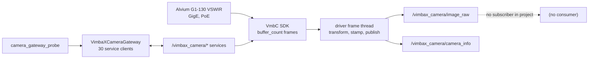

# Trace of the current acquisition path

Checkpoint `6247955`. Driver source at fork merge `74c9128` (branch `venimapping`).

## How to read this trace

Each claim has one label.

- `[F]` is a fact. It has a citation.
- `[A]` is a working assumption. It is cheap to reverse. The text says what depends on it.
- `[Q]` is an open question. Section 4 lists who can answer it.

Citations use these forms.

- `path:line` is a path from the project worktree root.
- `driver:path:line` is a path from the driver root `vimbax_ros2_driver/`.
- `ros:path:line` is a path from the ROS 2 Jazzy source root `ros2-jazzy/src/`.

## 1. Current path

### 1.1 Summary

No code in the project receives pixels today. The only path that exists is a control path from the gateway to the driver services. `[F]` No source file under `src/` subscribes to `image_raw`, and `venimapping_camera` does not depend on `sensor_msgs` (`src/venimapping_camera/package.xml:15-16`).

### 1.2 Bringup

1. `[F]` `camera.launch.py` starts one process: package `vimbax_camera`, executable `vimbax_camera_node` (`src/venimapping_bringup/launch/camera.launch.py:35-41`).
2. `[F]` The launch sets the namespace from argument `camera_namespace`, default `/vimbax_camera`, and the node name `vimbax_camera` (`src/venimapping_bringup/launch/camera.launch.py:19-23`, `:38-39`).
3. `[F]` The launch loads parameters from argument `params_file`, default `config/camera.yaml` in the installed share (`src/venimapping_bringup/launch/camera.launch.py:24-34`, `:40`).
4. `[F]` `camera.yaml` sets two parameters only: `camera_id: "0GPF3"` and `autostream: 0` (`src/venimapping_bringup/config/camera.yaml:9-12`).
5. `[F]` The bringup package installs `config/` and `launch/` (`src/venimapping_bringup/CMakeLists.txt:14`).
6. `[F]` The driver builds its node with name and namespace both set to `vimbax_camera_<pid>` (`driver:vimbax_camera/src/vimbax_camera_helper.cpp:59-64`, `driver:vimbax_camera/src/vimbax_camera_node.cpp:1671-1680`).
7. `[A]` The launch remaps override both, so the node resolves as `/vimbax_camera/vimbax_camera`. The YAML key `/**/vimbax_camera` depends on this override. If the override fails, the driver ignores `camera.yaml` and `autostream` returns to 1.

### 1.3 Driver parameters in effect

| Parameter | Value now | Source | Read when |
|---|---|---|---|
| `camera_id` | `"0GPF3"` | `camera.yaml:11` | Open and reopen (`driver:vimbax_camera/src/vimbax_camera_node.cpp:371-373`) |
| `autostream` | `0` | `camera.yaml:12` | Each graph poll (`driver:vimbax_camera/src/vimbax_camera_node.cpp:602`, `:610`) |
| `buffer_count` | `7` (driver default, range 3 to 1000) | `driver:vimbax_camera/src/vimbax_camera_node.cpp:286-290` | Each stream start (`:1587`) |
| `use_ros_time` | `false` (driver default) | `driver:vimbax_camera/src/vimbax_camera_node.cpp:303-305` | Each frame (`:1608`) |
| `command_feature_timeout` | `0`, which means 1 s | `driver:vimbax_camera/src/vimbax_camera_node.cpp:298-301` | Each `command_run` call (`:1047`) |
| `camera_frame_id` | `vimbax_camera_<DeviceID>` (read-only) | `driver:vimbax_camera/src/vimbax_camera_node.cpp:409-412` | Each frame (`:1605`) |
| `camera_info_url` | `""` (read-only) | `driver:vimbax_camera/src/vimbax_camera_node.cpp:415-423` | Open and reopen |
| `settings_file` | `""` (read-only) | `driver:vimbax_camera/src/vimbax_camera_node.cpp:282-284` | Open and reopen (`:390-400`) |

`[F]` The driver refuses a `buffer_count` change while it streams (`driver:vimbax_camera/src/vimbax_camera_node.cpp:307-321`). `[F]` `use_ros_time` and `command_feature_timeout` are not read-only, so a parameter set changes them at run time (`driver:vimbax_camera/src/vimbax_camera_node.cpp:298-305`).

### 1.4 Topics and services under `/vimbax_camera`

1. `[F]` `image_raw` (`sensor_msgs/msg/Image`) and `camera_info` (`sensor_msgs/msg/CameraInfo`) come from one `image_transport::CameraPublisher` (`driver:vimbax_camera/src/vimbax_camera_node.cpp:350-364`, `ros:ros-perception/image_common/image_transport/src/camera_publisher.cpp:78-95`).
2. `[F]` `image_transport` also advertises one subtopic for each installed transport plugin, filtered by `image_raw.enable_pub_plugins` (`ros:ros-perception/image_common/image_transport/src/publisher.cpp:120-153`). Bringup does not set that filter.
3. `[F]` The driver offers these services: `connected`, `status`, `stream_start`, `stream_stop`, `settings/save`, `settings/load`, `feature_info_query`, and `features/*` for int, float, string, bool, enum, command, raw, access mode, and list (`driver:vimbax_camera/src/vimbax_camera_node.cpp:660-1579`).
4. `[F]` The driver also offers event subscribe and unsubscribe services for `feature_invalidation` and `events` (`driver:vimbax_camera/src/vimbax_camera_node.cpp:160-274`, `driver:vimbax_camera_events/src/event_publisher_base.cpp:43-75`).
5. `[F]` `camera_info_manager` adds a `set_camera_info` service on the driver node (`ros:ros-perception/image_common/camera_info_manager/src/camera_info_manager.cpp:110`).

### 1.5 Gateway

1. `[F]` `CameraGateway` is a ROS-free abstract class with 30 methods: connection, status, stream start and stop, settings, feature list and info, and get, set, and info for each feature type (`src/venimapping_camera/include/venimapping_camera/camera_gateway.hpp:35-138`).
2. `[F]` Its contract states no policy: "no clamping, fallback, retry, readback, or validation" (`src/venimapping_camera/include/venimapping_camera/camera_gateway.hpp:24-26`).
3. `[F]` `VimbaXCameraGateway::create` takes a `rclcpp::Node&`, a namespace, and one timeout for all calls (`src/venimapping_camera/include/venimapping_camera/vimbax_camera_gateway.hpp:55-61`).
4. `[F]` The constructor makes 30 service clients. Each name is the namespace plus a leaf, for example `stream_start` (`src/venimapping_camera/src/vimbax_camera_gateway.cpp:49-145`, `src/venimapping_camera/src/gateway_support/vimbax_service_calls.hpp:36-46`).
5. `[F]` Each call checks the bound thread, waits for the service, sends the request, and waits on the future until one deadline (`src/venimapping_camera/src/vimbax_camera_gateway.cpp:179-211`).
6. `[F]` On a deadline, the gateway removes the pending request and returns `kResponseTimeout` (`src/venimapping_camera/src/gateway_support/vimbax_service_calls.hpp:79-94`).
7. `[F]` A nonzero driver `error.code` becomes a driver-domain `Error` with the code and text unchanged (`src/venimapping_camera/src/vimbax_camera_gateway.cpp:213-229`).
8. `[F]` Gateway-domain codes are `kServiceUnavailable` 1, `kResponseTimeout` 2, `kConstructionFailed` 3, `kRosClientFailure` 4, and `kThreadContractViolation` 5. They are for logs and tests only (`src/venimapping_camera/src/gateway_support/gateway_errors.hpp:15-22`).
9. `[F]` The gateway header warns that a setter that times out can still have been applied (`src/venimapping_camera/include/venimapping_camera/vimbax_camera_gateway.hpp:49`).
10. `[F]` The header warns that `feature_command_run` takes at least about 100 ms (`src/venimapping_camera/include/venimapping_camera/vimbax_camera_gateway.hpp:150-152`).
11. `[F]` The header warns that `camera_status()` leaves `TriggerSelector` on its last value (`src/venimapping_camera/include/venimapping_camera/vimbax_camera_gateway.hpp:69-71`).

### 1.6 Threads

Project side, in `camera_gateway_probe`, the only executable:

1. `[F]` The main thread is the gateway worker. It calls `bind_to_current_thread()` once and then makes all calls (`src/venimapping_camera/src/camera_gateway_probe.cpp:1019-1037`).
2. `[F]` A second thread spins a `SingleThreadedExecutor` that holds the node and so the client responses (`src/venimapping_camera/src/camera_gateway_probe.cpp:1011-1014`).
3. `[F]` Shutdown calls `rclcpp::shutdown()` and then joins the executor thread (`src/venimapping_camera/src/camera_gateway_probe.cpp:1062-1065`).
4. `[F]` The thread check detects misuse. It is not synchronization (`src/venimapping_camera/include/venimapping_camera/vimbax_camera_gateway.hpp:45-47`).

Driver side:

1. `[F]` The executable runs a `MultiThreadedExecutor` (`driver:vimbax_camera/CMakeLists.txt:44-48`).
2. `[F]` Feature and status services are in Reentrant callback groups. Stream and settings services are in MutuallyExclusive groups (`driver:vimbax_camera/src/vimbax_camera_node.cpp:630-658`).
3. `[F]` A graph thread wakes on a graph change or every 50 ms. It runs autostream and the restart after a reconnect (`driver:vimbax_camera/src/vimbax_camera_node.cpp:579-628`).
4. `[F]` Each active stream has one frame thread. It pops complete frames, transforms them, and calls the publish callback (`driver:vimbax_camera/src/vimbax_camera.cpp:458-482`).
5. `[F]` The SDK frame callback runs on an SDK thread. It only pushes complete frames to the frame thread queue (`driver:vimbax_camera/src/vimbax_camera.cpp:1724-1743`).
6. `[F]` A camera discovery callback handles disconnect. A detached thread reopens the camera after a reconnect (`driver:vimbax_camera/src/vimbax_camera_node.cpp:503-577`).

### 1.7 Frame path inside the driver

1. `[F]` At stream start, the driver reads `PayloadSize`, checks `PixelFormat` against a gate list, and announces `buffer_count` frames (`driver:vimbax_camera/src/vimbax_camera.cpp:409-456`).
2. `[F]` Each driver `Frame` is a `sensor_msgs::msg::Image` subclass (`driver:vimbax_camera/include/vimbax_camera/vimbax_camera.hpp:55`). Its `step` is `Width * bits_per_pixel / 8`, computed once here (`driver:vimbax_camera/src/vimbax_camera.cpp:1656-1722`).
3. `[F]` The driver starts capture, queues all frames, and runs `AcquisitionStart` (`driver:vimbax_camera/src/vimbax_camera.cpp:484-511`).
4. `[F]` For a complete frame, the frame thread sets `encoding`, `width`, and `height`, then shifts or copies pixels (`driver:vimbax_camera/src/vimbax_camera.cpp:1745-1807`).
5. `[F]` The node callback logs a frame ID gap, sets `header.frame_id` and `header.stamp`, and builds `camera_info` with the same header (`driver:vimbax_camera/src/vimbax_camera_node.cpp:1595-1628`).
6. `[F]` The callback publishes and then requeues the buffer to the SDK (`driver:vimbax_camera/src/vimbax_camera_node.cpp:1631-1638`).
7. `[F]` `image_transport` sends the image only to transports that have subscribers. `camera_info` is always published (`ros:ros-perception/image_common/image_transport/src/publisher.cpp:174-188`, `ros:ros-perception/image_common/image_transport/src/camera_publisher.cpp:123-137`).
8. `[A]` A RELIABLE writer in CycloneDDS can block in publish when a reader is slow. The buffer then returns to the SDK late. With few free buffers, the SDK drops frames, and only the driver log shows the gap. The `buffer_count` choice and subscriber QoS choice depend on this.

## 2. Driver contract

### 2.1 Image publishing

1. `[F]` QoS is `rmw_qos_profile_default` with depth 10: KEEP_LAST 10, RELIABLE, VOLATILE (`driver:vimbax_camera/src/vimbax_camera_node.cpp:354-357`, `ros:ros2/rmw/rmw/include/rmw/qos_profiles.h:51-56`). No parameter changes it.
2. `[F]` The driver has no service or action that returns one image. Pixels leave the driver only on the topic (`driver:vimbax_camera/src/vimbax_camera_node.cpp:660-1579`, `driver:vimbax_camera_msgs/srv/`).
3. `[F]` The gate list allows Mono8, Mono12, Mono16, Bayer 8, 10, 12, and 16 bit, Rgb8, Bgr8, Yuv422_8, YCbCr422_8, and YCbCr422_8_CbYCrY (`driver:vimbax_camera/src/vimbax_camera.cpp:1621-1651`).
4. `[F]` Mono10 and Mono14 are not on the gate list. Their shift code is not reachable through `start_streaming` (`driver:vimbax_camera/src/vimbax_camera.cpp:1784-1800`).
5. `[F]` Mono12 and Bayer 10 and 12 bit data reach the wire shifted left by 4 or 6 bits in a 16-bit encoding (`driver:vimbax_camera/src/vimbax_camera.cpp:1784-1797`, `:1840-1868`). The message does not record the shift.
6. `[F]` Pixel formats outside the encoding table publish as `8UC1` (`driver:vimbax_camera/src/vimbax_camera.cpp:1905-1906`). The gate list prevents this for supported starts.
7. `[F]` CycloneDDS offers loans only for self-contained types (`ros:ros2/rmw_cyclonedds/rmw_cyclonedds_cpp/src/rmw_node.cpp:2479`, `:2984`). `sensor_msgs/Image` has unbounded fields, so each subscriber gets a deserialized heap copy.

### 2.2 Stream start and stop

The driver keeps a four-state machine: `kStopped`, `kStarting`, `kActive`, `kStopping`.

| Call | State before | Result | Evidence |
|---|---|---|---|
| `stream_start` | `kStopped` | Start, then `kActive`, or an error | `driver:vimbax_camera/src/vimbax_camera.cpp:414-515` |
| `stream_start` | `kActive` | Success, no effect | `driver:vimbax_camera/src/vimbax_camera.cpp:516-517` |
| `stream_start` | `kStarting` or `kStopping` | `VmbErrorInvalidCall` (-15) | `driver:vimbax_camera/src/vimbax_camera.cpp:518-519` |
| `stream_stop` | `kActive` | Stop, then `kStopped`, or an error | `driver:vimbax_camera/src/vimbax_camera.cpp:525-581` |
| `stream_stop` | `kStopped` | Success, no effect | `driver:vimbax_camera/src/vimbax_camera.cpp:582-583` |
| `stream_stop` | `kStarting` or `kStopping` | `VmbErrorInvalidCall` (-15) | `driver:vimbax_camera/src/vimbax_camera.cpp:584-585` |
| either | camera unavailable | `VmbErrorNotFound` (-3) | `driver:vimbax_camera/src/vimbax_camera_node.cpp:1551-1553`, `:1571-1573` |

1. `[F]` Each error return inside `start_streaming` leaves the state at `kStarting`. Examples are a bad `PixelFormat` (-18), a `PayloadSize` failure, and a `CaptureStart` failure (`driver:vimbax_camera/src/vimbax_camera.cpp:416-510`).
2. `[F]` After such a failure, `stream_start` and `stream_stop` both return -15, and `status.streaming` reports `true` (`driver:vimbax_camera/src/vimbax_camera.cpp:1508-1513`). Only a camera reopen creates a new state machine.
3. `[F]` `stream_start` and `stream_stop` run `AcquisitionStart` and `AcquisitionStop` through the command path, which sleeps 100 ms at least once (`driver:vimbax_camera/src/vimbax_camera.cpp:503`, `:529`, `:682`). Each call costs at least 100 ms.
4. `[F]` `stream_stop` joins the frame thread and drops frames still in its queue (`driver:vimbax_camera/src/vimbax_camera.cpp:547-559`).
5. `[F]` With `autostream: 1`, the graph thread starts the stream when the subscriber count rises and stops it when the count reaches 0 (`driver:vimbax_camera/src/vimbax_camera_node.cpp:597-619`).
6. `[F]` The condition at `driver:vimbax_camera/src/vimbax_camera_node.cpp:604` is always true in its branch. A new subscriber undoes a `stream_stop` under autostream.
7. `[F]` The subscriber count is the larger of the image count and the `camera_info` count (`ros:ros-perception/image_common/image_transport/src/camera_publisher.cpp:97-105`).
8. `[F]` With `autostream: 0`, only `stream_start` and the reconnect restart start the stream (`driver:vimbax_camera/src/vimbax_camera_node.cpp:590-593`, `:1538-1554`).

### 2.3 Single frames and triggers

1. `[F]` `features/command_run` runs any command feature, for example `TriggerSoftware` (`driver:vimbax_camera/src/vimbax_camera_node.cpp:1039-1067`).
2. `[F]` The command loop checks `IsDone`, sleeps 100 ms, checks the timeout, and repeats until done (`driver:vimbax_camera/src/vimbax_camera.cpp:674-688`). Each call takes at least 100 ms.
3. `[F]` If the timeout is 100 ms or less, the timeout check fails after the first sleep, so the call returns `VmbErrorTimeout` (-12) even when the command is done (`driver:vimbax_camera/src/vimbax_camera.cpp:682-687`).
4. `[F]` The feature callback group is Reentrant, so two clients can run commands in parallel (`driver:vimbax_camera/src/vimbax_camera_node.cpp:632`, `:1065`). One serial caller gets at most about 10 commands per second.
5. `[F]` The driver offers no single-frame mode of its own. `AcquisitionMode`, `TriggerMode`, `TriggerSource`, and `TriggerSelector` are plain GenICam features through the feature services.
6. `[F]` The `status` service sets each available `TriggerSelector` value in turn to read trigger mode and source (`driver:vimbax_camera/src/vimbax_camera.cpp:1452-1473`). A `status` call between a selector write and a mode write changes the target of the mode write.

### 2.4 Timestamps

1. `[F]` With `use_ros_time: false`, `header.stamp` is the SDK frame timestamp scaled by `DeviceTimestampFrequency` from the local device module (`driver:vimbax_camera/src/vimbax_camera_node.cpp:1610-1618`, `driver:vimbax_camera/src/vimbax_camera.cpp:308-316`, `:1760-1778`).
2. `[F]` If the local device module lacks `DeviceTimestampFrequency`, the driver uses raw ticks as nanoseconds (`driver:vimbax_camera/src/vimbax_camera.cpp:1777`).
3. `[F]` With `use_ros_time: true`, `header.stamp` is `node->now()` in the frame thread, after the pixel transform and before publish (`driver:vimbax_camera/src/vimbax_camera_node.cpp:1608-1609`, `driver:vimbax_camera/src/vimbax_camera.cpp:1745-1757`).
4. `[F]` The driver offers only one stamp per frame. It never publishes the device stamp and the host stamp together.
5. `[Q]` The epoch and tick rate of the G1-130 VSWIR device clock are not in code (U6).

### 2.5 Frame identity

1. `[F]` `header.frame_id` is the `camera_frame_id` parameter (`driver:vimbax_camera/src/vimbax_camera_node.cpp:1605`). It names a TF frame. It does not identify a frame.
2. `[F]` The SDK `frameID` feeds only the gap log. It does not reach the message (`driver:vimbax_camera/src/vimbax_camera_node.cpp:1596-1603`, `driver:vimbax_camera/src/vimbax_camera.cpp:1910-1913`).
3. `[F]` `last_frame_id_` resets at each stop, so the first frame after a start never logs a gap (`driver:vimbax_camera/src/vimbax_camera_node.cpp:1659`).

### 2.6 Frame loss visibility

| Where a frame can be lost | What shows it | Evidence |
|---|---|---|
| SDK receives an incomplete frame | WARN log with the receive status. Buffer requeued. | `driver:vimbax_camera/src/vimbax_camera.cpp:1739-1742` |
| SDK has no free buffer | WARN log "N frames missing" at the next published frame | `driver:vimbax_camera/src/vimbax_camera_node.cpp:1596-1601` |
| Requeue fails | ERROR log | `driver:vimbax_camera/src/vimbax_camera_node.cpp:1633-1638` |
| DDS sample lost or rejected at the reader | `message_lost` event, mapped to `DDS_SAMPLE_LOST_STATUS` | `ros:ros2/rmw_cyclonedds/rmw_cyclonedds_cpp/src/rmw_node.cpp:3815`, `ros:eclipse-cyclonedds/cyclonedds/src/core/ddsc/src/dds_rhc_default.c:1643-1647` |
| Reader KEEP_LAST history overwrites an old sample | Nothing | `[A]` from the same Cyclone code. Section 4, U18. |

No loss signal reaches the message itself. `[F]` The message carries only `header`, size, encoding, step, and data.

### 2.7 Calibration

1. `[F]` `camera_info_manager` loads from `camera_info_url`. An empty URL selects `file://${ROS_HOME}/camera_info/${NAME}.yaml` (`ros:ros-perception/image_common/camera_info_manager/src/camera_info_manager.cpp:69`, `:241`).
2. `[F]` `${NAME}` is the camera `device_id` (`driver:vimbax_camera/src/vimbax_camera_node.cpp:421-423`).
3. `[F]` If the loaded width or height differs from the frame, the driver publishes a `CameraInfo` with only width and height set. `K` is all zero (`driver:vimbax_camera/src/vimbax_camera_node.cpp:1620-1628`).
4. `[F]` `K[0] == 0.0` means uncalibrated by the message definition (`ros:ros2/common_interfaces/sensor_msgs/msg/CameraInfo.msg:21-23`).

### 2.8 Events

1. `[F]` Event topics need a call to a subscribe service first. The driver then makes a per-event publisher (`driver:vimbax_camera_events/src/event_publisher_base.cpp:43-66`).
2. `[F]` A 500 ms timer removes each event publisher that has zero subscribers (`driver:vimbax_camera_events/src/event_publisher_base.cpp:78-91`). A client that subscribes to the topic late loses the event.
3. `[F]` No event exists for frames, stream state, or connection.

### 2.9 Connection handling

1. `[F]` `connected` returns `camera_ != nullptr` (`driver:vimbax_camera/src/vimbax_camera_node.cpp:1520-1527`).
2. `[F]` On a "Missing" discovery event, the driver records whether it was streaming, sets the camera unavailable, and releases it (`driver:vimbax_camera/src/vimbax_camera_node.cpp:545-555`).
3. `[F]` While unavailable, every service except `connected` returns -3 (for example `driver:vimbax_camera/src/vimbax_camera_node.cpp:721-723`).
4. `[F]` On a "Detected" event for the same camera ID, a detached thread reopens the camera and reloads `settings_file` (`driver:vimbax_camera/src/vimbax_camera_node.cpp:556-568`, `:390-400`).
5. `[F]` If the stream was active at the disconnect, the graph thread restarts it. `autostream` does not affect this (`driver:vimbax_camera/src/vimbax_camera_node.cpp:565`, `:590-593`).
6. `[F]` The driver does not publish a disconnect or reconnect message. It logs both (`driver:vimbax_camera/src/vimbax_camera_node.cpp:547-549`, `:558-559`).
7. `[A]` A camera power cycle resets features that the project wrote through services. Only `settings_file` values return after a reopen. Configuration ownership depends on this (U9).
8. `[F]` If the first open fails, the driver calls `rclcpp::shutdown()` (`driver:vimbax_camera/src/vimbax_camera_node.cpp:375-382`).

## 3. Audit of v1

The v1 design (`docs/architecture/image-acquisition-design-v1.md`, commit `d79ebfd`, 2026-11-22) describes an older gateway. `[F]` The gateway gained stream, command, int, bool, string, raw, and settings calls in `f578840` (2026-11-17). `[F]` The "future layers" header text left in `ce0aa1e` (2026-11-18).

Three v1 claims have no evidence in code: the 2 to 15 MB frame size (§6.1), the power-on epoch of the device clock (§3.4), and the `AcquisitionFrameRateEnable` need on Alvium (§8.3). Section 4 lists them as U4, U6, and U8. They are not in the table.

| Claim | v1 section | Verdict | Evidence |
|---|---|---|---|
| `CameraGateway` covers float and enum features, access mode, feature list, status, and connection | §2 | Stale | It also covers int, string, bool, raw, command, stream, and settings (`src/venimapping_camera/include/venimapping_camera/camera_gateway.hpp:35-138`) |
| `VimbaXCameraGateway` hides service names, timeouts, and rclcpp exceptions | §2 | Confirmed | `src/venimapping_camera/src/vimbax_camera_gateway.cpp:179-211` |
| Gateway calls are synchronous on one bound worker thread | §2, §5 | Confirmed | `src/venimapping_camera/include/venimapping_camera/vimbax_camera_gateway.hpp:45-47`, `src/venimapping_camera/src/vimbax_camera_gateway.cpp:147-177` |
| `Expected` and `Error` live in `expected.hpp` | §2, §15.5 | Stale | `Error` is in `types/error.hpp:22-49`. `Expected` is in `types/expected.hpp:17-18` |
| Driver errors pass verbatim, gateway diagnostics are not contractual | §2, §4 | Confirmed | `src/venimapping_camera/src/vimbax_camera_gateway.cpp:223-226`, `src/venimapping_camera/src/gateway_support/gateway_errors.hpp:15` |
| `camera_gateway_probe` is temporary | §2 | Confirmed | `src/venimapping_camera/CMakeLists.txt:50-56` |
| Bringup launches the driver under `/vimbax_camera` with `autostream` 0 | §2, §3.2 | Confirmed | `src/venimapping_bringup/launch/camera.launch.py:19-41`, `src/venimapping_bringup/config/camera.yaml:12` |
| Image acquisition is absent | §2 | Confirmed | No `image_raw` subscriber in `src/`. `src/venimapping_camera/package.xml:15-16` |
| The gateway has seconds-scale timeouts | §2 | Confirmed | One caller-set timeout (`vimbax_camera_gateway.hpp:55-61`). Probe default 2000 ms (`camera_gateway_probe.cpp:137-138`) |
| The gateway header defers clamping, fallback, retry, and configuration ordering to "future layers" | §2, §4, §8 | Stale | Header now lists "no clamping, fallback, retry, readback, or validation" and no future layers (`camera_gateway.hpp:24-26`) |
| The driver is v1.0.1, the version that `scripts/env.sh` targets | §3 | Wrong | `env.sh` names no version (`scripts/env.sh:27-31`). README pins fork tag `v1.0.1-beta1-venimapping.1` (`README.md:13-15`) |
| Allied Vision tests with CycloneDDS, and the environment selects it | §3 | Confirmed | `driver:README.md:7`. `scripts/env.sh:127-134` selects it only if `RMW_IMPLEMENTATION` is unset |
| `image_raw` and `camera_info` come from a `CameraPublisher` with one shared header | §3.1 | Confirmed | `driver:vimbax_camera/src/vimbax_camera_node.cpp:350-364`, `:1620-1631` |
| Publisher QoS is fixed at RELIABLE, KEEP_LAST 10, VOLATILE | §3.1, §14 | Confirmed | `driver:vimbax_camera/src/vimbax_camera_node.cpp:354-357`, `ros:ros2/rmw/rmw/include/rmw/qos_profiles.h:51-56` |
| No snapshot service exists | §3.1 | Confirmed | `driver:vimbax_camera/src/vimbax_camera_node.cpp:660-1579` |
| `stream_start` and `stream_stop` use `StreamStartStop` with an empty request and an `Error` reply | §3.2 | Confirmed | `driver:vimbax_camera_msgs/srv/StreamStartStop.srv:1-2` |
| Start while active is a success with no effect | §3.2, §7 | Confirmed | `driver:vimbax_camera/src/vimbax_camera.cpp:516-517` |
| Start or stop during a transition returns -15 | §3.2 | Confirmed | `driver:vimbax_camera/src/vimbax_camera.cpp:518-519`, `:584-585` |
| An unavailable camera returns -3 | §3.2 | Confirmed | `driver:vimbax_camera/src/vimbax_camera_node.cpp:1551-1553` |
| An unsupported `PixelFormat` fails start with -18, visible to an explicit caller | §3.2, §7 | Confirmed | `driver:vimbax_camera/src/vimbax_camera.cpp:427-431`. v1 misses that the state then stays `kStarting` (section 2.2) |
| `autostream` defaults to 1 | §3.2 | Confirmed | `driver:vimbax_camera/src/vimbax_camera_node.cpp:296` |
| A polling thread starts on a subscriber rise and stops at zero | §3.2 | Confirmed | `driver:vimbax_camera/src/vimbax_camera_node.cpp:579-628` |
| The guard at `node.cpp:604` is always true, so a new subscriber undoes `stream_stop` | §3.2 | Confirmed | `driver:vimbax_camera/src/vimbax_camera_node.cpp:601-607` |
| The subscriber count includes `camera_info` subscribers | §3.2 | Confirmed | It is the larger of the two counts (`ros:ros-perception/image_common/image_transport/src/camera_publisher.cpp:97-105`) |
| Under autostream the driver swallows a start failure | §7, §11 | Confirmed | Result ignored at `driver:vimbax_camera/src/vimbax_camera_node.cpp:606`. Logged at `driver:vimbax_camera/src/vimbax_camera.cpp:430` |
| `features/command_run` can run `TriggerSoftware` | §3.3 | Confirmed | `driver:vimbax_camera/src/vimbax_camera_node.cpp:1039-1067` |
| Each command call takes at least 100 ms | §3.3, §15.3 | Confirmed | `driver:vimbax_camera/src/vimbax_camera.cpp:682` |
| The 100 ms sleep comes before the completion check | §3.3 | Wrong | The first `IsDone` check comes first. The loop exits only after the sleep (`driver:vimbax_camera/src/vimbax_camera.cpp:676-688`) |
| A software-trigger path is capped below 10 Hz | §3.3, §8.2 | Confirmed | True for one serial caller. Parallel callers can overlap (`driver:vimbax_camera/src/vimbax_camera_node.cpp:632`) |
| `command_feature_timeout` of 100 ms or less reports timeout on every command | §3.3 | Confirmed | `driver:vimbax_camera/src/vimbax_camera.cpp:682-687` |
| `command_feature_timeout` 0 means 1 s | §3.3, §7 | Confirmed | `driver:vimbax_camera/src/vimbax_camera_node.cpp:1047-1054`, `driver:vimbax_camera/src/vimbax_camera.cpp:657` |
| `use_ros_time` defaults to false and stamps come from the camera clock | §3.4 | Confirmed | `driver:vimbax_camera/src/vimbax_camera_node.cpp:305`, `:1610-1618` |
| `use_ros_time: true` stamps with the node clock in the frame worker after the transform | §3.4 | Confirmed | `driver:vimbax_camera/src/vimbax_camera_node.cpp:1608-1609`, `driver:vimbax_camera/src/vimbax_camera.cpp:1745-1757` |
| `header.frame_id` comes from read-only `camera_frame_id`, default `vimbax_camera_<DeviceID>` | §3.4 | Confirmed | `driver:vimbax_camera/src/vimbax_camera_node.cpp:409-412`, `:1605` |
| No frame counter reaches the wire. `frameID` feeds only a log line | §3.4 | Confirmed | `driver:vimbax_camera/src/vimbax_camera_node.cpp:1596-1603` |
| Incomplete frames are requeued silently | §3.4, §14 | Wrong | The driver logs a WARN with the status (`driver:vimbax_camera/src/vimbax_camera.cpp:1740`) and a gap count (`driver:vimbax_camera/src/vimbax_camera_node.cpp:1599-1601`) |
| The `message_lost` event shows consumer-side transport loss | §3.4, §6.4 | Confirmed | It maps to `DDS_SAMPLE_LOST_STATUS` (`ros:ros2/rmw_cyclonedds/rmw_cyclonedds_cpp/src/rmw_node.cpp:3815`). Coverage of history overwrite is U18 |
| 10, 12, and 14-bit data is MSB-aligned (x64, x16, x4) with no marker | §3.4, §6.2 | Confirmed | `driver:vimbax_camera/src/vimbax_camera.cpp:1781-1800`. Mono10 and Mono14 never pass the gate |
| The gate list is Mono8/12/16, Bayer 8/10/12/16, Rgb8, Bgr8, and YUV422 variants | §3.4 | Confirmed | `driver:vimbax_camera/src/vimbax_camera.cpp:1621-1651` |
| `camera_info` comes from `camera_info_manager` and read-only `camera_info_url` | §3.5 | Confirmed | `driver:vimbax_camera/src/vimbax_camera_node.cpp:415-423` |
| A size mismatch publishes a blank `CameraInfo` with all-zero `K` | §3.5 | Confirmed | `driver:vimbax_camera/src/vimbax_camera_node.cpp:1620-1628`. Width and height are still set |
| `K[0] == 0` is the documented uncalibrated sign | §3.5 | Confirmed | `ros:ros2/common_interfaces/sensor_msgs/msg/CameraInfo.msg:21-23` |
| No connect or disconnect event exists. Only `connected` polling | §3.6, §8.4 | Confirmed | `driver:vimbax_camera/src/vimbax_camera_node.cpp:503-577`, `:1520-1527` |
| GenICam events use a subscribe service, a per-event topic, and a 500 ms reaper | §3.6, §14 | Confirmed | `driver:vimbax_camera_events/src/event_publisher_base.cpp:43-91` |
| Factories return `Expected`, adapters are pinned, C++23 | §4 | Confirmed | `vimbax_camera_gateway.hpp:58-61`, `camera_gateway.hpp:29-32`, `src/venimapping_camera/CMakeLists.txt:27` |
| `ConnectionStatusGet` returns false as a successful negative | §4 | Stale | Name is `connection_status()` (`camera_gateway.hpp:35`). Behaviour matches (`vimbax_camera_gateway.cpp:231-238`) |
| The gateway lacks `StreamStart`, `StreamStop`, and `FeatureCommandRun` | §5, §7, §13, §15.3 | Stale | `camera_gateway.hpp:39-40`, `:121-126`, `vimbax_camera_gateway.cpp:251-267`, `:516-525` |
| The gateway does not wrap int, bool, string, raw, or settings services | §7, §13 | Stale | `camera_gateway.hpp:43-44`, `:59-138` |
| `status.streaming` means active or starting | §7 | Confirmed | `driver:vimbax_camera/src/vimbax_camera.cpp:1419`, `:1508-1513` |
| The gateway machinery is `Call` and `CallChecked` | §5 | Stale | `call` and `call_checking_driver_error` (`vimbax_camera_gateway.hpp:187-194`) |
| House style is `<Noun><Verb>` in PascalCase | §15 | Stale | Style is snake_case noun then verb, for example `feature_int_get` (`camera_gateway.hpp:59`) |
| `BindToCurrentThread` detects misuse and does not synchronize | §6.3 | Stale | Name is `bind_to_current_thread` (`vimbax_camera_gateway.hpp:63-64`). Behaviour matches (`:45-47`) |
| The gateway header warns of a deadlock if executor code calls the gateway | §6.3 | Confirmed | It warns that every call times out if the caller spins the node (`vimbax_camera_gateway.hpp:45-47`). The effect is a timeout |
| The probe spins a `SingleThreadedExecutor` on its own thread | §6.5 | Confirmed | `src/venimapping_camera/src/camera_gateway_probe.cpp:1011-1014` |
| Diagnostics live in `detail::GatewayDiagnostic` with an existing code 5 | §9 | Stale | `gateway_support::GatewayDiagnostic`, code 5 is `kThreadContractViolation` (`src/venimapping_camera/src/gateway_support/gateway_errors.hpp:16-22`) |
| `src/detail/gateway_util.hpp` and `.cpp` exist | §15.5 | Stale | Files are `src/gateway_support/gateway_errors`, `vimbax_response_conversion`, `vimbax_service_calls` (`src/venimapping_camera/CMakeLists.txt:37-41`) |
| Private headers are never installed | §15.5 | Confirmed | `src/venimapping_camera/CMakeLists.txt:58-63` |
| Bringup `config/` is new and CMake must start to install it | §15.5 | Stale | `src/venimapping_bringup/CMakeLists.txt:14`, `src/venimapping_bringup/config/camera.yaml` |
| Bringup parameters go in `camera.launch.py` | §10, §15.5 | Stale | Parameters come from `camera.yaml` through `params_file` (`camera.launch.py:24-40`) |
| `ament_cmake_gtest` is already a test dependency | §15.5 | Confirmed | `src/venimapping_camera/package.xml:18`. No test target exists yet |
| Target names are `venimapping_camera_gateway_api` (INTERFACE) and `venimapping_camera_vimbax_gateway` | §15.5 | Confirmed | `src/venimapping_camera/CMakeLists.txt:26-48` |
| Adapters take `rclcpp::Node&` without ownership | §14 | Confirmed | `vimbax_camera_gateway.hpp:55-61` |
| The driver computes `step` once at stream start | §6.1, §8.3, §14 | Confirmed | `driver:vimbax_camera/src/vimbax_camera.cpp:1712`, called from `:445-456` |
| `buffer_count` defaults to 7 and changes only while stopped | §10 | Confirmed | `driver:vimbax_camera/src/vimbax_camera_node.cpp:286-290`, `:307-321` |
| The driver reopens on reconnect but does not restart the stream | §8.4, §14 | Wrong | It restarts the stream if it was active at disconnect (`driver:vimbax_camera/src/vimbax_camera_node.cpp:551`, `:565`, `:590-593`) |
| CycloneDDS has no loaned-message support | §11 | Wrong | It loans self-contained types (`ros:ros2/rmw_cyclonedds/rmw_cyclonedds_cpp/src/rmw_node.cpp:2479`, `:2984`). `Image` gets no loan, so v1's conclusion holds |
| A received image is heap memory, not a DDS loan | §6.1 | Confirmed | Follows from `ros:ros2/rmw_cyclonedds/rmw_cyclonedds_cpp/src/rmw_node.cpp:2984` |
| The driver README recommends DDS socket tuning | §10 | Confirmed | `driver:README.md:35-36`, `:819` |

## 4. Unknowns

| ID | Unknown | What it blocks | Who can answer |
|---|---|---|---|
| U1 | Which components consume frames, in this process or in other nodes | Delivery shape, ROS service or C++ API, executor model | Logan |
| U2 | Required resolution, frame rate, and bit depth for mapping | Pixel format, memory budget, queue size, QoS | Logan for the need. Camera check for the limits |
| U3 | Which `PixelFormat` values the G1-130 VSWIR offers, and which pass the driver gate | Pinned format. A Mono10-only default fails start and wedges the stream (section 2.2) | Camera check |
| U4 | `WidthMax`, `HeightMax`, and `PayloadSize` at the chosen format. v1 assumes 2 to 15 MB | Frame memory, DDS tuning, queue size | Camera check |
| U5 | Highest frame rate the GigE link delivers at the chosen format and size | Feed rate, `buffer_count`, QoS | Camera check |
| U6 | Device clock epoch and tick rate. If `DeviceTimestampFrequency` is on the local device module. v1 assumes a power-on epoch | `use_ros_time` choice, freshness rule | Camera check |
| U7 | Time from `stream_start` to the first published frame. Time from `TriggerSoftware` to the frame | Cold get image cost, persistent stream choice | Camera check |
| U8 | Whether `AcquisitionFrameRateEnable`, `TriggerSoftware`, and `TriggerSelector=FrameStart` exist on this model | Frame-rate control and trigger-based get image | Camera check |
| U9 | Whether the camera keeps written features after a PoE power cycle or a reconnect | Who owns configuration: `settings_file`, `UserSet`, or service writes | Camera check with a power cycle, or Logan |
| U10 | What "fresh" means for get image: any recent frame, received after the request, or exposed after the request | Get image source and freshness rule | Logan |
| U11 | How often get image runs, and whether a feed runs at the same time | Persistent stream versus start and stop per call | Logan |
| U12 | Whether the driver and all consumers run on one host | QoS, DDS tuning, zero-copy value | Logan |
| U13 | Whether a patch to the driver fork is acceptable, for example to fix the `kStarting` wedge or publish `frameID` | Frame identity, loss counts, start-failure recovery | Logan |
| U14 | Whether mapping needs intrinsics with each frame | `camera_info` pairing, `camera_info_url` | Logan |
| U15 | Whether host socket buffers are tuned per the driver README | Loss at full rate | Host check by Logan. Not a camera question |
| U16 | Which `image_transport` plugins are installed on the host | Extra topics, subscriber count under autostream | Host check by Logan |
| U17 | Whether other tools, for example `rqt`, call `status` or features while the project runs | Risk that `status` changes `TriggerSelector` during a trigger setup | Logan |
| U18 | Whether a KEEP_LAST reader history overwrite raises `message_lost` in CycloneDDS | Meaning of a transport-loss counter | Bench test without the camera |
| U19 | Whether a RELIABLE publish in the driver blocks on a slow reader in this setup | Driver-side frame loss under load | Camera check under load |

The camera request in `camera-requests/trace-claude.json` covers U3 to U8.

## 5. Design choices

### Shared by both features

| ID | Choice | Question |
|---|---|---|
| S1 | Package layout | Do the new parts go in `venimapping_camera`, or in a new package? |
| S2 | Port shape | Does acquisition extend `CameraGateway`, or use a separate data-plane port? |
| S3 | Frame type | Which fields does the project frame carry, and does it hide all ROS types? |
| S4 | Memory model | Does the frame keep the received message alive, or own a copy of the pixels? |
| S5 | Stream ownership | Which one component may call `stream_start` and `stream_stop`? |
| S6 | Start-failure recovery | How does the design recover from the `kStarting` wedge after a failed start? |
| S7 | Configuration ownership | Does pixel format, size, and rate come from `settings_file`, a camera `UserSet`, or service writes at open? |
| S8 | Timestamp source | Does bringup keep `use_ros_time: false` or set it to true? |
| S9 | Driver changes | Does the design work around driver defects, or patch the fork? |
| S10 | Thread and executor model | Which thread runs the image subscription callback, and does it share a node and executor with the gateway? |
| S11 | Error vocabulary | Which new failures need codes, and in which domain? |
| S12 | Disconnect handling | Given the driver restart of an active stream, what does the project report and do after a reconnect? |
| S13 | Pixel interpretation | Does the project pass the encoding unchanged, or undo the MSB shift? |
| S14 | Calibration | Does a frame come with its `camera_info`, and how is a blank `K` reported? |

### Get image

| ID | Choice | Question |
|---|---|---|
| G1 | Frame source | Does get image take a frame from the stream, start and stop a stream for one frame, or use a software trigger? |
| G2 | Freshness rule | Which frame counts as the answer: the next received, the first stamped after the request, or the first exposed after it? |
| G3 | Idle behaviour | If no stream runs, does get image start one, keep one running, or fail? |
| G4 | Result shape | What does get image return on timeout: an empty result or an error? |
| G5 | Timeout budget | What timeout covers stream start, first frame, and stream stop, each at least 100 ms in the driver? |
| G6 | Trigger state restore | If a trigger is used, how are trigger features saved and restored, also on failure? |
| G7 | Concurrency with a feed | What happens if get image runs while a feed is open? |
| G8 | Caller interface | Is get image a C++ call only, or also a ROS service for other nodes? |

### Get image feed

| ID | Choice | Question |
|---|---|---|
| F1 | Delivery shape | Do consumers pull frames with a timeout, get a callback, or subscribe to the driver topic directly? |
| F2 | Transport | Does the feed use an rclcpp subscription, an `image_transport` subscriber, or the VmbC SDK without the driver? |
| F3 | Overflow policy | Where do frames drop when the consumer is slow, and is it the oldest or the newest? |
| F4 | Buffer size | What queue capacity and `buffer_count` does the feed use? |
| F5 | Subscriber QoS | Does the subscriber use RELIABLE or BEST_EFFORT, and which history depth? |
| F6 | Frame identity | Does the feed number frames on receipt, use the device stamp, or need `frameID` from a driver patch? |
| F7 | Loss reporting | Which loss counters does the feed offer, and can it count driver-side loss? |
| F8 | Lifecycle | Does opening a feed start the stream, and what does closing it do if another user still needs frames? |
| F9 | Multiple consumers | Can two feeds be open at the same time, and do they share one subscription? |
| F10 | Silence detection | How long without a frame before the feed checks `connected` or reports a stall? |
